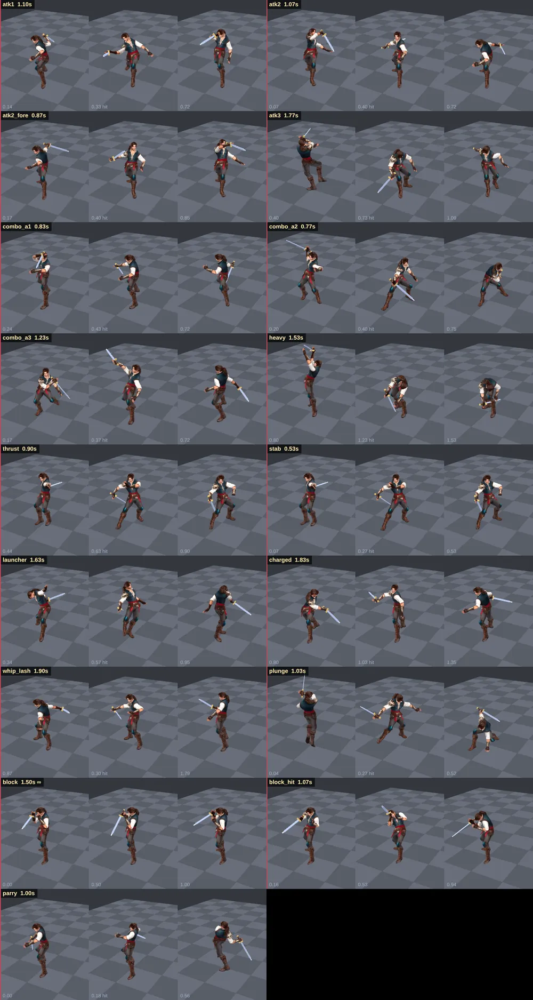
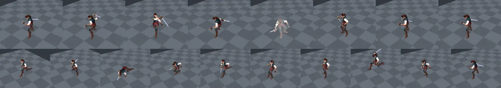
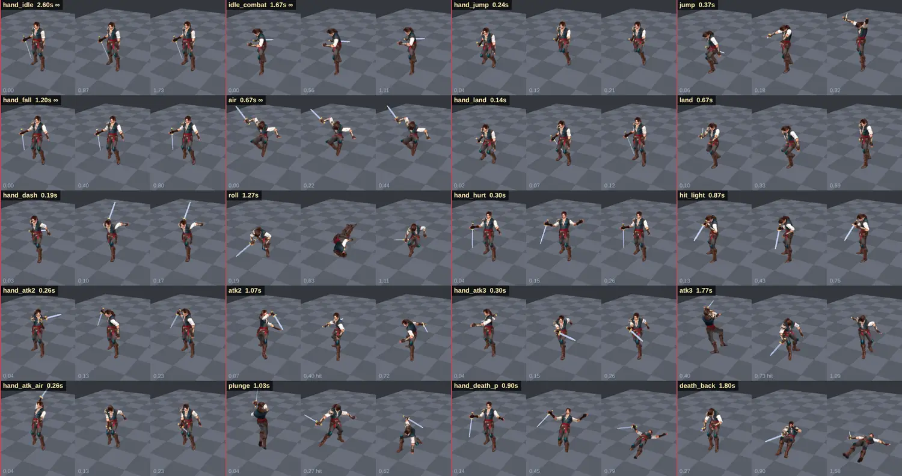
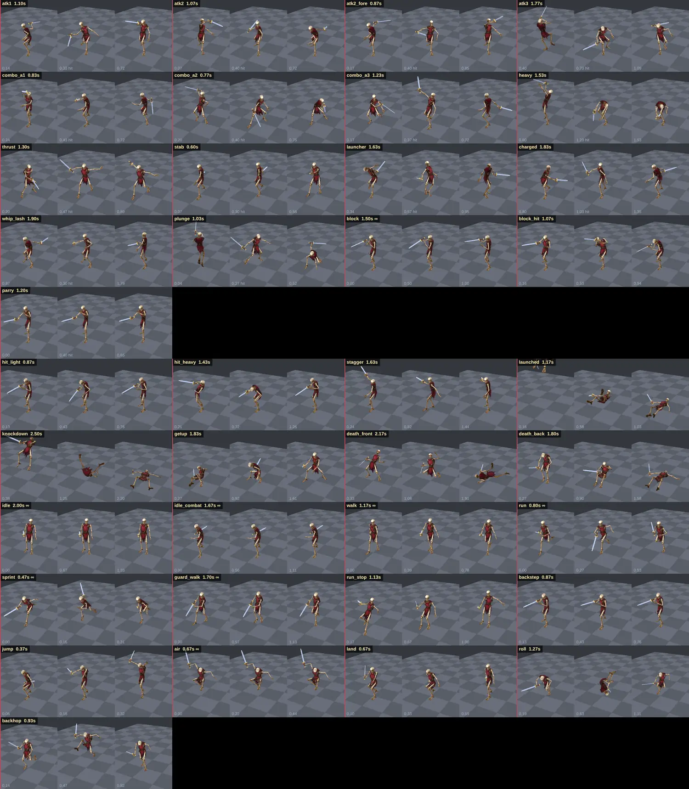
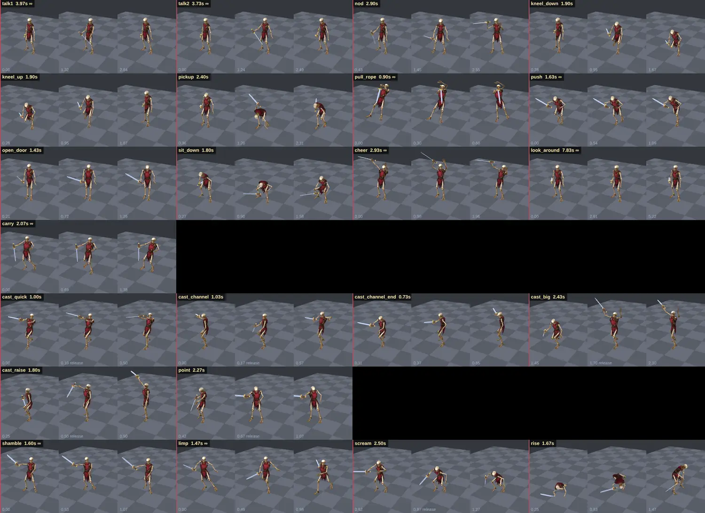
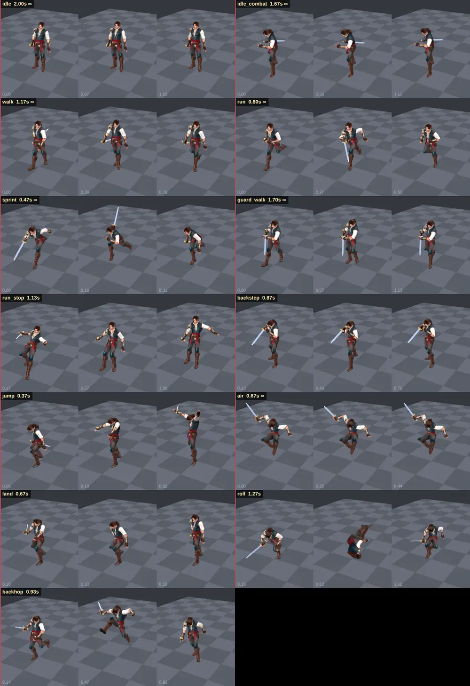
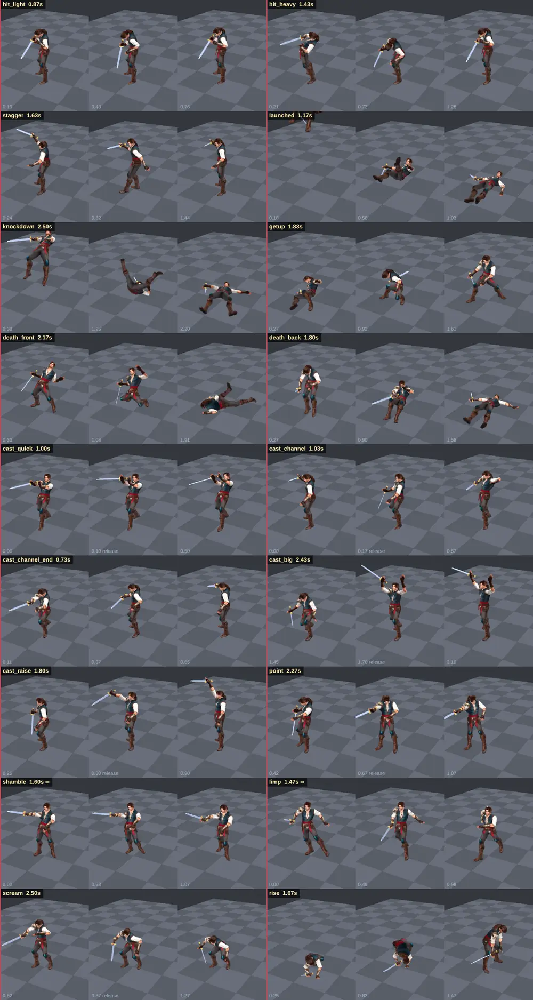
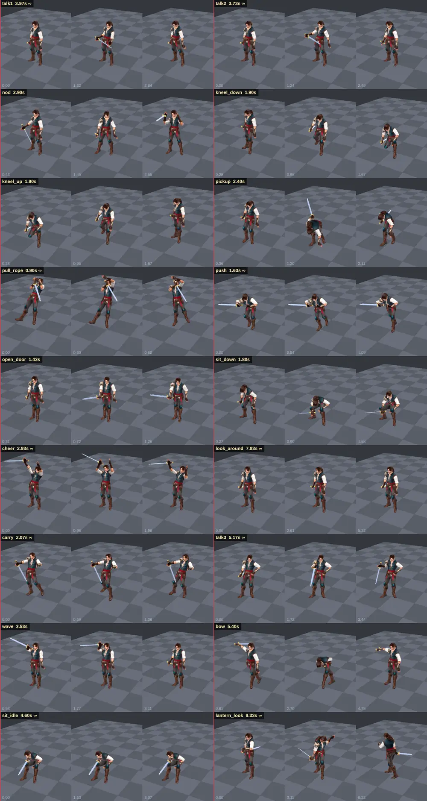

# 공용 클립 라이브러리 — 사람형 캐릭터 모두가 나눠 쓰는 움직임

2026-11-17 · 담당 animlib · 클립 `assets/v2/char3d/clips/` · 도구 `tools/v2/animlib_*.mjs` · 보기 `tools/v2/animlib_view.html` · 기록 `tools/higgsfield/manifest_animlib.json`

소유자 요청: *"3d지만 타격감(효과, 음향 등) 최고로 살려줘, 마법 등도 3d로 화려하게. 최적화로 느리지 않고 경쾌한 움직임이 느껴지게"* (헌장 §2).
시범(`CHAR3D_PILOT.md`)의 결론은 "산 클립 3개는 살아 있고 손으로 쓴 10개는 뻣뻣하다"였다. 이 문서는 그 빈자리를 메운 **공용 클립 62개**의 기록이다.

## 0. 한눈에

- **62개 클립, 768 KB.** 묶음 여섯(이동 13 · 전투 17 · 피격 9 · 마법 6 · 이야기 13 · 적 전용 4) + 목록 `index.json`. 상한 1.2 MB 의 64%.
- **408 크레딧** (리깅 + 클립 1개 = 8 × 51건). 상한 420. 시범 때 산 3개(달리기 · 베기 · 쓰러짐)도 다시 가공해 함께 실었다.
- 라이브러리 678개 가운데 **미리보기 221개를 받아 프레임을 보고** 골랐다. 고른 까닭과 버린 후보는 §2.
- 클립마다 **죽은 프레임을 자르고, 게임이 움직여 줄 수평 이동을 빼고, 순환은 처음과 끝을 맞추고, 타격 · 발 디딤 · 터뜨림 시각(이벤트)과 권장 배속**을 적었다 (§3).
- **사람형이면 누구나 쓴다.** 카엘과 해골 병사 두 몸에 62개를 전부 틀어 숫자와 그림으로 확인했다 — 깨지는 클립 없음, 살펴볼 것 2건(§6).
- **손으로 쓴 클립 열 개는 모두 물러나도 된다** (§5). 다만 게임 코드가 아직 이 라이브러리를 읽지 않는다 — 읽는 코드(`tools/v2/animlib_load.js`)는 써 두었고, 게임 소스로 옮기는 일은 요청으로 남겼다(§4).
- 못 구한 것: 옆걸음, 기도, 던지기, 사다리 · 턱 오르기, 귀 막기, 채찍 전용 동작 (§7).





## 1. 클립 표

시각은 모두 초, 1배속 기준. "뺀 이동"은 원본에서 캐릭터가 실제로 나아간 거리(키 1.8 m 기준)로, 클립에서는 빼고 숫자만 남겼다 — 게임이 그만큼 움직여 주면 발이 미끄러지지 않는다. ★ = 시범 때 이미 산 것.

<!-- AL:clips -->

**이동** — `locomotion.glb` · 13개 · 124 KB

| 이름 | 쓰임 | 원본 (번호) | 순환 | 길이 | 권장 배속 | 이벤트 (초) | 뺀 이동 (m) |
|---|---|---|---|---|---|---|---|
| `idle` | 서 있기 (편안히) — 마을 사람 · 전투 밖의 카엘 | Idle_9 (249) | 순환 | 2.00초 | ×1 | — | — |
| `idle_combat` | 서 있기 (싸울 준비) — 적이 가까울 때 · 락온 중 | Combat_Stance (89) | 순환 | 1.67초 | ×1 | — | — |
| `walk` | 걷기 — 스틱을 조금만 밀었을 때 · 마을 사람 · 컷 장면 | walking_2 (566) | 순환 | 1.17초 | ×1 | 왼발 0.4 · 오른발 1.03 | 앞 1.43 · 옆 0 |
| `run` | 달리기 (기본) | Run_03 (15) | 순환 | 0.80초 | ×1 | 오른발 0 · 왼발 0.43 | — |
| `sprint` | 전력 질주 — 구르기 직후 · 추격 · 컷 장면 | RunFast (16) ★ | 순환 | 0.47초 | ×1 | 왼발 0.07 · 오른발 0.27 | — |
| `guard_walk` | 가드 올리고 걷기 — 락온한 채 다가가기 · 갑주 적의 접근 | Walk_Fight_Forward (21) | 순환 | 1.70초 | ×1 | 왼발 0.6 · 오른발 1.47 | — |
| `run_stop` | 급정지 · 반대로 꺾기(미끄러지며 멈춘 뒤 돌아섬) | Sprint_and_Sudden_Stop (531) | 한 번 | 1.13초 | ×1.3 | 왼발 0.07 · 왼발 0.2 · 오른발 0.23 · 오른발 0.43 · 왼발 0.83 | 앞 1.86 · 옆 0.04 |
| `backstep` | 뒷걸음 한 발 — 가드 자세에서 간격 벌리기 | Step_Back (543) | 한 번 | 0.87초 | ×1.3 | 오른발 0.43 · 왼발 0.8 | 앞 -0.57 · 옆 0 |
| `jump` | 점프 시작 (웅크림 끝 → 도약) | Regular_Jump (466) | 한 번 | 0.37초 | ×1 | 도약 0.12 | — |
| `air` | 공중 (떠 있는 동안 순환) | Fall2 (503) | 순환 | 0.67초 | ×1 | — | — |
| `land` | 착지 (무릎으로 받고 일어섬) | Regular_Jump (466) | 한 번 | 0.67초 | ×1.3 | 왼발 0.03 · 착지 0.04 · 오른발 0.07 | — |
| `roll` | 구르기 (회피 · 짧은 무적) | Roll_Dodge_1 (159) | 한 번 | 1.27초 | ×1.3 | 왼발 0.97 · 오른발 1 | 앞 5.75 · 옆 -0.02 |
| `backhop` | 뒤로 폴짝 (짧은 백스텝 회피) | Back_Jump (468) | 한 번 | 0.93초 | ×1.2 | 왼발 0.57 · 오른발 0.7 | 앞 -2.35 · 옆 0 |

**전투** — `combat.glb` · 17개 · 188 KB

| 이름 | 쓰임 | 원본 (번호) | 순환 | 길이 | 권장 배속 | 이벤트 (초) | 뺀 이동 (m) |
|---|---|---|---|---|---|---|---|
| `atk1` | 연타 1 — 오른손 사선 내려베기 | Right_Hand_Sword_Slash (219) ★ | 한 번 | 1.10초 | ×1.1 | 휘두름 0.24 · 타격 0.33 · 오른발 0.8 | — |
| `atk2` | 연타 2 — 왼쪽에서 오른쪽으로 되받아 긋기(백핸드) | Left_Slash (97) | 한 번 | 1.07초 | ×1.35 | 휘두름 0.17 · 왼발 0.33 · 타격 0.4 | 앞 -0.12 · 옆 0.07 |
| `atk2_fore` | 예비 베기 — 위에서 왼쪽 아래로 (적 병사의 기본 공격) | Left_Slash (97) | 한 번 | 0.87초 | ×1.35 | 휘두름 0.27 · 타격 0.4 | 앞 0.12 · 옆 0.02 |
| `atk3` | 연타 3 · 넓은 베기 — 한 바퀴 돌며 휘두름 ("셋째는 넓게") | Axe_Spin_Attack (238) | 한 번 | 1.77초 | ×1.6 | 휘두름 0.5 · 오른발 0.67 · 왼발 0.7 · 타격 0.73 · 왼발 1.23 | 앞 0.01 · 옆 -0.09 |
| `combo_a1` | 이어 치기 A-1 (한 호흡 3연타의 첫 타) — 적 병사 · 다른 사냥꾼 | Triple_Combo_Attack (105) | 한 번 | 0.83초 | ×1.45 | 휘두름 0.34 · 타격 0.43 | 앞 0.23 · 옆 0.04 |
| `combo_a2` | 이어 치기 A-2 | Triple_Combo_Attack (105) | 한 번 | 0.77초 | ×1.35 | 휘두름 0.3 · 타격 0.4 · 오른발 0.4 | 앞 0.78 · 옆 -0.04 |
| `combo_a3` | 이어 치기 A-3 (마무리) | Triple_Combo_Attack (105) | 한 번 | 1.23초 | ×1.2 | 휘두름 0.27 · 타격 0.37 · 왼발 0.4 · 오른발 0.47 | 앞 0.85 · 옆 0.3 |
| `heavy` | 강공격 — 두 손으로 머리 위에서 내려찍기 (영웅 강타 · 적의 큰 무기) | Heavy_Hammer_Swing (128) | 한 번 | 1.53초 | ×1.3 | 휘두름 0.9 · 왼발 0.9 · 오른발 1.2 · 타격 1.23 | 앞 0.07 · 옆 -0.14 |
| `thrust` | 찌르기 — 팔을 뻗어 내지름 (적의 창 · 지팡이 찌르기도) | Thrust_Slash (240) | 한 번 | 1.30초 | ×1.55 | 휘두름 0.3 · 타격 0.47 · 왼발 1 · 오른발 1.3 | 앞 -0.66 · 옆 0.27 |
| `stab` | 짧은 찌르기 — 준비 자세에서 곧장 내지름 (해골 병사의 창 · 술사의 지팡이) | Thrust_Slash (240) | 한 번 | 0.60초 | ×1.1 | 휘두름 0.17 · 타격 0.3 | 앞 0.67 · 옆 0.06 |
| `launcher` | 올려치기 — 아래에서 위로 띄우기 | Charged_Upward_Slash (221) | 한 번 | 1.63초 | ×1.5 | 휘두름 0.44 · 타격 0.57 · 오른발 0.7 | 앞 0.28 · 옆 0.08 |
| `charged` | 모아 베기 — 길게 눌렀다 놓기 (휘감기의 시작) | Charged_Slash (242) | 한 번 | 1.83초 | ×1.25 | 모음 0.05 · 휘두름 0.9 · 타격 1.03 | — |
| `whip_lash` | 채찍 휘감기 — 머리 위로 한 바퀴 돌려 내리침 (채찍 · 사슬 · 도리깨) | Reaping_Swing (99) | 한 번 | 1.90초 | ×1.3 | 휘두름 0.17 · 타격 0.3 · 휘두름 0.97 · 타격 1.13 · 오른발 1.47 · 왼발 1.5 · 왼발 1.87 | 앞 -0.18 · 옆 0.51 |
| `plunge` | 공중 내려치기 — 뛰어올라 내리꽂음 | Sword_Judgment (102) | 한 번 | 1.03초 | ×1.2 | 휘두름 0.14 · 타격 0.27 · 왼발 0.37 · 오른발 0.37 | 앞 0.11 · 옆 -0.3 |
| `block` | 막기 (누르고 있는 동안 순환) | Block3 (140) | 순환 | 1.50초 | ×1 | — | — |
| `block_hit` | 막은 채 맞음 (가드 위로 받아냄) | Block4 (141) | 한 번 | 1.07초 | ×1.3 | 막음 0.03 | — |
| `parry` | 튕겨내기 — 오른손으로 쳐내기 | Sword_Parry (147) | 한 번 | 1.20초 | ×1.4 | 휘두름 0.07 · 타격 0.4 | — |

**피격 · 쓰러짐** — `reactions.glb` · 9개 · 125 KB

| 이름 | 쓰임 | 원본 (번호) | 순환 | 길이 | 권장 배속 | 이벤트 (초) | 뺀 이동 (m) |
|---|---|---|---|---|---|---|---|
| `hit_light` | 약한 피격 (앞에서) — 움찔 | Hit_Reaction_1 (179) | 한 번 | 0.87초 | ×1.3 | 맞음 0.02 | — |
| `hit_heavy` | 강한 피격 — 배를 맞고 꺾임 | Hit_Reaction_to_Waist (171) | 한 번 | 1.43초 | ×1.25 | 맞음 0.08 | — |
| `stagger` | 비틀거림 — 가드가 깨졌을 때 · 튕겨내기에 당한 적 | Hit_Reaction (178) | 한 번 | 1.63초 | ×1.2 | 맞음 0.02 · 왼발 0.4 · 오른발 0.63 · 왼발 1 | 앞 0 · 옆 1.07 |
| `stagger_r` | 비틀거림 (반대쪽) — stagger 의 좌우 거울상 | Hit_Reaction (178) 거울상 | 한 번 | 1.63초 | ×1.2 | 맞음 0.02 · 오른발 0.4 · 왼발 0.63 · 오른발 1 | 앞 0 · 옆 -1.07 |
| `launched` | 띄워짐 — 올려치기에 맞고 떠올랐다 등으로 떨어짐 | BeHit_FlyUp (7) | 한 번 | 1.17초 | ×1 | 맞음 0.02 · 몸이 닿음 0.63 · 오른발 0.73 · 왼발 0.8 | — |
| `knockdown` | 쓰러짐 — 영웅이 쓰러질 때 | Knock_Down (187) ★ | 한 번 | 2.50초 | ×1.3 | 맞음 0.02 · 몸이 닿음 1 · 오른발 1.73 · 왼발 1.83 | 앞 -0.81 · 옆 0.04 |
| `getup` | 일어나기 (등으로 누운 데서 → 준비 자세) | Arise (3) | 한 번 | 1.83초 | ×1.2 | 왼발 0.23 · 오른발 1.1 | — |
| `death_front` | 죽음 1 — 앞으로 고꾸라짐 | Shot_and_Fall_Forward (184) | 한 번 | 2.17초 | ×1.2 | 맞음 0.02 · 몸이 닿음 1.63 · 왼발 1.97 · 오른발 2.13 | 앞 1.04 · 옆 -0.07 |
| `death_back` | 죽음 2 — 뒤로 넘어감 | dying_backwards (189) | 한 번 | 1.80초 | ×1.2 | 맞음 0.02 · 몸이 닿음 0.97 · 오른발 1.4 · 왼발 1.43 | 앞 -0.89 · 옆 -0.07 |

**마법** — `magic.glb` · 6개 · 79 KB

| 이름 | 쓰임 | 원본 (번호) | 순환 | 길이 | 권장 배속 | 이벤트 (초) | 뺀 이동 (m) |
|---|---|---|---|---|---|---|---|
| `cast_quick` | 빠른 주문 — 두 손을 옆으로 튕겨 올림 (해골 술사의 탄 · 은탄 신호) | mage_soell_cast_8 (137) | 한 번 | 1.00초 | ×1.2 | 터뜨림 0.1 | — |
| `cast_channel` | 이어 쏘기 — 앞으로 딛고 두 손을 내밀어 버팀 (끝 자세에서 멈춰 유지) | mage_soell_cast_3 (132) | 한 번 | 1.03초 | ×1.2 | 터뜨림 0.17 | — |
| `cast_channel_end` | 이어 쏘기 끝 — 손을 거두고 섬 | mage_soell_cast_3 (132) | 한 번 | 0.73초 | ×1.2 | — | — |
| `cast_big` | 큰 주문 — 웅크려 모았다가 두 손을 하늘로 (조종 · 세라의 큰 등불) | Charged_Spell_Cast (125) | 한 번 | 2.43초 | ×1.15 | 모음 0.57 · 터뜨림 1.7 | — |
| `cast_raise` | 들어 올리기 — 한 손을 높이 듦 (부름 · 소환 · 종 조각을 들어 메아리) | mage_soell_cast (129) | 한 번 | 1.80초 | ×1.15 | 터뜨림 0.5 | — |
| `point` | 가리키기 — 팔을 뻗어 지목 (명령 · 표적 지정 · 등불 비추기) | mage_soell_cast_7 (136) | 한 번 | 2.27초 | ×1.1 | 터뜨림 0.67 | — |

**이야기 · 세계** — `story.glb` · 13개 · 178 KB

| 이름 | 쓰임 | 원본 (번호) | 순환 | 길이 | 권장 배속 | 이벤트 (초) | 뺀 이동 (m) |
|---|---|---|---|---|---|---|---|
| `talk1` | 말하기 1 — 두 손을 펴 보이며 | Talk_with_Hands_Open (313) | 순환 | 3.97초 | ×1 | — | — |
| `talk2` | 말하기 2 — 오른손만 내밀며 | Talk_with_Right_Hand_Open (314) | 순환 | 3.73초 | ×1 | — | — |
| `nod` | 끄덕이기 — 수긍 | Agree_Gesture (25) | 한 번 | 2.90초 | ×1 | — | — |
| `kneel_down` | 한쪽 무릎 꿇기 (끝 자세에서 멈춰 유지 = 기도 · 비석 앞) | Kneel_on_One_Knee_and_Stand (365) 거꾸로 | 한 번 | 1.90초 | ×1 | — | 앞 -0.23 · 옆 -0.23 |
| `kneel_up` | 무릎 꿇은 데서 일어서기 | Kneel_on_One_Knee_and_Stand (365) | 한 번 | 1.90초 | ×1 | — | 앞 0.23 · 옆 0.23 |
| `pickup` | 줍기 — 허리 숙여 집어 듦 | Female_Bend_Over_Pick_Up_Inspect (281) | 한 번 | 2.40초 | ×1.3 | 잡음 1.2 | — |
| `pull_rope` | 줄 당기기 — 종 줄 · 사슬 · 도르래 (두 손을 번갈아 머리 위에서 당김) | Climb_Up_Rope (449) | 순환 | 0.90초 | ×1 | 당김 0.83 | 앞 0.01 · 옆 0.16 |
| `push` | 밀기 — 무거운 것(관 · 돌 · 수레)을 밀며 걷기 | Push_and_Walk_Forward (261) | 순환 | 1.63초 | ×1 | 오른발 0.23 · 왼발 1.03 | 앞 0.98 · 옆 0 |
| `open_door` | 문 열기 — 손잡이를 잡아 당김 (궤짝 · 걸쇠도) | open_door_1 (285) | 한 번 | 1.43초 | ×1.2 | 잡음 0.7 | — |
| `sit_down` | 앉기 — 의자에 (끝 자세에서 멈춰 유지 = 식탁에 앉은 사람들) | Stand_to_Sit_Transition_M (57) | 한 번 | 1.80초 | ×1 | — | 앞 -0.25 · 옆 0.03 |
| `cheer` | 환호 — 두 팔을 들고 (맺음 장면의 마을 사람) | Cheer_with_Both_Hands (303) | 순환 | 2.93초 | ×1 | — | — |
| `look_around` | 둘러보기 — 숨 고르며 좌우를 살핌 (서 있기의 변주) | Short_Breathe_and_Look_Around (338) | 순환 | 7.83초 | ×1 | — | — |
| `carry` | 들고 걷기 — 두 팔로 무거운 것을 안고 (엘리제 · 관 · 상자) | Carry_Heavy_Object_Walk (551) | 순환 | 2.07초 | ×1 | 왼발 0.47 · 오른발 1.73 | 앞 0.68 · 옆 0.04 |

**적 전용** — `enemy.glb` · 4개 · 57 KB

| 이름 | 쓰임 | 원본 (번호) | 순환 | 길이 | 권장 배속 | 이벤트 (초) | 뺀 이동 (m) |
|---|---|---|---|---|---|---|---|
| `shamble` | 어기적 걷기 — 역병 주검 (두 팔을 앞으로 든 채) | Mummy_Stagger (113) | 순환 | 1.60초 | ×1 | 왼발 0.7 · 오른발 1.57 | — |
| `limp` | 절뚝이며 달리기 — 다친 적 · 빠른 주검 (1.3–1.6배속으로) | Limping_Walk_3 (557) | 순환 | 1.47초 | ×1 | 왼발 0.3 · 오른발 0.97 | 앞 1.51 · 옆 0.04 |
| `scream` | 포효 · 비명 — 몸을 웅크리며 내지름 (주검 · 밴시 · 등장 연출) | Zombie_Scream (386) | 한 번 | 2.50초 | ×1.15 | 비명 0.75 · 터뜨림 0.87 | — |
| `rise` | 땅에서 일어남 — 엎드린 데서 기어 일어섬 (무덤에서 나오는 주검 · 해골) | Stand_Up4 (347) | 한 번 | 1.67초 | ×1 | 왼발 1 · 오른발 1.27 | 앞 0.91 · 옆 -0.05 |

<!-- /AL:clips -->

## 2. 왜 이것을 골랐나 — 버린 후보

고르는 기준: ① 짧고 ② 위에서 비스듬히 봐도 실루엣이 읽히고 ③ 준비 동작과 마무리가 뚜렷하고 ④ 멀리 가 버리지 않는 것(가도 이동을 뺄 수 있는 것).
미리보기 GIF 에서 여섯 장씩 뽑아 본 판(`/tmp/claude-0/v2/animlib/work/sheets/`)으로 골랐다.

<!-- AL:why -->

**이동**

| 이름 | 원본 (번호) | 고른 까닭 | 버린 후보 |
|---|---|---|---|
| `idle` | Idle_9 (249) · 0–2초 | 2.0초로 짧고 팔을 내린 중립 자세라 누구에게나 맞는다. 처음과 끝이 정확히 이어진다 | Idle(0) 4초 · 몸을 크게 옮김, Idle_02(11) 팔을 벌린 과장된 자세, Idle_3·4·6·7·12(243–252) 5–13초로 길다, Idle_13·14 손짓이 들어 있다 |
| `idle_combat` | Combat_Stance (89) · 0–1.67초 | 무게를 낮추고 오른손 무기를 앞에 둔 자세. 1.7초 순환, 위에서 봐도 어깨선이 뚜렷하다 | Idle_10(250) 주먹 가드라 무기 든 손이 가려진다, Idle_5(245) 너무 웅크림, Axe_Stance(85) 6초 · 앉았다 일어남, Alert(2) 4초 |
| `walk` | walking_2 (566) · 0–1.17초 | 한 걸음 주기(1.17초)만 들어 있어 작고, 팔 흔들림이 자연스럽다 | Casual_Walk(30) 4.2초, Confident_Walk(106) 5.8초 · 머리 만지는 동작, Quick_Walk(115) 3초, Spear_Walk(560) 창 든 자세 |
| `run` | Run_03 (15) · 0–0.8초 | 윗몸을 세운 달리기라 비스듬히 위에서 보는 카메라에 얼굴이 보인다 (검수 지적: 시범의 RunFast 는 정수리만 보였다). 0.8초 순환 | Run_02(14) 더 숙임, run_fast_2–10(530–539) 팔이 과하거나 1.8초, Standard_Forward_Charge(510) 돌격 자세 |
| `sprint` | RunFast (16) ★ · 0–0.47초 | 시범 때 이미 산 것. 깊이 숙인 질주라 "기본 달리기"로는 얼굴을 가리지만 순간 가속에는 잘 맞는다 | Lean_Forward_Sprint(509) — 이미 가진 것과 겹쳐서 사지 않음 |
| `guard_walk` | Walk_Fight_Forward (21) · 0–1.7초 | 제자리 순환 1.7초, 두 팔을 올린 채 낮게 걷는다. 뒤로 걸을 때는 거꾸로 재생한다 | Walk_Fight_Back(20) 같은 값에 방향만 다름, Walk_Backward_with_Sword(546) 팔을 벌려 어색, Walk_Left_with_Gun(528) 총 자세 — 옆걸음은 살 만한 것이 없었다 |
| `run_stop` | Sprint_and_Sudden_Stop (531) · 0.43–1.57초 | 달리다 두 발로 미끄러지며 서는 1.1초. 방향을 확 바꿀 때 경쾌한 "끼익"을 준다 | Run_Turn_Left(571) · Idle_Turn_Left(576) · Combat_Idle_Turn_Left(575): 몸이 실제로 도는 클립이라 게임이 방향을 돌리는 것과 두 번 돈다 |
| `backstep` | Step_Back (543) · 0–0.87초 | 0.87초, 가드를 유지한 채 한 발 물러난다 | Crouch_and_Step_Back(404) 2.6초, BackLeft_run(5) 뒤로 달리기 |
| `jump` | Regular_Jump (466) · 0.27–0.63초 | 한 클립에서 도약과 착지를 함께 얻는다. 높이는 게임이 주므로 골반이 서 있는 높이 위로 뜨는 부분은 뺐다 | Basic_Jump(86) 6초 · 방패 자세, Jump_Run(13) · Run_and_Jump(463) 달리며 뛰어 멀리 감, 손으로 쓴 jump — 자세 둘을 잇기만 해서 뻣뻣 |
| `air` | Fall2 (503) · 0–0.67초 | 0.67초 순환, 팔다리가 가볍게 허우적거려 살아 보인다 | Fall1(502) 엎드려 떨어짐, Fall3(504) 뒤로 넘어가며 추락, Fall4(505) 4초 · 땅에 구름, 손으로 쓴 fall — 팔만 흔들림 |
| `land` | Regular_Jump (466) · 1.07–1.73초 | 점프와 같은 클립의 뒷부분이라 자세가 이어진다 | Jumping_Down(470) 3.2초, Dive_Down_and_Land(506) 거꾸로 내리꽂음, Jump_Down_from_Wall(493) 벽에서 뛰어내림 |
| `roll` | Roll_Dodge_1 (159) · 0–1.27초 | 구르기 다섯 가운데 가장 짧고(1.27초) 준비 자세에서 바로 굴러 준비 자세로 선다 | Roll_Dodge(158) 1.8초 · 옆으로 누움, Roll_Dodge_2(160) 2초, Roll_Dodge_3(161) 뒤로 구름, Roll_Dodge_4(163) 3.1초, 손으로 쓴 dash — 굳은 자세 하나 |
| `backhop` | Back_Jump (468) · 0–0.93초 | 0.93초, 두 팔이 벌어지며 뒤로 뛰어 한눈에 읽힌다 | Stand_Dodge(156) · _1 · _2 · _3: 제자리에서 몸만 젖혀 위에서 보면 안 보인다, Backflip(452) 2.1초 · 과함, Quick_Step_and_Spin_Dodge(384) 옆돌기(다음에 살 것) |

**전투**

| 이름 | 원본 (번호) | 고른 까닭 | 버린 후보 |
|---|---|---|---|
| `atk1` | Right_Hand_Sword_Slash (219) ★ · 0.2–1.3초 | 시범 때 산 것. 준비 → 베기 → 마무리가 또렷하다 | — |
| `atk2` | Left_Slash (97) · 0.97–2.03초 | Left_Slash 는 내려베기 뒤에 되받아 긋는 동작이 이어진다. 뒤쪽만 쓰면 1타(왼쪽 아래에서 끝남)와 자세가 이어진다 | Double_Combo_Attack(92) 두 타가 다 위에서 아래, Weapon_Combo(199) · _1(202) · _2(241) 3–4초 · 발차기 섞임, 손으로 쓴 atk2 — 준비 자세에서 팔이 꺾인다 |
| `atk2_fore` | Left_Slash (97) · 0.3–1.17초 | 같은 클립의 앞쪽. 값이 들지 않아 함께 싣는다 | — |
| `atk3` | Axe_Spin_Attack (238) · 0.2–1.97초 | 몸을 틀어 모았다가 한 바퀴 — 위에서 볼 때 가장 넓게 읽힌다 | Double_Blade_Spin(91) 5.7초 쌍검, Rightward_Spin(100) 8초 · 땅에 구름, 360_Power_Spin_Jump(397) 발차기, 손으로 쓴 atk3(찌르기) — 넓지 않다 |
| `combo_a1` | Triple_Combo_Attack (105) · 0.33–1.17초 | 세 타가 한 번의 모션 캡처라 타와 타 사이가 끊기지 않는다 | Attack(4) 한 타뿐, Sword_Judgment(102) 뛰어올라 한 타 |
| `combo_a2` | Triple_Combo_Attack (105) · 1.13–1.9초 | 위와 같음 | — |
| `combo_a3` | Triple_Combo_Attack (105) · 1.87–3.1초 | 위와 같음 | — |
| `heavy` | Heavy_Hammer_Swing (128) · 0.3–1.83초 | 1.8초, 크게 들어 올렸다 찍는 준비 동작이 길어 "피하라"는 신호가 분명하다 | Charged_Axe_Chop(237) 7.4초, Attack(4) 2.8초 · 약함 |
| `thrust` | Thrust_Slash (240) · 1–2.3초 | 라이브러리에서 찌르기가 든 유일한 한 손 클립. 앞부분의 베기는 버리고 찌르는 쪽만 쓴다 | 창 전용 공격 클립은 라이브러리에 없다 (Spear_Walk 뿐) |
| `stab` | Thrust_Slash (240) · 0.07–0.67초 | 같은 클립의 앞쪽 0.6초. 값이 들지 않아 함께 싣는다 | — |
| `launcher` | Charged_Upward_Slash (221) · 0.47–2.1초 | 낮게 모았다가 위로 긋는다. launched(피격) 와 짝 | Right_Uppercut_from_Guard(194) 주먹 |
| `charged` | Charged_Slash (242) · 0.17–2초 | 0.9초 동안 뒤로 당겨 모으는 자세가 길게 유지돼 "모으는 중"이 보인다 | Charged_Axe_Chop(237) 7.4초 |
| `whip_lash` | Reaping_Swing (99) · 2.97–4.87초 | 칼 클립이지만 머리 위 원을 그린 뒤 내려치는 큰 궤적이 채찍에 가장 가깝다. 채찍 띠는 코드가 손을 따라 그린다 | 채찍 · 도리깨 전용 클립은 라이브러리에 없다. Grip_and_Throw_Down(389) 5초 · 팔만 듦, baseball_pitching(393) 다리를 들어 올림 |
| `plunge` | Sword_Judgment (102) · 0.73–1.77초 | Leap_and_Punch(464) 가 서비스에서 두 번 실패(환불)해 대신 고름 | Leap_and_Punch(464) 실패, Jump_and_Slam_Back_Down(382) 등으로 떨어짐, Basic_Jump(86) 6초 |
| `block` | Block3 (140) · 0–1.5초 | 두 팔을 올린 가드가 1.5초 순환으로 유지된다 | Block1(138) 3.4초, Block2(139) · Block5(142) 몸을 숙임, Block6(143) 머리 위 막기, Block8(144) · Block9(145) 한 팔, Block10(146) 0.6초 · 앞으로 숙임 |
| `block_hit` | Block4 (141) · 0–1.07초 | 가드를 든 채 뒤로 밀렸다 돌아온다 | Hit_Reaction_with_Bow(150) 활 자세, Shield_Push_Left(220) 밀어내기(다음에 살 것) |
| `parry` | Sword_Parry (147) · 0.1–1.3초 | 한 손 쳐내기. 0.4초에 팔이 가장 빠르다 | Two_Handed_Parry(149) 두 손, Sword_Parry_Backward(148 · 151–155) 뒤로 물러남 |

**피격 · 쓰러짐**

| 이름 | 원본 (번호) | 고른 까닭 | 버린 후보 |
|---|---|---|---|
| `hit_light` | Hit_Reaction_1 (179) · 0–0.87초 | 1.2초 가운데 앞 0.4초에 반응이 몰려 있어 짧게 끊어 쓰기 좋다 | Face_Punch_Reaction(174–176) 2.8–5.4초, Slap_Reaction(173) 4.7초, Gunshot_Reaction(177) 팔을 듦, 손으로 쓴 hurt — 굳은 자세 |
| `hit_heavy` | Hit_Reaction_to_Waist (171) · 0.07–1.5초 | 몸이 접혔다 펴지는 큰 반응이 1.6초 안에 끝난다 | Electrocution_Reaction(172) 감전, Shot_and_Blown_Back(182) 날아가 쓰러짐 |
| `stagger` | Hit_Reaction (178) · 0–1.63초 | 옆으로 1 m 쯤 비틀거리며 팔이 풀린다 | Hit_in_Back_While_Running(416) 달리다 맞음, Stumble_Walk(562) 걷기 |
| `stagger_r` | Hit_Reaction (178) 거울상 · 0–1.63초 | 거울상은 값이 들지 않는다. 맞은 쪽에 따라 골라 쓴다 | — |
| `launched` | BeHit_FlyUp (7) · 0–1.17초 | 1.5초, 높이 떴다 떨어진다. 끝 자세가 getup 의 첫 자세(누움)와 맞는다 | Shot_and_Blown_Back(182) 뒤로 날아감 |
| `knockdown` | Knock_Down (187) ★ · 0–2.5초 | 시범 때 산 것 | Knock_Down_1(190) 3.2초 |
| `getup` | Arise (3) · 0–1.83초 | 1.8초, 누운 자세에서 바로 싸울 자세로 선다 | Stand_Up1–10(344–353): 3–11초이거나 엎드린 데서 시작 (347 은 적 전용 rise 로 삼) |
| `death_front` | Shot_and_Fall_Forward (184) · 0–2.17초 | 2.2초, 맞고 휘청이다 앞으로 넘어간다 | Dead(8) 3초, Strangled_and_Fall_Forward(186) 9초, Electrocuted_Fall(181) 6초, Fall_Dead_from_Abdominal_Injury(188) 주저앉음 |
| `death_back` | dying_backwards (189) · 0.23–2.03초 | 2.2초, 무릎이 꺾이며 뒤로 눕는다 | Shot_and_Fall_Backward(183) 3.4초, falling_down(366) 옆으로 쓰러짐, 손으로 쓴 death_p — 굳은 자세 둘 |

**마법**

| 이름 | 원본 (번호) | 고른 까닭 | 버린 후보 |
|---|---|---|---|
| `cast_quick` | mage_soell_cast_8 (137) · 0–1초 | 주문 열한 개 가운데 가장 짧다(1.3초). 0.15초에 손이 튄다 | mage_soell_cast_1(130) 3.4초, _2(131) · _4(133) · _6(135) 발을 크게 딛는 휘두르기 |
| `cast_channel` | mage_soell_cast_3 (132) · 0.07–1.1초 | 1초에 자세를 잡고 1.6초 동안 그대로 버티는 클립. 버티는 구간은 마지막 프레임을 붙들면 된다 | mage_soell_cast_5(134) 11초, Charged_Spell_Cast_1(126) 4.2초 · 팔을 벌림 |
| `cast_channel_end` | mage_soell_cast_3 (132) · 2.6–3.33초 | 같은 클립의 끝부분 | — |
| `cast_big` | Charged_Spell_Cast (125) · 0.07–2.5초 | 모으기(0.6초)와 터뜨리기(1.7초)가 뚜렷이 나뉘어 효과 · 소리를 두 번 얹기 좋다 | Charged_Ground_Slam(127) 땅 찍기, Skill_01–03(17–19) 무술 동작 |
| `cast_raise` | mage_soell_cast (129) · 0.1–1.9초 | 오른손을 머리 위로 올려 멈춘다. 부르는 신호로 읽힌다 | Arise(3) 는 누운 데서 일어나는 것, Call_Gesture(29) 7.6초 |
| `point` | mage_soell_cast_7 (136) · 0.2–2.47초 | 팔을 앞으로 뻗어 1초쯤 유지한다 | baseball_pitching(393) 3.9초, Crouch_Charge_and_Throw(398) 7.4초, Over_Shoulder_Throw(421) 업어치기 — 던지기는 사지 않았다 |

**이야기 · 세계**

| 이름 | 원본 (번호) | 고른 까닭 | 버린 후보 |
|---|---|---|---|
| `talk1` | Talk_with_Hands_Open (313) · 0–3.97초 | 4초 순환, 손짓이 크지 않아 누구에게나 맞는다 | Talk_Passionately(308) 9.9초, Stand_Talking_Angry(311) 20초, Stand_and_Chat(56) 5.2초 |
| `talk2` | Talk_with_Right_Hand_Open (314) · 0–3.73초 | 3.7초 순환. talk1 과 번갈아 틀면 같은 동작이 겹치지 않는다 | Talk_with_Left_Hand_on_Hip(309) 5초, Talk_with_Left_Hand_Raised(310) 4.5초 |
| `nod` | Agree_Gesture (25) · 0.5–3.4초 | 수긍하는 몸짓이 든 유일한 클립(13초)에서 한 대목만 잘랐다 | Listening_Gesture(47) 9.4초 · 거의 안 움직임 |
| `kneel_down` | Kneel_on_One_Knee_and_Stand (365) 거꾸로 · 0.1–2초 | 일어서는 클립을 거꾸로 돌려 꿇는 동작을 얻는다 | Formal_Bow(41) 7.7초 · 허리 숙여 절, 기도 클립은 라이브러리에 없다 |
| `kneel_up` | Kneel_on_One_Knee_and_Stand (365) · 0.1–2초 | 위와 같은 클립 | — |
| `pickup` | Female_Bend_Over_Pick_Up_Inspect (281) · 0.1–2.5초 | 줍는 대목이 2.4초로 가장 짧다 (뒤의 살펴보기는 잘라 냄) | Male_Bend_Over_Pick_Up(276) 7초, Collect_Object(284) 5.8초 · 쪼그려 앉음, Pull_Radish(283) 뽑기 |
| `pull_rope` | Climb_Up_Rope (449) · 1.27–2.17초 | 밧줄 오르기에서 위로 올라가는 이동만 빼면 제자리에서 줄을 당기는 동작이 된다 | Pull_Radish(283) 땅에서 뽑기, Sumo_High_Pull(331) 역기 들기 — 레버 당기기 클립은 없다 |
| `push` | Push_and_Walk_Forward (261) · 3.67–5.3초 | 8초 가운데 걸음 한 주기만 순환으로 잘랐다 | Step_Forward_and_Push(259) · Push_Forward_and_Stop(260): 한 번 밀고 끝나 순환이 안 된다 |
| `open_door` | open_door_1 (285) · 0.07–1.5초 | 서서 오른손만 뻗는 가장 단순한 것 | open_door_1(286) 거의 안 움직임, _2(287) 9초 · 두 손 번쩍, _3(288) 10초 · 엿보기, _4(289) 어깨로 밀기 |
| `sit_down` | Stand_to_Sit_Transition_M (57) · 2.17–3.97초 | 의자에 앉는 2.4초. 앉아 있는 순환을 따로 사지 않고 끝 자세를 붙든다 | Chair_Sit_Idle_M(33) 8.7초, Sit_Cross_Legged_on_Floor(363) 바닥에 책상다리, Walk_to_Sit(60) 걸어가 앉기 |
| `cheer` | Cheer_with_Both_Hands (303) · 0–2.93초 | 2.9초 순환 | Victory_Cheer(59) 9.4초, Motivational_Cheer(49) 9초, Victory_Fist_Pump(403) 1.5초 한 번뿐 |
| `look_around` | Short_Breathe_and_Look_Around (338) · 0–7.83초 | 과장 없이 고개와 어깨만 움직인다. 7.8초 순환을 12fps 로 줄여 싣는다 | Long_Breathe_and_Look_Around(336) 10.9초, Look_Around_Dumbfounded(333) 우스꽝스러움, Torch_Look_Around(337) 9초 횃불(세라 등불용으로 다음에) |
| `carry` | Carry_Heavy_Object_Walk (551) · 2.73–4.8초 | 6.5초 가운데 걸음 한 주기만 순환으로 잘랐다 | Carry_Water_Bucket_Walk(552) 9초 · 한 손 양동이, Carry_Heavy_Cannon_Forward(550) 어깨에 멤 |

**적 전용**

| 이름 | 원본 (번호) | 고른 까닭 | 버린 후보 |
|---|---|---|---|
| `shamble` | Mummy_Stagger (113) · 0.6–2.2초 | 팔을 든 실루엣이 위에서도 "주검"으로 읽힌다 | Monster_Walk(112) 뻣뻣하기만 함, Slow_Orc_Walk(119) 덩치 걸음(갑주용으로 다음에), Unsteady_Walk(123) 취한 걸음 |
| `limp` | Limping_Walk_3 (557) · 0.93–2.4초 | 절뚝 걸음 넷 가운데 가장 빠르고 팔을 크게 휘젓는다 | Limping_Walk(558) · _1(555) · _2(556) 느림, Injured_Walk(111) 8.7초 |
| `scream` | Zombie_Scream (386) · 0.1–2.6초 | 2.8초, 웅크리는 순간이 뚜렷해 소리 · 화면 흔들림을 얹기 좋다 | Shouting_Angrily(51) 7.2초, Sword_Shout(101) 6.2초 칼을 듦, Chest_Pound_Taunt(88) 4.9초 |
| `rise` | Stand_Up4 (347) · 0–1.67초 | 1.7초, 엎드린 자세에서 손으로 짚고 일어난다 | Stand_Up1(344) 8초, Stand_Up5(348) 11초, Crawl_and_Look_Back(340) 기어가기, Prone_Reach_Help(372) 17.8초 |

<!-- /AL:why -->

## 3. 가공 — 산 클립에 한 일

`node tools/v2/animlib_build.mjs` 가 `tools/v2/animlib_spec.mjs`(한 줄 = 클립 하나)를 읽어 전부 다시 만든다. 원본 GLB(한 개 2.2 MB)는 저장소 밖 `/tmp/claude-0/v2/animlib/raw/` 에 있고 주소는 기록 파일에 있다.

| 한 일 | 방법 | 까닭 |
|---|---|---|
| 정규 클립으로 | 런타임의 `clipFromAnim` 그대로: 뼈 이름 → "쉬는 자세에서 캐릭터 축으로 얼마나 돌았나" | 리깅은 할 때마다 뼈 길이 · 축이 조금씩 달라서. 이 형식이라 다른 몸에도 그대로 튼다 |
| 자르기 | `cut:[시작, 끝]` 을 눈과 숫자(뼈 각속도 · 손끝 속도 · 골반 높이 그래프)로 정함. 지정이 없으면 앞뒤의 움직임 없는 프레임만 자동으로 뺌 | 라이브러리 클립은 앞뒤로 0.3–2초씩 서 있다. 한 클립에 두세 동작이 든 것은 나눠 썼다(3연타 → 3개, 점프 → 도약 · 착지) |
| 수평 이동 빼기 | 순환: 직선 성분과 평균을 뺌. 한 번짜리: 0.18초보다 느린 이동만 빼고 빠른 흔들림(무게 이동)은 남김. 뺀 양은 `travel`, 이동이 일어나는 구간은 `moveT` | 캐릭터 위치는 게임이 정한다. 흔들림까지 빼면 다시 뻣뻣해진다 |
| 높이 | 보통은 그대로(웅크림 · 구르기 · 쓰러짐). 점프 · 착지 · 내려치기는 "서 있는 높이 위로 뜬 만큼"을 뺌(`y:'clamp'`), 공중 순환은 0 으로 | 뛰는 높이는 게임이 준다 |
| 순환 닫기 | 긴 클립은 가장 잘 이어지는 한 주기를 찾아 자르고, 끝 6프레임에 걸쳐 끝 자세를 첫 자세와 똑같이 맞춤 | 검사: 순환 22개 모두 이음 어긋남 0 |
| 거꾸로 · 거울상 | `rev` (일어서기 → 무릎 꿇기), `mir` (비틀거림의 반대쪽) | 값 없이 클립이 는다 |
| 이벤트 | 공격: 무기 끝(손에서 팔 방향으로 55 cm) 속도의 봉우리 = `hit`, 그 직전 = `swing`, 빠른 구간 = `strike:[t0,t1]`. 주문: 손 속도 봉우리 = `release`(앞선 봉우리는 `charge`). 발: 발목 · 발끝이 바닥 가까이로 내려오는 순간 = `footL/R`. 쓰러짐: 골반이 가장 낮은 높이에 닿는 순간 = `body`. 몇 개는 손으로 적음(`takeoff` · `land` · `grab` · `scream` · `hurt` · `guard`) | 소리 · 효과 · 히트스톱 · 화면 흔들림을 "이 프레임"에 얹기 위해 |
| 권장 배속 | 공격: 시작 → 타격이 0.3초 안팎이 되게, 다만 1.6배를 넘지 않음(넘으면 빨리 감기로 보인다). 큰 공격(강타 · 모아 베기 · 휘감기)은 준비가 곧 신호라 1.25–1.3배. 피격 1.2–1.3 · 주문 1.15–1.2 · 이야기 1.0 · 순환 1.0(이동 속도에 맞춤) | 경쾌하되 빨리 감은 티가 나지 않게 |
| 줄이기 | 빠른 동작 30fps, 걷기 · 가드 · 이야기 24fps, 서 있기 · 말하기 15fps, 둘러보기 12fps. 회전 키는 int16 쿼터니언, 안 움직이는 뼈는 뺌 | 원본 한 개 2.2 MB → 클립 평균 12 KB |

### 파일 형식

- **묶음 GLB** (`locomotion.glb` …): 뼈대 노드 + 스킨(뼈 목록) + 애니메이션. 메시 · 그림 없음. 애니메이션 이름 = 클립 이름. `glb.js loadGLB` → `skel.js clipFromAnim(rig, anim, {name, loop})` 로 **옵션 없이** 읽으면 된다(이동 가공은 이미 끝나 있다).
- **`index.json`**: `groups:[{g, file, bytes, clips}]`, `clips:[…]`. 클립 한 줄:

| 칸 | 뜻 |
|---|---|
| `n` · `g` | 이름 · 묶음 |
| `id` · `src` | 라이브러리 번호 · 원본 이름 |
| `loop` · `dur` · `keys` · `fps` | 순환인가 · 길이(초) · 키 수 · 저장 fps |
| `speed` | 권장 재생 배속 |
| `ev` | 이벤트 `[[초, 이름], …]` |
| `strike` | (공격) 무기가 빠르게 지나가는 구간 `[t0, t1]` — 판정 구간에 맞춰 시간을 접을 때 쓴다 |
| `travel` · `moveT` | 뺀 수평 이동 `[옆(왼쪽 +), 앞(+)]` m (키 1.8 m 기준; 다른 키는 키/1.8 을 곱한다) · 그 이동이 일어나는 구간(초) |
| `cut` · `rev` · `mir` · `root` | 원본에서 자른 구간 · 거꾸로 · 거울상 · 이동 가공 방식 |
| `use` | 쓰임 (한 줄) |

## 4. 게임 코드가 고르고 섞는 법

### 읽기

```js
import { loadAnimLib, eventsBetween, warpToHit } from '…/animlib.js';      // 지금은 tools/v2/animlib_load.js
const lib = await loadAnimLib('assets/v2/char3d/clips/index.json', { groups: ['locomotion', 'combat', 'reactions'] });
Object.assign(asset.clips, lib.clips);            // Animator 가 쓰는 묶음에 더한다
ch.anim.play('atk1', { fade: 0.08, speed: lib.clips.atk1.speed });
for (const e of eventsBetween(clip, prevT, ch.anim.t)) onAnimEvent(e);     // 'hit' → 히트스톱 · 흔들림, 'footL' → 발소리 …
```

- **지금 런타임은 이 라이브러리를 읽지 않는다.** `clips.js buildClips()` 가 이름 규칙으로 달리기 · 베기 · 쓰러짐 세 개만 고르기 때문이다. 읽는 코드는 `tools/v2/animlib_load.js`(70줄)에 써 두었고, `src/v2/char3d/animlib.js` 로 옮기는 일과 `hero3d.js` 의 이름 바꾸기를 요청했다(`/tmp/claude-0/v2/requests.md` animlib 1 · 2).
- 뷰어의 `?clips=` 로는 묶음 GLB 여섯 개가 모두 **오류 없이 열린다**(확인함). 다만 같은 까닭으로 `locomotion.glb` 에서는 `run`, `reactions.glb` 에서는 `death`(= knockdown)만 단추로 나온다. 전부 보려면 `tools/v2/animlib_view.html`.
- 캐릭터마다 필요한 묶음만 받는다: 영웅 = 이동 + 전투 + 피격(+ 마법), 적 = 이동 + 전투 + 피격 + 적 전용, 마을 사람 = 이동 + 이야기. 묶음은 한 번 받아 모두가 나눠 쓴다(클립은 뼈대와 무관한 자료다).

### 상태 → 클립 (영웅)

| 놀이 상태 | 클립 | 섞는 시간 | 재생 |
|---|---|---|---|
| 서 있기 · 적 없음 | `idle` (가끔 `look_around`) | 0.2 | 1배속 |
| 서 있기 · 적이 가깝거나 락온 | `idle_combat` | 0.15 | 1배속 |
| 걷기 (스틱 절반 아래) | `walk` | 0.15 | 배속 = 이동 속도 ÷ 1.22 m/s (`travel` ÷ `dur`) |
| 달리기 | `run` | 0.12 | 배속 = 속도 ÷ 최고 속도, 0.6–1.2 로 자름 |
| 전력 질주 (구르기 직후 · 추격) | `sprint` | 0.1 | 위와 같음 |
| 락온한 채 이동 | `guard_walk` | 0.15 | 뒤로 갈 때는 배속을 음수로(거꾸로 재생) |
| 달리다 반대로 꺾음 · 급히 놓음 | `run_stop` | 0.08 | ×1.3. 미끄러지는 동안 방향을 돌린다 |
| 점프 | `jump` → `air` → `land` | 0.05 → 0.15 → 0.05 | `jump` 는 도약 순간(0.12초)이 놀이의 도약과 맞게 `time` 을 준다. `land` 는 ×1.3, 이동 입력이 오면 0.2초 뒤부터 끊어도 된다 |
| 구르기 | `roll` | 0.06 | ×1.3 (0.98초). 놀이의 회피 시간이 더 짧으면 클립의 0.15–1.0초 구간을 그 시간에 맞춰 접는다 |
| 뒤로 폴짝 (제자리에서 회피) | `backhop` | 0.06 | ×1.2 |
| 연타 1 · 2 · 3 | `atk1` → `atk2` → `atk3` | 0.06–0.1 | `warpToHit(clip, t, 공격 길이, 판정 시작, 판정 끝)` — 클립의 `strike` 구간이 놀이의 판정 구간과 겹치게 시간을 접는다(시범의 `ATK1` 방식을 모든 공격에). 다음 타 입력이 오면 `strike` 끝 + 0.1초부터 넘어간다 |
| 길게 눌러 모으기 → 휘감기 | `charged` (모으는 동안 0.2–0.85초에서 멈춤) → 놓으면 `whip_lash` | 0.1 | 다 모이지 않았으면 `charged` 를 끝까지 |
| 점프 중 내려치기 | `plunge` | 0.05 | 0–0.27초(낙하)를 떨어지는 시간에 맞추고, 땅에 닿는 순간 = `hit` |
| 구른 직후 훑기 | `atk3` 또는 `launcher` | 0.05 | 권장 배속 |
| 강공격 (성장 뒤) | `heavy` | 0.1 | ×1.3 |
| 막기 | `block` (누르는 동안) · 맞으면 `block_hit` · 딱 맞추면 `parry` | 0.08 · 0.03 · 0.03 | `parry` 는 `hit`(0.4초)가 튕겨내는 순간 |
| 맞음 | 약 `hit_light` · 강 `hit_heavy` · 가드 깨짐 `stagger`/`stagger_r` | 0.04 | ×1.2–1.3 |
| 띄워짐 · 쓰러짐 | `launched` 또는 `knockdown` → `getup` | 0.05 → 0.1 | `body` 이벤트에 쿵 소리 + 먼지 |
| 죽음 | `death_front`(뒤에서 맞음) · `death_back`(앞에서 맞음) | 0.08 | ×1.2, 끝 자세에서 멈춤 |
| 종 — 메아리 · 건넘/조종 | `cast_raise` · `cast_big` | 0.1 | `release` 에 종소리 + 파동. `cast_big` 은 `charge`(0.57초)에 모으는 빛 |
| 채찍 걸기 · 부름 | `point` (걸고 나서 끌려가는 동안 `air`) | 0.1 | `release`(0.67초)에 채찍이 뻗는다 |
| 줍기 · 문 · 종 줄 · 밀기 · 들고 걷기 | `pickup` · `open_door` · `pull_rope` · `push` · `carry` | 0.15 | `grab` 이벤트에 물건이 손에 붙는다 |

- 섞기는 `Animator.play(name, {fade})` 그대로다(섞는 도중에 또 바뀌어도 튀지 않게 고쳐져 있다 — CHAR3D_PILOT §10).
- 한 번짜리 클립은 끝 자세에서 멈춘다. 무릎 꿇기 · 앉기 · 이어 쏘기 · 죽음은 그 성질을 "유지"로 쓴다.
- 이동을 뺀 클립을 틀 때는 `travel` 만큼(또는 놀이 규칙이 정한 만큼) 캐릭터를 움직여 준다. 구르기 · 뒤로 폴짝 · 급정지 · 3연타의 내딛기가 그렇다.

### 적 · 인물

| 누구 | 묶음 | 클립 |
|---|---|---|
| 해골 병사 | 이동 · 전투 · 피격 · 적 | `idle_combat` · `walk`/`guard_walk` · `atk2_fore` · `combo_a1–a3` · `stab` · `block` · `hit_light` · `death_*` · `rise`(땅에서 솟음) |
| 해골 술사 | 이동 · 마법 · 피격 | `idle` · `walk` · `cast_quick`(탄) · `cast_channel`(이어 쏘기) · `backstep` · `hit_light` · `death_back` |
| 역병 주검 | 적 · 전투 · 피격 | `shamble` · `limp`(×1.4 로 달려듦) · `heavy`(×1.0 — 느리고 질기게) · `scream` · `hit_heavy` · `death_front` · `rise` |
| 무덤 유령 · 유령 수녀 | 마법 · 적 | `air`(떠 있는 자세) · `cast_raise` · `scream` · `point` |
| 무덤지기 갑주 · 성의 병사 | 이동 · 전투 · 피격 | `guard_walk` · `heavy` · `thrust` · `block` · `block_hit` · `stagger` · `knockdown` → `getup` |
| 밴시 여왕 | 마법 · 적 · 피격 · 이야기 | `scream`(노래) · `cast_big` · `cast_channel` · `point` · `stagger` · `kneel_down`(조종 앞에 무릎 꿇음) |
| 말하는 인물 · 마을 사람 | 이동 · 이야기 | `idle` · `look_around` · `talk1`/`talk2` 번갈아 · `nod` · `walk` · `sit_down`(식탁) · `kneel_down`/`kneel_up`(비석 앞) · `cheer` · `carry` · `pickup` · `open_door` · `push` |
| 세라 (등불대) | 이동 · 마법 · 이야기 | `idle` · `walk` · `talk1` · `cast_raise`(등불 들기) · `cast_big`(큰 등불) |

같은 클립도 배속만 바꾸면 성격이 달라진다: `heavy` ×1.3 은 영웅의 강타, ×1.0 은 주검의 굼뜬 내려찍기다.

## 5. 손으로 쓴 클립 — 모두 물러나도 된다



| 손으로 쓴 것 (`clips.js`) | 대신할 것 | 판정 |
|---|---|---|
| `idle` 서 있기 | `idle` · `idle_combat` | 물러남. 숨쉬기만 있던 것이 무게 이동과 손 움직임까지 생긴다 |
| `jump` 점프 | `jump` | 물러남. 웅크림에서 펴 올리는 팔이 생긴다 |
| `fall` 떨어짐 | `air` | 물러남 |
| `land` 착지 (0.14초) | `land` (0.67초 ×1.3) | 물러남. 길어졌으므로 이동 입력이 오면 중간에 끊는다 |
| `dash` 대시 (0.19초) | `roll` · `backhop` | 물러남. 설계(GDD §7)가 "구르기"이므로 놀이 규칙의 회피 시간을 0.5초 안팎으로 늘리는 것과 함께 |
| `hurt` 피격 | `hit_light` · `hit_heavy` | 물러남 |
| `atk2` 2타 | `atk2` | 물러남. 팔이 꺾이던 준비 자세가 사라진다 |
| `atk3` 3타 (찌르기) | `atk3` (넓은 회전 베기) — 찌르기가 필요하면 `stab` · `thrust` | 물러남. 설계의 "셋째는 넓게"에 맞는다 |
| `atk_air` 공중 베기 | `plunge` | 물러남 |
| `death_p` 쓰러짐 (예비) | `knockdown` · `death_front` · `death_back` | 물러남 |

`clips.js` 의 코드는 라이브러리를 받지 못했을 때의 예비로만 남기면 된다(지금 구조가 이미 그렇다: 모델을 못 받으면 2D 로 돌아간다).
**시범에서 산 3개와의 관계:** 달리기(RunFast)는 `sprint` 로 내려가고 기본 달리기는 윗몸을 세운 `run`(Run_03)이 맡는다 — 검수가 지적한 "달리는 동안 얼굴이 안 보인다"가 풀린다. 베기 · 쓰러짐은 `atk1` · `knockdown` 으로 그대로 쓴다.

## 6. 확인한 것

| 무엇 | 결과 |
|---|---|
| 런타임 그대로 읽히나 | 묶음 6개 모두 `loadGLB` → `clipFromAnim` 으로 읽힘. index 와 개수 · 길이 일치. 옛 뷰어 `?clips=` 로도 6개 모두 오류 없이 열림 |
| 크기 | 786,520 B = 768 KB ≤ 1.2 MB |
| 순환 | 22개 모두 처음과 끝 자세가 같다 |
| 이벤트 | 모든 이벤트 시각이 클립 안에 있다. 공격 18개 모두 `hit` 과 `strike` 가 있다 |
| 카엘에서 | 묶음마다 세 순간씩 찍은 판 6장 (`/tmp/claude-0/v2/animlib/sheets/*_kael.png`), 3연타 · 회피를 이어 찍은 영상 2개 (`/tmp/claude-0/v2/animlib/video/combo_kael.mp4` 3.2초, `dodge_kael.mp4` 4.7초 — 실제 `Animator` 의 섞기 그대로) |
| 다른 몸에서 (해골 병사 `tools/v2/char3d_samples/skeleton.glb`) | 62개 전부 재생. NaN 0. 골반 높이로 나눈 관절 위치가 카엘과 평균 4.7%, 가장 큰 곳 15%(`rise`) 다름 — 팔다리 비율이 달라 생기는 차이이고, 팔이 뒤집히거나 발이 꼬인 클립은 없다. 판 6장 (`*_skeleton.png`) |
| 살펴볼 것 | `launched` · `knockdown`: 해골 병사가 누울 때 발목이 바닥 아래로 11–12 cm 내려간다(카엘은 문턱 안). 다리가 가는 몸이라 눈에는 거의 띄지 않지만, 누운 자세가 중요한 캐릭터는 그림자 · 먼지로 가리거나 누운 높이를 2–3 cm 올린다 |











다시 확인하기: `node tools/v2/animlib_check.mjs` (숫자, 3초) · `node tools/v2/animlib_shot.mjs sheet out.png combat` (그림).
헤드리스 렌더러는 기계가 바쁘면 GL 컨텍스트를 잃어 흰 그림을 낸다 — 캡처 도구가 알아채고 다시 찍는다.

## 7. 아직 없는 것 — 메우는 길

| 없는 것 | 까닭 | 메우는 길 |
|---|---|---|
| 옆걸음 (스트레이프) | 라이브러리의 옆걸음은 총을 든 웅크린 자세뿐 | `guard_walk` 를 틀고 몸통만 이동 방향으로 조금 튼다(코드). 옆으로 빠지는 회피는 다음에 `Quick_Step_and_Spin_Dodge`(384) 를 사서 거울상으로 양쪽을 만든다 |
| 제자리에서 돌아서기 | 도는 클립은 게임이 방향을 돌리는 것과 겹친다 | 코드가 방향을 돌리고(지금처럼) 빠른 반전에는 `run_stop` |
| 기도 | 클립 없음 | `kneel_down` 의 끝 자세 + 두 손을 모으는 팔 자세를 손으로 쓴다(자세 하나라 뻣뻣함이 문제 되지 않는다) |
| 끄덕임만 따로 | `nod` 는 손짓이 섞인 수긍 몸짓이다 | 고개 뼈만 숙였다 드는 작은 덧움직임을 코드로(어느 클립 위에나 얹는다) — 런타임에 "뼈 일부만 덮기"가 생기면 |
| 레버 당기기 | 클립 없음 | `open_door`(잡아 당김) 또는 `pull_rope` |
| 던지기 | 살 만한 것이 길었다(3.9–7.4초) | `cast_quick` 이나 `point` 의 `release` 에 던지는 물건을 내보낸다. 꼭 필요하면 `baseball_pitching`(393)의 뒷부분 |
| 사다리 · 턱 잡고 오르기 | 사지 않음 (크레딧 상한) | 다음에 살 것: `Ladder_Climb_Loop`(438) · `Jump_and_Grab_Wall`(448) · `climbing_up_wall`(444). 종탑 "오르기"에 필요 |
| 귀 막기 (종소리 · 밴시의 노래에 움찔) | `Head_Hold_in_Pain`(391) 을 사려 했으나 호출이 막혀 내지 않음 | **다음에 살 것 1순위.** 그때까지 `hit_heavy` 를 느리게(×0.7) |
| 방패 밀치기 · 덩치 걸음 · 앉아 있는 순환 · 횃불 들고 둘러보기 | 사지 않음 | `Shield_Push_Left`(220) · `Slow_Orc_Walk`(119) · `Chair_Sit_Idle_M`(33) · `Torch_Look_Around`(337) |
| 공중 내려찍기 (주먹/무기로 땅을 침) | `Leap_and_Punch`(464) 가 서비스에서 두 번 실패(환불됨) | `plunge`(Sword_Judgment)로 대신했다. 464 는 다시 넣지 말 것 |
| 채찍 · 도리깨 전용 동작 | 라이브러리에 없음 | `whip_lash`(큰 원을 그리는 베기) + 코드로 그리는 채찍 띠(GDD §7). 채찍 끝의 지연 · 휘어짐은 띠 쪽에서 만든다 |
| 손가락 · 얼굴 · 머리카락 · 옷자락 | 뼈가 없다 (CHAR3D_PILOT §6) | 클립으로는 못 푼다 |
| 사람 아닌 것 (박쥐 · 떠다니는 유령의 아랫몸) | 사람형 전용 라이브러리 | 코드로 쓴다. 유령은 윗몸에 이 라이브러리를, 아랫몸은 흔들리는 천으로 |
| 위 · 아랫몸 따로 틀기 (달리며 베기, 걸으며 말하기) | 런타임이 자세 전체만 섞는다 | `Animator` 에 뼈 묶음별 가중치를 더하는 일(반나절, 미확인). 생기면 이 라이브러리가 조합으로 몇 배 늘어난다 |

## 8. 값

| | 크레딧 |
|---|---|
| 리깅 + 클립 1개 × 51건 (성공) | 408 |
| 실패 2건 (`Leap_and_Punch`) | 0 (환불됨 — 거래 내역에 "3D Rigging refund +8") |
| 미리보기 GIF 221개, 목록 검색 | 0 |
| **합계** | **408 / 상한 420** |

- 클립 하나 = 8. 새 사람형 캐릭터를 리깅할 때 끼우면 +3 (CHAR3D_PILOT §3). 한 번 산 클립은 모든 사람형이 쓴다.
- 리깅 한 건은 약 1분. 51건을 다섯 개씩 나란히 넣어 받는 데까지 15분쯤 걸렸다.
- 원본에서 게임 클립까지: 미리보기 고르기 → 사기 → 숫자 · 그림으로 자를 곳 정하기 → 만들기 → 검사. 이 작업 전체가 약 50분이었다(도구를 처음 쓰는 시간 포함). 다음부터 클립 하나는 5–10분.
- 싣는 크기: 62개 768 KB. 클립 하나 평균 12 KB(2초짜리 30fps 기준 약 10 KB).

## 9. 클립 하나 더하는 순서

```
1) 고르기      animation_actions 도구로 검색 → preview_url 의 GIF 를 받아 프레임을 본다
               (주소 규칙: https://cdn.meshy.ai/webapp-assets/feature-demo/animation/preview/biped/<이름>.gif)
2) 사기        generate_3d  { model:'meshy_rigging', model_url:<올려 둔 사람형 GLB 주소>, height_meters:1.8,
                              enable_animation:true, animation_action_id:<번호> }      ← get_cost:true 로 먼저 8 인지 확인
               model_url: tools/higgsfield/manifest_animlib.json 의 model_url (만료됐으면 char3d_orient.mjs 로 돌린 GLB 를
               media_upload(.glb) → curl PUT → media_confirm(type:'file') 로 다시 올린다). 어떤 사람형이든 된다.
3) 받기        jobs_wait 의 result_url 을 /tmp/claude-0/v2/animlib/raw/<번호>_<이름>.glb 로 저장, 기록 파일에 한 줄
4) 목록에 한 줄 tools/v2/animlib_spec.mjs 의 CLIPS 에
               { n:'이름', g:'묶음', id:번호, src:'<번호>_<이름>', kind:'attack', use:'…', why:'…', rej:'…' }
               먼저 cut 없이 만들고 → 뷰어에서 보며 cut:[시작, 끝] · loop · speed 를 정한다
5) 만들기      node tools/v2/animlib_build.mjs            (전부 다시 만든다, 2초)
6) 보기        node tools/serve.mjs 8080 → http://localhost:8080/tools/v2/animlib_view.html?clip=이름
               node tools/v2/animlib_shot.mjs strip out.png 이름 --n=16        (자를 곳 찾기)
               node tools/v2/animlib_shot.mjs sheet out.png 묶음 [--glb=char3d_samples/skeleton.glb]
7) 검사        node tools/v2/animlib_check.mjs            (다른 몸에서도 깨지지 않는지, 크기 ≤ 1.2 MB)
8) 문서        node tools/v2/animlib_table.mjs            (이 문서의 표 두 개를 다시 채운다)
```

값이 들지 않는 변주: 같은 원본에서 다른 구간을 한 줄 더(`cut`), 거꾸로(`rev:true`), 좌우 거울상(`mir:true`), 배속만 다르게(게임 쪽).

## 10. 파일

| 경로 | 내용 |
|---|---|
| `assets/v2/char3d/clips/{locomotion,combat,reactions,magic,story,enemy}.glb` · `index.json` | 라이브러리 (768 KB) |
| `tools/v2/animlib_spec.mjs` | 목록 + 가공 지시 + 고른 까닭 |
| `tools/v2/animlib_core.mjs` · `animlib_build.mjs` | 가공 · 만들기 |
| `tools/v2/animlib_load.js` | 읽기(브라우저 · node 공용). `src/v2/char3d/animlib.js` 로 옮길 것 |
| `tools/v2/animlib_view.html` | 보기: 모델 하나에 62개 + 손으로 쓴 10개(`hand_*`)를 단추로. `?glb=` 로 다른 사람형 |
| `tools/v2/animlib_shot.mjs` · `animlib_check.mjs` · `animlib_table.mjs` | 캡처(판 · 띠 · 영상) · 숫자 검사 · 문서 표 |
| `tools/higgsfield/manifest_animlib.json` | 산 것 53건의 번호 · 작업 id · 결과 주소 · 크레딧 |
| `docs/v2/img/al_*.webp` | 이 문서의 그림 8장 |
| `/tmp/claude-0/v2/animlib/` (저장소 밖) | `raw/` 원본 GLB 52개 · 미리보기 GIF, `sheets/` 판, `video/` 영상, `work/` 분석 |
