# v2 캐릭터 재디자인 시범 (ART_PILOT)

2026-11-17 · 헌장 `docs/v2/README.md` §1 캐릭터 항목의 시범 작업. 그림 기록은 `tools/higgsfield/manifest_v2pilot.json`.
이 문서의 그림은 모두 **시범**이다. 소유자가 방향을 고르기 전에는 게임에 들어가지 않는다.

## 0. 한눈에

- 소유자 요청대로 **수렵 액션 게임의 등장인물 같은 느낌**으로 주인공 카엘을 세 방향 새로 그렸다. 세 장 모두 지금 퍼펫과 **같은 걷는 자세**라서 기존 움직임(리그)을 다시 쓸 수 있다.
- 추천은 **① 길드의 사냥꾼**: 작은 화면에서 가장 잘 보이고(바닥 대비 약 1.5배), 요청한 "밝고 깔끔한 수렵 장비"에 가장 가깝다.
- 같은 방향으로 나머지 영웅 6인도 한 장씩 그렸다. 여성 얼굴(세라·리아)도 확인했다.
- 새 카엘 그림 한 장을 기존 퍼펫 도구에 넣어 보니 **약 4분** 만에 걷고 채찍을 휘둘렀다(리그 2곳 수정).
- 전체를 이 화풍으로 바꾸는 데는 **자세를 유지하면 약 490–540 크레딧**이 든다. 지금 잔액은 103.75 크레딧이라 **1장 수직 슬라이스(주인공 1 · 적 5 · 보스 1, 약 16–23 크레딧)는 바로 할 수 있고**, 전체는 크레딧을 더 채워야 한다.

## 1. 소유자 요청과 읽은 방법

> "지금 캐릭터들이 너무 못생겼어. 몬스터헌터에 나오는 등장인물 같은 느낌이었으면 좋겠어." (2026-11-17)

| 요청에서 읽은 것 | 그림에 넣은 것 |
|---|---|
| 못생겼다 → 얼굴이 먼저 | 20대 호감형 얼굴, 자신 있는 옅은 미소, 건강한 피부. 흉상으로 따로 확인 |
| 수렵 액션 게임의 사냥꾼 | 반실사 고품질 일러스트, 7.5–8등신, 당당한 자세 |
| 정성 들인 장비 | 밤의 괴물 소재(박쥐 날개 가죽 · 늑대 털 · 용 비늘 · 뼈 · 뿔)에 가죽과 단조 금속을 겹침, 한쪽만 큰 견갑, 주머니·도구 |
| 큼직한 상징 무기 | 카엘의 채찍을 '대채찍'으로 키움 (용 등뼈 / 은사슬 / 송곳니) |
| 인물마다 뚜렷한 색 | 카엘 진홍, 세라 흰색·금, 빅터 갈색·은, 브란 강철·코발트, 리아 검정·진홍, 아젤 검정·금, 이졸데 은·하늘색 |
| 지금보다 밝고 깔끔하게 | 밝은 중립 조명, 탁하지 않은 색 |

지킨 것: 특정 게임·회사 이름은 프롬프트에 넣지 않았고, 기존 게임의 캐릭터·장비·무기를 베끼지 않은 독자 디자인이다. 셀 애니풍은 쓰지 않았다(`docs/specs/ART_DECISION.md`).

## 2. 카엘 — 새 방향 셋

세 방향 나란히 (맨 왼쪽은 지금 카엘):

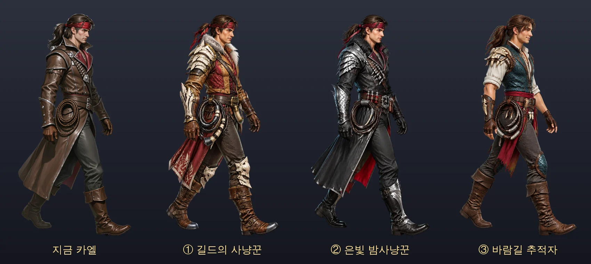

### ① 길드의 사냥꾼 (추천)

밝고 영웅적인 정통 수렵복. 드레이크 가죽 재킷에 상아빛 뼈 견갑, 늑대 털 깃과 진홍 머리띠.
색은 뼈 · 황동 · 진홍. 무기는 용 등뼈를 이은 대채찍.

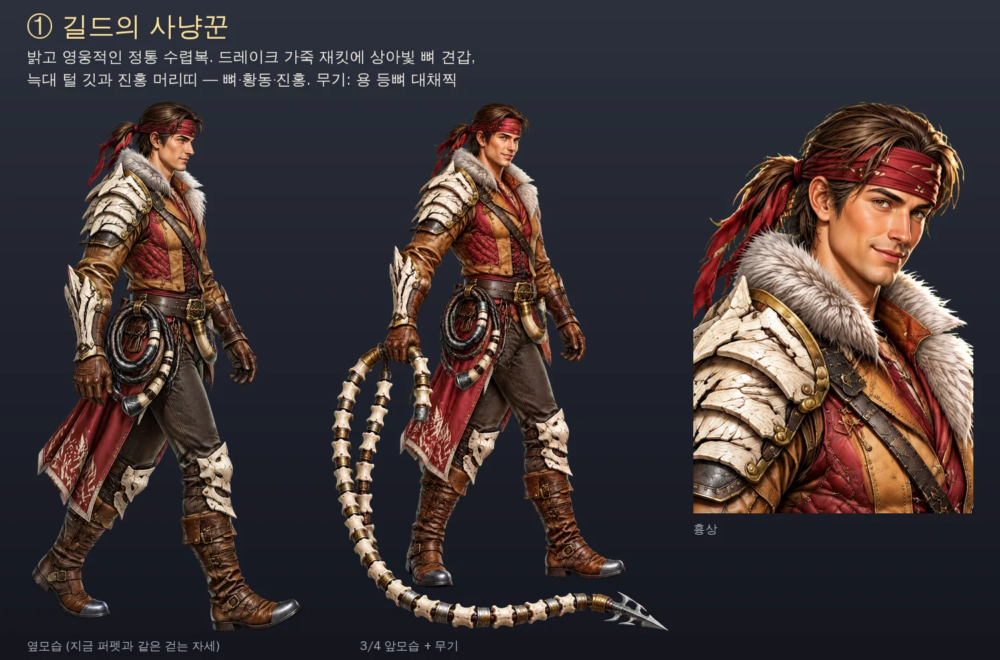

### ② 은빛 밤사냥꾼

같은 품질을 고딕 색으로. 박쥐 날개 가죽 검은 코트에 은빛 용비늘 견갑, 진홍 안감과 은 말뚝.
뱀파이어 헌터의 정체성이 가장 뚜렷하다. 무기는 은사슬 끝에 십자 날이 달린 채찍.

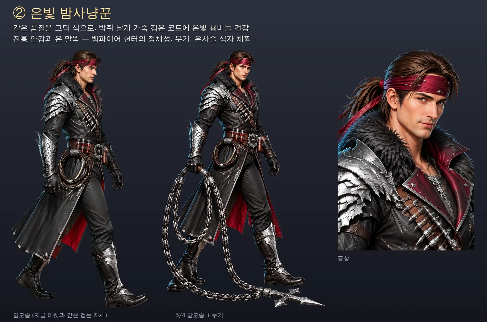

### ③ 바람길 추적자

얼굴과 머리카락이 가장 잘 보이는 경장. 청록 용비늘 조끼와 리넨 셔츠, 진홍 허리띠 (머리띠 없음).
날렵하고 친근하다. 무기는 송곳니를 박은 가죽 채찍.

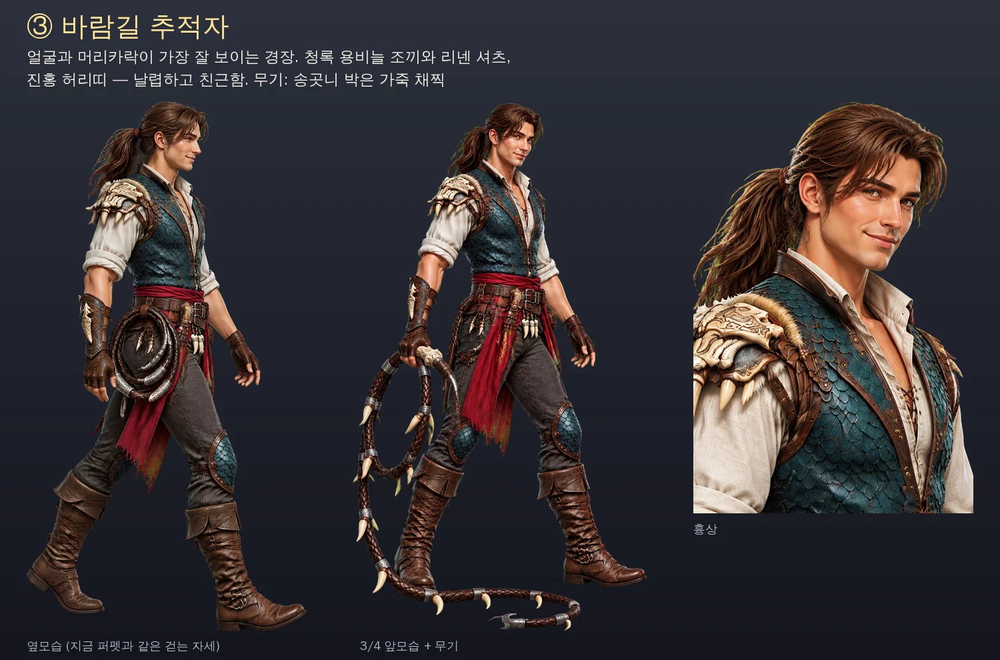

### 비교군 — 기존 화풍 (1차)

소유자 의견을 듣기 전에 지금의 어두운 채색 화풍 그대로 만든 세 방향이다. 비교용으로만 둔다.

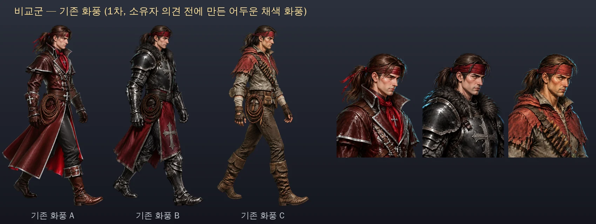

## 3. 작은 화면에서 잘 보이나

폴드를 편 화면(QA 기기 `fold_open`, 논리 960×726)에 영웅을 실제 게임 크기(키 116px)로 놓았다. 아래 그림은 2배 확대.
윗줄: 지금 카엘 · 기존 화풍 A · ① · ② · ③. 아랫줄: ①을 **옆모습 그대로**와 **살짝 위에서 본 3/4 옆모습** 두 가지로.

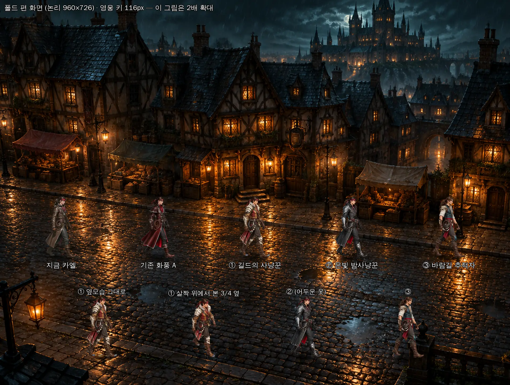

실제 크기(확대 없음), 배경 세 가지:

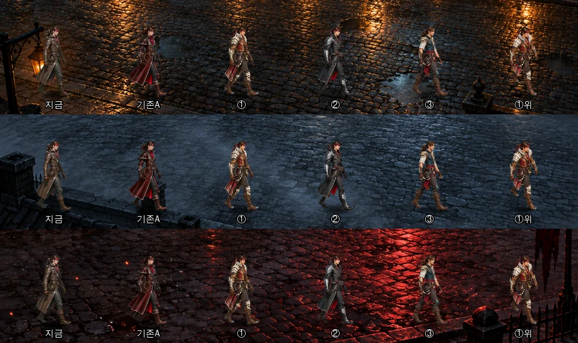

다른 배경: [달빛 안개](img/ap_read_moon.webp) · [붉은 달](img/ap_read_blood.webp)

**숫자로 본 결과** — 인물과 바닥의 밝기 대비 (1.0 = 구분 안 됨, 배경 세 장 × 자리 30곳 평균):

| | 등불 | 달빛 | 붉은 달 | 윤곽 대비 |
|---|---|---|---|---|
| 지금 카엘 | 1.41 | 1.23 | 1.61 | 0.02 |
| 기존 화풍 A | 1.28 | 1.11 | 1.41 | 0.02 |
| **① 길드의 사냥꾼** | **2.08** | **1.87** | **2.41** | **0.08** |
| ② 은빛 밤사냥꾼 | 1.47 | 1.29 | 1.68 | 0.02 |
| ③ 바람길 추적자 | 1.89 | 1.68 | 2.18 | 0.06 |

- **①이 가장 잘 보인다.** 밝은 뼈 장갑과 붉은 천이 어두운 밤 배경에서 윤곽을 만든다. ③이 그다음이다.
- ②는 멋있지만 검은 옷이 밤 배경에 묻혀 지금 카엘과 비슷한 수준이다. ②를 쓰려면 은색·진홍 면적을 늘리거나 게임에서 윤곽 빛을 더해야 한다.

**옆모습 그림이 위에서 내려다본 땅에 어울리나?**

- 어울린다. 발밑 그림자만 있으면 옆모습 그대로도 땅에 서 있는 것으로 읽힌다. 헌장 §4("캐릭터는 2D 그림이고 좌우로 뒤집는다")와도 맞는다.
- 살짝 위에서 본 그림은 어깨 윗면이 보여 조금 더 자연스럽지만, 이 크기에서는 차이가 작다. 대신 자세가 달라져 **기존 움직임을 다시 쓸 수 없고**(§6 의 '자유 재디자인' 비용), 얼굴이 작아진다.
- 그래서 **옆모습으로 시작**하고, 시범판에서 실제로 움직여 본 뒤 필요하면 바꾸는 것을 권한다.

## 4. 영웅 7인과 얼굴

①의 방향으로 나머지 여섯 명을 한 장씩 그렸다. 모두 지금 그림과 같은 걷는 자세이고, 누구인지(무기 · 역할 · 색)는 그대로다.
무기는 손에 들지 않고 등·허리에 찼다(손에 든 무기는 게임이 따로 그린다 — §5).

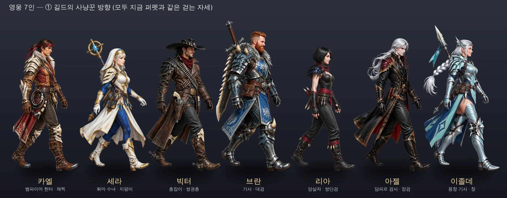

얼굴 (남 3 · 여 2):

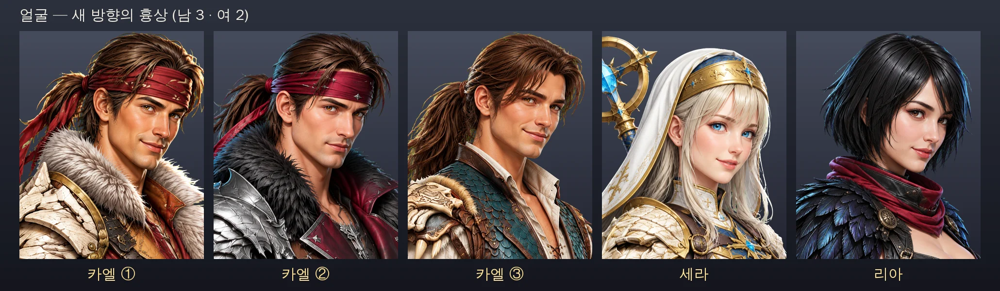

자세가 얼마나 그대로인지(지금 그림과 겹친 비율, 1.0 = 완전히 같음): 카엘 ① .83 · ② .88 · ③ .75 · 세라 .74 · 빅터 .75 · 브란 .74 · 리아 .81 · 아젤 .89 · 이졸데 .81.
등에 멘 무기와 달라진 옷자락 때문에 낮아진 것이고, 9장 모두 팔·다리 자리는 같다. 다시 뽑은 그림은 없다.

## 5. 퍼펫으로 움직여 보기

새 카엘 ① 그림 한 장을 기존 퍼펫 도구에 넣고, 카엘의 기존 리그를 그대로 물려받게 했다(`PUPPET_PIPELINE.md` §2.6 방식).
게임이 읽지 않는 자리에 만들었다: 원화 `tools/puppet/src/v2pilot/`, 리그 `tools/puppet/rigs/v2pilot/kael/kael_guild.json`, 결과 `assets/v2/pilot/puppet/kael_guild/`.

윗줄 새 카엘, 아랫줄 지금 카엘 (같은 프레임: 서기 · 달리기 · 점프 · 채찍 공격):

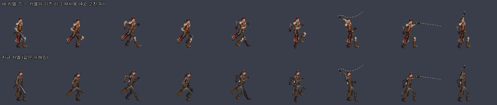

| 단계 | 걸린 시간 | 결과 |
|---|---|---|
| 등록 (크기·발 위치를 지금 그림에 맞춤) | 3초 | 맞춘 뒤 겹친 비율 .80 |
| 빌드 (부품 15개 자르기) | 18초 | 리그 수정 0곳 |
| 검사 (58칸: 서기·달리기·점프·채찍·대검·창) | 16초 | 39칸에서 관절 틈 |
| 리그 2곳 수정 후 다시 빌드·검사 | 약 3분 | **관절 틈 0칸** (지금 카엘도 0칸) |
| 합계 | **약 4분** | 그리는 시간 0.46ms (지금 0.49ms) |

무엇이 깨졌나 (왼쪽: 수정 전, 오른쪽: 2곳 수정 뒤. 위는 큰 무기 확인):

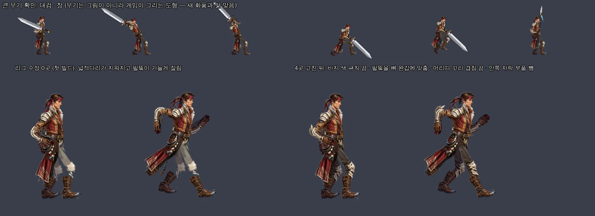

1. **넓적다리가 지워졌다.** 도구가 "갈색 = 코트"로 보는데 새 바지가 갈색이라 다리를 코트로 착각했다. → 그 규칙을 껐다.
2. **팔뚝이 가늘게 잘렸다.** 뼈 완갑이 지금 팔보다 넓고 왼쪽에 있다. → 팔꿈치·손목 점과 팔뚝 영역을 완갑에 맞췄다.

아직 남은 것 (고치지 않음, 영웅 한 명당 30–60분 어림):
- 먼 쪽 무릎의 뼈 보호대가 옷자락 부품에 섞여 번진다.
- 무기를 들면 허리의 채찍 똬리가 사라지고 그 자리에 갈색 얼룩이 보인다.
- 머리띠 꼬리가 그림에도 있고 게임도 그려서 두 겹이다.
- 장비 색 바꾸기용 마스크, 인벤토리 돌려 보기 그림, 손 그림(지금은 카엘의 예전 장갑)을 새로 맞춰야 한다.

**무기는 어떻게 되나.** 퍼펫 그림에는 무기가 없다. 손에 든 무기는 게임이 도형으로 그린다(`src/render/hero.js`).
그래서 **큰 무기도 크기는 문제없이 들어간다**(위 그림의 대검·창). 다만 회색 도형이라 새 화풍과 어울리지 않는다.
새 화풍에 맞추려면 무기도 그림으로 바꿔야 한다: 무기 종류마다 그림 1장 + 게임 코드 수정(무기 축에 그림을 붙이는 기능, 아직 없음).
등에 멘 대검·창처럼 몸을 가리는 무기는 퍼펫용 그림에서는 빼고 따로 그려야 한다(§4 의 그림은 보여 주기용).

리그가 지금 그림 위에 어떻게 얹히는지: [겹쳐 본 그림](img/ap_puppet_fit.webp)

### 적도 같은 방식이 되나 (가고일 1종 시험)

적은 부품 시트를 잘라 만든다. 가고일의 참고 그림과 부품 시트를 "자리는 그대로, 겉만 새 화풍으로" 다시 칠했다.

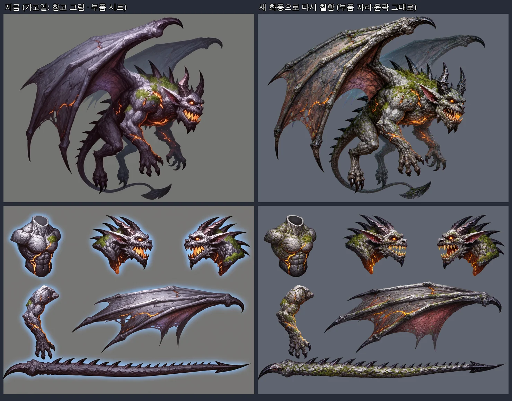

부품 6개가 모두 같은 자리에 나왔다(중심 이동 8px 이하 / 폭 1168px, 크기 1.01–1.11배). 기존 조각의 푸른 테두리 빛도 사라져 오리기가 쉬워진다.
다만 다시 칠한 시트로 실제 적을 빌드해 보지는 않았다.

## 6. 비용

값: `gpt_image_2_5` 1k 한 장 0.25 크레딧, 2k 한 장 0.5 크레딧. **측정**은 이번 시범이나 v1 기록에서 실제로 잰 값, **어림**은 그것으로 계산한 값이다.

### 6.1 한 캐릭터당

| 대상 | 방식 | 그림 | 크레딧 | 리그·코드 작업 | 근거 |
|---|---|---|---|---|---|
| 영웅 기본 직업 | 자세 유지 | 7–8장 (측면 1 + 예비 1, 손 1, 돌려 보기 1, 흉상 3, 무기 1) | 2.5–3.0 | 45–90분 | 측면·리그 측정, 나머지 어림 |
| 영웅 추가 직업 | 자세 유지 | 2장 (측면 1, 돌려 보기 1) | 1.0 | 10–40분 | 측정 (v1 초월 25직업: 직업당 1.0) |
| 영웅 기본 직업 | 자유 재디자인 (체형·자세 새로) | 8–11장 (측면 후보 2–4 포함) | 3.5–4.5 | 2–3시간 (새 리그) | `PUPPET_PIPELINE.md` §4.1 |
| 적 1종 | 자리 유지 다시 칠하기 | 평균 3.6장 (0–8) | 1.0–1.5 | 15–30분 | 그림은 측정(가고일 2장), 빌드는 어림 |
| 적 1종 | 자유 재디자인 | 4–7장 | 1.5–3.0 | 1–3시간 (부품·그리기 코드) | `ENEMY_PIPELINE.md` 장수 |
| 보스 1명 | 자리 유지 다시 칠하기 | 평균 12.5장 (7–21) + 초상 1–2 | 약 7 (3.5–11) | 1–2시간 | `BOSS_PIPELINE.md` 장수, 시험 안 함 |
| 보스 1명 | 자유 재디자인 | 12–20장 + 초상 | 7–11 | 4–8시간 | 어림 |
| 초상화 1장 (NPC·동료) | 새로 | 1장 | 0.25 | — | 측정 |

### 6.2 전체

| 묶음 | 수 | 자세 유지 | 자유 재디자인 |
|---|---|---|---|
| 영웅 기본 직업 | 7명 | 21 | 32 |
| 영웅 나머지 직업 | 42 (영웅당 6) | 42 | 42 |
| 영웅 초월·비전 | 35 (지금 25 + 아젤·이졸데 10) | 35 | 35 |
| 적 | 약 100종 | 100–150 | 150–300 |
| 보스 | 약 40명 | 약 280 | 280–440 |
| NPC·동료 초상 | 48장 | 15 | 15 |
| **합계** | | **약 490–540 크레딧** | **약 550–860 크레딧** |

- 지금 잔액 **103.75 크레딧** (시범 중에 계정에 보너스 50이 들어왔다. 그 전에는 59.5).
- **1장 수직 슬라이스**(헌장 P1: 새 주인공 1명 · 적 5종 · 보스 1명 · 초상 몇 장): **약 16–23 크레딧** → 지금 잔액으로 된다.
- 영웅 7명의 기본 직업만 먼저: 21 크레딧.
- 적·보스 숫자는 v1 그림 장수에 새 값을 곱한 어림이다. 보스는 시험해 보지 않았으니 첫 보스를 만들 때 다시 잰다.
- 자유 재디자인은 크레딧보다 **작업 시간**이 훨씬 많이 든다(영웅 7명 리그만 14–21시간, 적 100종 100–300시간).

## 7. 세계 분위기 판과 바닥 재질 (1차에서 만든 것)

위에서 내려다본 거리 세 가지 분위기 — 달빛 안개 · 빗속 등불 · 붉은 달:

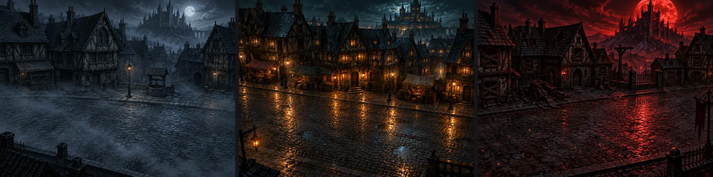

바닥·벽 재질 네 가지(자갈길 · 돌벽 · 나무 널 · 풀밭), 2×2로 이어 붙인 모습:

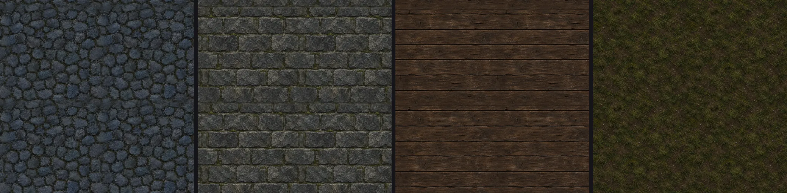

재질은 이어 붙였을 때 줄이 보이지 않게 손봤다(자갈길·돌벽·나무 널은 가장자리를 섞음, 풀밭은 원래 이어짐).
파일: `assets/v2/pilot/plate_{moon,lantern,blood}.webp` (94–173KB), `tex_{cobble,wall,planks,grass}.webp` (512px, 38–57KB).

## 8. 추천

1. **화풍은 이번 새 방향으로.** 기존 화풍(§2 비교군)보다 얼굴이 호감형이고 장비가 또렷하다.
2. **카엘은 ① 길드의 사냥꾼을 기본으로.** 가장 잘 보이고 요청에 가장 가깝다. ②는 버리지 말고 카엘의 상위 직업(밤 사냥 장비)으로 쓰면 1 크레딧으로 얻는다. ③은 경장 직업 계열에 맞는다.
3. **재디자인은 자세 유지로.** 싸고(영웅당 약 3 크레딧) 빠르며(4분 만에 움직임) 기존 움직임을 모두 물려받는다. 체형까지 바꾸는 자유 재디자인은 주인공 한 명만 먼저 해 보고 결정한다.
4. **옆모습 그림으로 시작.** 위에서 본 그림은 이득이 작고 비용이 크다.
5. **무기 그림을 따로 만든다.** 수렵 액션 느낌의 절반은 무기다. 무기 종류마다 그림 1장과 코드 수정이 필요하다.
6. **순서:** 주인공 1명 → 1장 적 5종 → 1장 보스 1명 (약 16–23 크레딧) → 폴드에서 확인 → 나머지.

## 9. 소유자에게 묻고 싶은 것

1. 카엘은 ① · ② · ③ 중 어느 쪽인가요? (섞어도 됩니다: 예 — ①을 기본, ②를 상위 직업으로)
2. 얼굴은 이 정도면 되나요? 더 어리게, 더 날카롭게, 미소 없이 같은 바람이 있나요?
3. 여성 캐릭터의 옷차림이 지금 그림 정도면 괜찮은가요? (리아·세라 흉상은 가슴이 강조되어 나왔습니다. 낮출 수 있습니다.)
4. 카엘의 무기를 '용 등뼈 대채찍'처럼 크게 바꿔도 되나요? 다른 영웅도 무기를 더 크게 할까요?
5. 대검·창처럼 큰 무기를 쓰지 않을 때 등에 멘 모습으로 보여 줄까요?
6. 체형·자세까지 새로 그리길 원하시나요, 아니면 지금 움직임을 살리고 겉모습만 바꾸면 되나요?
7. 적과 보스도 전부 이 화풍으로 다시 칠할까요? (약 380–430 크레딧) 아니면 1장부터 차례로 할까요?
8. 영웅마다 7직업 + 초월 5를 v2 에서도 모두 유지하나요? (줄이면 그만큼 싸집니다: 직업당 1 크레딧)

## 10. 기록

- 그림: 1차 16장 4.75 크레딧 + 2차 20장 5.75 크레딧 = **36장 10.5 크레딧**, 모두 `gpt_image_2_5`. 버린 그림 없음. 프롬프트·작업 번호는 `tools/higgsfield/manifest_v2pilot.json`.
- 잔액: 64.25 (1차 전) → 59.5 (2차 전) → 53.75 (2차 사용 뒤) + 50 (Discord 연결 보너스, 이 작업과 무관) = 103.75.
- 원본 PNG 는 저장소 밖 `/tmp/claude-0/v2/art/` 에 있다(재부팅하면 사라질 수 있음). 저장소에는 작은 사본만: `assets/v2/pilot/hero_*.webp`(키 480px, 영웅 9장 + 위에서 본 1장), 이 문서의 `docs/v2/img/ap_*.webp`.
- **주의:** 배포 빌드는 `assets/` 를 통째로 복사한다. `assets/v2/pilot/`(약 1.1MB)도 웹·APK 에 들어가므로, 배포 전에 지우거나 빌드에서 빼야 한다.
- 시범 리그는 `tools/puppet/rigs/v2pilot/kael/` 처럼 한 단계 깊게 두어 `build_all.py` 가 집어 가지 않는다.
