# 첫 출시의 적 6종과 보스 — 입체 모델 (CAST R1 · 적)

2026-11-17 · 담당 castenemy · 범위 `docs/v2/GDD.md` §9.2 · 길 `docs/v2/CHAR3D_PILOT.md` §9 · 기록 `tools/higgsfield/manifest_castenemy.json`
파일 `assets/v2/char3d/` · 도구 `tools/v2/castenemy_*.mjs` · 보기 `tools/v2/castenemy_view.html` · 소유자용 그림 `/tmp/claude-0/v2/castenemy/owner_enemies.png`

소유자 말: *"적과 모든 것들을 3d로 바꿔주고"*, *"배경, 캐릭터, 인터페이스 모두 3d 게임에 어울리게, 이질감 없게, 그리고 디테일이 있도록"*.
이 문서는 GDD 첫 출시 범위의 **적 6종(해골 병사 · 해골 술사 · 역병 주검 · 무덤 유령 · 무덤지기 갑주 · 박쥐)과 보스 밴시 여왕**을 입체 모델로 만든 기록이다. 말하는 인물 8명은 다른 담당(castpeople), 공용 움직임 묶음은 또 다른 담당(animlib)이 만든다.

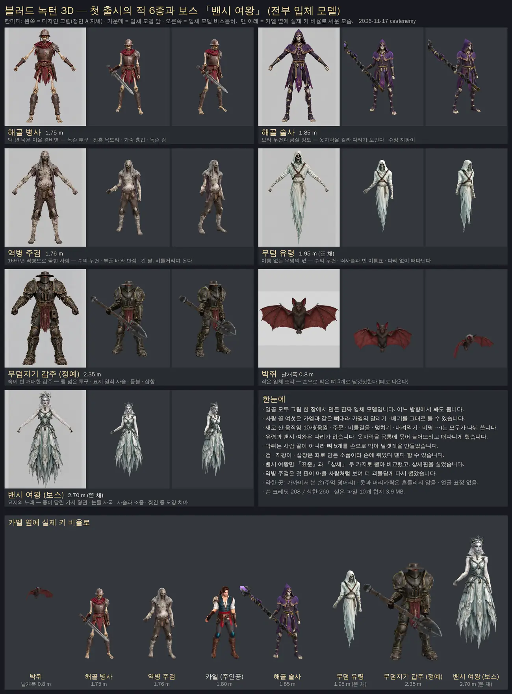

## 0. 한눈에

- **일곱 모두 입체 모델로 실었다.** 사람 꼴 다섯 + 보스는 그림 → Tripo H3.1 → 방향 돌리기 → 자동 리깅 → 다시 싸기, 박쥐는 그림 → 모델 → **손으로 박은 뼈 5개 + 손으로 쓴 날갯짓**.
- 디자인은 v1 의 정체(해골 병사의 진홍 목도리, 술사의 보라 두건과 수정 지팡이, 유령의 흰 수의, 갑주의 붉은 앞자락, 박쥐의 붉은 날개, 밴시의 청록 사슬)를 잇되 전부 새로 그렸다. 카엘의 A 자세 그림을 **화풍 참고**로만 넣어 같은 결(반실사 CG, 고른 빛)로 맞췄다.
- **쓴 크레딧 208 / 상한 260** (계정 거래 내역과 한 건씩 맞춰 봄 — §8). 실은 파일 10개 합계 **3.91 MB** (적 6 + 보스 1 + 소품 3).
- 보스만 「표준 9」과 「상세 18」을 같은 그림으로 뽑아 비교했고 **상세판**을 실었다 (§6).
- 역병 주검은 첫 판이 "마을 사람"처럼 보여 **그림부터 다시 뽑았다** (§7).
- 새로 산 움직임 10개 가운데 6개가 animlib 담당이 같은 시각에 산 것과 겹쳤다 — 겹치지 않은 것은 내려찍기 · 휩쓸기 · 머리 감싸기 · 무거운 걸음 넷이다 (§3). 솔직히 적어 둔다.

## 1. 캐릭터 표

키는 리깅 서비스에 준 값이고 다시 싼 파일에서 다시 쟀다. 삼각형 · 정점 · 크기는 실린 파일 기준. 뼈 24개 = 카엘과 같은 사람형 뼈대(손가락 · 얼굴 · 옷 뼈 없음).

| 캐릭터 | 파일 (`assets/v2/char3d/`) | 디자인 | 삼각형 / 정점 | 뼈 | 그림 | 키 | 든 클립 (라이브러리 번호) | 크레딧 | 약한 곳 |
|---|---|---|---|---|---|---|---|---|---|
| **해골 병사** | `skeleton_soldier.glb` 473 KB | 백 년 묵은 마을 경비병의 유골. 찌그러진 녹슨 투구, 진홍 목도리, 가죽 흉갑(마을 문장), 한쪽 어깨 보호대, 짧은 앞자락, 녹슨 정강이받이, 맨뼈 발. 눈구멍에 붉은 불씨 | 11,976 / 9,453 | 24 | 1024² WebP | 1.75 m | `Hit_Reaction_1` (179) 1.2초 — 움찔 | 18 | 팔 · 허벅지 뼈가 가늘어 멀리서는 몸통과 투구로 읽힌다. 턱끈이 턱에 붙어 있다. 시험판(`tools/v2/char3d_samples/skeleton.glb`)은 맨 해골에 천 한 장이라 **새로 만들었다** |
| **해골 술사** | `skeleton_mage.glb` 445 KB | 죽은 궁정 마법사. 뾰족한 보라 두건 + 금실 어깨 망토, 몸에 붙는 윗옷, 금 밧줄 띠와 해골 장식 · 약병, **무릎 길이의 갈라진 옷자락 넷**, 보라 천으로 감은 다리뼈, 이마와 가슴의 자수정 | 11,900 / 8,646 | 24 | 1024² | 1.85 m | `mage_soell_cast` (129) 2.3초 — 한 팔을 높이 들었다 내지르는 주문 | 18 | 망토 뒤가 밋밋하다(뒤는 지어낸 면). 눈의 보랏빛은 그림에 칠해진 것이라 빛나지 않는다 → 게임이 눈 자리에 빛을 얹는다 |
| **역병 주검** | `plague_corpse.glb` 472 KB | 1697년 역병으로 묻힌 사람. 수의 두건, 부푼 배와 드러난 갈비, 회녹색 살갗의 검보라 반점, 긴 팔과 큰 손, 누렇게 빛나는 눈, 벌어진 턱. 해진 자줏빛 윗옷, 밧줄 띠와 역병 패 · 깨진 병, 붕대 감은 팔 · 정강이, 맨발 | 11,856 / 9,262 | 24 | 1024² (q70) | 1.76 m | `Slow_Orc_Walk_inplace` (669) — 무거운 걸음(갑주도 쓴다) · `Mummy_Stagger_inplace` (650) 4.8초 — 팔을 뻗고 비틀거리는 걸음 | 18 + 버린 첫 판 18 | 얼굴이 두건 그늘에 묻혀 멀리서는 눈빛이 안 보인다. 두건 자락이 어깨에 붙어 고개를 돌리면 늘어난다. 그림 품질을 70 으로 낮춰 500 KB 안에 맞췄다(클립 둘) |
| **무덤 유령** | `grave_ghost.glb` 416 KB | 이름 없는 무덤의 넋. 뼈빛 수의 두건 속 해골 얼굴(벌린 입), 가슴에 엇건 녹슨 쇠사슬과 **빈 이름표**, 매듭 띠, 붕대 감은 가는 팔, 아래로 갈수록 좁아져 누더기로 끝나는 옷자락 — 다리 없음 | 9,932 / 7,748 | 24 | 1024² | 1.95 m (뜬 채, 자락 끝까지) | `mage_soell_cast_3` (132) 3.3초 — 두 팔로 밀어 덮치기 · `float_idle` 4초 — 떠서 서 있기(손으로 씀) | 18 | 불투명한 천으로 만들었다 — 비쳐 보이는 것은 게임 셰이더의 몫(§4). 사슬이 몸에 붙은 무늬다 |
| **무덤지기 갑주** (정예) | `gravekeeper_armor.glb` 455 KB | 속이 빈 거대한 묘지기 갑주. 챙 넓은 쇠 모자를 얹은 투구(틈새에 붉은 불씨), 묘비 모양 어깨 보호대, **묘지 열쇠 세 개를 건 사슬**, 허리의 등불, 좁은 진홍 앞자락, 이끼와 녹 | 11,316 / 8,612 | 24 | 1024² (q72) | 2.35 m (카엘의 1.3배, 어깨 폭 1.7 m) | `Charged_Ground_Slam` (127) 3.0초 — 팔을 치켜들었다 땅을 내려찍기 · `Slow_Orc_Walk_inplace` (669) — 무거운 걸음 | 18 | 어깨 보호대 · 팔 갑옷이 팔과 함께 휜다(가중치를 못 고친다). 등불 · 열쇠가 몸에 붙어 흔들리지 않는다 |
| **박쥐** | `bat.glb` 153 KB | 흡혈 박쥐. 검갈색 털 몸통, 붉은 속귀, 붉은 눈과 송곳니, 손가락뼈가 비치는 검붉은 날개막 | 4,774 / 3,430 | **5 (손으로)** | 512² | 날개폭 0.8 m | `fly` 0.4초 (손으로 씀) + 같은 내용의 `run` | 10 | 날개가 관절 둘로만 꺾인다(막이 출렁이지 않는다). 등은 지어낸 면이라 털이 뭉개져 있다 |
| **밴시 여왕** (보스) | `banshee_queen.glb` 1,319 KB | 묘지의 노래. 창백하고 아름다운 얼굴에 검은 눈물 자국과 청록빛 눈, 땋아 올린 은발, **작은 종이 달린 가시나무 왕관**, 짧은 면사포, 레이스 깃과 소매, 은세공 몸통에 백합 자수, 가슴과 허리에 엇건 **청록 사슬과 조종(弔鐘)**, 종 모양으로 퍼져 누더기로 끝나는 치마 — 다리 없음 | 26,860 / 21,819 | 24 | 2048² | 2.70 m (카엘의 1.5배) | `Zombie_Scream` (386) 2.8초 — **비명(상징)** · `Charged_Spell_Cast` (125) 2.7초 — 웅크렸다 두 팔을 치켜들기 · `mage_soell_cast_1` (130) 3.5초 — 두 팔로 크게 휩쓸기 · `Head_Hold_in_Pain` (391) 3.7초 — 조종에 노래가 깨져 머리를 감싸기 · `float_idle` 4초 — 떠서 서 있기(손으로 씀) | 61 | 왕관의 가는 가지와 종이 굵어졌다. 면사포가 단단한 판이다. 사슬 · 종이 몸에 붙어 흔들리지 않는다. 손이 주먹이라 "노래하는 손짓"이 안 된다 |

8방향과 움직임 한가운데 (★ 가 아닌 것도 모두 라이브러리 클립. 「카엘의 달리기 · 베기」는 카엘 파일의 클립을 빌려 튼 것):

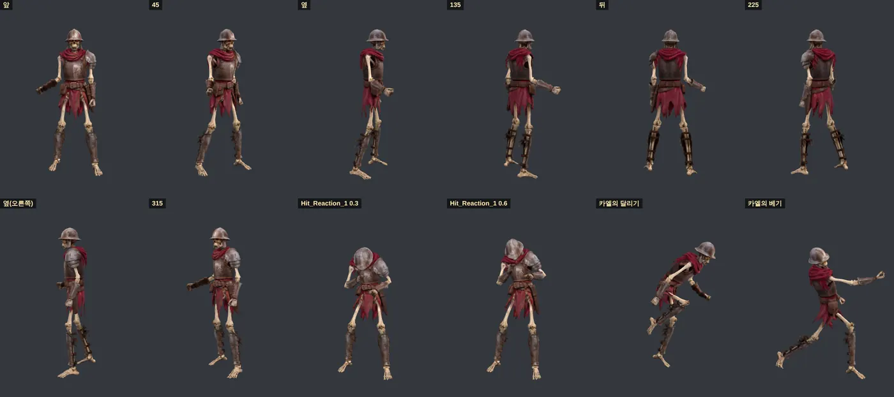
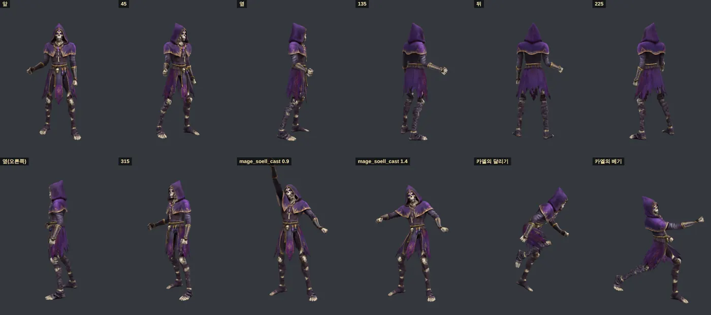
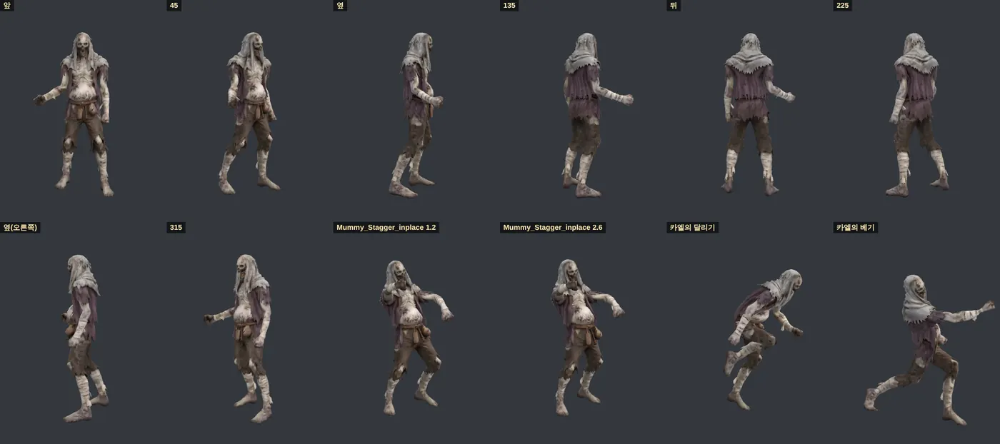
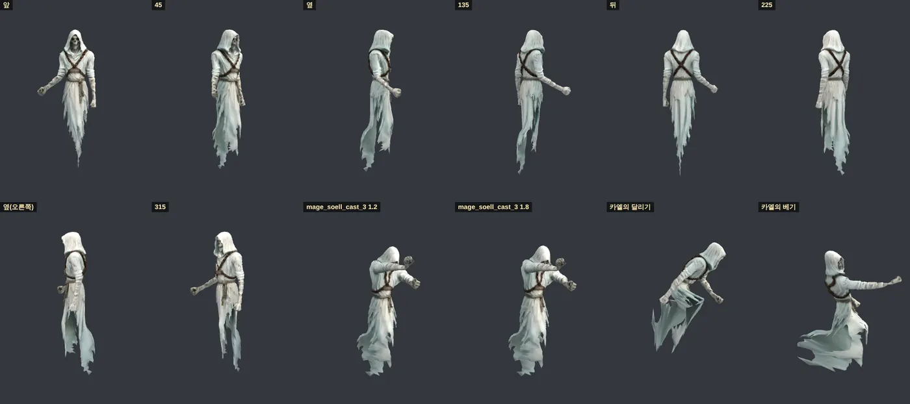
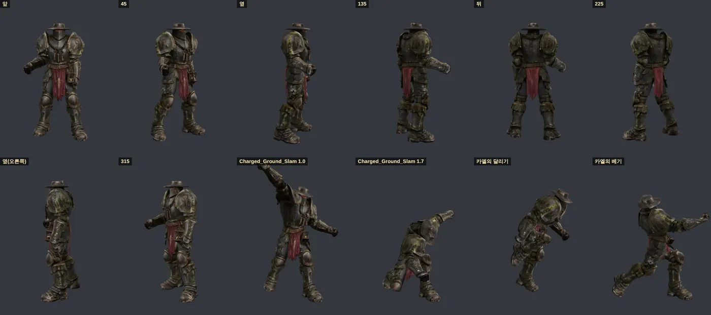
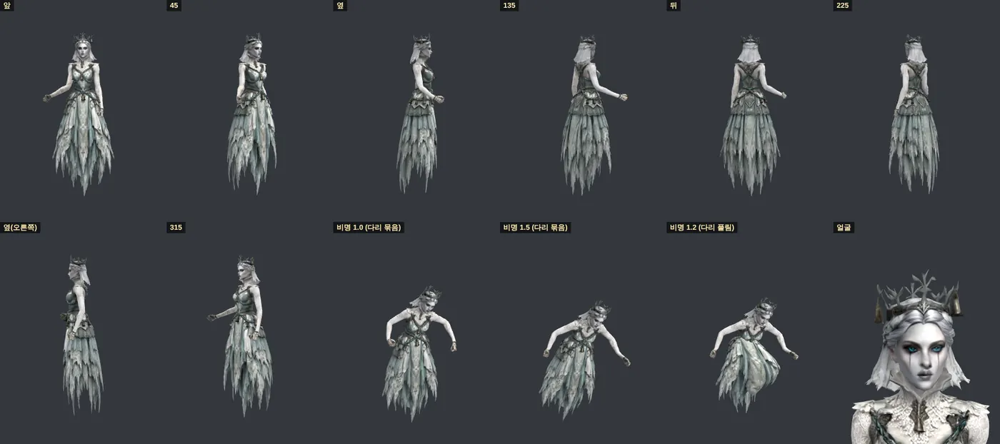

게임 카메라 높이에서 밤 조명으로 본 모습(실제 키 비율). 여덟이 서로 다른 덩어리와 색으로 읽힌다 — 다만 **갑주는 어두운 쇠라 밤 장면에 묻힌다**: 투구 틈의 붉은 빛과 허리 등불에 실제 빛을 달고 테두리 빛을 세게 줘야 한다.

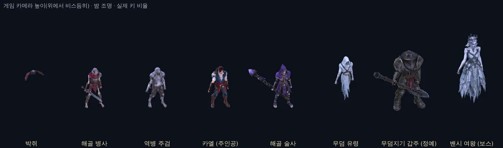

## 2. 손에 드는 소품 (무기)

그림에 무기를 들리면 손과 한 덩어리가 되어 리깅을 망친다(시범 §6). 그래서 **캐릭터는 빈 주먹으로 만들고, 무기는 따로 그려 따로 모델로** 만들었다. 결과가 깨끗해서 셋 다 싣는다.

| 소품 | 파일 | 삼각형 | 길이 | 쥐는 자리 | 쥐는 자세 (`Char3D.grip`) | 크레딧 |
|---|---|---|---|---|---|---|
| 녹슨 검 (해골 병사) | `w_rusty_sword.glb` 76 KB | 1,426 | 92 cm | 아래에서 16% | 기본값 `{pos:[0,7,3], rotX:-80}` | 9.5 |
| 수정 지팡이 (해골 술사) | `w_crystal_staff.glb` 110 KB | 2,844 | 175 cm | 42% | `{pos:[0,7,3], rotX:100}` — 머리를 위로 | 9.5 |
| 무덤지기 삽창 (갑주) | `w_grave_spade.glb` 86 KB | 2,432 | 215 cm | 33% | `{pos:[0,9,4], rotX:-80}` — 날이 앞 · 아래로 (내려찍기와 맞는다) | 9.5 |

- 소품 파일은 **뼈 없는 정지 모델, 단위 cm, 원점 = 쥐는 자리, +Y = 날 · 머리 쪽**이다. 지금 런타임의 `Char3D.weapon` 자리(오른손 뼈에 붙는 상자 검)에 `renderer.add(소품 모델)` 을 그대로 넣으면 된다 — 뷰어의 `&prop=` 가 그렇게 한다.
- 못 한 것: 왼손(방패 · 두 손 쥐기). 런타임이 오른손 한 곳만 안다. 삽창은 오른손에만 붙고 왼손은 따라오지 않는다. v1 해골 병사의 둥근 방패는 만들지 않았다.
- 유령 · 주검 · 박쥐 · 밴시는 빈손이 맞다.

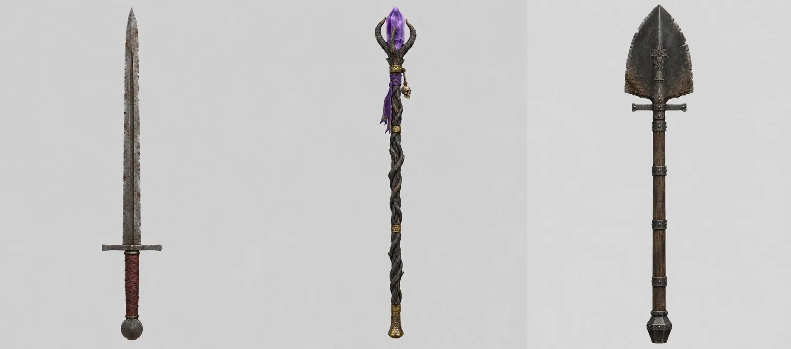

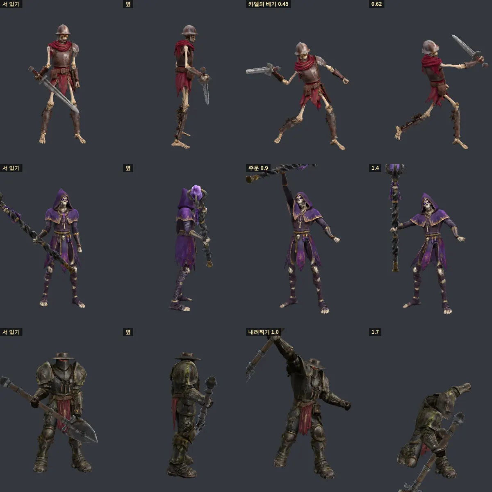

## 3. 움직임 (클립)

리깅 한 번에 라이브러리 클립 하나를 +3 크레딧에 끼울 수 있고, 사람형끼리는 클립을 나눠 쓴다(시범 §3). 이번에 끼운 것:

| 번호 | 이름 | 길이 | 어디에 들었나 | 쓰임 | animlib 과 겹침 |
|---|---|---|---|---|---|
| 179 | Hit_Reaction_1 | 1.2초 | 해골 병사 | 맞고 움찔 | 겹침 |
| 129 | mage_soell_cast | 2.3초 | 해골 술사 | 주문 (한 팔) | 겹침 |
| 650 | Mummy_Stagger_inplace | 4.8초 (순환) | 역병 주검 | 팔 뻗고 비틀걸음 | 겹침 (113 의 제자리판) |
| 132 | mage_soell_cast_3 | 3.3초 | 무덤 유령 | 두 팔로 밀며 덮치기 | 겹침 |
| 127 | Charged_Ground_Slam | 3.0초 | 무덤지기 갑주 | 치켜들었다 땅 내려찍기 (튕겨내기 연습 상대) | **새것** |
| 386 | Zombie_Scream | 2.8초 | 밴시 여왕 | 비명 — 보스의 상징 | 겹침 |
| 125 | Charged_Spell_Cast | 2.7초 | 밴시 여왕 | 웅크렸다 두 팔을 치켜듦 (유령 부르기) | 겹침 |
| 130 | mage_soell_cast_1 | 3.5초 | 밴시 여왕 | 두 팔로 크게 휩쓸기 (울음 물결) | **새것** |
| 391 | Head_Hold_in_Pain | 3.7초 | 밴시 여왕 | 조종에 노래가 깨져 머리를 감쌈 | **새것** |
| 669 | Slow_Orc_Walk_inplace | 5.5초 (순환) | 역병 주검 · 무덤지기 갑주 | 무거운 걸음 — 정예 갑주가 사람처럼 가볍게 걷지 않게 | **새것** |

- **겹친 까닭:** 세 담당이 같은 30분 사이에 따로 샀다. 내가 살 때(14:35–14:42 UTC) animlib 의 구매 목록은 아직 없었다. 겹친 6개의 값은 클립 몫 3 × 6 = **18 크레딧**이다(리깅 몫 5는 어차피 든다). 겹친 클립은 캐릭터 파일 안에 그대로 들어 있어 쓰는 데는 문제없지만, 공용 묶음(`assets/v2/char3d/clips/`)을 쓰게 되면 캐릭터 파일의 것은 빼도 된다(파일당 20–30 KB).
- 다른 담당이 사서 **적이 빌려 쓸 수 있는 것**: 걷기 · 서 있기 · 달리기 · 베기 여럿 · 막기 · 맞기 셋 · 쓰러짐 둘 · `Stand_Up4`(누웠다 일어남 — 역병 주검이 땅에서 일어날 때) · `Heavy_Hammer_Swing`(갑주의 두 손 휘두르기) · `Kneel_on_One_Knee_and_Stand`(무릎 꿇기).
- **손으로 쓴 것 (크레딧 0):** 박쥐 `fly`(§5), 떠다니는 적의 `float_idle`(§4).
- 카엘의 클립(달리기 · 한 손 베기 · 쓰러짐)을 다섯 사람형에 모두 틀어 봤다 — 발이 꼬이거나 팔이 뒤집히지 않는다(위 8방향 그림의 마지막 두 칸).

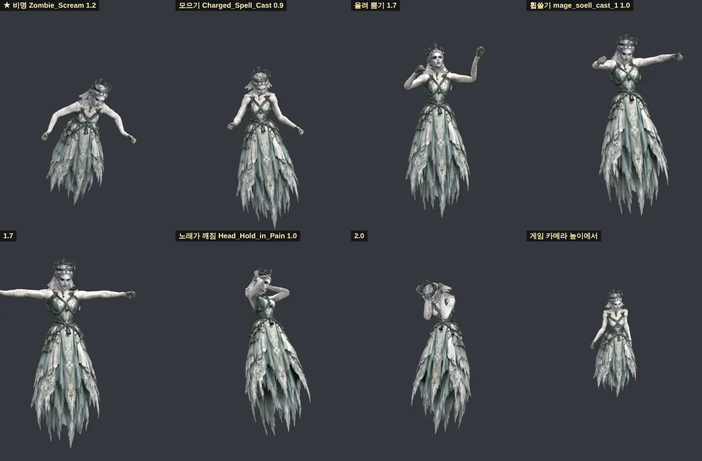

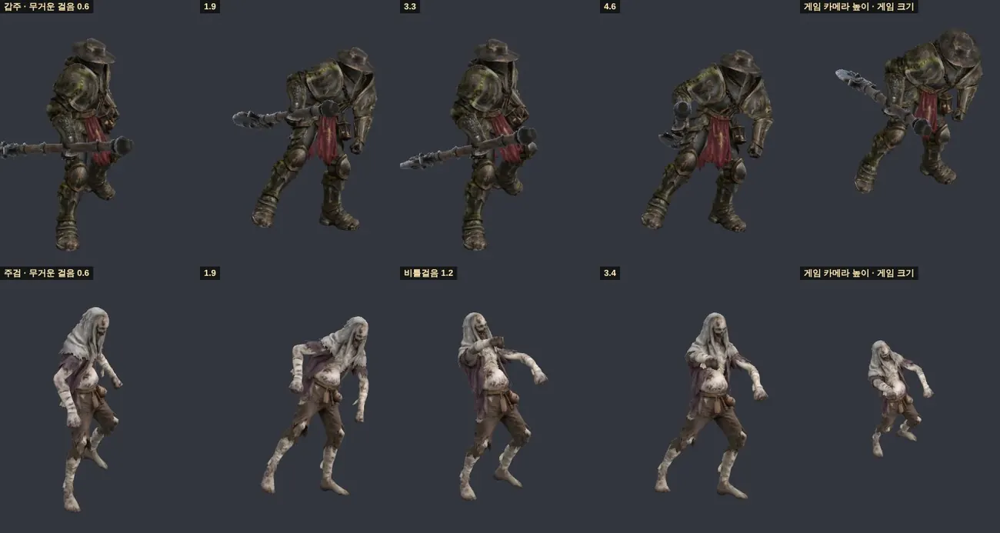

## 4. 떠다니는 적 — 무덤 유령 · 밴시 여왕

**만든 방식.** 다리가 필요 없게 디자인했다(옷자락이 누더기로 끝남). 그래도 사람형으로 리깅했다 — 팔 · 머리 · 몸통에 라이브러리 클립을 그대로 쓰기 위해서다. 서비스는 옷자락 속에 다리 뼈를 박는다.

**해 본 것.** 다리 뼈를 움직이면(달리기 · 웅크리기) 옷자락이 두 갈래로 찢어지고 물갈퀴처럼 늘어난다. **다리 뼈를 쉬는 자세로 묶으면** 옷자락은 골반에 매달린 단단한 자락이 되어, 몸이 숙으면 뒤로 흐르듯 따라온다 — 떠다니는 것에게는 이쪽이 오히려 그럴듯하다.

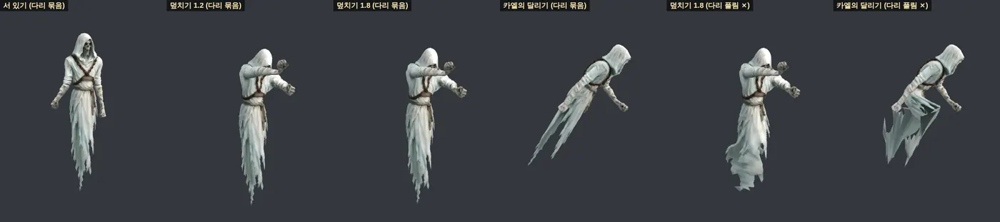

**게임이 할 일 (정한 규칙):**

1. **다리 뼈 8개를 틀지 않는다** — `uplegL/R · legL/R · footL/R · toeL/R` 은 클립이 뭐라 하든 쉬는 자세로 둔다. 뷰어의 `&legs=0` 이 하는 일이고 코드로는 자세를 입힌 뒤 한 번:
   `for (const b of LEGS) { const j = rig.key.get(b); rig.R.set(rig.restR.subarray(j*4, j*4+4), j*4); } rig.pose();`
2. **골반 이동은 그대로 둔다.** 비명 · 웅크리기 클립에서 몸이 내려앉는 것은 "가라앉았다 솟는" 움직임으로 읽힌다.
3. **띄우는 높이:** 유령 0.2–0.3 m, 여왕 0.3–0.5 m (모델의 y 0 = 자락 끝). 발밑 그림자는 작고 옅게.
4. **서 있기는 `float_idle`** (두 파일에 들어 있다): 팔을 내려 조금 벌리고, 4초에 한 번 떠오르내린다. 유령은 고개를 떨구고 여왕은 턱을 든다. 이동할 때는 같은 클립에 몸을 앞으로 10–15° 숙여 주면 자락이 뒤로 흐른다.
5. **자락 흔들림은 셰이더로:** 정점 셰이더에서 `y < 골반 높이` 인 정점에 `sin(시간·2 + y·6) × (골반 높이 − y) × 0.04 m` 를 x · z 에 더한다(아래로 갈수록 크게). 뼈를 더하지 않아도 된다. **아직 만들지 않았다** — 런타임 셰이더는 내 범위 밖이라 값만 적는다.
6. **비침 · 사라짐:** 모델은 불투명하다. 유령은 평소 알파 0.25–0.35 + 테두리 빛(청록)으로 그리고, 메아리 · 등불로 드러난 동안만 알파 0.85 로 올린다(GDD "드러내야 맞는다"). 아래 끝 0.3 m 는 알파를 0 으로 흘려 "안개로 끝나게" 한다. 여왕은 불투명하게 두고 자락 끝만 흘린다 — 얼굴이 비치면 아름다움이 죽는다. 이것도 런타임 일이다.
7. **보스의 무릎 꿇기**는 다리가 없으니 "허리를 깊이 숙이고 0.4 m 가라앉기"로 한다 — `Head_Hold_in_Pain` 의 끝 자세나 castpeople 의 무릎 꿇기 클립에서 윗몸만 쓴다.

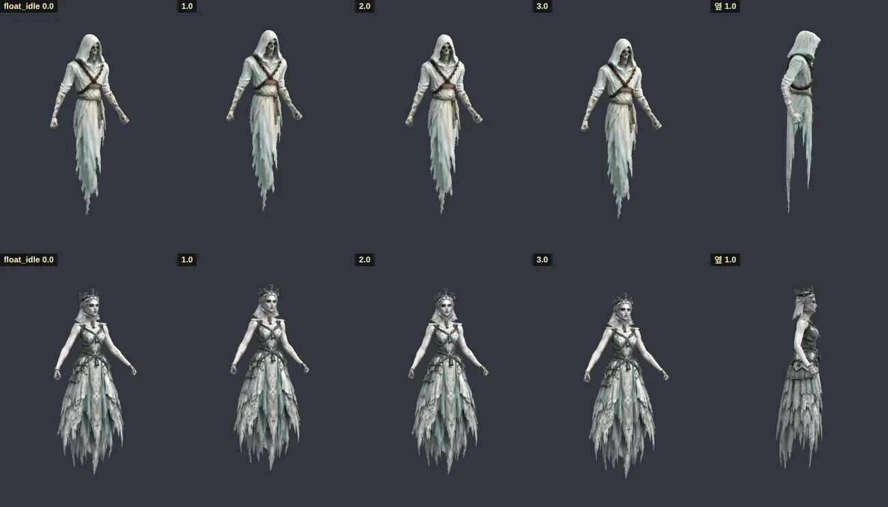

## 5. 박쥐 — 사람 꼴이 아닌 것

자동 리깅은 두 발 사람형 전용이다. 박쥐는 **작은 도구 하나로 뼈대와 날갯짓을 써 넣었다**: `tools/v2/castenemy_bat_rig.mjs`.

- **그림:** 정면, 몸을 세우고 날개를 좌우로 활짝 편 "표본" 자세 — 날개막이 카메라를 봐야 모델이 막을 만든다.
- **뼈 5개:** `Hips`(몸통) → `wingL1`(어깨) → `wingL2`(손목), 오른쪽도 같다. 가중치는 |x| 로만 정한다(몸통 → 안쪽 날개 → 바깥 날개를 부드럽게 섞음). 어깨 자리는 메시의 두께(z)가 가운데의 35% 아래로 떨어지는 곳으로 스스로 찾는다.
- **클립 `fly` 0.4초:** 날개 뼈를 몸의 긴 축(Y)으로 ±48° 돌리고 바깥 날개가 늦게 따라온다. 몸통은 내려칠 때 등 쪽으로 밀린다.
- **지금 런타임이 그대로 튼다.** `Rig` · `clipFromAnim` · `Animator` · 스킨 셰이더는 뼈 이름을 가리지 않는다. 다만 `buildClips` 가 이름에 run 이 든 클립만 집어 가므로 **같은 내용의 `run` 을 하나 더 넣었다** — 고치지 않은 원래 뷰어(`char3d_view.html`)의 「★ run」 단추로도 날갯짓이 나온다(아래 둘째 그림).
- **게임이 할 일:** 모델은 몸을 세운 채(얼굴 +Z)다. 날릴 때 **모델을 앞으로 40–60° 숙이면**(`Rx`) 같은 날갯짓이 위아래 날갯짓이 된다. y 0 은 몸통 아래 끝이므로 나는 높이(1.2–1.8 m)를 더한다. 떼로 나올 때는 박쥐마다 클립 시작 시각을 어긋나게 한다. 4,774 삼각형이라 12마리면 5.7만 — 멀리 있는 것은 날개를 접은 채 그려도 된다.
- 손으로 쓴 사람형 클립(서기 · 맞기 등)은 박쥐에 없는 뼈를 가리키므로 아무 일도 하지 않는다(오류 없음).

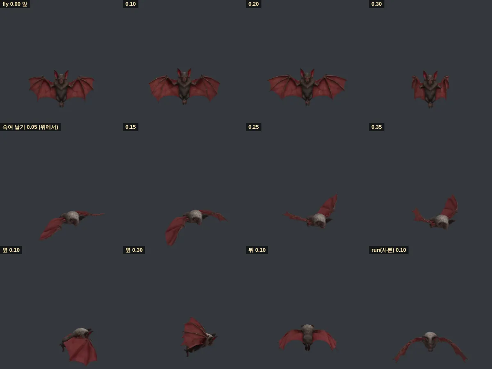
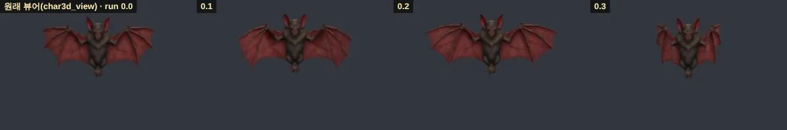

## 6. 보스 — 표준과 상세 비교

같은 그림(밴시 A 안)으로 Tripo H3.1 을 두 번 돌렸다. 미리 물은 값: 표준 9 · 텍스처만 상세 12 · **형태와 텍스처 모두 상세 18**.

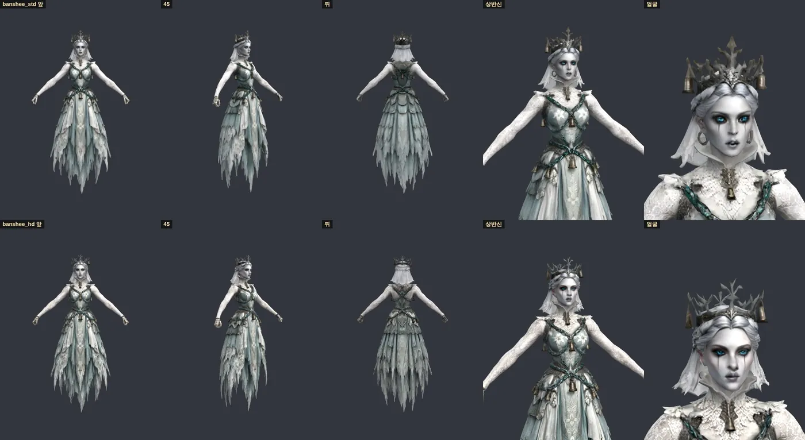

| | 표준 (9) | 상세 (18) — 실음 |
|---|---|---|
| 삼각형 | 27,658 | 26,860 |
| 그림 | 2048² | 4096² (실을 때 2048² 로 줄임) |
| 왕관 | 굵고 뭉툭한 뿔 | 가지가 갈라지고 종이 따로 읽힌다 |
| 얼굴 | 입이 벌어져 조금 멍하다 | 눈매 · 눈물 자국이 또렷하고 입이 다물렸다 |
| 등 | 민무늬 | 레이스 무늬와 사슬이 이어진다 |
| 레이스 소매 | 흰 덩어리 | 무늬가 남는다 |

- **보스 초상화:** 대화 · 등장 연출용 상반신을 같은 디자인 그림을 참고로 한 장 만들었다 — `assets/v2/portraits/banshee_queen.webp` (880×1168, 투명 배경, castpeople 의 인물 초상화와 같은 규격). v1 초상화(`assets/portraits/b_banshee.webp`, 해골 얼굴)는 새 디자인과 맞지 않는다.

→ 얼굴과 왕관은 보스의 인상을 정하는 곳이라 9 크레딧 차이가 아깝지 않다. **보스 · 주요 인물은 상세, 졸개는 표준**으로 정한다. 디자인 그림은 두 안을 만들어 A(아름다운 얼굴 · 가시 왕관의 종)를 골랐고, B(반쪽 해골 얼굴 · 백합 어깨 장식)는 예비로 남겼다(`raw/img_banshee_b.png`, 저장소 밖).

## 7. 정한 규칙

1. **긴 옷 금지, 갈라진 옷자락.** 걷는 캐릭터에 긴 로브 · 치마 · 코트를 입히지 않는다. 술사는 「어깨만 덮는 짧은 망토 + 무릎 길이의 갈라진 자락 넷 + 다리가 보임」으로 그렸고 달리기 · 내딛기에서 천이 늘어나지 않았다. 반대 증거는 유령이다: 긴 수의에 다리 뼈를 움직이면 찢어진다(§4 그림 오른쪽).
2. **떠다니는 것은 다리 없는 자락 + 다리 뼈 묶기** (§4).
3. **넓은 소매 금지** — 팔에서 떨어진 천은 팔과 몸통 사이에 막이 생긴다. 소매는 팔에 붙이고 손목에서 끝낸다.
4. **빈 주먹, 무기는 따로** (§2). 주먹 속으로 자루가 지나가 "쥔 것"처럼 보인다.
5. **화풍 참고 한 장.** 카엘의 A 자세 그림을 모든 사람형 그림의 참고로 넣고 "화풍과 자세만 따르라"고 적는다 — 옷을 베끼지 않았고 빛 · 질감 · 비율의 결이 맞았다.
6. **발이 없는 모델은 방향 도구에 `+x` 를 직접 준다.** `char3d_orient.mjs` 의 자동(발끝 찾기)이 유령에서 거꾸로 골랐다. Tripo 는 늘 +X 를 본다.
7. **삼각형 · 그림:** 졸개 10–12k · 1024², 박쥐 5k · 512², 보스 27k · 2048². 넷 다 정한 상한 안이다(적 ≤ 500 KB, 보스 ≤ 1.6 MB).
8. **키:** 카엘 1.80 기준 — 병사 1.75 < 주검 1.76 < 술사 1.85 < 유령 1.95 < 갑주 2.35 < 여왕 2.70.
9. **적은 "사람과 헷갈리지 않아야" 한다.** 첫 역병 주검은 얼굴이 멀쩡하고 옷이 마을 사람 같아서, 그 밤의 마을에서 마을 사람 모델과 섞이면 구별이 안 됐다 → 수의 두건 · 부푼 배 · 반점 · 긴 팔로 다시 그렸다.

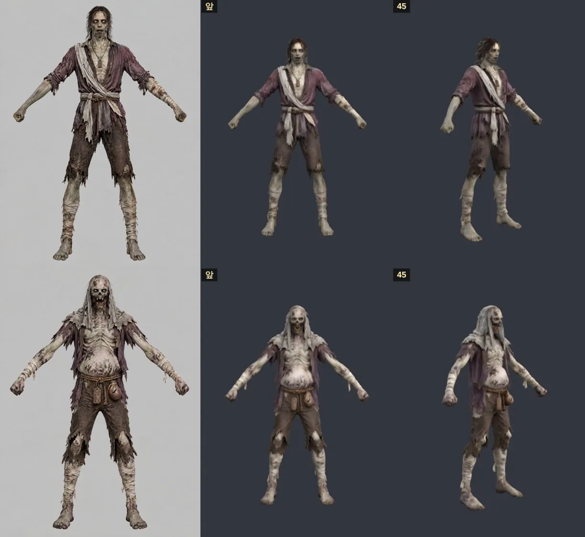

## 8. 값

| 묶음 | 내역 | 크레딧 |
|---|---|---|
| 디자인 그림 | 2k · 중간 품질 1.0 × 9장(밴시 2안, 주검 2판 포함) + 소품 1k 0.5 × 3 + 보스 초상화 0.5 | 11 |
| 모델 (Tripo H3.1 표준 9) | 적 6 + 주검 다시 1 + 보스 표준 1 + 소품 3 | 99 |
| 보스 상세 모델 | 형태 · 텍스처 상세 | 18 |
| 리깅 + 클립 (8) | 적 5 + 주검 다시 1 + 보스 4 | 80 |
| **합계** | | **208** |

- 계정 거래 내역과 맞춰 봤다: 그림 14:26:58–14:27:01 에 1.0 × 8, 14:42:27–29 에 0.5 × 3, 14:55:00 에 1.0; Tripo 14:28:53–14:29:09 에 9 × 6, 14:29:59 에 9, 14:30:02 에 18, 14:45:27–32 에 9 × 3, 14:55:45 에 9; 리깅 14:35:40–45 에 8 × 5, 14:37:28 · 14:41:47–50 에 8 × 4, 15:05:21 에 8 (주검 다시); 초상화 15:06:07 에 0.5. 세 담당의 거래가 같은 계정에 섞여 있어 시각과 작업 번호(결과 주소의 시각)로 가려냈다.
- 버린 것: 밴시 B 안 그림 1, 보스 표준 모델 9(비교용), 역병 주검 첫 판 18(그림 1 + 모델 9 + 리깅 8 — 그 리깅에 끼운 비틀걸음 클립은 계속 쓴다). 실패한 작업은 없다.
- 캐릭터당: 졸개 18(그림 1 + 모델 9 + 리깅 · 클립 8), 박쥐 10, 소품 9.5, 보스 61(그림 2 + 모델 27 + 리깅 · 클립 32).

## 9. 약한 곳 · 시간이 더 있다면

- **흔들리는 것이 없다.** 목도리 · 앞자락 · 사슬 · 종 · 등불 · 면사포가 모두 몸에 붙어 있다. 보스의 종과 사슬은 따로 만들어 뼈에 매달고 흔들림을 계산하면 인상이 크게 달라진다(반나절–하루).
- **빛나는 곳이 그림이다.** 눈의 불씨 · 자수정 · 청록 사슬은 칠해진 색이라 어두운 장면에서 빛나지 않는다 → 눈 · 수정 자리에 작은 빛 조각을 뼈에 붙인다.
- **손.** 전부 주먹 덩어리다. 술사의 "주문 거는 손", 여왕의 "노래하는 손"은 못 한다.
- **뒤.** 그림 한 장에서 지어낸 면이다. 보스는 뒷모습 그림도 넣는 다시점 모델(값 미확인)로 다시 뽑으면 등과 면사포가 디자인대로 나온다.
- **해골 병사의 방패**, 왼손 소품 자리.
- **갑주의 단단한 판이 휜다.** 어깨 보호대를 따로 떼어 뼈에 붙이면 낫다.
- **박쥐 날개막**을 관절 셋(손가락 하나 더)으로, 등 털을 다시.
- **자락 흔들림 · 비침 셰이더** (§4 의 5 · 6) — 값만 적었고 만들지 않았다.
- **실제 기기에서 본 적이 없다.** 모든 그림은 헤드리스 Chromium(소프트웨어 렌더러)에서 찍었다.
- 겹쳐 산 클립 6개 — 담당끼리 구매 목록을 먼저 나눴어야 했다.

## 10. 다시 해 보기

```
# 보기 (적 · 보스용 뷰어: GLB 에 든 클립을 모두 단추로, 키에 맞춘 카메라, 다리 묶기, 소품)
node tools/serve.mjs 8080
  …/tools/v2/castenemy_view.html?glb=../../assets/v2/char3d/banshee_queen.glb&legs=0&clip=Zombie_Scream
  …/castenemy_view.html?glb=../../assets/v2/char3d/skeleton_mage.glb&clips=../../assets/v2/char3d/kael.glb&prop=../../assets/v2/char3d/w_crystal_staff.glb&weapon=1&grip=0,7,3,100,0,0
  …/castenemy_view.html?glb=../../assets/v2/char3d/bat.glb&clip=fly&fit=0.5&pitchm=50
# 찍기 (칸마다 legs · pitchm · fit · lift)
node tools/v2/castenemy_shot.mjs out.png ../../assets/v2/char3d/grave_ghost.glb '[{"yaw":20,"clip":"float_idle","t":1,"legs":0}]' 300 400 4 "legs=0"
# 사람형 한 명 (시범 §9 와 같다)
node tools/v2/char3d_orient.mjs tripo.glb oriented.glb [+x]      # 발이 없으면 +x 를 직접
#   media_upload(.glb) → generate_3d meshy_rigging {model_url, height_meters, enable_animation:true, animation_action_id}
node tools/v2/char3d_pack.mjs rigged.glb assets/v2/char3d/<id>.glb --clips=다른리깅.glb,… --tex=1024
# 박쥐 (사람 꼴이 아닌 것)
node tools/v2/castenemy_bat_rig.mjs bat_oriented.glb bat_rigged.glb --span=0.8 --period=0.4 --amp=48
node tools/v2/char3d_pack.mjs bat_rigged.glb assets/v2/char3d/bat.glb --tex=512
# 떠서 서 있기 클립 굽기
node tools/v2/castenemy_float_clip.mjs rigged.glb float_clip.glb [--regal]     # → char3d_pack 의 --clips 에 넣는다
# 소품
node tools/v2/castenemy_prop_pack.mjs tripo.glb assets/v2/char3d/w_<이름>.glb --len=92 --grip=0.16 --tex=512
# 실은 파일 검사 (브라우저 없이 런타임 그대로: 클립마다 자세 표본, NaN · 가중치 합 · 뼈 이름) — 지금 10개 모두 통과
node tools/v2/castenemy_check.mjs assets/v2/char3d/{skeleton_soldier,skeleton_mage,plague_corpse,grave_ghost,gravekeeper_armor,bat,banshee_queen,w_rusty_sword,w_crystal_staff,w_grave_spade}.glb
```

- 서비스에서 받은 원본(그림 · 정지 모델 · 리깅 모델)은 `/tmp/claude-0/v2/castenemy/raw/`(저장소 밖)와 기록 파일의 `result_url`.
- 이름이 겹치는 것 주의: `tools/v2/cast_view.html` · `cast_shot.mjs` 는 **castpeople 담당의 것**이다(같은 시각에 같은 이름을 골랐다). 이 문서의 도구는 모두 `castenemy_` 로 시작한다.
- 캡처: `/tmp/claude-0/v2/castenemy/` (`tt_*.png` 8방향 · 클립, `sheet/` 소유자 그림 조각, `st_*` 리깅 전 정지 모델).
