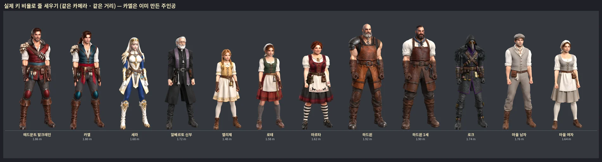
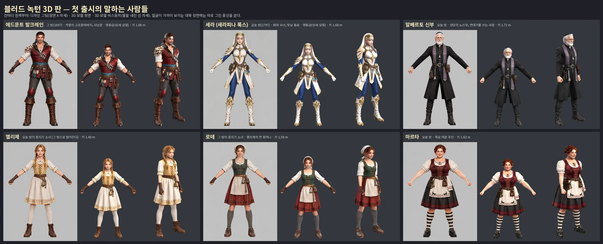
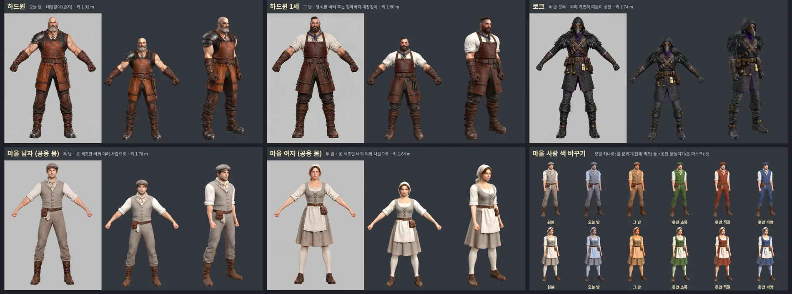
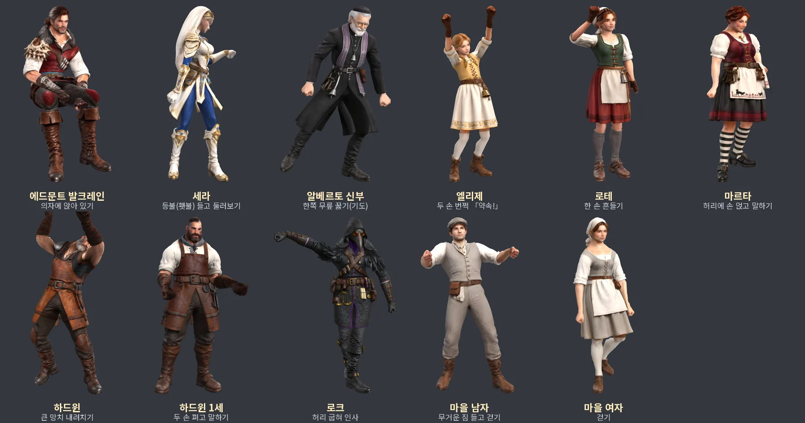
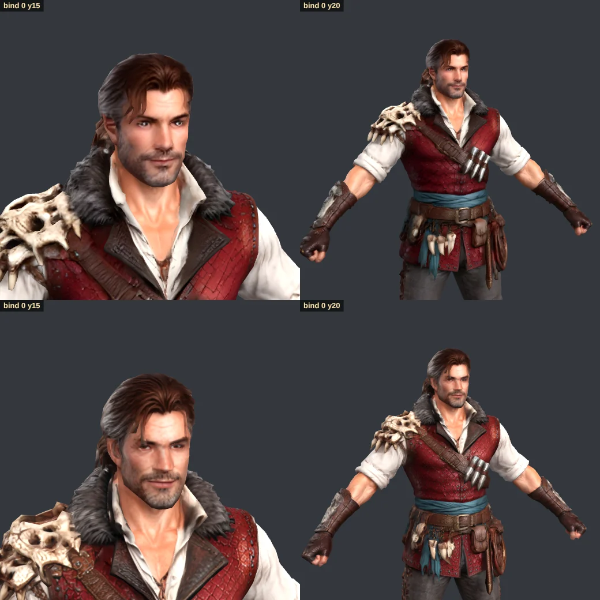
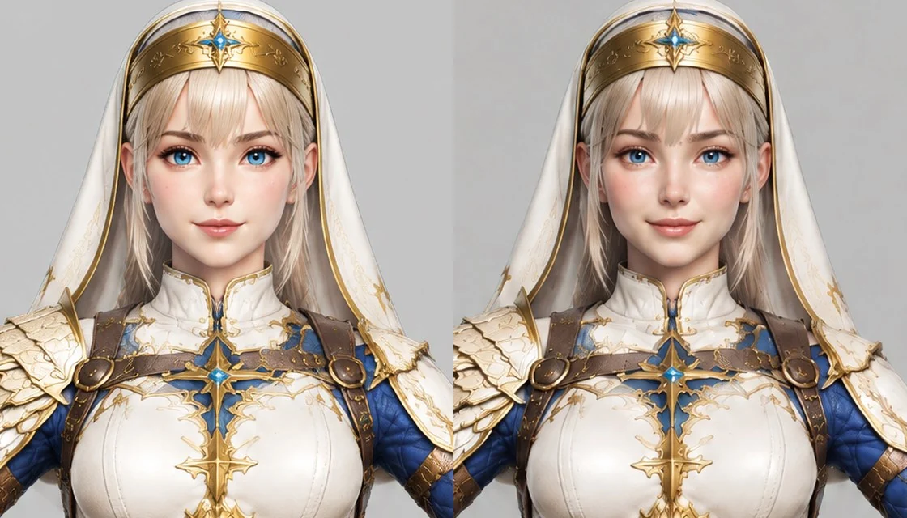
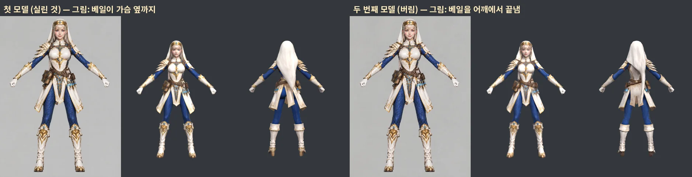
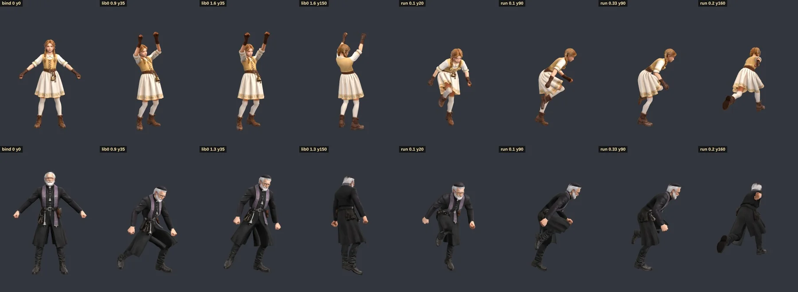
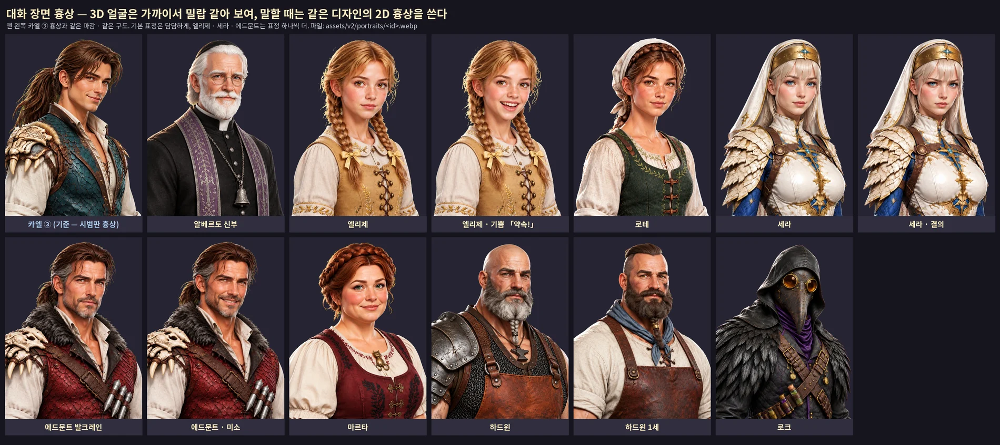

# 첫 출시의 사람들 — 3D 모델과 대화 흉상 (CAST_R1_PEOPLE)

2026-11-17 · 담당 castpeople · 범위 `GDD.md` §9.2 「말하는 3D 인물」 8 + 「마을 사람」 공용 몸 2 (+ 하드윈 1세)
파일 `assets/v2/char3d/<id>.glb` · `assets/v2/portraits/<id>.webp` · 기록 `tools/higgsfield/manifest_castpeople.json` · 도구 `tools/v2/cast_*`
만드는 길은 `CHAR3D_PILOT.md` 그대로다. 적 · 보스는 `CAST_R1_ENEMIES.md`, 공용 움직임은 `ANIM_LIBRARY.md` 가 맡는다.

## 0. 한눈에

- **사람 11명이 모두 진짜 입체 모델이 됐다.** 알베르토 신부 · 엘리제 · 로테 · 세라 · 마르타 · 하드윈 · 하드윈 1세 · 에드문트 발크레인 · 로크 · 마을 남자 · 마을 여자. 모두 뼈 24개 사람형이라 카엘과 같은 클립을 나눠 쓴다.
- **한 게임으로 보인다.** 카엘 ③ 의 A 자세 그림을 "마감 · 빛 · 자세"의 기준으로 넣고 그렸고, 같은 서비스 · 같은 설정으로 모델을 뽑았다. 아래 줄 세우기는 같은 카메라로 찍은 실제 키 비율이다.
- **말하는 아홉 명에게 흉상 12장**(기본 표정 9 + 엘리제 기쁨 · 세라 결의 · 에드문트 미소). 카엘 ③ 흉상과 같은 구도 · 같은 마감.
- **모델 13개를 뽑아 11개를 실었다.** 얼굴과 옷은 그림 단계에서 걸렀다(세라의 얼굴만 두 번 고쳐 그림: 인형 같음 → 너무 나이 듦 → 채택). 싣지 않은 둘은 표준/상세 비교용 하나와, 세라의 등 뒤 베일을 고치려던 재시도 하나다 — **재시도는 실패했다** (§3).
- **치마와 긴 옷은 규칙을 정해 통과했다** (§4): 치마는 무릎 길이 종 모양, 긴 겉옷은 앞을 터서 종아리까지.
- **쓴 크레딧 243.25 / 상한 300.** 계정 거래 내역 54건과 하나씩 맞춰 확인했다 (§10).
- **실은 크기:** 모델 11개 약 6.0 MB(영웅급 둘 0.83 · 0.85 MB, 나머지 0.49–0.58 MB, 마을 사람 0.38–0.39 MB) + 흉상 12장 2.4 MB.
- **약한 곳도 분명하다** (§8): 세라의 등 뒤 베일이 길게 나왔고, 3D 얼굴은 가까이서 밀랍 같고, 손가락 · 표정 · 흔들리는 머리카락이 없다. 종 줄 당기기 · 모루질 · 손 모은 기도는 라이브러리에 없어 손으로 써야 한다.







## 1. 누가 어느 밤에, 몇 살로

GDD §5.3 · §9.1 과 `STORY_CANON.md` §2 · §6 에서 읽은 것과 그에 따라 정한 것.

| 사람 | 나오는 밤 | 정한 모습 |
|---|---|---|
| 알베르토 신부 | 오늘 밤(1797) | 일흔다섯쯤으로 **보이는** 노신부. (그 밤의 열다섯 살 알베르토는 11장에야 나온다 — 첫 출시에는 만들지 않았다) |
| 엘리제 | 오늘 밤의 종지기. 그 밤으로 떨어져도 같은 옷 | 열세 살쯤. 로테를 "언니"라 부르므로 로테보다 어리게 |
| 로테 | 그 밤(1697) | 열다섯 살쯤. 엘리제의 먼 할머니 — **호박색 눈을 둘이 같게** 했다. 옷은 백 년 앞선 투박한 손바느질 |
| 세라 | 오늘 밤 | 스물둘쯤. 시범 줄 세우기의 모습(흰색 · 금 · 사파이어)을 정면으로 다시 그림 |
| 마르타 | 오늘 밤 | 마흔다섯쯤. 그 밤의 주막 안주인은 이름이 없으므로 **마을 여자 공용 몸**에 색을 입혀 쓴다 |
| 하드윈 | 오늘 밤 | 쉰쯤의 손자 |
| 하드윈 1세 | 그 밤 | 마흔다섯쯤의 할아버지. **따로 만들었다** — 까닭은 아래 |
| 에드문트 발크레인 | 그 밤 | 마흔둘. 카엘의 고조할아버지, 한창때 |
| 로크 | 두 밤 모두 | 천 년을 산 같은 사람이라 **모델도 옷도 그대로** 쓴다("어디서 뵌 적이 있습죠") |
| 마을 남자 · 여자 | 두 밤 모두 | 무채색 옷의 공용 몸. 밤과 사람의 차이는 색으로 (§6) |

**"백 년을 색조만으로" 물음에 대한 답.** 후보는 하드윈(손자/할아버지)과 로크였다.

- 로크는 설정상 같은 사람이므로 바꿀 것이 없다.
- 하드윈은 GDD 가 "같은 모델로 시작하고 값이 맞으면 따로"라고 했다. **따로 만들었다(17.75 크레딧).** 플레이어는 26–33분에 할아버지에게 열쇠를 맡기고 33–36분에 손자를 만난다 — 3분 사이에 같은 얼굴 · 같은 대머리 · 같은 흉터를 색만 바꿔 다시 보면 "백 년이 3초에 흐른다"는 장면이 싸 보인다. 할아버지는 같은 체형 · 같은 눈매 · 같은 땋은 수염이되 머리숱이 있고 수염이 검고 흉터가 없고, 사슬 조끼 대신 삼베 셔츠를 입었다. 손자에게만 있는 흉터와 쇠 견갑은 "그 뒤 백 년"의 흔적으로 읽힌다.
- 아그네스 수녀와 울프람은 GDD 대로 이 조각에서는 공용 몸을 식탁에 앉혀 쓴다 (만들지 않았다 — §8).

## 2. 캐릭터 표

키는 리깅할 때 준 값이고 GLB 가 이미 그 크기다(카엘 1.80 m). 삼각형은 실린 파일에서 센 값. 크레딧은 그 사람에게 든 것 전부(그림 + 모델 + 리깅·클립 + 흉상).

| 누구 (id) | 밤 | 디자인 | 파일 크기 | 삼각형 | 그림 | 키 | 끼워 산 클립 (번호) | 크레딧 | 약한 곳 |
|---|---|---|---|---|---|---|---|---|---|
| 알베르토 신부 `alberto` | 오늘 밤 | 흰 수염 · 둥근 안경 · 검은 모자, 앞이 트인 종아리 길이 수단, 보라-은 영대, 연대기 책 · 열쇠 · 종 목걸이. 색: 검정 · 흰색 · 은 · 보라 한 줄 | 494 KB | 17,644 | 1024² | 1.72 | 한쪽 무릎 꿇고 일어서기 `Kneel_on_One_Knee_and_Stand` (365) | 17.75 | 안경이 얼굴에 붙은 덩어리다. 영대 자락이 가슴 · 허벅지와 함께 휜다. 손을 모으는 기도 자세는 없다 |
| 엘리제 `elise` | 오늘 밤 | 꿀빛 두 갈래 땋은 머리, 촛불빛 노랑 조끼, 무릎 길이 크림 치마, 종 줄 손바닥 보호대, 허리의 놋종. 색: 크림 · 노랑 · 놋쇠 | 516 KB | 15,714 | 1024² | 1.48 | 두 손 번쩍 환호 `Cheer_with_Both_Hands` (303) — 「약속!」 | 18.25 | 땋은 머리가 몸통에 붙어 흔들리지 않는다. 전력 질주 클립에서는 치마가 접히고 안쪽이 보인다 (걷기 · 환호는 괜찮다) |
| 로테 `lotte` | 그 밤 | 두건 아래 올린 땋은 머리, 짙은 초록 조끼, 적갈색 무릎 치마, 밧줄 허리띠와 백랍 종. 색: 초록 · 적갈 | 502 KB | 15,300 | 1024² | 1.58 | 한 손 흔들기 `Wave_One_Hand` (290) | 18.00 | 머리 색이 그림(밀빛 갈색)보다 붉게 나와 마르타와 비슷하다. 종 줄 당기기 클립이 없다 |
| 세라 `sera` ★ | 오늘 밤 | 흰 베일과 금 머리테, 흰-금 전투 수녀복(앞이 트이고 무릎 위에서 끝나는 자락), 상아빛 뿔 견갑, 사파이어 누비 바지, 금 정강이받이. 색: 흰색 · 금 · 파랑 | 825 KB | 19,638 | 2048² | 1.68 | 횃불(등불) 들고 둘러보기 `Torch_Look_Around` (337) | 47.00 | **등 뒤 베일이 허리 아래까지 길게 나왔다**(그림은 어깨뼈까지 — 뒤는 서비스가 지어낸다). 그림을 고쳐 한 번 더 뽑았지만 같았다(그 19 포함). 3D 얼굴은 다시 조금 인형 같다. 굽 있는 장화 |
| 마르타 `marta` | 오늘 밤 | 땋아 올린 적갈색 머리, 포도주빛 조끼, 숯빛 무릎 치마, 검은 고양이 수 앞치마, 줄무늬 양말, 고양이 브로치. 색: 포도주 · 크림 · 검은 고양이 | 535 KB | 17,100 | 1024² | 1.62 | 허리에 손 얹고 말하기 `Talk_with_Left_Hand_on_Hip` (309) | 17.75 | 어깨 위 고양이 「백작님」이 없다(따로 소품으로 만들어야 한다). 열쇠 꾸러미가 치마와 함께 휜다 |
| 하드윈 `hadwin` | 오늘 밤 | 민머리 · 흉터 · 회색 땋은 수염, 사슬 조끼, 불씨빛 가죽 앞치마(허리 아래 두 갈래), 쇠 견갑. 색: 불씨빛 가죽 · 쇠 | 519 KB | 16,952 | 1024² | 1.92 | 큰 망치 내려치기 `Heavy_Hammer_Swing` (128) | 17.75 | 클립이 전투용 휘두르기라 모루질로는 너무 크다. 쇠 견갑이 팔과 함께 휜다 |
| 하드윈 1세 `hadwin1` | 그 밤 | 뒤로 묶은 짙은 머리 · 검은 땋은 수염, 삼베 셔츠, 바랜 파란 목수건, 검붉은 가죽 앞치마, 큰 열쇠 꾸러미. 색: 검붉은 가죽 · 삼베 · 파랑 | 514 KB | 17,048 | 1024² | 1.90 | 두 손 펴고 말하기 `Talk_with_Hands_Open` (313) | 17.75 | 체형이 손자와 같아 멀리서는 머리 · 셔츠 색으로만 갈린다. 고른 클립이 공용 라이브러리와 겹쳤다 (§5) |
| 에드문트 발크레인 `edmund` ★ | 그 밤 | 카엘과 같은 밤색 머리(관자놀이가 셈) · 짧은 수염 · 눈썹 흉터, **진홍 용비늘 조끼 + 청록 허리띠**(카엘의 색을 뒤집음), 늑대 털 깃, 송곳니 박힌 뼈 견갑, 은 말뚝 띠, 허리의 채찍. 색: 진홍 · 청록 · 뼈 | 845 KB | 19,648 | 2048² | 1.86 | 의자에 앉아 있기 `Chair_Sit_Idle_M` (33) — 식탁 | 36.25 | 허리의 채찍 · 송곳니 장식이 허벅지에 붙어 함께 늘어난다. 3D 의 눈은 밝은 회갈색(흉상은 호박갈색으로 고쳤다). 비교용 표준 모델 9 포함 |
| 로크 `rook` | 두 밤 | 검은 두건, 까마귀 부리 가죽 가면(호박색 유리 눈), 짧은 깃털 어깨망토, 허벅지 길이 누비 겉옷(앞 트임), 보라 목수건, 약병 · 저울 · 주머니. 색: 검정 · 보라 · 놋쇠 | 576 KB | 17,434 | 1024² | 1.74 | 허리 굽혀 인사 `Gentlemans_Bow` (42) | 17.75 | 검은 옷이 밤 배경에 묻힌다 — 게임에서 윤곽 빛을 세게 줘야 한다. 깃털 망토가 팔과 함께 늘어난다 |
| 마을 남자 `villager_m` | 두 밤 | 납작 모자, 삼베 셔츠, 연회색 조끼, 회갈색 바지 — 일부러 무채색 | 384 KB | 11,487 | 1024² | 1.76 | 무거운 짐 들고 걷기 `Carry_Heavy_Object_Walk_inplace` (611) | 17.50 | 얼굴이 하나라 여럿 세우면 쌍둥이다. 옷만 물들이려면 셰이더에 한 줄이 필요하다 (§6) |
| 마을 여자 `villager_f` | 두 밤 | 흰 두건, 삼베 블라우스, 연회색 조끼, 무릎 길이 회갈색 치마, 흰 앞치마 | 389 KB | 11,912 | 1024² | 1.64 | 걷기 `Casual_Walk_inplace` (613) | 17.50 | 위와 같다. 옷 마스크가 앞치마 · 양말의 그늘진 곳에 조금 번진다 |

★ = 영웅급(세라는 뒷날 직접 움직이는 동료, 에드문트는 카엘의 조상): 상세 모델 · 2048² 그림. 나머지 말하는 사람은 1024² 로 실었다 — 게임 카메라와 상반신 거리에서는 2048² 과 구별되지 않았고(얼굴을 화면 가득 당겨야 조금 무르다), 한 사람에 84–172 KB 와 텍스처 메모리의 3/4 을 아낀다. 되돌리려면 §9 의 다시 싸기 한 줄에서 `--tex=2048`.

공통으로 약한 것(`CHAR3D_PILOT.md` §6 그대로): 손가락이 없다(주먹으로 그렸다), 표정이 없다, 머리카락 · 옷자락이 흔들리지 않는다, 뒷모습은 서비스가 지어낸 것이다, 빛이 그림에 구워져 금속이 번쩍이지 않는다.



## 3. 만든 길과 고른 것

1. **디자인 그림** — `gpt_image_2_5` 2k(0.5 크레딧). 카엘 ③ 의 A 자세 그림을 참고로 넣어 "마감 · 빛 · 카메라 · 자세만 따르고 얼굴 · 옷은 베끼지 말라"고 했다. 세라는 시범 줄 세우기의 측면 그림을, 하드윈 1세는 손자의 그림을 참고로 더 넣었다. 프롬프트에는 게임 · 회사 이름이 없다.
2. **모델** — Tripo H3.1. 삼각형 요청: 영웅급 20,000 · 말하는 사람 18,000 · 아이 16,000 · 마을 사람 12,000.
3. **방향 돌리기** — `char3d_orient.mjs` (11개 모두 +X 를 보고 나왔다. 빠짐없이 거쳤고 리깅 실패는 0번).
4. **리깅 + 클립 하나** — `meshy_rigging`, 키를 미터로.
5. **다시 싸기** — `char3d_pack.mjs`.
6. **보기** — 리깅 전에 정지 모델을 6방향으로, 리깅 뒤에 8방향 + 클립 세 장면 + 상반신. 서비스에 올리기 전에 볼 수 있어 나쁜 모델에 리깅 값(8)을 쓰지 않는다.

**표준과 상세 비교 (에드문트).** 같은 그림에서 표준(9)과 상세 — 텍스처 · 지오메트리 둘 다 detailed(18) — 를 뽑았다. 텍스처만 상세(12)는 값만 확인했다.



- 게임 거리에서는 차이가 없다.
- 가까이에서는 상세 쪽이 그림에 더 충실하다: 주름 · 수염의 센 털 · 눈매가 살아 있고 뼈 견갑이 입체로 나온다. 표준은 얼굴이 매끈해 열 살 젊어 보이고 밀랍 같다.
- 실리는 크기는 같다(둘 다 2048² 로 줄여 싣는다). 값은 사람당 +9.
- → **영웅급 둘(세라 · 에드문트)은 상세로**, 나머지는 표준으로 했다.

**세라의 얼굴.** 시범 그림을 그대로 정면으로 옮기니 눈이 크고 인형 같아 다른 사람들과 결이 달랐다. 얼굴만 고쳐 그린 2차는 서른 넘어 보였고, "스물둘, 주름 없이, 눈만 사람 크기로"라고 한 3차를 썼다.



**세라의 등 — 다시 뽑아도 안 됐다.** 첫 모델은 등 뒤 베일이 허리 아래까지 흰 천 한 장으로 나왔다. 그림에서 베일을 턱까지 줄인 4차는 시범 그림의 인상에서 너무 멀어져 버렸고, 어깨 위에 금테 단이 또렷이 얹히게 한 5차로 상세 모델을 한 번 더 뽑았다(18). 결과는 같았다 — 앞은 어깨에서 끝나는데 뒤는 또 허리까지 내려온다. 리깅하지 않고 첫 모델을 그대로 실었다. **정면 그림을 고치는 것으로는 등 뒤를 못 잡는다**는 것이 19 크레딧으로 산 결론이다.



## 4. 치마 · 긴 옷 규칙

첫 치마 캐릭터(엘리제)와 첫 긴 옷 캐릭터(알베르토)를 다른 치마 캐릭터의 모델을 뽑기 **전에** 리깅까지 해서 확인했다. 가장 험한 움직임으로 카엘의 전력 질주 클립을 빌려 틀었다.



| 정한 규칙 | 까닭 |
|---|---|
| **치마는 무릎에서 끝나는 종 모양.** 무릎 아래 두 다리가 떨어져 보이게 그린다 | 자동 리깅이 다리를 찾으려면 다리가 보여야 한다. 치마는 좌우 절반씩 두 허벅지를 따라가는데, 무릎 길이면 걷기 · 환호 · 손 흔들기에서 치마로 읽힌다 |
| **긴 겉옷(수단 · 코트)은 허리 아래 앞을 터서 종아리까지.** 안에 바지와 장화 | 트인 두 자락이 다리마다 하나씩 붙어 코트 자락처럼 움직인다. 무릎을 꿇어도 자연스럽게 벌어졌다 |
| **앞치마는 짧게**(허벅지 중간) 하거나 두 갈래로 갈라 허벅지에 묶는다(대장장이) | 다리 사이를 잇는 넓은 판이 가장 심하게 늘어난다 |
| **치마 입은 사람은 달리지 않는다** — 걷기 · 빠른 걸음까지만 | 전력 질주에서는 든 허벅지가 치마 앞을 주름처럼 밀어 올리고 안쪽 면이 보인다. 찢어져 보이지는 않지만 예쁘지 않다 |
| 발목까지 닫힌 치마 · 로브는 만들지 않는다 | 다리가 안 보여 리깅이 불안하고 다리 사이 천이 늘어난다 (시험하지 않고 피했다) |
| 망토 · 베일은 **어깨뼈 위에서 끝나게, 그리고 뒤 그림 없이는 믿지 않는다** | 세라의 베일은 그림에서 어깨에서 끝나게 고쳐 다시 뽑아도 뒤가 허리까지 나왔다(두 번 가운데 두 번). 정면 그림 한 장으로는 뒤 길이를 정할 수 없다 — 머리에 쓰는 천은 뒤가 길게 나온다고 보고 디자인한다 |

이 규칙으로 엘리제 · 로테 · 마르타 · 마을 여자(치마)와 알베르토 · 로크 · 세라(긴 겉옷) 일곱을 한 번에 통과시켰다.

## 5. 클립

리깅할 때마다 하나씩, 서로 다른 일상 · 이야기 클립을 끼웠다(리깅 5 + 클립 3 = 8). 클립은 각자의 GLB 안에 들어 있고, 사람형이면 누구에게나 틀 수 있다.

| 번호 | 라이브러리 이름 | 든 곳 | 길이 | 쓰임 | 공용 라이브러리(`ANIM_LIBRARY.md`) |
|---|---|---|---|---|---|
| 33 | Chair_Sit_Idle_M | `edmund.glb` | 10.67초 | 식탁에 앉아 있기 | `sit_idle` 로 가져감 |
| 337 | Torch_Look_Around | `sera.glb` | 9.33초 | 등불을 들고 살피기 | `lantern_look` 으로 가져감 |
| 309 | Talk_with_Left_Hand_on_Hip | `marta.glb` | 5.17초 | 말하기(허리에 손) | `talk3` 으로 가져감 |
| 290 | Wave_One_Hand | `lotte.glb` | 4.10초 | 손 흔들기 | `wave` 로 가져감 |
| 42 | Gentlemans_Bow | `rook.glb` | 7.27초 | 허리 굽혀 인사 | `bow` 로 가져감 |
| 613 | Casual_Walk_inplace | `villager_f.glb` | 4.17초 | 느긋한 걸음(제자리) | 아직 안 가져감 — 요청 적음 |
| 611 | Carry_Heavy_Object_Walk_inplace | `villager_m.glb` | 6.50초 | 짐 들고 걷기(제자리) | 같은 움직임의 이동판(551)이 `carry` 로 있음 |
| 365 | Kneel_on_One_Knee_and_Stand | `alberto.glb` | 2.53초 | 무릎 꿇기 | **겹침** — `kneel_down` · `kneel_up` |
| 303 | Cheer_with_Both_Hands | `elise.glb` | 2.93초 | 환호 「약속!」 | **겹침** — `cheer` |
| 128 | Heavy_Hammer_Swing | `hadwin.glb` | 1.83초 | 큰 망치 | **겹침** — `heavy` |
| 313 | Talk_with_Hands_Open | `hadwin1.glb` | 3.97초 | 말하기(두 손) | **겹침** — `talk1` |

**겹친 넷은 버린 값이다(3 × 4 = 12 크레딧).** 세 묶음이 동시에 시작해서 공용 라이브러리의 구매 목록이 아직 없을 때 골랐다. 마지막 하나(313)는 목록이 이미 나와 있었는데 확인하지 않고 골랐다 — 내 실수다. 다음부터는 리깅 전에 `ANIM_LIBRARY.md` §7 「다음에 살 것」에서 고른다.

GLB 에 든 클립은 모두 합쳐 384 KB 다. 공용 라이브러리가 다 가져간 뒤에는 `--noanim` 으로 다시 싸면 그만큼 준다.

**라이브러리에 없어서 손으로 써야 하는 것**(검색어 pray · hammer · pull · kneel 로 찾아봤다):

| 필요한 움직임 | 가장 가까운 것 | 길 |
|---|---|---|
| 종 줄 당기기 (로테 · 엘리제 — 이야기의 핵심 동작) | 없음 (`Pull_Radish` 는 쭈그려 뽑기) | 두 팔을 위에서 아래로 당기는 키 자세 3개짜리 손 클립 |
| 모루질 (하드윈 둘) | `Heavy_Hammer_Swing` — 두 손 전투 휘두르기 | 내려치는 구간만 잘라 느리게 쓰거나, 한 손 손 클립 |
| 손 모아 기도 (알베르토 · 세라) | 무릎 꿇기까지만 | 꿇은 끝 자세에 팔 자세만 덧입힌다 |

## 6. 마을 사람 색 바꾸기

공용 몸 둘은 일부러 삼베 · 연회색 옷으로 만들었다. 색을 바꾸는 길이 둘 있다 (§0 의 셋째 그림 「…(2)」 오른쪽 아래 칸).

1. **전체 색조** — 지금 렌더러가 이미 받는 `tint` (곱하는 색). 오늘 밤 `[0.76, 0.84, 1.0]`(찬 색), 그 밤 `[1.0, 0.80, 0.60]`(촛불빛)처럼 **밤의 분위기**를 바꾸는 데 쓴다. 살빛도 함께 물들기 때문에 초록 · 빨강 같은 옷 색에는 쓸 수 없다(해 봤다 — 얼굴이 초록이 된다).
2. **옷만 물들이기** — `assets/v2/char3d/villager_m_cloth.webp` · `villager_f_cloth.webp` (512², 19 · 25 KB, 흰색 = 조끼 · 바지 · 치마). 텍스처에서 채도가 낮고 중간 밝기인 곳을 옷으로 본 마스크다. 셰이더에서 `rgb = tex.rgb * mix(vec3(1.0), tint, mask)` 한 줄이면 살 · 머리 · 가죽 · 흰 셔츠는 그대로 두고 옷 색만 바뀐다. **이 한 줄은 아직 렌더러에 없다**(요청 적음). 그림 속 초록 · 적갈 · 파랑은 같은 식을 미리 텍스처에 구워 본 미리보기다.

만드는 도구: `python3 tools/v2/cast_clothmask.py <glb> <mask.webp> [--demo out.glb r,g,b]`.

남는 약점: 얼굴과 체형은 하나뿐이다. 마을에 다섯 명을 세우면 같은 얼굴 다섯이다 — 모자 · 두건 색까지 바꾸고 멀리 세우는 것으로 버티거나, 얼굴이 다른 몸을 한두 벌 더 만든다(한 벌 17.5).

## 7. 대화 흉상

3D 얼굴은 가까이 당기면 밀랍 같고 표정이 없다. 그래서 대화 창에는 같은 디자인의 2D 흉상을 쓴다. 모두 880×1168, 투명 배경 WebP, 같은 구도(머리 · 어깨 · 가슴, 3/4 방향, 눈은 정면).



| 파일 (`assets/v2/portraits/`) | 누구 · 표정 | 크기 |
|---|---|---|
| `alberto.webp` | 알베르토 신부 · 담담 | 218 KB |
| `elise.webp` | 엘리제 · 담담 | 184 KB |
| `elise__joy.webp` | 엘리제 · 기쁨 「약속!」 | 182 KB |
| `lotte.webp` | 로테 · 담담 | 178 KB |
| `sera.webp` | 세라 · 담담 | 203 KB |
| `sera__resolve.webp` | 세라 · 결의 | 187 KB |
| `marta.webp` | 마르타 · 담담 | 201 KB |
| `hadwin.webp` | 하드윈 · 담담 | 211 KB |
| `hadwin1.webp` | 하드윈 1세 · 담담 | 209 KB |
| `edmund.webp` | 에드문트 · 담담 | 203 KB |
| `edmund__smile.webp` | 에드문트 · 미소 | 194 KB |
| `rook.webp` | 로크 (가면) | 218 KB |

- 만든 법: 디자인 그림 + 카엘 ③ 흉상(구도 · 마감의 기준)을 참고로 한 장씩(0.25). 표정과 눈 색은 **기본 흉상을 고쳐 그려서** 얼굴이 달라지지 않게 했다.
- 고친 것: 엘리제 · 로테의 눈이 초록으로, 에드문트의 눈이 회색으로 나와 호박색 · 호박갈색으로 고쳤다(각 0.25).
- 오려 내기: `tools/higgsfield/key_green.py` 뒤에 가장자리 띠만 한 번 더 뺐다(머리카락 사이로 비친 녹색). 엘리제의 잔머리 끝에 아주 옅은 올리브 기운이 남아 있다.
- "담담"이라고 했지만 그림 모델이 입꼬리를 조금씩 올렸다. 화난 · 놀란 표정은 만들지 않았다(v1 은 인물마다 세 장이었다).
- 마을 사람 둘은 이름 없는 사람이라 흉상이 없다.

## 8. 약한 곳 · 다시 한다면

| 무엇 | 지금 | 다시 한다면 |
|---|---|---|
| 세라의 등 뒤 베일 | 허리 아래까지 흰 천 한 장 — 뒤에서 보면 밋밋하고 디자인과 다르다 | 정면 그림을 고쳐 다시 뽑는 길은 해 봤고 소용없었다(§3). 남은 길: 뒷모습 그림을 한 장 더 넣는 여러 시점 모델(이 묶음에 허락된 모델이 아니어서 값도 보지 않았다), 아니면 베일 대신 머리테 + 땋은 머리로 디자인을 바꾼다(소유자가 고른 모습이 달라지므로 물어야 한다) |
| 세라 · 에드문트의 3D 얼굴 | 게임 거리에서는 호감형. 당기면 세라는 인형, 에드문트는 눈 색이 다르다 | 대화는 흉상으로 가린다. 컷 장면에서 얼굴을 당기지 않는다 |
| 클립 겹침 | 12 크레딧을 겹치는 클립에 썼다 | 리깅 전에 공용 목록을 본다 |
| 하드윈의 모루질 · 종 줄 · 기도 | 라이브러리에 없다 | 손 클립 셋 (§5) |
| 마르타의 고양이 | 없다. 흉상에도 넣지 않았다(모델과 맞추려고) | 고양이를 작은 소품 모델로 만들어 어깨 뼈에 붙이고 흉상에도 넣는다 |
| 아그네스 · 울프람 | 만들지 않았다. GDD 는 공용 몸을 앉혀 쓰라고 했지만 수녀복 · 총잡이 차림이 아니어서 식탁 장면이 어색할 것이다 | 값이 맞으면 따로(각 17.5). 남은 상한 56.75 로 둘 다 된다 |
| 마을 사람의 얼굴 | 남 1 · 여 1 | 한두 벌 더 |
| 로크 | 검은 옷이 어두운 배경에 묻힌다 | 게임에서 윤곽 빛, 아니면 보라 면적을 늘린 그림으로 다시 |
| 로테의 머리 색 | 3D 에서 마르타처럼 붉다 | 그림에서 "ash-blonde"로 못 박아 다시 — 급하지 않다(두 사람은 다른 밤에 나온다) |
| 용량 | 모델 6.0 MB + 흉상 2.4 MB. `CHAR3D_PILOT.md` §7 의 APK 여유(약 3.8 MB)를 넘는다 | 흉상을 660×876 으로(약 −1 MB), 클립을 빼고 다시 싸기(−0.38 MB), 정점 위치를 16비트로(런타임 쪽 일). 그래도 모자라면 v2 를 따로 받는 묶음으로 |
| 텍스처 메모리 | 1024² 는 밉맵까지 5.6 MB, 2048² 는 22 MB | 마을 장면에 영웅급 둘이 함께 서면 `maxTex: 1024` 로 내려 받게 |

## 9. 다시 해 보기

```
# 보기 (정지 모델도, 든 클립도 다 본다)
node tools/serve.mjs 8080 → http://localhost:8080/tools/v2/cast_view.html?glb=../../assets/v2/char3d/marta.glb&clip=lib0
#   &clip=bind(A 자세) | stand(팔 내린 선 자세) | lib0(든 클립) | idle …   &tint=1,0.8,0.6   &zoom=body|upper|face
# 찍기: 8방향 + 클립
node tools/v2/cast_shot.mjs out.png ../../assets/v2/char3d/elise.glb '[{"yaw":0},{"yaw":45},{"yaw":30,"clip":"lib0","t":1.5}]' 300 440 4
# 리깅 전 정지 모델 확인 (저장소 밖 파일은 --extra 로)
node tools/v2/cast_shot.mjs out.png /__x/x_oriented.glb '[{"yaw":0},{"yaw":90},{"yaw":180},{"yaw":20,"zoom":"face"}]' 300 440 4 --extra=/tmp/claude-0/v2/castpeople/raw
# 다시 싸기 (받은 리깅 파일에서)
node tools/v2/char3d_pack.mjs <rigged.glb> assets/v2/char3d/<id>.glb --tex=1024            # 영웅급: --tex=2048 --q=74(세라) / 76(에드문트)
# 옷 마스크
python3 tools/v2/cast_clothmask.py assets/v2/char3d/villager_f.glb assets/v2/char3d/villager_f_cloth.webp
```

- 디자인 그림 원본(1120×1500): `docs/v2/img/cast_design_<id>.webp` — 다시 뽑을 때 이 그림을 올려 쓴다.
- 받은 원본 모델 · 리깅 파일: `/tmp/claude-0/v2/castpeople/raw/` (저장소 밖)와 기록 파일의 `result_url`.
- 헤드리스 렌더는 기계가 바쁠 때 가끔 흰 칸을 낸다(GL 컨텍스트를 잃음). 다시 찍으면 된다.

추가한 도구 (기존 파일은 고치지 않았다):

| 파일 | 하는 일 |
|---|---|
| `tools/v2/cast_view.html` | `char3d_view.html` 의 사본 + 정지 모델 그리기 · 든 클립 전부(`lib0`…) · `bind` · `stand` · `tint` · `scale` |
| `tools/v2/cast_shot.mjs` | `char3d_shot.mjs` 의 사본, 위 뷰어를 쓴다. 장면마다 `tint` |
| `tools/v2/cast_clothmask.py` | 공용 몸의 옷 마스크 + 물들인 미리보기 GLB |

## 10. 값

| | 건 | 크레딧 |
|---|---|---|
| 디자인 그림 (2k) — 11명 + 세라 얼굴 고침 2 + 세라 베일 고침 2 | 15 | 7.5 |
| 흉상 (1k) — 기본 9 · 표정 3 · 눈 색 고침 3 | 15 | 3.75 |
| 모델 표준 (9) — 9명 + 에드문트 비교용 1 | 10 | 90 |
| 모델 상세 (18) — 세라 · 에드문트 + 세라 재시도 | 3 | 54 |
| 리깅 + 클립 (8) | 11 | 88 |
| **합계** | **54** | **243.25** (상한 300) |

- 쓰고도 싣지 않은 것 9건 · 29.75 크레딧: 세라 그림 1 · 2 · 4 · 5차(2.0), 세라 재시도 모델(18.0 — 실패), 에드문트 표준 모델(9.0 — 시킨 비교), 눈 색이 틀린 흉상 3장(0.75). 겹친 클립 12 를 더하면 헛돈은 41.75 로 전체의 17% 다.
- 한 사람 값: 말하는 사람 17.75(그림 0.5 + 모델 9 + 리깅 8 + 흉상 0.25), 영웅급 26.75 부터, 마을 사람 17.5.
- **계정과 맞춰 본 것:** 15:12 UTC 에 계정 거래 내역 160건을 받아, 내 작업 51건을 결과 주소의 시각과 금액으로 하나씩 맞췄다(거래 내역에는 작업 번호가 없다). 15:27 에 그 뒤의 3건(세라 재시도)도 같은 방법으로 맞췄다. 54건 모두 있고 합이 243.25 로 같다. 환불 · 실패는 없다. 같은 시간대의 다른 거래는 다른 묶음의 것이다.
