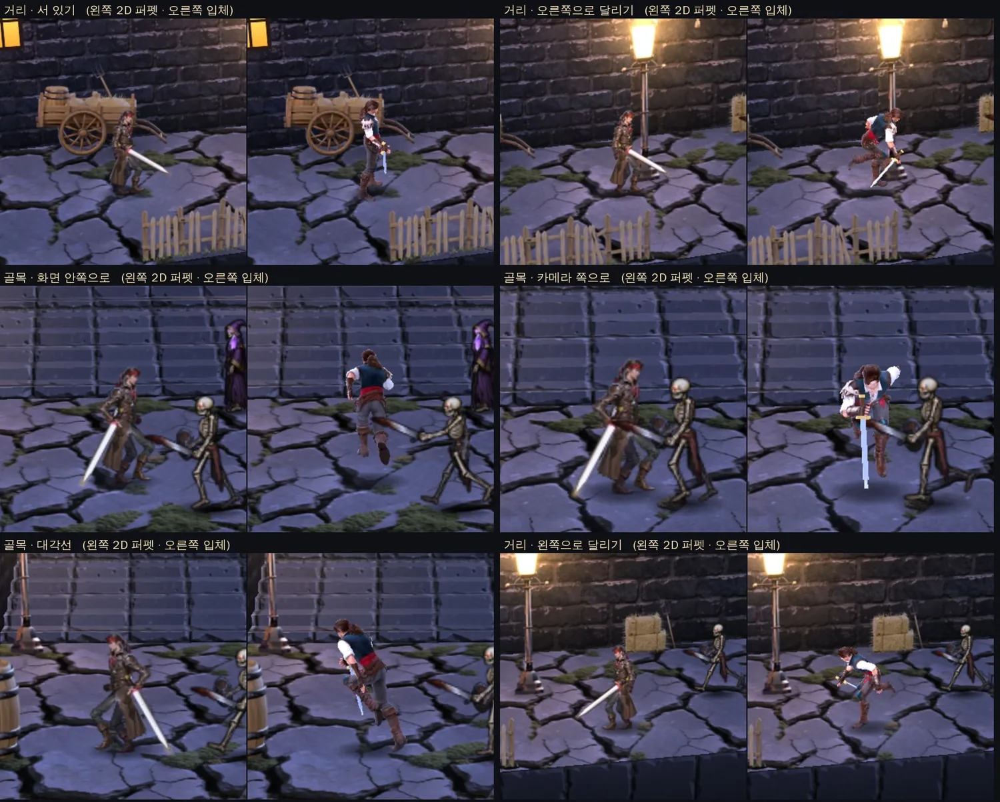
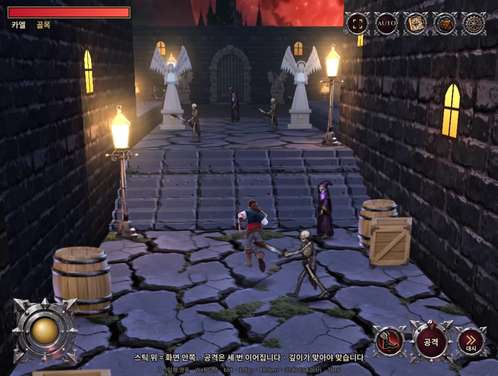
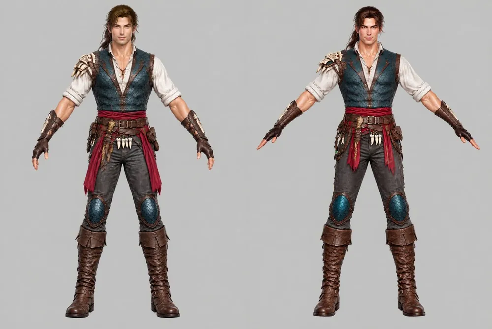
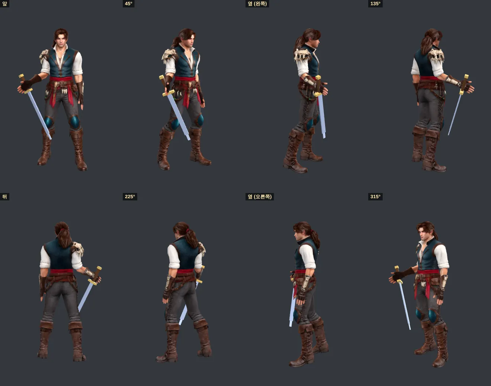
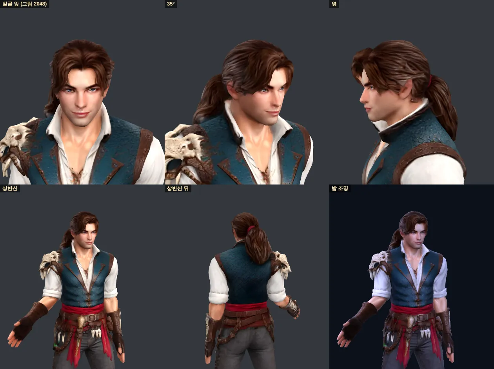
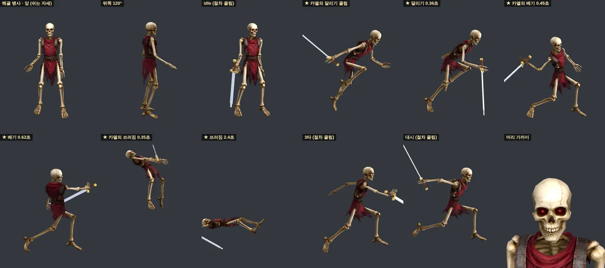
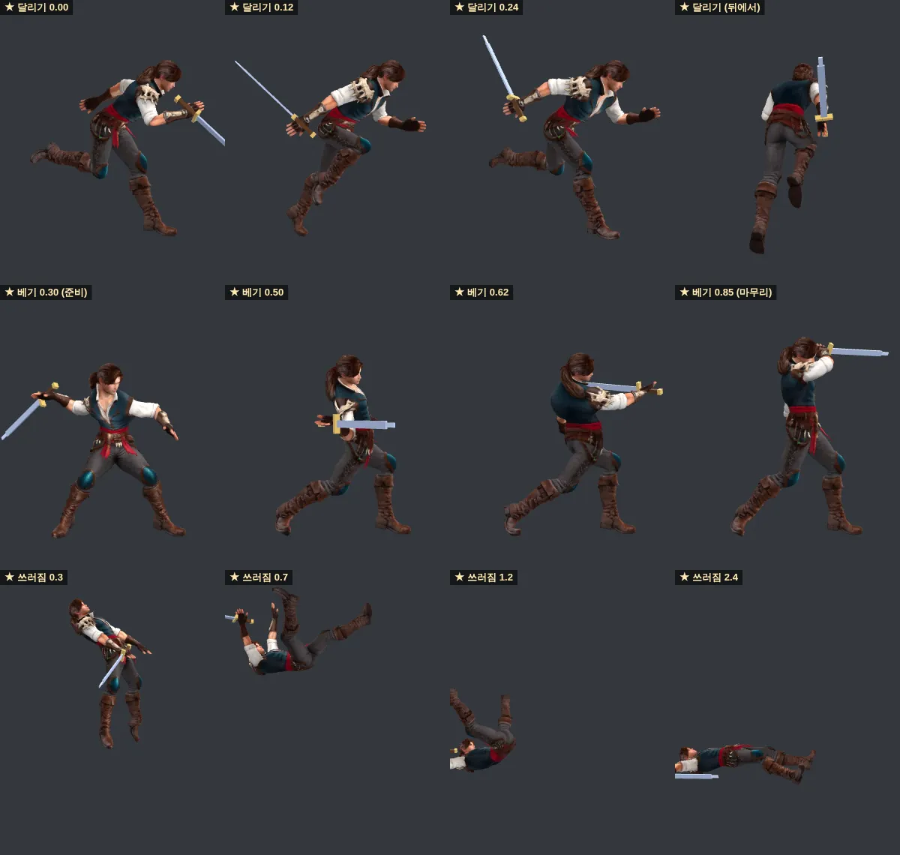
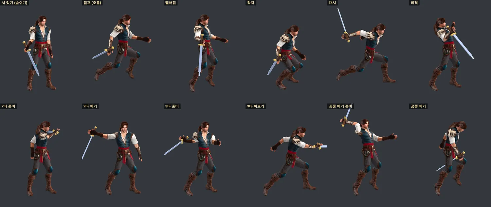
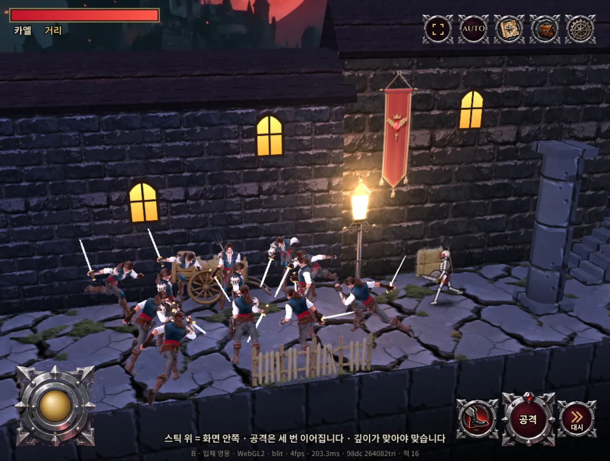

# CHAR3D 시범 — 디자인 그림을 "진짜 입체 캐릭터"로

2026-11-17 · 담당 char3d · 코드 `src/v2/char3d/` · 도구 `tools/v2/char3d_*.mjs` · 보기 `tools/v2/char3d_view.html` · 기록 `tools/higgsfield/manifest_char3d.json`

소유자 의견: *"종횡 입체로 됐는데 캐릭터만 2d 그대로니까 너무 이질감이 느껴져"* → 이 문서는 **그림 한 장에서 시작해 달리고 뛰고 싸우는 입체 카엘을 시범판 B 안에 넣는 길**이 되는지, 얼마가 드는지, 무엇이 안 되는지를 실제로 해 본 기록이다.

## 0. 한눈에

- **된다.** 카엘 ③ 「바람길 추적자」가 시범판 B(`index.html?scene=v2b`)에서 입체 모델로 돈다. 움직이는 방향을 360° 로 바라보고(화면 안쪽으로 달리면 등이, 카메라 쪽으로 오면 얼굴이 보인다), 서기·달리기·점프·착지·대시·3연타·공중 베기·피격·쓰러짐을 놀이 상태 그대로 재생한다. 기본이 입체이고 `?hero=2d` 를 붙이면 예전 납작한 퍼펫으로 돌아간다.
- **가장 싼 길로 충분했다.** 앞모습 A 자세 그림 1장(0.5 크레딧) → Tripo H3.1 표준(9) → 자동 리깅(5, 클립 1개 끼우면 8). 더 비싼 모델(Meshy 7 = 38)은 쓰지 않았다.
- **클립은 한 번 사면 사람형 모두가 쓴다.** 카엘에게 산 달리기·베기·쓰러짐을 따로 만든 해골 병사에 **실제로** 틀어 확인했다 (§3).
- **쓴 크레딧 56.25 / 상한 60.** 그 가운데 8은 실수(모델 방향)로 버렸다 — 원인과 막는 도구를 §2 에 적었다.
- **싣는 파일은 작다.** 카엘 808 KB(삼각형 19,578 · 뼈 24 · 그림 2048² WebP · 클립 3개), 해골 병사 416 KB.
- **안 되는 것도 분명하다**: 가까이서 본 얼굴, 손가락, 머리카락·천의 흔들림, 채찍, 사람 아닌 괴물, 그리고 **적이 아직 2D 라 이질감이 영웅에서 적으로 옮겨 갔다** (§6).





## 1. 해 본 순서

| 단계 | 한 일 | 결과 |
|---|---|---|
| 1 원본 그림 | 고른 디자인(③ 3/4 앞모습)을 참고로 `gpt_image_2_5` 에 **정면 · A 자세 · 빈손 · 고른 빛 · 회색 바탕**을 요청, 2장 | 둘 다 쓸 만함. 팔이 몸에서 더 떨어지고 다리 사이가 벌어진 오른쪽을 골랐다 |
| 2 모델 | Tripo H3.1 (`face_limit` 20000, 텍스처 표준, PBR 끔) 9 크레딧, 약 2분 | 삼각형 19,578 · 텍스처 2048² 한 장. 8방향에서 보고 합격 (§2) |
| 3 리깅 | `meshy_rigging` (키 1.8 m) + 라이브러리 클립 | 뼈 24개 사람형. **첫 시도 실패**(§2), 방향을 돌려 다시 해서 성공 |
| 4 클립 | 달리기 `RunFast`(16) · 한 손 베기 `Right_Hand_Sword_Slash`(219) · 쓰러짐 `Knock_Down`(187) 을 사고, 나머지 10개는 손으로 씀 | §3 |
| 5 런타임 | `src/v2/char3d/` 5파일 약 830줄 (라이브러리 없음) + 뷰어 | §4 |
| 6 다시 싸기 | `tools/v2/char3d_pack.mjs` | 2.19 MB → 808 KB (§5) |
| 7 시범판 B 에 넣기 | `src/v2/b/index.js` 에 약 70줄 | 영웅만 입체, 적·2D 경로 그대로 |



## 2. 모델 판정 — 가장 싼 길(Tripo H3.1 표준)





| 항목 | 판정 |
|---|---|
| 게임 크기(화면에서 키 약 100 px) | **좋다.** 옷 색(청록 조끼 · 흰 셔츠 · 진홍 허리띠)이 뚜렷하고 어느 방향에서도 카엘로 읽힌다 |
| 얼굴 | 게임 크기에서는 충분히 호감형. **가까이 당기면** 피부가 밀랍 같고 그림의 하이라이트가 굳어 있다. 눈 색이 호박색이 아니라 파랗게 나왔다(원본 그림에서 이미 그랬다). 표정은 못 바꾼다(얼굴 뼈 없음) |
| 뒤 · 옆 | 뒤는 그림 한 장에서 **지어낸 것**이다. 자연스럽게 나왔지만(등, 묶은 머리, 붉은 끈) 디자인 의도와 다를 수 있다 → 중요한 캐릭터는 뒷모습 그림도 넣는 다시점 모델을 쓴다 (값 미확인) |
| 손 | 손가락이 붙은 벙어리장갑 모양. 손가락 뼈도 없다 → 무기를 "쥔" 것처럼 보이지 않고 손바닥에 붙어 보인다 |
| 머리카락 | 덩어리로는 좋다. 묶은 머리가 머리뼈에 붙어 있어 흔들리지 않는다 |
| 텍스처 | 깨끗하다. 조각난 UV 라 손으로 고치기는 어렵다. 빛이 그림에 구워져 있어(요청한 대로 고른 빛) 금속이 번쩍이지 않는다 |
| 삼각형 | 19,578 (요청 20,000). 적은 10,000 으로 충분했다 (해골 병사 9,731) |

**더 비싼 길은 쓰지 않았다.** 게임 거리에서 모자람이 없었고, 남은 크레딧은 "클립을 나눠 쓸 수 있는가"를 실제로 확인하는 데 썼다. 값만 확인해 둔 것: Tripo 텍스처 '상세' 12, Meshy 7 텍스처 38.

**실패 한 번 (8 크레딧).** Tripo 는 캐릭터가 **+X 를 보는** 모델을 준다(팔이 Z 축). 리깅 서비스는 **+Z 를 본다고 가정**한다. 그대로 넣었더니 옆모습을 앞으로 알고 뼈를 박아 좌우가 뒤섞였다(다리 뼈가 앞뒤로, 팔 길이 좌우 12 cm / 30 cm). → `tools/v2/char3d_orient.mjs` 가 발끝이 뻗은 쪽을 앞으로 보고 +Z · 발 높이 0 으로 돌려 놓는다. **리깅 전에 반드시 이 도구를 거친다.** 돌린 뒤에는 좌우 대칭으로 깨끗이 박혔다.

## 3. 뼈대와 클립

- 뼈 24개: `Hips → Spine02 → Spine01 → Spine → neck → Head(+head_end, headfront)`, 좌우 `Shoulder → Arm → ForeArm → Hand`, `UpLeg → Leg → Foot → ToeBase`. **손가락 · 얼굴 · 머리카락 · 옷 뼈는 없다.** 척추 번호가 거꾸로(Spine02 가 맨 아래)라 코드에서 골반에서 가까운 순서로 다시 이름 붙인다.
- 쉬는 자세 = A 자세. 뼈 단위는 cm(`Armature` 노드가 0.01 배). GLB 의 노드 값이 곧 바인드 자세다(쉬는 자세로 그리면 뼈 행렬이 단위 행렬 — 확인함).
- **리깅은 할 때마다 조금씩 다르다**(같은 모델인데 팔 뼈 길이 16.51 / 16.51 / 16.22, 가중치도 다름). 그래서 클립을 "뼈 로컬 회전" 그대로 옮기면 어긋난다.

### 클립을 나눠 쓰는 법 (핵심)

클립을 **뼈 이름 → "쉬는 자세에서 캐릭터 축으로 얼마나 돌았나"** 로 바꿔 들고 있는다(`skel.js` 의 정규 클립). 트는 쪽 뼈대의 쉬는 자세에 다시 입히므로 뼈의 로컬 축이나 길이가 달라도 된다.

**실제로 확인했다.** v1 해골 병사를 같은 길로 따로 만들어(그림 0.25 + Tripo 9 + 리깅만 5 = 14.25 크레딧) 카엘에게 산 클립 3개와 손으로 쓴 클립을 틀었다. 발이 꼬이거나 팔이 뒤집히지 않았다.



→ **사람형 캐릭터는 리깅(5)만 하면 되고, 클립 값은 한 번만 낸다.** 클립은 리깅과 한 묶음으로만 살 수 있어 한 개에 8(리깅 5 + 클립 3)이다. 새 캐릭터를 리깅할 때 새 클립을 하나 끼우면 **+3 에 클립 하나**를 얻는 셈이다.

### 산 클립 3개 (★)



- 달리기: 0.47초 순환, 몸을 깊이 숙인 전력 질주. 제자리 클립이라 그대로 쓴다. 속도에 맞춰 재생 속도를 바꾼다.
- 베기: 1.5초짜리(준비 0.45 → 베기 0.45–0.66 → 마무리). 놀이의 1타는 0.26초라 **베는 구간을 판정 구간에 맞춰 시간을 접어** 쓴다(`hero3d.js ATK1`).
- 쓰러짐: 공중으로 떠올랐다 등으로 떨어지는 2.5초. 영웅이 쓰러질 때 쓴다(다시 시작까지 1.7초라 1.35배속).

### 손으로 쓴 클립 10개



서 있기(숨쉬기) · 점프 · 떨어짐 · 착지 · 대시 · 피격 · 2타(가로 베기) · 3타(찌르기) · 공중 베기 · 쓰러짐(예비). 키 자세 몇 개를 부드럽게 잇는 방식이고 `clips.js` 에 각도 표로 들어 있다(크레딧 0).

**솔직한 비교:** 자세 하나하나는 읽히지만 산 클립 옆에 두면 **뻣뻣하다**. 무게 이동 · 반동 · 손목 · 어깨가 따라오는 움직임이 없고, 2타 준비 자세는 팔이 어색하게 꺾인다. 대시 · 점프 · 착지 · 피격처럼 0.2초 안에 지나가는 것은 이대로 써도 되고, **공격과 서 있기처럼 오래 · 자주 보는 것은 사는 편이 낫다**.

## 4. 런타임 (`src/v2/char3d/`, 라이브러리 없음)

| 파일 | 줄 | 내용 |
|---|---|---|
| `glb.js` | 138 | GLB 읽기: JSON+BIN, 접근자(보폭 · 정규화 정수), 스킨, 노드, 애니메이션, 든 그림(PNG/JPEG/WebP → `createImageBitmap`). node 에서도 돈다 |
| `skel.js` | 253 | 뼈대(`Rig`), 정규 자세 · 클립 변환, 표본 뽑기, 두 클립 섞기(cross-fade, `Animator`) |
| `clips.js` | 95 | 손으로 쓴 클립 + 모델에 든 클립을 이름으로 찾아 묶기 |
| `render.js` | 219 | 스킨 셰이더(WebGL1/2 공용 GLSL ES 1.00), 뼈 행렬 = vec4 3개씩 uniform 배열, 텍스처 × (주변빛 + 달빛) + 테두리 빛 + 장면 안개, 번쩍임 · 잔상(더하기) |
| `hero3d.js` | 123 | 캐릭터 한 명 묶기, 세계 행렬, 손 뼈에 무기 붙이기, 놀이 상태 → 방향 · 클립(`driveHero`) |
| `tools/v2/char3d_view.html` | | 따로 여는 보기 화면: 드래그로 돌리기, 클립 단추(★ = 산 클립), 전신/상반신/얼굴, 밤 조명, `?glb=` `?clips=`(다른 캐릭터의 클립 빌려 틀기) |

시범판 B 와 붙는 자리 (`src/v2/b/index.js`):

- 세계 메시를 그린 **다음**, 반투명 빌보드 **앞**에 입체 영웅을 그린다 → 깊이 버퍼가 기둥 · 벽 · 적과의 가림을 그대로 푼다. 발밑 그림자는 있던 것을 그대로 쓴다.
- 빛: 영웅 자리의 `lightAt`(가로등 색 포함)을 곱하고, 장면의 달빛 방향 · 안개 값을 그대로 넘긴다.
- 방향: 속도 방향으로 부드럽게 돈다. **공격 판정이 아직 좌우로만 나므로 공격하는 동안은 좌우를 본다** — 놀이 규칙(`sim.js`)을 방향 기반으로 바꾸면 한 줄만 고치면 된다 (요청 적음).
- 무기: 시범용 상자 검을 오른손 뼈에 붙였다. 2D 퍼펫의 베기 호 대신 날이 지나간 자리를 잇는 옅은 빛 띠를 그린다(아직 약하다).
- GL 컨텍스트를 잃었다 되찾으면 자기 자원도 다시 만든다. 장면을 나가면 놓는다. 모델을 못 받으면 스스로 2D 퍼펫으로 돌아간다.
- 고친 남의 파일: `src/v2/b/index.js`, `tools/v2/proto_b_check.mjs`(영웅이 아틀라스 칸을 안 쓰므로 기대 칸 수 13 → 입체일 때 12).

## 5. 싣는 크기 · 성능

`node tools/v2/char3d_pack.mjs <리깅된.glb> <out.glb> --clips=<클립 든 다른 glb,…> --tex=2048 --fmt=webp`

| | 받은 그대로 | 다시 싼 것 |
|---|---|---|
| 카엘 | 2,192,812 B (클립 1개) + 클립 파일 2개 각 2.2 MB | **827,008 B (808 KB)**, 클립 3개 포함 |
| ― 정점 13,018 | 52 B/정점 | 28 B/정점 = 364 KB (법선 int8 · uv uint16 · 가중치 uint8) |
| ― 색인 | | 117 KB |
| ― 그림 | JPEG 2048² 1,143 KB | WebP 2048² q80 **294 KB** (1024² 이면 145 KB → 전체 662 KB) |
| ― 클립 3개 + 뼈대 | | 약 50 KB (회전 키 int16) |
| 해골 병사 (삼각형 9,731) | 1,743 KB | **416 KB** (그림 1024²) |

그리기 · 메모리 (카엘 한 명): 삼각형 19,578 · 그리기 호출 **몸 1번** + 시범용 검 5번(상자 5개를 따로 그림 — 한 번으로 합칠 수 있다) · 텍스처 메모리 22.4 MB(2048² + 밉맵; 1024² 로 올리면 5.6 MB) · 정점/색인 버퍼 0.64 MB.

프레임 시간 — **헤드리스 Chromium 은 소프트웨어 렌더러(SwiftShader)라 실제 기기를 대표하지 않는다.** 같은 기계 · 같은 자리(거리에서 달리기 120프레임, `gl.finish` 포함)에서의 차이만 본다:

| 화면 | 영웅 | p50 | p95 | 그리기 호출 | 삼각형 |
|---|---|---|---|---|---|
| fold_open (1000×756 ×2.6) | 2D 퍼펫 | 33.8 ms | 80.5 ms | 22 | 8,796 |
| fold_open | 입체 | 35.8 ms | 61.6 ms | 28 | 28,432 |
| fold_open | 입체 + 스킨 캐릭터 12명 더 (`?c3dbench=12`) | 123 ms | 195 ms | 100 | 264,088 |
| phone2 (740×360 ×3) | 2D 퍼펫 | 10.3 ms | 17.2 ms | 28 | 8,808 |
| phone2 | 입체 | 18.5 ms | 25.9 ms | 34 | 28,444 |
| phone2 | 입체 + 12명 더 | 124.8 ms | 151 ms | 106 | 264,100 |

(fold_open 값은 다른 검사와 함께 돌려 잡음이 크다. 입체 영웅 한 명의 CPU 쪽 그리기 제출은 0.1–0.2 ms.)

- 뼈 계산(CPU): 캐릭터 한 명 0.1 ms 안팎, 13명 0.4 ms (데스크톱 CPU). 폰에서도 문제 될 크기가 아니다.
- **입체 적 12마리**: 지금 카엘 모델(19.6k)을 12개 더 그리면 삼각형 +235,000 · 그리기 호출 +72(검 포함; 검을 합치면 +24). 적을 10k 로 만들면 +117,000 · +12. 폴드 8 급 GPU 에는 가벼운 양이지만 **기기에서 재 보기 전에는 장담하지 않는다.** 소프트웨어 렌더러에서는 삼각형 수에 비례해 느려졌다(위 표).
- 줄일 수 있는 것: 적 텍스처 512–1024², 멀리 있는 적은 삼각형 절반짜리(LOD), 뼈 행렬을 텍스처로 올려 한 번에 여러 명 그리기.



## 6. 되는 것 · 안 되는 것

**되는 것**

- 그림 한 장 → 리깅된 사람형 모델까지 약 10분 · 14.5 크레딧. 사람 손 작업 없이.
- 360° 방향, 가림, 장면의 빛 · 안개 속에 앉는 것, 클립 사이 부드러운 전환, 무기 붙이기.
- 사람형끼리 클립 나눠 쓰기(확인함). 손으로 쓴 클립도 모든 사람형에 그대로.
- 2D 퍼펫으로 되돌리는 스위치, 2D 적과 함께 그리기.

**안 되는 것 · 조심할 것**

| 무엇 | 지금 상태 | 길 |
|---|---|---|
| **적이 아직 2D** | 영웅이 입체가 되니 이번에는 **납작한 적이 어색하다.** 이질감이 없어진 게 아니라 옮겨 갔다 | 한 장(章)의 적을 함께 입체로 바꿔야 끝난다 |
| 가까이서 본 얼굴 | 밀랍 같은 피부, 굳은 하이라이트, 표정 없음, 눈 색 틀림 | 대화 · 컷신은 2D 초상화/일러스트를 계속 쓴다. 게임 카메라는 지금 거리 유지 |
| 손 | 손가락 없음. 무기가 손바닥에 붙어 보인다 | 원본 그림을 **주먹 쥔 손**으로 만들거나, 손잡이를 감싸는 장갑 덩어리를 무기 쪽에 붙인다 |
| 머리카락 · 천 | 뼈가 없어 흔들리지 않는다. 허리띠 자락은 허벅지에 붙어 같이 늘어난다 | 묶은 머리 · 자락에 뼈 1–2개를 코드로 더하고(가중치를 높이 기준으로 다시 계산) 흔들림을 계산 — 반나절 일, 미확인 |
| 긴 코트 · 치마 | 시험 안 함. 다리 사이 천이 늘어나 찢어져 보일 것으로 예상 | 디자인을 짧은 옷으로 고르거나(③ 이 유리했던 이유), 옷자락을 따로 만든다 |
| 채찍 같은 긴 무기 | 서비스로는 못 만든다 | 코드로 사슬(마디 12–16개)을 계산해 손에 붙인다 — 하루 일, 미확인. 카엘 ③ 의 상징 무기가 채찍이므로 **꼭 필요** |
| 사람 아닌 괴물 (박쥐 · 늑대 · 슬라임 · 거미) | 자동 리깅은 **두 발 사람형 전용** | 뼈 몇 개를 손으로 박고 움직임을 코드로 쓴다. 단순한 것(슬라임 · 박쥐)은 쉽고 네발짐승이 가장 어렵다 |
| 보스 | 크고 고유한 모양 · 여러 단계 움직임 | 모델은 같은 길(상세 옵션), 움직임은 대부분 손 작업. 사람형 보스만 클립을 살 수 있다 |
| 탈것 | 기수 + 네발 탈것 = 뼈대 둘 | 탈것 뼈대는 손으로. 가장 뒤로 미룬다 |
| 모델 고치기 | 우리에게 3D 편집 도구가 없다. 마음에 안 들면 **다시 뽑는 수밖에** 없다(9 크레딧씩) | 원본 그림 단계에서 충분히 고른다 |
| 리깅 품질 | 어깨 보호대처럼 단단한 것도 팔과 함께 휜다. 가중치를 고칠 수 없다 | 단단한 장비는 따로 만들어 뼈에 붙이는 방식(무기처럼)이 낫다 |
| 재질 | 빛이 그림에 구워져 있다. 금속 반짝임 · 젖은 느낌 없음 | PBR 옵션(값 더 듦) — 폰 성능과 맞바꿈, 미확인 |
| 공격 방향 | 판정이 좌우로만 난다 → 화면 안쪽을 보고 공격해도 옆으로 돈다 | `sim.js` 판정을 방향 기반으로 (요청 적음) |
| 베기 효과 | 2D 퍼펫의 큼직한 베기 호가 없어 타격감이 약하다 | 궤적 띠에 전용 텍스처 · 굵기 · 색 (반나절) |
| 화풍 | v1 의 손그림 화풍과 다르다(매끈한 CG) | 소유자가 요청한 방향과는 맞는다. 배경 텍스처도 같은 결로 맞춰야 한다 |

## 7. 값 — 캐릭터 하나에 드는 것

크레딧은 이번에 실제로 낸 값이다. 작업 시간은 이 시범에서 걸린 시간에서 뽑은 **에이전트 작업 분**이다(파이프라인이 이미 있다고 보고).

| 종류 | 크레딧 | 작업 시간 | 내역 |
|---|---|---|---|
| 영웅 (사람형) | **14.5** (상세 텍스처면 17.5) | 60–90분 | 그림 0.5 + 모델 9 + 리깅 5. 시간은 무기 손잡이 맞추기 · 고유 공격 자세 · 눈으로 검수 |
| 적 (사람형) | **14.25** | 25–40분 | 그림 0.25 + 모델 9 + 리깅 5. 해골 병사로 확인 |
| 적 (사람 아님) | 약 9.25 | 60–120분 | 그림 + 모델. 리깅 · 움직임은 손으로 (미확인 추정) |
| 보스 | 30–70 | 3–6시간 | 모델 12–38 + (사람형이면) 리깅 5 + 고유 클립 3–4개 × 8, 나머지는 손 작업 (미확인 추정) |
| 공용 클립 1개 | 8 (새 캐릭터 리깅에 끼우면 +3) | 10분 | 사람형 모두가 쓴다 |
| 색만 바꾼 변종 | 미확인 | | `meshy_v5_retexture` 가 있으나 값 · 품질을 보지 않았다 |

**이번 시범에 쓴 것: 56.25** = 그림 1.25 + 카엘 모델 9 + 버린 리깅 8 + 리깅·클립 3번 24 + 해골 병사 14.

### 1장 (영웅 1 · 적 5 · 보스 1)

| | 크레딧 |
|---|---|
| 영웅 카엘 | 이미 만듦 (0) |
| 적 5 (사람형 3 + 사람 아님 2 로 가정) | 42.75 + 18.5 = 61 |
| 보스 1 | 약 40 |
| 공용 클립 6개 더 (걷기 · 서 있기 · 맞기 · 막기 · 주문 · 점프) | 18 (리깅에 끼움) – 48 (따로) |
| 다시 뽑기 여유 (20%) | 약 25 |
| **합계** | **약 145–175** |

작업 지시서에는 계정 잔액이 약 102 라고 적혀 있었다. 그 기준이면 남은 것은 약 **45** 이고(102 − 56), **1장을 통째로 입체로 하려면 100–130 크레딧이 더 필요하며** 지금 남은 것으로는 사람형 적 3종 정도까지다.
다만 13:35 UTC 에 잔액 도구(`balance`)는 **6,046.5 크레딧 · ultra 요금제**라고 답했다. 지시서의 숫자와 60배 차이가 나므로 **어느 쪽이 맞는지 총괄이 확인해야 한다** (이 시범은 어느 쪽이든 상한 60 안에서 끝냈다). 도구의 숫자가 맞다면 1장은 물론 전체(약 1,800)도 크레딧으로는 감당이 되고, 병목은 손 작업 시간과 품질 검수가 된다.

### 전체 (v1 기준 영웅 7 · 적 약 90종 · 보스 약 12)

영웅 7 × 14.5 ≈ 100, 적 90 × 약 12 ≈ 1,080, 보스 12 × 약 45 ≈ 540, 공용 클립 20개 ≈ 100 → **약 1,800 크레딧 + 수백 시간.** v1 의 적을 그대로 다 옮기는 것은 현실적이지 않다. v2 는 장마다 적 종류를 줄이고(색 변종 · 장비 바꿔 끼우기로 늘림) 장 단위로 예산을 잡아야 한다.

### 용량

| | 한 명 | 1장 | 전체 (가정) |
|---|---|---|---|
| 영웅 (2048² 그림) | 0.8 MB | 0.8 MB | 7명 5.6 MB |
| 적 (10k · 1024²) | 0.42 MB | 5종 2.1 MB | 90종 38 MB → 512² 로 줄이면 약 25 MB |
| 보스 | 약 1.5 MB | 1.5 MB | 12명 18 MB |
| 공용 클립 20개 | | 0.3 MB | 0.3 MB |
| **합계** | | **약 4.7 MB** | **약 50–60 MB** |

APK 상한은 95 MB 이고 지금 v1 APK 가 약 69 MB 다. **1장을 더하는 것은 문제없다.** 전체를 입체로 가면 v1 그림을 덜어 내야 들어간다(v2 가 v1 을 대신하는 P4 에서).

## 8. 권고

**실시간 입체 캐릭터로 간다 — 영웅과 사람형 적부터.**

| 길 | 판단 |
|---|---|
| **실시간 입체** | 소유자가 본 문제(입체 세계에 납작한 캐릭터, 한쪽만 보는 캐릭터)를 정면으로 푼다. 방향 360°, 가림, 장면의 빛이 그냥 된다. 파일이 작다(한 명 0.4–0.8 MB). 클립을 나눠 쓴다. 이번에 끝까지 돌려 봤다 |
| 같은 모델로 미리 찍은 스프라이트 | 방향을 8–16개로 끊어야 하고(돌 때 딱딱 끊긴다), 방향 × 클립 × 프레임만큼 그림이 는다(16방향 × 10클립 × 8프레임 = 1,280장/캐릭터 → 한 명에 수 MB–수십 MB). 장면의 빛을 못 받는다. 얻는 것은 "기기 성능 걱정 없음" 하나 → **아주 약한 기기용 예비안**으로만 둔다 |
| 2D 유지 | 값은 0 이지만 소유자가 거절한 바로 그 화면이다 |

**이 권고에 대한 가장 강한 반론:** *우리에게는 3D 를 고칠 손이 없다.* 모델은 뽑기다 — 마음에 안 들면 다시 뽑을 뿐 한 군데만 고칠 수 없고, 얼굴 · 손 · 옷자락 · 머리카락 같은 "가까이서 호감을 만드는 부분"이 바로 이 길의 약점이다. 2D 일러스트는 지금도 훨씬 예쁘다. 게다가 영웅만 입체로 바꾸면 이질감이 적으로 옮겨 갈 뿐이라 **적 · 보스 · 탈것까지 다 바꿔야 끝나는데**, 그 값(전체 약 1,800 크레딧 — 지시서의 잔액 기준으로는 40배; 잔액 도구의 숫자가 맞다면 감당은 된다)에 더해 사람 아닌 괴물과 보스는 자동화가 안 돼 손이 많이 든다. 폴드에서의 실제 프레임 시간도 아직 재지 않았다. 즉 "카엘 한 명은 오늘 됐다"와 "게임 전체가 된다" 사이에는 큰 간격이 있다.

그래서 다음 순서를 권한다:

1. **폴드에서 직접 본다** — 지금 빌드의 `?scene=v2b`(입체)와 `?scene=v2b&hero=2d` 를 번갈아. 프레임이 60 을 지키는지, 카엘이 마음에 드는지.
2. 좋다면 **1장의 사람형 적 3종**을 같은 길로 만든다(약 43 크레딧). 이때 리깅마다 공용 클립을 하나씩 끼운다(걷기 · 서 있기 · 맞기).
3. 사람 아닌 적 1종과 **채찍**을 코드로 시험해 손 작업 값을 실제로 잰다.
4. 그 결과로 1장 전체 예산(크레딧 충전 포함)을 정한다.

## 9. 다시 해 보기

```
# 보기 (게임 없이)
node tools/serve.mjs 8080  →  http://localhost:8080/tools/v2/char3d_view.html
#   …/char3d_view.html?glb=char3d_samples/skeleton.glb&clips=../../assets/v2/char3d/kael.glb   ← 해골 병사에 카엘의 클립 틀기
# 게임 안
index.html?scene=v2b            입체 영웅 (기본)
index.html?scene=v2b&hero=2d    예전 2D 퍼펫
index.html?scene=v2b&c3dbench=12  성능 시험: 스킨 캐릭터 12명 더
# 새 캐릭터 한 명
1) A 자세 정면 그림 (gpt_image_2_5)        2) generate_3d tripo_h3_1_image_to_3d
3) node tools/v2/char3d_orient.mjs in.glb oriented.glb          ← 꼭
4) media_upload(.glb) → generate_3d meshy_rigging (model_url = 올린 주소)
5) node tools/v2/char3d_pack.mjs rigged.glb assets/v2/char3d/<이름>.glb --clips=… --tex=1024
# 캡처 · 비교
node tools/v2/char3d_shot.mjs out.png ../../assets/v2/char3d/kael.glb '[{"yaw":0},{"yaw":90,"clip":"run","t":0.1}]'
node tools/v2/char3d_evidence.mjs /tmp/claude-0/v2/char3d/ev fold_open 2d,3d
```

시험용 견본(게임에는 싣지 않음): `tools/v2/char3d_samples/` — 해골 병사 `skeleton.glb`(416 KB)와 두 캐릭터의 A 자세 원본 그림. 서비스에서 받은 원본 GLB 는 `/tmp/claude-0/v2/char3d/raw/`(저장소 밖)와 `tools/higgsfield/manifest_char3d.json` 의 `result_url`.

캡처 원본: `/tmp/claude-0/v2/char3d/` (8방향 `turntable8.png`, 얼굴 `face_closeup.png`, 클립 `clips_library.png` · `clips_procedural.png`, 비교 `compare_move.jpg` · `compare_action.jpg`, 자리별 `ev/`, 클립 나눠 쓰기 `retarget_skeleton.png`, 성능 `perf_*/` · `bench12_*/`).
