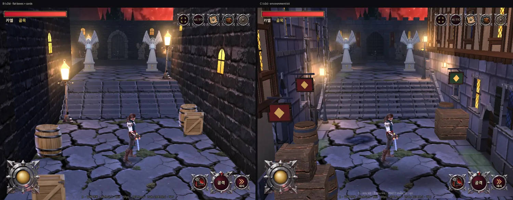

# 환경 키트 — 상자 세계를 "지은 마을"로 (장면 `v2c`)

`index.html?scene=v2c` · 코드 `src/v2/env/` · 보기 도구 `tools/v2/env_view.html` · 검사 `node tools/v2/envkit_check.mjs`
작성 2026-11-17. 소유자 의견("적과 모든 것들을 3D 로, 배경도 좀 더 디테일하게 — 사물이나 벽면 등도")에 대한 **배경 쪽 답**이다.
숫자는 §5. 헤드리스 Chromium 은 소프트웨어 렌더러(SwiftShader)라 **프레임 시간은 실제 기기 값이 아니다** — 삼각형·그리기 호출·메모리만 믿을 수 있다.

> **2026-11-18 14:00 UTC, FENCE 구역이 고친 것은 §21** (담장을 뚫는 버그): 울타리 · 쇠 난간 · 단상 난간 · 계단 옆 벽 · 낮은 담 · 묘지 문이 **그려진 자리에서** 영웅을 막는다 — 그리는 키트 조각이 충돌도 낸다. 낮은 담의 끝 면 기둥(담 길이만큼 긴 돌 띠)은 없어졌고 끝 기둥은 담 끝과 나란히, 계단 옆 벽의 끝 기둥은 계단 위에 선다.
>
> **2026-11-18 02:10 UTC(숫자 · 검사는 02:47–02:55 UTC 에 마지막 트리에서 다시 잼), WORLD-2 구역이 더한 것은 §18** (납골당 · 종탑 소품 12종을 생성 모델로, 채찍 고리 · 길종 종대, 작은 재질 접기로 그리기 호출 줄이기 — 에슈빌 33/35 → 30/30, 수레 손잡이 · 고목 발자국, 지역별 숫자 전 → 후). §17 "남은 것"의 수레 손잡이 · 고목 · 납골 벽감 · 가판대 줄은 이제 옛 얘기다(묘지 문은 그대로 남았다).
>
> **2026-11-18 00:55 UTC, 검수(propsverify)는 §17** — §16 의 숫자는 다시 재도 같았다. 고친 것: 떠 있던 등불 기둥 · 기둥 옆에 서 있던 충돌 상자 · 수레 손잡이 사이의 밝은 번짐 · 영웅이 몸 반쯤 들어가던 수레 · 묶음 · 화로의 충돌 상자. 묶음 파일의 크기와 숫자는 §17 끝의 값이 지금 값이다(§16.2 의 217,532 · 272,418 바이트는 고치기 전)
>
> **2026-11-18 00:10 UTC, PROPS 구역이 더한 것은 §16** (생성 모델 소품 18종 · 그린 표면 6장 · 잎 모양 불길 · 지역별 숫자 전 → 후). §11 의 "빚은 소품 3종"과 §12 의 "코드 텍스처 그대로다", §15 의 "남은 것" 첫 두 줄은 이제 옛 얘기다 — 빚은 천사상 · 가고일 · 고목은 생성 모델이 대신한다(빚는 도구 `world_sculpts.mjs` 는 남아 있지만 묶음에 들어가지 않는다).
>
> **2026-11-17 22:50 UTC, WORLD 구역이 더한 것은 §11–§14** (구운 입체 소품 · 새 소품 15종 · 새 텍스처와 되풀이 깨기 · 지역 세 곳). §2 의 "그림판으로 남긴 것"과 §7-2·§10 의 "천사상·가고일은 그림판"은 이제 옛 얘기다 — 시범 구간에도 납작한 그림판이 없다.

## 0. 한눈에

- 시범판 B 는 **납작한 상자에 타일을 바른 벽 + 색칠한 네모 창 + 세워 둔 그림판 소품**이었다. 키트는 같은 자리를 **실제 기하**로 다시 짓는다:
  깊이 있는 창(틀·창턱·살·덧문·불 켜진 유리), 아치 문과 계단, 밑돌·돌림띠·모서리돌·버팀벽, 내민 목조 위층, 돌기와 지붕(처마·용마루·굴뚝·지붕창), 아치 다리, 성문, 난간과 울타리, 연석과 올린 보도, 그리고 저폴리 3D 소품 12종.
- **놀이 규칙은 B 와 같다(바닥은 세 군데가 다르다 — §7-8, §10).** 충돌 상자는 B 의 `compileStage` 가 그대로 만들고(같은 숫자), 카메라·영웅·적·판정·HUD 는 B 의 장면을 상속해서 쓴다. B 가 입체 영웅(`src/v2/char3d/`)을 그리면 `v2c` 도 그대로 그린다.
- B 의 렌더러(`glr.js`)·셰이더·정점 형식을 **한 줄도 바꾸지 않았다.** 키트는 그 형식의 삼각형을 만들어 내는 순수 함수 모음이라 나중에 B 의 건축기로 그대로 들어갈 수 있다.
- 실행 중 빛 계산 0, 프레임마다 올리는 캔버스 0(추가분). 정적 기하는 "덩어리 × 텍스처"로 묶여 있다.

| 파일 | 내용 |
|---|---|
| `src/v2/env/geo.js` | 기하 쓰기 + 빛 굽기: `Geo`(quad·quad4·tri·poly·box·lathe 회전체·tube 각기둥) · `Frame`(벽면 틀) — 순수 JS, node 에서도 돈다 |
| `src/v2/env/mats.js` | 재질 표(`KMATS`) · 잡동사니 아틀라스 조각(`TRIM`) · 키트 텍스처 목록 |
| `src/v2/env/kit.js` | 건물 조각: `dressWall` `dressRoof` `dressFloor` `pave` `dressBlock` `dressStairs` `dressPillar` `arch` `gate` `railing` `woodFence` `windowAt` `doorAt` `timberFrame` |
| `src/v2/env/props.js` | 3D 소품 `PROPS`(12종) · 벽에 다는 것 `WALLPROPS`(간판·깃발·벽등) |
| `src/v2/env/build.js` | 스테이지 컴파일러 `compileEnv` (충돌은 B, 그림은 키트) · `validateEnv` |
| `src/v2/env/stage_slice0_env.js` | 다시 지은 시범 구간 (저작 데이터) |
| `src/v2/env/index.js` | 장면 `v2c` = B 장면을 상속 + 덩어리 가려 그리기 + 바닥 스티커 |
| `assets/v2/env/*.webp` | 텍스처 6장 (합계 248 KB) · 만드는 법 `tools/v2/envkit_tex.py` |
| `tools/v2/` | `env_view.html`(보기) · `envkit_check.mjs`(검사) · `envkit_shot.mjs` · `envkit_compare.mjs/.py`(B 와 나란히) · `envkit_view_shot.mjs` |

왼쪽 B · 오른쪽 `v2c` (폴드 화면, 같은 자리 · 같은 카메라):




## 1. 키트에 든 것 — 건물 조각

모든 조각은 **벽면 틀**(`Frame`: u = 벽을 따라 오른쪽, y = 위, w = 벽 바깥) 위에서 짓는다. 벽이 길 건너(−z)를 보든 골목 옆(±x)을 보든 같은 코드다.

| 조각 | 무엇이 생기나 | 삼각형 (시범 구간 실측) |
|---|---|---|
| 벽 `dressWall` | 격자로 쪼갠 벽면(창·문 자리는 **실제로 뚫린다**) + 밑돌(plinth) + 돌림띠 + 모서리돌(quoin) + 버팀벽(두 단, 비스듬한 머리) + 처마띠/갓돌/성가퀴 + 낮은 담의 기둥·쇠 난간 | 집 한 채 정면 750–1,360 · 골목 긴 벽 2,200 · 낮은 담 250–550 |
| 창 `windowAt` | 깊이 9 의 구멍(안쪽 문설주·창턱이 어둡다) + 돌/나무 틀 + 내민 창턱 + 십자 살 + 열어젖힌 덧문(띠쇠) + 납선 유리. `lit` 이면 유리가 스스로 빛나고 앞 벽·바닥에 빛을 굽는다. 네모/둥근 아치/뾰족 아치 | 약 40–70 |
| 문 `doorAt` | 깊이 15 의 아치 속 문짝(널 + 띠쇠 3줄 + 고리) + 문설주 + 홍예석·이맛돌 + 문 앞 계단(밟는 상자도 생긴다) | 약 60–90 |
| 목조 `timberFrame` | 기둥(창 양옆에 자동으로 선다) · 가로대 · 가새 · 들보. 위층은 `jetty` 만큼 길 쪽으로 내밀고 장선 끝이 보인다 | 층당 100–250 |
| 지붕 `dressRoof` | 돌기와 경사면 + 처마 널 + 용마루 + 박공 벽·박공널 + 굴뚝(갓돌·연통) + 지붕창(작은 맞배, 불 켜진 창) | 100–280 |
| 바닥 `dressFloor` | 36 단위 격자(빛 웅덩이가 곱게 구워진다) + **띠별 재질**(조약돌 길·판석 띠·이끼·흙) + 벽 밑동 그늘 | 구간 합 5,600 |
| 보도 `pave` | 높이 7 의 판석 보도 + 낱장 연석 + 젖은 도랑. 밟는 상자가 생겨 캐릭터가 실제로 올라선다 | 500 |
| 단상 `dressBlock` | 밑단 + 몸통 + 내민 갓돌 + 판석 윗면 + 뒤쪽 난간동자 | 520 |
| 계단 `dressStairs` | 칸마다 밝은 디딤판·어두운 챌판 + 비스듬히 오르는 옆 벽(갓돌) + 끝 기둥 | 130–390 |
| 기둥 `dressPillar` | 네모 주춧돌 + 10각 배흘림 몸통 + 머릿돌 | 100 |
| 아치 `arch` | 골목을 건너는 아치 다리: 홍예석 띠 + 이맛돌 + 밑면 + 성가퀴 + 받침돌 | 136 |
| 성문 `gate` | 뾰족 아치 속 내림 쇠창살 + 양옆 버팀 기둥 | 벽에 포함 |
| 난간 `railing` · 울타리 `woodFence` | 쇠: 기둥 + 가로대 + 끝이 뾰족한 창살 / 나무: 기둥 + 널 + 기운 말뚝 | 길이 100 당 약 80 |

깊이감을 싸게 내는 장치(전부 구운 값, 실행 비용 0):
- **벽 밑동·바닥 닿는 곳의 그늘**: 벽은 아래 70 단위가 어둡고, 바닥은 벽·단상·기둥에서 46 단위 안쪽이 어둡다.
- **처마·내민 층 밑 그늘**, **창·문 안쪽 어둠**(문설주 0.5–0.6배), 지붕 처마 쪽 어둠.
- **빛 웅덩이**: 가로등·화로·벽등·불 켜진 창이 바닥과 벽에 따뜻한 빛을 굽는다(빛 43개). 가로등·화로 밑에는 바닥 스티커를 한 장 더 깐다.
- **얼룩 잡음**: 꼭짓점 색에 낮은 주파수 잡음(±8–15 %) + 집마다 다른 색조 → 긴 벽이 되풀이되어 보이지 않는다.
- 보이지 않는 면(카메라는 늘 화면 안쪽을 본다: 뒤를 보는 면, 낮은 곳의 밑면)은 아예 만들지 않는다 → 삼각형 약 25 % 절약.
- 소품은 구운 빛을 캐릭터와 같은 식으로 들어 올린다(`Geo.lift`) → 어두운 길에서도 장애물이 읽힌다(B 의 그림판 색조와 같은 생각).

## 2. 3D 소품 (세워 둔 그림판 대신)

`PROPS[이름](G, x, y, z, 옵션)` — 텍스처를 입힌 저폴리 메시. 충돌은 스테이지 줄의 `solid` 값이 맡으므로 B 와 같다.

| 소품 | 삼각형 (보이는 면만 / 전부) | 생김새 |
|---|---|---|
| 술통 `barrel` | 104 / 168 | 배부른 10각 몸통 + 쇠 테 3줄 + 뚜껑 |
| 나무 상자 `crate` | 80 / 84 | 널 + 테두리 널 + 가새 (크기를 주면 B 의 상자 장애물 자리에 그대로) |
| 손수레 `cart` | 262 / 314 | 짐칸 + 살 달린 바퀴 2 + 손잡이 + 받침 다리 + 자루 2 |
| 우물 `well` | 125 / 151 | 돌 테 + 물 + 기둥 + 도르래 줄 + 두레박 + 작은 지붕 |
| 가로등 `lamp` | 129 / 182 | 쇠 받침·기둥·가로대 + **빛나는 등불 상자** + 빛 번짐·바닥 빛 |
| 가판대 `stall` | 284 / 382 | 판매대 + 기둥 4 + 줄무늬 차양(늘어진 술) + 궤짝·채소·병 |
| 화로 `brazier` | 82 / 106 | 세 다리 + 쇠 그릇 + 이글거리는 숯 + 불꽃 |
| 건초 `hay` | 48 | 짚단 3개 + 묶는 끈 |
| 묘비 `tomb` | 38 | 둥근 머리 석판 또는 십자, 조금 기울어 있다 |
| 분수대 `fountain` | 128 / 192 | 팔각 수반 + 물 + 기둥 + 윗 접시 |
| 석상 `statue` | 158 / 215 | 받침대 + 두건 쓴 수호자(칼을 짚고 선 모습)의 회전체 — **시범 구간에서는 쓰지 않음**(아래) |
| 마른 나무 `tree` | 168 / 192 | 휘어 오르는 줄기 + 가지 두 층 + 잔가지 |
| 벽걸이 `sign` `banner` `sconce` | 20–60 | 걸이 간판(골목에서는 카메라를 본다) · 제비꼬리 깃발 · 벽등 |

**그림판으로 남긴 것: 가고일 2개와 천사상 2개.** 날개·얼굴 같은 유기적인 모양은 손으로 짠 저폴리로 만들면 지금 그림보다 못하다. 키트의 3D 석상(`statue`)을 골목에 세워 봤더니 가까이서 "두건 쓴 덩어리"로만 읽혀 B 의 천사상 그림보다 분명히 못했다 → 시범 구간에서는 그림판으로 되돌리고, 3D 석상은 보기 도구의 늘어놓기에만 남겼다(§7·§8: 생성 3D 모델이 필요한 첫 대상).

## 3. 텍스처와 재질

- 새 텍스처 6장을 `assets/v2/env/` 에 두었다: `k_ashlar`(다듬은 돌 쌓기) · `k_plaster`(회벽) · `k_slate`(돌기와, 256²) · `k_cobble`(조약돌) · `k_flag`(판석) · `k_trim`(잡동사니 아틀라스: 참나무 널·불 켜진 납선 유리·어두운 유리·짚·쇠·천·숯·흰색). 모두 512²(기와만 256²), webp 5–66 KB, **합계 248 KB**.
- **코드로 만든 텍스처다**(`python3 tools/v2/envkit_tex.py`, 주기 잡음이라 이음매가 없다, 같은 씨앗이면 늘 같은 결과). Higgsfield 생성은 이번 작업에서 **쓰지 못했다**(생성 요청이 실행 권한 단계에서 거절됨, 0 크레딧) — §7 의 약점 1 과 이어진다.
- B 가 이미 올리는 v1 타일 5장(`flag`·`block`·`brick`·`wood`·`dirt`)도 그대로 쓴다(거친 돌벽·단상·계단·나무·흙·골목의 갈라진 판석).
- 재질 표 `KMATS`: 텍스처 + 타일 크기 + 색. 아틀라스 조각 재질(`timber`·`glass`…)은 반복하지 않고 면 크기에 맞춰 조각 안에 넣는다.
- 픽셀 단위 빛·노멀맵은 **넣지 않았다**(기기가 이미 끊긴다). 품질 단계는 하나만 있다: `?envq=0` 이면 반투명 꾸밈(얼룩·물웅덩이·바닥 빛 웅덩이·빛 번짐 바깥 겹)을 끈다 → 겹쳐 칠하는 양이 준다.

## 4. 스테이지를 쓰는 법 (저작 형식)

**B 의 parts 형식 그대로 + 꾸밈 필드.** 한 줄 = 눈에 보이는 한 덩어리라는 약속은 같다.

1. B 의 part(`floor` `block` `wall` `stairs` `pillar` `roof` `blocker` `prop` `light`)는 숫자를 그대로 쓴다 → 충돌·검증(`validateStage`)이 B 와 같다.
2. 거기에 `kit:{…}`(어떻게 꾸밀지)와 `mesh:'이름'`(그림판 대신 3D 소품)을 덧붙인다.
3. 키트 전용 줄: `pave`(올린 보도) · `arch`(아치 다리) · `fence`(쇠/나무 울타리) · `deco`(충돌 없는 3D 소품).
4. `chunks`(메시를 나누는 덩어리)와 `decals`(바닥 얼룩)는 스테이지 맨 위에.

```js
// 목조 3층 집 한 채 = 벽 한 줄 + 지붕 한 줄  (src/v2/env/stage_slice0_env.js 발췌)
{ t: 'wall', x: 440, z: 260, w: 470, d: 90, h: 350, mat: 'plaster', kit: {
    style: 'timber',            // stone(돌집) · timber(아래 돌 + 위 목조) · plaster · rubble(거친 돌) · low(낮은 담)
    faces: 'F',                 // 꾸밀 면: F 앞(−z) · L(−x) · R(+x)
    base: 7,                    // 벽 앞 땅 높이 (올린 보도 위)
    storey: 150, jetty: 14,     // 150 부터 위층, 길 쪽으로 14 내민다
    windows: [ { u: 250, y: 60, w: 84, h: 64, lit: 0.9, cols: 3, rows: 2 },          // u = 벽 왼끝에서, y = 벽 밑에서
               { u: 395, y: 66, w: 42, h: 62, shutters: true },
               { u: 110, y: 176, w: 42, h: 56, lit: 0.5, frame: 'timber' } ],
    doors:   [ { u: 75, w: 58, h: 104, rise: 7 } ],                                   // rise = 문턱 높이(계단 한 칸 = 7)
    hang:    [ { type: 'sign', u: 250, y: 128, w: 78, h: 20 } ],                      // 간판 · banner · sconce(벽등 + 빛)
} },
{ t: 'roof', x: 440, z: 260, w: 470, d: 90, y: 350, h: 70, kit: { chimneys: [{ u: 390, t: 0.75 }], dormers: [{ u: 150, lit: 0.5 }] } },
{ t: 'prop', mesh: 'barrel', x: 1500, z: 214, h: 78, solid: 24 },                     // 3D 소품 (충돌 반지름 24 — B 와 같은 값)
{ t: 'pave', x: -60, z: 240, w: 2040, d: 20, h: 7, kerb: 'F' },                       // 보도 + 연석 + 도랑
{ t: 'fence', kind: 'iron', x0: 196, z0: 5, x1: 464, z1: 5, h: 44 },
```

- 시범 구간 전체 = part 80줄(B 는 84줄) + 얼룩 28줄. B 의 숫자에 `kit` 을 덧붙이는 데 든 시간은 약 30분(키트를 만든 시간 제외).
- `compileEnv(stage)` → B 의 세계 `W`(상자·빛·구간·적) + `W.env`(메시·덩어리 경계·스티커). node 에서 0.4초.
- 검증: `validateEnv(stage)` = B 의 `validateStage` (시작 위치에서 모든 적·구간·goal 에 닿는가).
- 카메라 규칙은 B 와 같다: 카메라와 놀이 공간 사이에 카메라보다 높은 것을 두지 않는다. 내민 위층·간판·차양은 캐릭터 머리(80)보다 위에만 둔다. 골목 아치는 카메라 길(높이 약 340)보다 높게 잡았다(시작 338 + 낮은 호).

## 5. 숫자 (`node tools/v2/envkit_check.mjs --base 1`, 2026-11-17, 헤드리스 fold_open)

> 검수(§10) 뒤에 다시 잰 값으로 고쳤다(얹은 상자 하나를 빼고 내민 간판 하나를 벽 간판으로 바꿔 삼각형이 94개 줄었다). 프레임 시간은 싣지 않는다 — 헤드리스는 소프트웨어 렌더러라 기기와 무관하다.

<!-- numbers:begin -->
| | 시범판 B (`v2b`) | 꾸민 배경 (`v2c`) | 목표 |
|---|---|---|---|
| 세계 정적 삼각형 (구간 전체) | 8,558 | **26,383** (거리 덩어리 11,045 · 골목+마당 덩어리 15,338) | — |
| 한 화면 삼각형 — 세계 + 스프라이트 | 약 8,800 | 약 26,700 (거리·골목) · 15,500 (뜰·마당) | ≤ 60,000 |
| 한 화면 삼각형 — 입체 영웅 포함 | 28,400 | **46,300** (거리·골목) · 35,200 (뜰·마당) | ≤ 60,000 |
| 그리기 호출 (영웅 포함, 서 있을 때) | 18–30 | **17–32** (그중 정적 메시 18 / 마당 9) | ≤ 40 |
| 그리기 호출 — 봇이 끝까지 싸우며 가는 동안 최대 (영웅 제외) | — | 33 | ≤ 40 |
| 텍스처 메모리 (GL, 밉맵 포함) | 20.7 MB | **27.7 MB** (키트 텍스처 +7.0 MB) | — |
| 정점 버퍼 | 850 KB | **2,312 KB** | — |
| 텍스처 파일 | (v1 타일 재사용) | 6장 248 KB (가장 큰 것 66 KB) | 장당 ≤ 150 KB |
| 프레임마다 올리는 캔버스 | 캐릭터 아틀라스 1 | 같다 (추가 0) | 추가 0 |
| 들어갈 때 세계 컴파일 | 약 0.1초 | 0.2–0.5초 (빛 43개 × 꼭짓점 8만) | — |
| 봇이 구간을 끝까지 (무적 없음) | 통과 | **통과** — 폴드·휴대폰 모두 40–45초(게임 시간), 최저 체력 82–100(돌릴 때마다 다르다), 쓰러짐 0 | 통과 |
| 페이지 오류 | 0 | 0 (폴드·휴대폰·배포 빌드) | 0 |
| 배포 빌드(`build_web.mjs`) + CSP 에서 열림 | 예 | 예 (키트 텍스처 6장을 실제로 받음) | — |
<!-- numbers:end -->

- 입체 영웅 모델 한 명이 19,638 삼각형·텍스처 21.4 MB 다(`src/v2/char3d/` 값). **지금 화면에서 가장 큰 덩어리는 배경이 아니라 영웅이다.**
- 봇이 달리는 동안 삼각형이 순간 15–16만, 그리기 호출이 39–43 까지 튄다: **대시 잔상이 영웅 모델을 여러 번 통째로 다시 그리기 때문**이다(B·char3d 쪽 코드). 기기에서 끊김의 한 원인일 수 있어 요청서에 적었다.
- 덩어리 가려 그리기: 메시를 **거리 / 골목+마당** 두 덩어리로 나누고 경계 상자가 시야 밖이면 그리지 않는다. 뜰·마당에서는 거리 덩어리(11,045 삼각형·그리기 9)가 빠진다. 거리에서는 먼 성벽이 지붕 너머로 보여 둘 다 그린다. (처음에는 골목과 마당도 나눴는데 늘 같이 보여서 그리기 호출만 5회 늘었다 → 합쳤다.)
- 반투명 꾸밈(매 프레임 동적 묶음에 쓰는 사각형): 얼룩 28 + 빛 웅덩이 11 + 소품 그림자 34 + 빛 번짐 14×2. 가까운 것만 쓴다. 그리기 호출은 B 의 스티커 묶음 1회에 같이 들어간다.

## 6. 검사와 보기

- `node tools/v2/envkit_check.mjs [--devices fold_open,phone2] [--base 1] [--json 파일]`
  ① 데이터 검증 ② 텍스처 파일 크기 ③ 장면이 뜨는가 ④ 구간 7곳의 그리기 호출·삼각형·덩어리 수와 예산 ⑤ **봇이 처음부터 마당까지 걸어 적을 모두 쓰러뜨림**(무적 없음) ⑥ 페이지 오류 0 ⑦ 나가기(자원 정리). `--base 1` 이면 B 를 같은 방법으로 재서 견준다.
  - 봇은 B 검사(`proto_b_check.mjs`)의 봇에 **한 줄을 더한 것**이다: 같은 적에게 세 번 막히면 7초 동안 잊고 길을 따라간다. 까닭: 골목 어귀의 벽 모서리와 나무 상자 사이(x 2020, z 269)에 근접 적이 끼면 영웅과 적이 서로 깊이를 못 맞춰 멈춘다. **B 의 세계에서도 똑같이 생기는 일**이다(같은 상자로 node 에서 `Sim` 만 돌려 재현). 키트 탓이 아니라 스테이지 배치·적 길찾기의 과제라 요청서에 적었다.
  - 숫자를 재려고 구간마다 순간 이동하면 적이 깨어 골목 어귀로 몰려와 위 상황이 잘 생긴다 → 검사는 숫자를 잰 뒤 `sim.reset()` 으로 처음 상태로 돌리고 봇을 돌린다.
- `tools/v2/env_view.html` — 게임 없이 배경만 본다. `?mode=gallery`(키트 조각·소품 늘어놓기, 돌려 보기) / `?mode=slice`(다시 지은 구간, 단추로 거리·모퉁이·골목·마당의 **게임 카메라 틀**). 드래그 = 돌리기, 휠 = 거리, WASD = 옮기기. 개발 서버(`node tools/serve.mjs`)에서 연다.
- 나란히 비교: `node tools/v2/envkit_compare.mjs && python3 tools/v2/envkit_compare.py` → `/tmp/claude-0/v2/envkit/cmp_1_street.png` … `cmp_6_yard.png` (왼쪽 B, 오른쪽 `v2c`, 폴드 화면).

## 7. 아직 약한 곳 (비교 그림을 직접 보고 적음)

1. **텍스처가 손그림보다 밋밋하다.** 새 6장은 코드로 만든 것이라 가까이서 보면 "무늬"로 읽힌다. 특히 조약돌은 칸 나눔이 규칙적이라 모자이크 같다. B 가 쓰는 v1 손그림 타일(갈라진 판석)이 한 장 한 장은 더 보기 좋다 — 그래서 골목 바닥은 v1 타일을 그대로 썼다. 벽·지붕·회벽은 그려진(또는 생성한) 텍스처로 바꾸면 바로 좋아진다(형식은 그대로, 파일만 바꾸면 된다).
2. **소품의 표면이 단순하다.** 실루엣은 3D 로 읽히지만(바퀴 살, 술통 테, 차양, 등불) 나무결·녹·때 같은 겉이 타일 한 장이라, B 의 채색 그림판보다 색이 수수하고 어둡다(나무 상자·술통). 석상·가고일 같은 조각상은 손으로 짠 저폴리로는 안 된다 — 그래서 넷은 아직 그림판이다("모든 것을 3D 로"에서 남은 숙제).
3. **계단 현상**(안티에일리어싱 없음)이 가는 것(쇠 난간, 창살, 목조 뼈대)에서 B 보다 더 눈에 띈다. 기기 여유가 확인되면 MSAA 를 켜야 한다.
4. **모서리가 전부 직각**이다. 돌 모서리의 닳은 면, 기와의 들쭉날쭉한 끝, 휘어진 들보가 없다.
5. 빛이 꼭짓점 단위라 창에서 나오는 빛 모양이 뭉툭하다. 그림자는 여전히 둥근 얼룩이다.
6. 거리에서 구간 전체(덩어리 둘)를 다 그린다(먼 성벽이 지붕 너머로 보인다). 장이 커지면 덩어리를 방 단위로 나누고 먼 것은 단순한 메시로 바꿔야 한다.
7. **성문이 납작하다.** 아치 속을 실제로 뚫지 않고 벽 앞에 어두운 면과 쇠창살을 덧댄 것이라, B 의 성문 그림(돌 아치 + 창살)보다 깊이가 덜하다. 마당 바닥의 판석 길도 흙과 만나는 가장자리가 칼로 자른 듯 곧다(띠 재질의 한계 — 가장자리 얼룩 스티커나 섞임 정점 색이 필요).
8. 가판대 하나가 B 에 없던 충돌(벽 쪽 144×46)을 더했고, 올린 보도(높이 7)와 문 앞 계단(높이 14) 위에 캐릭터가 실제로 올라선다. 봇 길과 검증은 통과하지만 "B 와 한 치도 다르지 않은 바닥"은 아니다.

## 8. 그린(또는 생성한) 3D 모델을 쓰면 무엇이 달라지고 얼마가 드나

| 방법 | 얻는 것 | 비용 |
|---|---|---|
| **지금 방식 + 그린 텍스처** (권장 첫걸음) | 약점 1 이 풀린다. 벽·지붕·바닥·나무 6–8장만 바꾸면 모든 집이 좋아진다 | Higgsfield `gpt_image_2_5` 1장 0.25 크레딧 × 8–12장 = 2–3 크레딧 + 이음매 손질(자동 스크립트) 반나절. 실행 비용 변화 없음 |
| 소품을 **생성 3D 모델**로 (술통·수레·석상·가고일·나무 등 눈에 띄는 것 10–15종) | 약점 2 가 풀린다: 구운 색·닳은 모서리·유기적인 모양(석상·가고일·나무) | 영웅 모델 기준으로 1개에 생성 수 크레딧 + 손질(삼각형 줄이기·크기 맞추기) 30–60분. 소품 하나를 500–1,500 삼각형·256² 텍스처로 줄이면 화면에 20개 = 삼각형 +2만·텍스처 +5 MB. **줄이지 않고 쓰면 영웅처럼 하나에 2만 삼각형·20 MB 라 못 쓴다** |
| 건물 전체를 생성 모델로 | 집마다 다른 개성 | 권하지 않는다: 충돌 상자와 어긋나고, 장마다 새로 만들어야 하고, 창 불빛·빛 굽기를 따로 맞춰야 한다. 키트 조각 + 좋은 텍스처가 60장 이상을 찍어내는 데 맞다 |
| 손으로 모델링(블렌더) | 가장 좋은 품질, 정확한 삼각형 수 | 사람 손이 필요하다 |

### 비교 그림을 보고 내린 판정 (`/tmp/claude-0/v2/envkit/cmp_*.png`)

| 자리 | 더 세밀한가 | 사물이 덩어리로 읽히나 | 싸 보이거나 시끄러운 곳 |
|---|---|---|---|
| 1 거리 | 분명히 그렇다 — 벽 한 장이 집 네 채(돌집·목조·예배당·목조)로 읽힌다 | 수레·건초·가판대·기둥 모두 입체 | 조약돌 무늬가 조금 시끄럽다. 쇠 난간에 계단 현상 |
| 2 건물 정면 가까이 | 가장 큰 차이 — 창 깊이, 덧문, 아치 문, 목조 뼈대, 내민 층 | — | 가까이서는 회벽·돌 텍스처가 밋밋하고 문짝 널이 흐리다 |
| 3 가로등·소품 | 그렇다 | 술통·상자·우물·가로등이 입체. 등불이 실제 상자 | 나무 겉이 B 의 그림보다 단순 |
| 4 골목 | 그렇다 — 간판·깃발·벽등·버팀벽·내민 층이 원근을 따라 늘어선다 | 그렇다 | 왼쪽 벽이 화면 가장자리에서 크게 잘린다(B 와 같은 카메라 문제) |
| 5 계단 | 조금 — 옆 벽·갓돌·끝 기둥이 생겼다 | — | 계단 자체는 B 와 비슷하다 |
| 6 마당 | 그렇다 — 성가퀴·깃발·좁은 창·버팀벽·쇠 난간 | 화로가 입체 | 성문이 그림보다 납작(약점 7), 판석 길 가장자리가 곧다 |

## 9. 다음 단계

1. **폴드에서 `?scene=v2c` 를 직접 본다.** 맨 아래 작은 글자 줄에 fps 가 나온다. B 와 견줘 더 끊기면 `?scene=v2c&envq=0` 으로 반투명 꾸밈을 끄고 다시 본다(삼각형 3배·버퍼 2.8배가 실제로 부담인지 여기서 갈린다).
2. 텍스처 6–8장을 그린 것으로 교체(§8 첫 줄).
3. 키트를 B 의 정식 건축기로 옮긴다: `compileStage` 가 `kit`·`mesh` 를 직접 읽게 하고(지금은 B 를 상속해 바꿔 끼우는 돌아가는 길 — 요청서 참고), 창 불빛·간판·등불을 스테이지 검증에 넣는다.
4. 덩어리를 방 단위로 더 잘게 + 먼 덩어리용 단순 메시, 굽기 때 빛을 가까운 것만 보게 해서 컴파일 0.1초로.
5. 눈에 띄는 소품 10종을 생성 3D 로 시험(삼각형 1,500 이하·256² 로 줄이는 손질 포함) → 석상·가고일부터.
6. 장마다 다른 분위기 묶음(성·묘지·성당): 재질 표와 벽 양식만 더하면 조각은 같이 쓴다.

## 10. 검수 (envverify, 2026-11-17 14:26–14:55 UTC)

만든 쪽과 다른 눈으로 다시 돌려 본 결과다. 숫자는 모두 헤드리스(소프트웨어 WebGL) 값이라 **기기의 부드러움은 여기서 알 수 없다.**

**통과한 것**
- 진짜 터치로 처음부터 끝까지 (`node tools/v2/p0_referee.mjs --protos c`, 폴드·휴대폰): 스틱 8방향·360°, 죽은 구역, 공격·점프·대시 단추, 점프로 단상, 구덩이, 깊이 판정, 거리 → 모퉁이 → 골목 계단 → 마당 싸움 → 끝 표시 → 터치로 다시 시작 → 일시정지 단추로 나가기 → 세 번 드나들기(캔버스 2 → 2, JS 힙 44 → 47 MB). 페이지 오류 0. (심판 도구가 `c` 를 B 와 같은 길로 읽도록 두 줄 고쳤다.)
- `envkit_check.mjs --base 1` 다시 돌림: 검증 오류 0, 봇 완주(폴드 45초 · 휴대폰 41초, 쓰러짐 0), 숫자는 §5 표.
- 새 기하가 길을 막는가 (`Sim` 의 `moveXZ` 로 걸어서 닿는 칸을 훑어 B 와 견줌): B 에서 닿던 곳 가운데 못 닿게 된 곳은 **새 가판대 자리(x 636–772, z 206–246)뿐**이다.
- 입체 소품을 뚫고 지나가는가: 충돌 없는 `deco` 소품(나무·묘비·분수·얹은 통)은 모두 걸어서 닿지 못하는 곳에 있다. 충돌 있는 소품 속에 설 수 있는 칸 0 (아래 고친 화로 뒤).
- 고르기 화면에 「꾸민 배경」 줄이 생겼다 (`src/v2/chooser.js`, `tools/v2/p0_entry_check.mjs`).

**찾아서 고친 것**
1. **마당 화로 넷을 그냥 뚫고 지나갔다.** 뿌리는 B 의 `compileStage`: 높이(`y`)를 안 적은 소품의 충돌 상자와 빛을 늘 y 0 에 세워서, 올린 바닥(뜰·마당 = 96) 위의 화로는 상자(0…90)가 바닥 밑에 묻혔다. 가로등·화로의 빛도 96 만큼 낮은 곳(화로는 바닥 아래)에서 났다. B 에서는 그림판이라 덜 티가 났지만 입체 화로는 몸이 겹쳐 보였다. → `src/v2/b/world.js` 에서 그런 소품은 그 자리 바닥 높이에 세우게 고쳤다(B·v2c 둘 다). 고친 뒤 `proto_b_check.mjs` ALL OK, 봇 완주.
2. **골목 어귀에서 영웅이 통째로 가려졌다.** 상자 위에 얹은 꾸밈 상자(`deco`, 높이 62–102)가 골목 카메라와 영웅 사이에 섰다 (x 2036–2068, z 270–334). → 얹은 상자를 뺐다.
3. **골목 왼쪽 벽을 따라 걸으면 내민 간판 뒤로 영웅이 사라졌다** (x 1996, z 461–557). → 모퉁이 집 간판은 높이 올리고(y 250), 골목 집 간판은 벽에 붙이는 간판으로 바꿨다.
   - 재는 법: 걸어서 닿는 1,742칸마다 카메라에서 영웅의 발·가슴·머리로 선을 쏴 정적 메시(앞면)와 만나는지 본다. 셋 다 막힌 칸 40 → 32. 남은 32칸은 B 에도 있던 기둥·벽 모서리 뒤(10칸)와 우물·가로등 기둥 바로 뒤 — "소품 뒤로 지나가면 가려진다"는 B 의 의도된 동작이다.

**이 문서에서 바로잡은 것**
- "놀이는 B 와 똑같다" → 규칙은 같지만 바닥은 세 군데(가판대 충돌, 올린 보도 +7, 문 앞 계단 +14)가 다르고, 이제 마당 화로도 막는다.
- §5 의 삼각형·버퍼 숫자를 다시 잰 값으로. 봇의 "최저 체력 91" 은 돌릴 때마다 82–100 으로 달라진다.

**아직 싸 보이는 곳 (비교 그림 `/tmp/claude-0/v2/owner_env.png` 을 소유자 눈으로 보고)**
- **적은 여전히 납작한 그림**이다(해골·마법사). 소유자의 "적과 모든 것을 3D 로" 가운데 이 장면이 한 것은 배경과 소품뿐이다. 천사상 둘·가고일 둘도 그림판이다.
- 마당이 가장 덜 달라졌다. 판석 길이 흙과 자로 그은 듯 만나고, 흙 바닥 조각이 떠 있는 네모처럼 보인다.
- 조약돌·돌벽이 되풀이 무늬로 읽힌다(코드로 만든 텍스처). 가는 쇠 난간·창살의 계단 현상.
- 화면 아래 정보 줄이 여전히 "B · 입체 영웅 …" 으로 시작한다(B 의 줄을 물려받음; 그 위에 "C · env kit" 줄이 7.5초 뒤에 뜬다).

**확인하지 못한 것**
- 실제 폴드에서의 프레임. 세계 삼각형 3배·정점 버퍼 2.7배·텍스처 +7 MB 가 끊김을 늘리는지는 기기에서만 알 수 있다. 「성능 진단」은 아직 B 의 세계로만 잰다(꾸민 배경 줄 없음 — 요청서에 적음).
- 낀 적(골목 어귀 x 2020, z 269)은 그대로다. 검사 봇이 7초 뒤 잊고 가는 것으로 피해 갈 뿐이다.


## 11. 구운 입체 소품 — 소품 하나는 그리기 호출이 아니라 삼각형 값만 든다 (WORLD, 2026-11-17)

**만드는 쪽** `node tools/v2/world_props_bake.mjs [--glb <폴더>]` → `assets/v2/props/props.bin`(기하 묶음) + `assets/v2/props/props_atlas.webp`(아틀라스 **한 장**).
- 원천 ① **빚은 소품**(`tools/v2/world_sculpts.mjs`): 부호 거리 함수(캡슐·타원체·상자를 부드럽게 잇기)로 빚는다 → 표면 그물(surface nets, 격자 2.8–3.4 단위, 1.0–1.5만 삼각형) → 2차 오차 모서리 접기로 850–1,050 삼각형 → 법선은 거리 함수의 기울기 → **텍스처는 줄이기 전의 세밀한 표면을 앞에서(18° 내려다보며) 찍어 굽는다**(빛 + 틈새 그늘 + 돌 얼룩·이끼·빗물 자국/나무결). 그래서 삼각형은 적어도 깃털 줄·옷 주름·얼굴 그늘이 그림에 남는다. 지금 3종: 우는 천사상 `angel` 950 · 가고일 `gargoyle` 1,050 · 고목 `deadtree` 850 삼각형.
- 원천 ② **생성 모델 GLB**(그림 → 입체): `--glb 폴더` 의 `<id>.glb`(+ 선택 `<id>.json` `{h, rotY, foot, footH, light, tris, tex}`)를 읽어 키·발밑 원점·앞(−z)을 맞추고, 1,500 삼각형을 넘으면 접고, 그림을 아틀라스 칸(기본 320²)에 넣는다. 같은 이름의 빚은 소품을 대신한다. **이번 작업에서는 유료 생성이 권한 단계에서 거절돼(0 크레딧) 이 길은 `assets/v2/char3d/w_rusty_sword.glb` 같은 기존 GLB 로만 돌려 봤다** — 돌릴 호출은 `/tmp/claude-0/v2/world/gen_requests.json`(그림 31장 → 입체 19개).
- 묶음 형식: `'BNP1'` + JSON 길이 + JSON(`props[name] = { nv, ni, lo, hi, h, foot, footH, light, cell, pos, nrm, uv, idx }`) + 본문(위치 int16 · 법선 int8 · uv uint16 · 색인 uint16). 지금 **37 KB**(3종) + 아틀라스 1024×512 **22 KB**(GPU 2.8 MB). 상한: 아틀라스 ≤ 2048², 묶음 ≤ 1.5 MB.

**쓰는 쪽** `src/v2/env/baked.js`
- `await ensureProps(url)`(브라우저) / `setPropPack(buffer)`(node: `tools/v2/world_node.mjs loadPropsNode()`) 로 한 번 받아 둔다. `compileEnv` 는 동기라 **컴파일 전에** 받아야 한다 — `src/v2/world` 의 `AREAS[id]()` 와 장면 `v2c` 가 그렇게 한다.
- 스테이지에는 여느 소품처럼 `{ t: 'prop' | 'deco', mesh: 'angel', x, z, h, flip, rot }`. `build.js` 가 이름이 묶음에 있으면 `bakedProp()` 으로, 없으면 `PROPS[이름]`(손으로 짠 것)으로, 묶음을 못 받았으면 대신 세울 저폴리(`statue`·`tree`)로 짓는다.
- `bakedProp` 은 삼각형을 **그 자리 덩어리의 메시(텍스처 = 아틀라스)에 써 넣고** 꼭짓점마다 그 자리 빛을 굽는다(`Geo.mesh`). 카메라가 못 보는 뒤쪽 삼각형은 버린다(약 35 %). 같은 덩어리의 구운 소품은 전부 **그리기 1회**.
- 충돌 발자국·빛: part 에 `solid` 가 없으면 묶음의 `foot`(반너비 x·z)·`footH` 를, `light` 가 없으면 묶음의 `light` 를 쓴다(크기 `h` 에 맞춰 줄어든다).
- 텍스처 이름은 `'../props/props_atlas'`(`assets/v2/env/` 기준 상대 경로) — 키트 텍스처를 `v2/env/<이름>.webp` 로 받는 기존 코드가 그대로 받는다.

## 12. 새 소품 15종 (`src/v2/env/props2.js`) · 새 표면 · 되풀이 깨기

| 소품 `mesh` | 삼각형(보이는 면) | 생김새 |
|---|---|---|
| `bell` | 약 330 | 돌 받침 + 참나무 틀·가새 + 멍에·쇠띠 + **금 간 청동 종**(12각 회전체) + 줄 |
| `grave` (`kind`: round · point · obelisk · ledger · broken · cross) | 30–60 | 비석 여섯 꼴 (기울기·떨어진 조각) |
| `cross` | 약 60 | 고리 달린 돌 십자가 + 두 단 받침 |
| `mausoleum` | 약 330 | 계단 3 + 뾰족 아치 쇠문 + 기둥 2 + 박공 지붕 + 십자가 |
| `cemgate` | 약 520 | 돌기둥 2(갓돌·항아리) + 쇠 아치 두 줄 + 굵은 창살 문짝 2 (`open` 0–1.25) |
| `lanternpost` | 약 90 | 나무 기둥 + 쇠 팔 + 매달린 등(빛 색 `c`, `lit:false` 면 꺼진 등) |
| `coffin` · `niche` · `plaguepost` | 60 · 220 · 110 | 여섯 모 관 / 해골이 찬 감실 셋 + 촛불 선반(`k_bone`) / 검은·흰 천과 붉은 가위표 판 |
| `wreck` · `fire` | 약 200 · 가닥당 10 | 그을린 벽 모서리 + 쓰러진 들보 + 재 + 잉걸불 / 불길(가닥마다 노랑→주황→검붉음 세 마디, 십자로 겹침). 빛은 part 의 `light`, 진짜 불티·연기는 지역의 `anchors` 자리에 효과가 낸다 |
| `sacks` · `harvest` · `candles` | 60–130 | 자루 더미 / 호박 셋 + 밀단 둘 / 촛불 무리(쉼터) |

**표면** (`python3 tools/v2/world_tex.py`, 3×3 으로 이어 붙여 눈으로 확인 — `/tmp/claude-0/v2/world/tex_sheet.png`). 모두 512², WebP, 장당 42–78 KB(상한 160 KB).
- 코드로 새로 만든 것: `k_cobble`(조약돌 — 크기·색이 제각각인 가중 셀 잡음으로 **다시 만듦**, 예전의 고른 모자이크 대신) · `k_cobble2`(잔돌 포장) · `k_cobworn`(닳고 진흙에 묻힌 길 가운데 + 짚) · `k_rubble`(막돌 + 밝은 회반죽) · `k_thatch`(초가).
- 게임의 **기존 손그림 타일**(`assets/tex/*.webp`, 이음매 없음)에서 뽑은 것: `k_soil`(묘지 흙 + 마른 풀·낙엽) · `k_cellar`(젖은 지하 돌) · `k_planks`(낡은 널) · `k_bone`(해골 더미).
- `--from 그림 --name k_xxx`: 생성·채색한 정사각 그림을 이어 붙게 만들어(가장자리 섞기 + 느린 밝기 흐름 제거) 넣는 길. 유료 생성이 거절돼 이번에는 쓰지 못했다(프롬프트는 gen_requests.json). **남은 약점:** `k_ashlar`·`k_plaster`·`k_slate`·`k_flag` 는 예전 코드 텍스처 그대로다.
- 새 재질(`mats.js`): `cobble2 cobworn fieldstone thatch soil cellar planks bone charred`. 지붕 `kit.mat:'thatch'`, 굴뚝 `kit.chimney`, 벽 `kit.lower:'fieldstone'`, 큰 벽의 빛 격자 `kit.cell`.

**되풀이·싼 티 줄이기 (코드)**
- 바닥 띠 `strips[].rag`(또는 `kit.rag`): 띠 가장자리를 잡음으로 들쭉날쭉하게 → **자로 그은 흙·판석 네모가 사라진다**(시범 구간 마당·뜰에도 적용).
- 길 가운데 닳은 띠(`cobworn`), 광장의 우물 둘레 판석처럼 **재질을 섞어** 한 무늬가 넓게 깔리지 않게.
- 바닥 스티커 8종(`src/v2/env/decals.js`): 이끼·물웅덩이·때 + **금·그을음·재·낙엽·짚**. 동적 묶음 1회에 같이 그려진다.
- 쇠 난간·문짝 창살을 굵고 성기게(창살 2 → 3.4 단위, 간격 11 → 14), 창 살대 2.6 → 3.8 단위: 안티에일리어싱이 없어도 톱니가 덜 보인다. (알파 잘라내기·alpha-to-coverage 는 정적 메시가 불투명 한 종류라 쓰지 않았다.)

## 13. 지역 (`src/v2/world/`, 형식 `docs/v2/AREA_FORMAT.md`)

`eshville_now` · `eshville_past`(같은 배치 함수, 두 밤) · `graveyard_now` · `graveyard_past`(같은 배치 함수) · `slice0`. 집은 `gen.js house()` 가 한 줄로 찍는다(창·문·간판·지붕·굴뚝을 씨앗으로 배치, `burnt` 면 지붕 없는 그을린 폐가).
검사 `node tools/v2/world_check.mjs`(§결과는 AREA_FORMAT §11): 네 지역 모두 검증 오류 0, 폴드·휴대폰에서 페이지 오류 0, 봇이 기본 들머리에서 **모든 나가는 곳**(10개)까지 걸어 들어감. 걸어 보기 `index.html?scene=v2c&area=eshville_now`.

| 지역 | 정적 삼각형 | 가장 무거운 화면(정적 삼각형 · 프레임 그리기) | 텍스처(시범 구간 대비) |
|---|---|---|---|
| 에슈빌 오늘 밤 | 33,840 | 33,840 · 37 | +5.4 MB |
| 에슈빌 그 밤 | 34,455 | 34,455 · 39 | +6.7 MB |
| 안개의 묘지 오늘 밤 | 21,473 | 21,473 · 23 | +2.7 MB |
| 안개의 묘지 그 밤 | 21,520 | 21,520 · 24 | +4.0 MB |
| 시범 구간(그림판 4개를 입체로 바꾼 뒤) | 29,045 (전 26,383) | 29,045 · 32 | 30.4 MB (전 27.7: 아틀라스 +2.8) |

## 14. 실행 중 받는 `assets/v2/` 파일 (배포 목록 `tools/deploy/v2_ship.txt` 에 넣을 것)

```
assets/v2/props/props.bin            assets/v2/props/props_atlas.webp          (모든 지역 · 시범 구간)
assets/v2/env/k_ashlar.webp  k_flag.webp  k_slate.webp  k_trim.webp            (모든 지역)
assets/v2/env/k_cobble.webp  k_plaster.webp                                    (에슈빌 두 밤 · 시범 구간)
assets/v2/env/k_cobble2.webp  k_cobworn.webp  k_rubble.webp  k_soil.webp       (에슈빌 두 밤 · 묘지[k_cobble2 제외])
assets/v2/env/k_thatch.webp                                                    (에슈빌 그 밤 · 묘지 그 밤)
assets/v2/env/k_bone.webp                                                      (안개의 묘지 두 밤)
```
아직 어느 지역도 쓰지 않는 것(납골당용): `k_cellar.webp` · `k_planks.webp`. 폴더 합계 819 KB. v1 파일(하늘 `assets/bg/s01_village` · `s02_graveyard`, 타일 `assets/tex/tex_{mossy_stone,castle_stone,wet_stone,wood,dirt}`)은 이미 실려 있다.

## 15. 검수 (worldverify, 2026-11-17 23:00–23:20 UTC)

만든 쪽과 다른 눈으로 다시 본 결과다. 숫자는 헤드리스(소프트웨어 WebGL) 값이라 **기기의 부드러움은 여기서 알 수 없다.** 도구: `tools/v2/world_verify_node.mjs`(브라우저 없이: 규칙의 `moveXZ` 로 걷기 · 카메라에서 영웅으로 선 쏘기) · `tools/v2/world_verify_shot.mjs`(폴드 · 휴대폰, **진짜 터치**로 들머리마다 밀기 · 나가는 곳마다 들어가기 · 가장 무거운 화면 · 다섯 번 드나들기) · `tools/v2/world_verify_owner.mjs`(소유자용 그림). 자세한 숫자는 `docs/v2/AREA_FORMAT.md` §12.

**통과한 것**
- `world_validate` 오류 0 · `world_check` ALL OK(4 지역 × 2 기기, 나가는 곳 20번, 페이지 오류 0) · `envkit_check --base 1` 모두 통과 · `p0_entry_check` PASS · `proto_b_check` ALL OK · 글꼴 검사 통과.
- 소품 묶음: `world_props_bake.mjs` 를 다시 돌리면 `props.bin`(37,424 바이트) · `props_atlas.webp`(22,144 바이트)가 **바이트 단위로 같게** 나온다. 3종 2,850 삼각형(천사상 950 · 가고일 1,050 · 고목 850), 아틀라스 1024×512 가운데 60 % 사용.
- 다섯 번 드나들기: GL 텍스처 · 버퍼 바이트가 매번 같고 캔버스가 늘지 않는다.
- 두 밤: 바닥 · 건물 자리가 같고(검증기가 본다), 분위기는 분명히 다르다 — 에슈빌 오늘 밤은 붉은 불빛과 폐가, 그 밤은 푸른 달빛 + 초가 · 가판대 · 불 켜진 창이라 어둡기만 한 것이 아니라 읽힌다. 묘지는 차이가 더 작다(등불 색 · 오두막 · 안개 농도).

**찾아서 고친 것**
1. **묘지 안쪽 담(높이 190)이 카메라와 묘지 사이에 서 있어** 담 뒤 300 깊이의 넓은 자리에서 영웅이 통째로 가려졌다(걸을 수 있는 칸의 20 %). → 낮은 담 + 쇠 난간으로(가려지는 칸 1,131 → 538).
2. 그 밤의 묘지기 오두막(벽 170 + 지붕 50 + 굴뚝)이 뒤 375 깊이를 가렸다. → 벽 132 + 지붕 30, 굴뚝 없음(1,301 → 649).
3. **에슈빌 오늘 밤 외곽의 불탄 폐가(높이 96)를 점프로 넘어 세계 밖으로 떨어졌다.** 점프 정점 112 + 턱 18 = 130 보다 낮은 벽은 넘어간다. → `gen.js house()` 의 불탄 집은 늘 `collideH: 800`.
4. 적의 `face` 가 스테이지 `spawns` 로 넘어가지 않았다. → `finishArea` 가 넘긴다.

**남은 것**
- 조각상의 겉: 코드로 빚은 천사상 · 가고일은 입체로 읽히지만 가까이서는 무르고 흐릿하다(아틀라스 칸 224×400 이 폴드 화면에서 400×900 px 로 늘어난다). 시범 구간 계단 위의 옛 그림판이 한 장으로는 더 또렷했다. 유료 생성 모델이 오면 바로 좋아질 자리다.
- 불길이 세 가지 색 뿔 모양이라 값싸 보인다(효과 구역의 입자가 얹히기 전까지). 막돌 벽(`k_rubble`) 무늬가 크고 되풀이된다. 묘지 가는 길 · 에슈빌 묘지 길은 양쪽 높은 벽 사이라 벽 무늬가 화면을 크게 차지한다.
- 그리기 호출: 에슈빌 큰길은 덩어리 셋이 다 보여 정적 33–35 + 영웅 4 = **37–39(적 · 사람 없이)**. 덩어리당 텍스처 10–13장이 원인이다.
- 가려짐: 묘지 문기둥 뒤(70 × 300 둘) · 고목과 큰 석상 뒤 · 시범 구간 뜰의 천사상 뒤(각 100칸) · 성당 앞 큰 종 뒤.
- 충돌 없는 소품을 뚫고 지나감: 열린 묘지 문짝, 바닥 촛불 5곳. (묘지 300, 1300 의 관은 충돌을 넣어 고쳤다.)
- 배포 목록에 `assets/v2/props/` 가 없다(§14). 배포 빌드 자체는 이번에 돌리지 못했다(`build_web.mjs` 가 `dist/` 밖 출력을 거절한다) — 묶기 단계만 메모리에서 돌려 확인했다(모듈 541개, 경고 0).

## 16. 생성 모델 소품 · 그린 표면 · 불길 (PROPS, 2026-11-18 00:10 UTC)

§15 가 "싸 보인다"고 적은 네 가지(코드로 빚은 석상 · 세 가지 색 뿔 불길 · 크게 되풀이되는 막돌 벽 · 코드 텍스처 넷)에 대한 답이다. 유료 생성은 메인 세션이 돌렸고(입체 19개 · 표면 12장, 원본 `/tmp/claude-0/v2/world/raw/`), 이 구역은 0 크레딧으로 그것을 게임에 넣었다. 숫자는 헤드리스(소프트웨어 WebGL) 값이라 **기기의 부드러움은 여기서 알 수 없다.**

### 16.1 소품 묶음을 굽는 길 (`node tools/v2/world_props_bake.mjs` — 옵션 없이 돌리면 실린 파일이 바이트 단위로 다시 나온다)

원천은 저장소의 `tools/v2/world_src/props/<id>.glb`(15개, 그림을 1024 px JPEG 으로 줄인 것, 합계 3.6 MB — 만드는 도구 `tools/v2/world_src_pack.py`) + `meta.json`(소품마다 키 `h` · 발자국 `foot` · 빛 `light`/`glow` · 그림 밀도 `px` · 밝기 `lum` · 채도 `sat` · 삼각형 `tris` · `emis` · 쪼개기 `split` · 버린 까닭 `skip`/`why`).

1. **축과 앞.** 생성 모델은 앞이 +x 를 본다. 게임 축 = (x, y, −z) 로 뒤집고 `rotY` 90° → 앞이 카메라(−z)를 본다. 거울 뒤집기라 삼각형 감기를 바꿔 "(b−a)×(c−a) = 바깥"을 지킨다. (예전 GLB 길은 z 를 뒤집지 않아 모델이 좌우로 뒤집혔고, 실제 모델로는 돌려 본 적이 없었다.)
2. **붙이기 · 덩어리.** UV 이음매에서 갈라진 꼭짓점을 위치로 붙이고 이어진 덩어리를 찾는다 → `split`(비석 넷 `tombs4` → `tomb_a…d`, 큰 덩어리 넷을 왼쪽부터, 부스러기는 가까운 쪽에) · `cut`(분수의 뾰족한 물줄기 조각을 상자로 잘라 냄).
3. **크기 · 땅.** 키를 `h` 로 맞추고 가장 낮은 점을 y = 0 에, 발자국 가운데를 원점에 둔다(뜨거나 묻히지 않는다 — `world_verify_node` "sunk: none").
4. **삼각형 줄이기.** 붙인 메시를 2차 오차 모서리 접기로 `tris` 까지. 구멍 · 천 조각 때문에 멈추면 두 번째 판은 열린 모서리도 접는다(면 뒤집힘만 막는다).
5. **그림을 게임 카메라에 맞춰 다시 굽는다** (`tools/v2/world_glb_prep.py`). 모델의 UV 시트는 대부분을 카메라가 못 보는 면에 쓴다. 그래서 칸에는 **줄이기 전 모델을 정사영으로 찍은 그림 넷**을 넣는다: 앞(24° 내려다봄) · 왼쪽 · 오른쪽(70° 돌려, 0.38배) · 위(0.45배). 줄인 모델의 삼각형은 자기가 보는 쪽 그림에서 색을 가져온다(앞을 조금 더 친다). 같은 아틀라스 넓이로 **보이는 면의 화소가 약 3배**가 된다. 빈 화소는 둘레 색으로 메운다(밉맵 번짐 방지).
6. **밝기 · 채도.** 생성 그림은 어둡다(평균 45–75/255). 앞 그림의 가운데값을 `lum` 으로 끌어올리고(돌 92–94, 나무 54–78), `sat` 0.7–0.9 로 초록 이끼 · 주황 나무가 밤 장면에서 튀지 않게 한다. 처음 값(돌 112, 나무 96)은 게임에서 "붙여 넣은" 듯 밝아서 낮췄다.
7. **빛나는 곳.** `emis` 소품(등불 기둥 · 화로)은 그림에서 불빛 색(빨강 > 120, 빨강−파랑 > 62)인 삼각형을 찾아 그 꼭짓점에 **깃발**을 단다(묶음의 법선 넷째 바이트). `Geo.mesh` 는 깃발 꼭짓점에 밤빛을 굽지 않고 밝기 1.45 로 둔다 → 등불 유리 · 숯이 밤에도 밝다. `lit:false` 면 0.22 로 꺼진 등, part 의 `c` 로 등불 색을 물들인다. 깃발 삼각형의 가운데(`glowAt`)에 빛 번짐 · 바닥 빛 웅덩이를 얹는다.
8. **아틀라스.** 스카이라인 채우기로 2048 폭에 놓는다. `meta.texels`(170만)를 넘지 않게 모든 칸을 같은 비율로 줄여 **2048×1024** 에 맞춘다(`--maxh 1024`).

묶음 형식은 `BNP1` 그대로(법선 넷째 바이트 = 빛 깃발, 머리에 `emis` · `glow` · `glowAt`). 쓰는 쪽: `baked.js`(깃발 · 빛 번짐) · `geo.js mesh()`(`o.E`) · `build.js`(`BAKED_EXTRA` = 구운 소품에 덧붙이는 것[화로의 불길], part 의 **`code:true`** = 묶음에 있어도 손으로 짠 것) · `props2.js`(`grave`/`tomb` → 생성 비석).

### 16.2 모델 19개의 판정 (네 방향 + 게임 카메라로 찍어 보고 — `python3 tools/v2/world_glb_shot.py <폴더>`, 그리고 게임 화면에서 영웅 옆에 세워 전 · 후로 — `node tools/v2/world_props_shot.mjs`)

| 소품 (묶음 이름) | 삼각형 (원본 → 묶음) | 칸 · 앞 그림 밀도 | 쓰는 곳 |
|---|---|---|---|
| 우는 천사상 `angel` | 1,352 → 760 | 371×499 · 2.55 화소/단위 | 빚은 것을 대신함 (묘지 3 · 에슈빌 2 · 시범 구간 2) |
| 가고일 `gargoyle` | 1,430 → 720 | 459×366 · 2.55 | 빚은 것을 대신함 (각 지역 2) |
| 고목 `deadtree` | 1,302 → 440 | 427×301 · 0.97 | 빚은 것을 대신함. 뿌리가 넓어 묘지 뜰의 셋은 **담 밖**으로 옮겼다(가지만 담 위로 보인다) |
| 큰 종 `bell` | 1,348 → 540 | 498×371 · 1.86 | 손으로 짠 것을 대신함 |
| 우물 `well` | 1,109 → 439 | 378×249 · 1.55 | 손으로 짠 것을 대신함 (광장 · 시범 구간) |
| 수레 `cart` | 1,325 → 440 | 562×209 · 1.70 | 손으로 짠 것을 대신함 |
| 돌 십자가 `cross` | 992 → 260 | 205×354 · 2.09 | 손으로 짠 것을 대신함 |
| 등불 기둥 `lanternpost` | 920 → 148 | 223×343 · 1.78 | 벽에 붙은 자리만. 영웅이 뒤로 지나가는 자리는 가는 손짠 기둥(`code:true`) |
| 화로 `brazier` | 914 → 240 (+ 불길 잎) | 319×239 · 1.86 | 손으로 짠 것을 대신함 (전보다 크다) |
| 관 `coffin` | 919 → 259 | 365×140 · 1.70 | 손으로 짠 것을 대신함 (받침목 위의 관) |
| 통 · 상자 · 자루 `goods` | 1,106 → 400 | 494×204 · 1.78 | 새 이름. 에슈빌 외곽의 통 + 상자 / 자루 + 통 자리 |
| 역병 기둥 `plaguepost` | 888 → 358 | 247×281 · 1.39 | 벽 쪽 하나만. 광장 쪽은 손짠 것(`code:true`) |
| 분수 `fountain` | 1,043 → 600 | 304×195 · 1.31 | 손으로 짠 것을 대신함 (시범 구간 뜰) |
| 비석 넷 `tomb_a…d` | 1,510 → 90 × 4 | 약 150×190 · 2.0 | `grave`(round · point · broken · cross) · `tomb` 가 이것을 세운다. obelisk · ledger 는 손짠 것 |
| 작은 예배당 `chapel` (모델 mausoleum) | 1,370 → 600 | 309×283 · 1.04 | 새 이름. 묘지 북서쪽 구석에 하나 |
| **버린 것** `gate` | — | — | 창살이 한 장으로 뭉개짐 + 문 사이로 걸어 들어가야 함 → 손짠 `cemgate` |
| **버린 것** `niche` | — | — | 해골 아치가 덩어리로 뭉개짐 → 손짠 `niche` |
| **버린 것** `stall` | — | — | 차양 · 물건이 구겨진 상자로 뭉개짐 → 손짠 `stall` |
| **버린 것** `wreck` | — | — | 게임 크기에서 밝은 구겨진 덩어리로 읽힘 → 손짠 `wreck`(들보가 또렷) + 새 불길 · 잉걸불 |

영묘(`mausoleum`)는 손짠 것을 그대로 뒀다: 납골당 들머리라 문이 또렷해야 하고, 생성 모델은 그 크기에서 작은 사당처럼 보였다(그래서 `chapel` 로 따로 썼다).
묶음 합계: **18종 6,564 삼각형** · `props.bin` 217,532 바이트(상한 1.5 MB) · `props_atlas.webp` 2048×1024, 272,418 바이트(상한 약 900 KB).
**GPU 값:** 2048×1024 RGBA = 8.4 MB, 밉맵까지 **11.2 MB**(전 1024×512: 2.8 MB → **+8.4 MB**). 2048×2048 이면 22.4 MB(+19.6 MB)라 예산(+10 MB)을 넘는다 → 2048×1024 로 정했다. 천사상 앞 그림은 전 224×400(2.08 화소/단위) → 253×499(2.55 화소/단위): 폴드에서 영웅 옆 소품은 단위당 약 2.7–2.9 기기 화소로 보이므로 거의 1:1 이다(시범 구간 뜰처럼 카메라가 가까운 곳은 여전히 1.5배쯤 늘어난다).

### 16.3 그린 표면 (`python3 tools/v2/world_tex.py` — 옵션 없이 돌리면 실린 13장이 바이트 단위로 다시 나온다)

원천 `tools/v2/world_src/tex/<이름>.webp`(1024 px, 6장 2.2 MB). 과정: ① **이어 붙게**(`make_tile`) — 느린 밝기 흐름을 빼고, 이음매를 잰다(이음매 차이 ÷ 이웃 화소 차이). 생성 그림은 대개 이미 이어진다(1.05–1.28) → 예전처럼 반 칸 민 그림을 섞지 않고(줄눈 · 기와가 겹쳐 보였다) 이음매의 작은 턱만 32 px 띠에 나눠 편다(결과 0.84–1.05). 1.35 를 넘는 축만 섞는다. ② **밤 장면에 맞춤**(`to_night`) — 평균 색 · 밝기를 **바꾸기 전 텍스처의 평균**으로 옮긴다(재질 색 배율과 구운 밤빛이 그 평균에 맞춰져 있다 → 벽이 빛나지 않고 두 밤의 분위기가 그대로다). 밝은 회벽 · 다듬은 돌은 평균 224 → 186, 167 → 110 으로 내려갔다. `calm` 은 한 번뿐인 얼룩(회벽의 떨어진 자리 · 밝은 기와 한 장)을 눌러 되풀이가 점무늬로 보이지 않게 한다. ③ 512 px WebP.

| 텍스처 | 전 | 후 | 크기 | 세계 크기 (재질 `tile`) |
|---|---|---|---|---|
| `k_ashlar` 다듬은 돌 | 코드 | 생성 | 78 KB | 250 → 돌 한 켜 약 33 (영웅 키 175) |
| `k_plaster` 회벽 | 코드 | 생성 | 63 KB | 300 |
| `k_slate` 돌기와 | 코드 (256 px) | 생성 (512 px) | 76 KB | 190 → 기와 한 줄 약 27 |
| `k_flag` 판석 | 코드 | 생성 | 90 KB | 300 → 판석 하나 약 55 |
| `k_rubble` 막돌 벽 | 코드 (큰 세포 무늬) | 생성 | 92 KB | 280 → 돌 하나 약 35 |
| `k_thatch` 초가 | 코드 | 생성 | 98 KB | 150 |

게임에서 나란히 보고 **바꾸지 않은 것**: `k_cobble`(조약돌) · `k_cobworn`(닳은 길) · `k_soil`(묘지 흙) — 새 그림이 뚜렷이 낫지 않았다. 보지 않은 것: `k_cellar` · `k_planks`(쓰는 지역이 아직 없다) · `k_cobble2`(부채꼴 무늬가 세로로 이어지지 않는다). `envkit_tex.py` 는 이제 `k_trim` 만 쓴다(`--legacy` 로 옛 코드 텍스처).

### 16.4 불길 (`props2.js flames() · embers()`)

세 가지 색 뿔 대신 **잎 모양 세 겹**(바깥: 검붉고 길게 · 가운데: 주황 · 속: 밝은 노랑, 짧게). 잎마다 밑에서 끝으로, 가운데 줄에서 가장자리로 색이 흐르게 **꼭짓점 색을 굽는다**(`o.emis` 에 함수) — 실행 중 계산 0, 잎 하나 12 삼각형, 불 하나 약 140–170 삼각형(전 약 80). 바닥에 놓인 불에는 그을린 재 자리와 빛나는 숯 조각(`embers`)이 깔린다(지붕 · 담 위의 불에는 깔지 않는다). 화로는 모델의 숯 위에 잎 불길을 얹는다. **불 자리는 전과 같이 `area.anchors`(kind `fire` · `embers` · `smoke`)로 나간다** — 입자는 여기서 만들지 않았다.

### 16.5 지역별 숫자 — 전 → 후 (fold_open)

| 지역 | 정적 삼각형 | 가장 무거운 화면: 정적 삼각형 · 프레임 그리기 | GL 텍스처 | 불러오기 (장면 · 컴파일) | 영웅이 가려지는 칸 (폴드 / 휴대폰) |
|---|---|---|---|---|---|
| 에슈빌 오늘 밤 | 33,840 → **34,430** | 33,840 · 37 → **34,430 · 37** | 35.8 → **44.8 MB** (+9.0) | 768 · 306 ms → 832 · 279 ms | 317 / 323 → **309 / 317** |
| 에슈빌 그 밤 | 34,455 → **34,706** | 34,455 · 39 → **34,706 · 39** | 37.1 → **46.2 MB** (+9.0) | 782 · 301 ms → 555 · 185 ms | 425 / 428 → **418 / 423** |
| 안개의 묘지 오늘 밤 | 21,473 → **21,588** | 21,473 · 23 → **21,588 · 23** | 33.1 → **42.1 MB** (+9.0) | 619 · 176 ms → 806 · 237 ms | 538 / 597 → **475 / 525** |
| 안개의 묘지 그 밤 | 21,520 → **21,577** | 21,520 · 24 → **21,577 · 24** | 34.4 → **43.5 MB** (+9.0) | 739 · 218 ms → 687 · 196 ms | 649 / 713 → **593 / 651** |
| 시범 구간 | 29,045 → **30,000** | 29,045 · 32 → **30,000 · 24** | 30.4 → **39.5 MB** (+9.0) | 715 · 289 ms → 726 · 242 ms | 311 / 344 → **270 / 332** |

- 표의 "전"은 §13 · §15 의 값(같은 도구 `world_verify_shot` · `world_verify_node`), "후"는 이번 마지막 트리에서 잰 값이다. 시범 구간의 그리기 32 는 §13 에 적힌 값이고, 같은 자리들에서 이번에 바꾸기 전에 잰 값은 24 였다(소품은 그리기 호출을 바꾸지 않는다). 불러오기 시간은 헤드리스에서 잴 때마다 ±200 ms 흔들린다.
- 삼각형: `world_check` 의 상한은 화면당 정적 **35,000** 이다(과제에 적힌 약 36,000 보다 빡빡하다). 처음 값(천사상 850 · 가고일 800 · 고목 560 …)으로는 에슈빌이 35,563 / 35,845 로 **걸렸다** → 소품 삼각형을 더 줄여(등불 기둥 148 · 화로 240 · 비석 90 · 고목 440) 34.4–34.7천으로 내렸다. 그 밤의 등불 14개 가운데 11개는 가는 손짠 기둥이다. 여유는 300–570 뿐이다.
- 텍스처: 지역마다 **+9.0–9.1 MB**(아틀라스 +8.4, `k_slate` 256 → 512 px +1.0, 나머지는 같은 크기). 예산 +10 MB 안.
- 그리기 호출은 늘지 않았다(구운 소품은 덩어리마다 한 번, 새 텍스처 파일 없음).
- 가려짐: 모든 지역에서 전과 같거나 줄었다(`world_verify_node`). 굵은 생성 소품이 가린 자리는 옮기거나(고목 → 담 밖) 줄이거나(시범 구간 천사상 210 → 178, 묘지 196) 손짠 것으로 뒀다.

### 16.6 실행 중 받는 `assets/v2/` 파일 (§14 와 같다 — 새 파일 없음, 내용만 바뀜)

```
assets/v2/props/props.bin (218 KB)   assets/v2/props/props_atlas.webp (272 KB)         (모든 지역 · 시범 구간)
assets/v2/env/k_ashlar.webp  k_flag.webp  k_slate.webp  k_trim.webp                    (모든 지역)
assets/v2/env/k_cobble.webp  k_plaster.webp                                            (에슈빌 두 밤 · 시범 구간)
assets/v2/env/k_cobble2.webp  k_cobworn.webp  k_rubble.webp  k_soil.webp               (에슈빌 두 밤 · 묘지[k_cobble2 제외])
assets/v2/env/k_thatch.webp                                                            (에슈빌 그 밤 · 묘지 그 밤)
assets/v2/env/k_bone.webp                                                              (안개의 묘지 두 밤)
```
`assets/v2/env/` 972 KB · `assets/v2/props/` 490 KB. 배포 목록(`tools/deploy/v2_ship.txt`)에 `assets/v2/props/` 가 아직 없다면 넣어야 한다(§15 에 적힌 그대로).

### 16.7 검사 (2026-11-18, 마지막 트리에서)

- `node tools/v2/world_validate.mjs`: ALL OK (exit 0) — 다섯 지역 오류 0
- `node tools/v2/world_check.mjs`: ALL OK (exit 0) — 처음 돌렸을 때는 **FAIL (6)**: 에슈빌 정적 삼각형 35,563 / 35,845 > 35,000. 소품 삼각형을 줄인 뒤 통과
- `world_verify_node`: exit 0 · sunk: none · open edges 0(시범 구간의 기존 40칸은 그대로) · 충돌 없는 소품은 전과 같은 것(열린 묘지 문 · 바닥 촛불) · 가려지는 칸은 위 표
- `node tools/v2/world_verify_shot.mjs`: ALL OK (exit 0) — 폴드 · 휴대폰, 진짜 터치로 들머리 · 나가는 곳, 다섯 번 드나들기, 페이지 오류 0
- `node tools/v2/envkit_check.mjs --base 1`: 모두 통과 (exit 0)
- `node tools/v2/p0_entry_check.mjs`: PASS (exit 0)
- `python3 tools/fonts/build_fonts.py --check`: 글꼴 검사 통과 (exit 0)
- 묶음 · 텍스처 다시 굽기: `world_props_bake.mjs` → `props.bin` · `props_atlas.webp`, `world_tex.py` → 13장 모두 실린 파일과 **바이트 단위로 같다**(`cmp`).

### 16.8 아직 약한 곳

- 생성 모델의 모서리: 수레 손잡이 · 우물 지붕 · 화로 다리는 가까이서 울퉁불퉁하다(원본이 900–1,500 삼각형이고 여기서 더 줄였다).
- 옆 · 위 그림은 작게 굽는다(0.38 · 0.45배). 화면 가장자리에서 소품의 옆면이 크게 보이면 앞면보다 흐리다.
- 불길은 서 있는 그림이다. 효과 구역의 불티 · 연기(`anchors`)가 얹혀야 살아난다.
- 손짠 것으로 남은 소품(묘지 문 · 납골 벽감 · 가판대 · 잔해 · 영묘 · 통 · 상자 · 건초 · 수확물 · 가는 등불 기둥)은 생성 소품 옆에서 더 단순해 보인다. 특히 납골 벽감과 가판대는 다시 생성할 만하다(프롬프트에 "굵은 덩어리, 얇은 천 없이").
- 에슈빌의 정적 삼각형 여유가 거의 없다(상한 35,000 에 300–570 남음). 소품을 더 놓으려면 다른 것을 빼야 한다.

## 17. 검수 (propsverify, 2026-11-18 00:24–00:56 UTC)

§16 을 만든 쪽과 다른 눈으로 다시 본 결과다. 숫자는 헤드리스(소프트웨어 WebGL) 값이라 **기기의 부드러움은 여기서 알 수 없다.** 도구: `tools/v2/world_propsverify_node.mjs`(브라우저 없이: 묶음의 소품마다 삼각형 · 영웅 키 높이에서 보이는 너비 · 발자국 · 가장 낮은 점, 지역별 소품 자리) · `tools/v2/world_propsverify_shot.mjs`(`--mode shots`: 지역마다 소품 종류 하나씩을 영웅 옆에서, 그리고 가까이서 찍는다 · `--mode touch`: **진짜 터치**로 소품 종류마다 네 방향에서 걸어 들어가 멈춘 자리를 보이는 꼴과 견준다 · `--pack` `--env` 로 임시 묶음을 실린 파일 대신 본다) · `tools/v2/world_propsverify_owner.mjs`(소유자용 그림 `/tmp/claude-0/v2/owner_propsverify.png`, 만든 쪽 그림 `owner_props.png` 은 그대로 둠).

**다시 해 보니 적힌 그대로였던 것**
- 다시 굽기: 저장소의 원천만으로 `props.bin`(217,532 바이트) · `props_atlas.webp`(272,418 바이트) · 표면 13장이 실린 파일과 바이트 단위로 같게 나왔다. 묶음 18종 6,564 삼각형, 아틀라스 2048×1024 에서 칸이 76 % 를 차지한다(GPU 11.2 MB, 전보다 +8.4 MB).
- §16.5 의 지역 숫자(정적 삼각형 · 그리기 호출 · GL 텍스처 · 가려지는 칸)는 다시 재도 같았다. 다섯 지역 모두 **다섯 번 드나들어도 GL 텍스처 · 버퍼 바이트가 매번 같다**(44.8 · 46.2 · 42.1 · 43.5 · 39.5 MB).
- 소품 18종: 앞이 카메라를 보고, 크기가 영웅(175)에 맞고, 두 밤 모두에서 밝기가 둘레와 어울린다. 등불 유리 · 화로 숯만 빛나고 꺼진 등(에슈빌 오늘 밤 외곽)은 어둡다. 휴대폰 화면에서도 같았다.
- 표면 여섯 장: 3×3 으로 이어 붙이면 회벽의 얼룩 · 돌기와의 밝은 기와 · 초가의 이끼 줄이 점무늬로 되풀이되지만, 게임 화면(타일 한 장이 150–300 단위)에서는 눈에 띄지 않았다. 이음매 없음. 다듬은 돌 한 켜가 영웅 무릎 아래 높이, 판석 하나가 영웅 발 두세 개 너비다. 밤에 빛나는 벽은 없다(횃불 · 화로 바로 옆의 밝은 벽은 전부터 있던 조명이다).

**찾아서 고친 것**
1. **등불 기둥이 땅에서 11 단위 떠 있었다.** 삼각형을 148 개로 줄이면서 밑의 돌 받침이 사라졌는데, 묶음은 줄인 뒤의 키(176.5)로 크기를 맞추고 꼭짓점은 그대로 y = 11 부터 썼다. 다른 소품도 0.1–4.3 단위씩 떠 있었다(고목 4.3 · 예배당 1.5 · 수레 1.1). → `world_props_bake.mjs` 가 줄인 모델의 가장 낮은 점을 y = 0 으로 내린다(빛 번짐 자리도 같이).
2. **등불 기둥의 충돌 상자가 기둥 옆 빈 곳에 서 있었다.** 모델의 원점이 상자 한가운데라 팔 달린 기둥은 원점에서 19 단위 비켜 있었다(터치로 걸어 보면 왼쪽에서는 기둥 속으로 21 들어가고 오른쪽에서는 20 앞에서 막혔다). → meta 의 새 옵션 `origin: 'base'`(원점 = 밑동 아래)를 등불 기둥에 주고, 지역의 등불 기둥 자리를 20 단위 옮겨 **보이는 자리는 그대로, 충돌은 기둥에** 오게 했다(`eshville.js LAMP` · 외곽의 꺼진 등, `graveyard.js LP`).
3. **수레 손잡이 사이가 밝은 종이처럼 보였다.** 줄인 모델은 가는 손잡이 둘을 한 장으로 잇는데, 그 사이는 그림의 빈 곳을 메운 밝은 번짐을 보여 준다(옆 · 위 그림은 작아서 번짐 세 화소가 한 뼘 너비였다). → `world_glb_prep.py fill()` 이 번짐을 한 화소만 그대로 두고 그 밖은 빠르게 그늘(0.32배)로 어둡게 한다. 가는 부분 사이가 "틈"으로 읽힌다. 다른 소품의 가장자리에는 눈에 띄는 변화가 없었다.
4. **영웅이 소품 속으로 걸어 들어갔다**(터치로 네 방향에서 밀어 본 값, 영웅 몸이 보이는 꼴 안으로 들어간 깊이): 수레 앞바퀴 28 · 통과 자루 묶음 20 · 화로 다리와 그릇 12–22. → 충돌 상자를 보이는 크기에 맞췄다: 수레 `solidZ` 22 → 36, 묶음 30 → 40, 화로 `solid` 20 → 30 × 24(성당 문 양옆은 22 × 22 — 그 옆에 인물이 선다). 고친 뒤: 수레 W 16 · E no ground · S(front) 14 · N(back) no ground · 묶음 W no ground · E 13 · S(front) 10 · N(back) no ground · 화로 W 5 · E 2 · S(front) 10 · N(back) no ground · 등불 기둥 W 5 · E -13 · S(front) -2 · N(back) no ground (W 왼쪽 · E 오른쪽 · S 앞 · N 뒤, 음수는 닿기 전에 멈춘 거리).

**남은 것**
- 시범 구간 뜰의 큰 천사상 뒤(각 80–100 칸)에서는 영웅이 통째로 가려진다. 전부터 있던 문제이고 조금 줄었을 뿐이다.
- 수레 손잡이는 가까이서 보면 납작한 쐐기 꼴이다(원본이 가늘고 삼각형을 440 으로 줄였다). 다시 생성하거나 `cut` 으로 손잡이를 떼는 편이 낫다. 수레는 줄인 뒤의 키가 88 이라 `h: 104` 로 놓으면 원본보다 18 % 크게 선다(묶음의 `h` 는 줄인 뒤의 키다 — 등불 기둥 176.5 · 예배당 205.5 · 역병 기둥 194.3 도 같다).
- 고목은 뿌리가 넓어(162 × 149) 발자국(42 × 29) 밖의 뿌리 위를 영웅이 65 단위까지 지나간다. 지금 걸어서 닿는 고목은 에슈빌 서쪽 끝의 하나뿐이다. 역병 기둥의 늘어진 천도 지나간다(37).
- 묘지의 생성 등불 기둥은 등이 영웅 가슴만 하다. 묘지 가는 길(너비 200)의 두 개는 길 가장자리로 걸으면 등이 영웅 머리를 스친다. 통째로 가려지는 칸은 기둥 하나에 3–5 칸이다. 가는 손짠 기둥(`code: true`)으로 바꾸면 사라지지만 눈에 띄게 밋밋해져서 그대로 뒀다.
- 손으로 지은 채 남은 것(광장 쪽 역병 기둥 · 납골 벽감 · 가판대 · 묘지 문)은 생성 소품 옆에서 훨씬 단순하다. 불길은 움직이지 않는 각진 잎 모양이다. 우물은 붉은 밤(오늘 밤)의 광장에서 이끼 빛이 조금 튄다(`sat` 0.8 → 0.6 을 권한다).
- 등불 기둥의 빛(`light`)은 part 의 자리(기둥)에 있고 등은 기둥에서 27 단위 떨어져 있다. 빛 번짐 · 바닥 빛 웅덩이는 등 자리에 있다.

**검사 결과 (마지막 트리에서, 00:56 UTC)**
- `node tools/v2/world_validate.mjs`: ALL OK (exit 0)
- `node tools/v2/world_check.mjs`: ALL OK (exit 0)
- `node tools/v2/world_verify_node.mjs`: sunk: none · 가려지는 칸은 아래 표 (exit 0)
- `node tools/v2/world_verify_shot.mjs`: ALL OK (exit 0)
- `node tools/v2/envkit_check.mjs --base 1`: 모두 통과 (exit 0)
- `node tools/v2/game_probe.mjs`: ready true · error null · pageerror 0 · console error 0 (GL ReadPixels 경고만) (exit 0)
- `node tools/v2/proto_b_check.mjs`: ALL OK (exit 0) — 00:30 의 첫 번째는 FAIL 1(휴대폰 터치에서 대시가 안 눌림), 00:48 에 다시 돌리니 통과. 다른 구역과 CPU 를 나눠 쓸 때의 흔들림으로 본다
- `node tools/v2/p0_entry_check.mjs`: **FAIL 3 (exit 1)** — 세 번 모두 본 게임 장면 `v2g` 안에서 멈춘다(터치: 가상 패드에 `pause` 단추가 없다 `Cannot read properties of null (reading 'x')` · 키보드: Esc 뒤 고르기 화면으로 돌아오지 않는다). 00:19 에는 PASS 였고 그 뒤 ENGINE 구역이 `src/v2/game/` 을 고치는 중이다. 꾸민 배경(`v2c`) 줄까지 가지 못해 이 검사로는 v2c 들머리를 확인하지 못했다(v2c 자체는 `envkit_check` · `world_check` 가 연다). 소품 · 표면과는 관계없다.
- `python3 tools/fonts/build_fonts.py --check`: 글꼴 검사 통과 (exit 0)

**고친 뒤의 숫자** (fold_open; 만든 쪽 → 검수 뒤. 가려지는 칸은 소품을 바꾸기 전 317 / 323 · 425 / 428 · 538 / 597 · 649 / 713 · 311 / 344 보다 모두 적다)

| 지역 | 정적 삼각형 | 가장 무거운 화면: 정적 삼각형 · 프레임 그리기 | GL 텍스처 | 영웅이 가려지는 칸 (폴드 / 휴대폰) |
|---|---|---|---|---|
| 에슈빌 오늘 밤 | 34,430 → **34,430** | 34,430 · 37 → **34,430 · 37** | 44.8 → **44.8 MB** | 309 / 317 → **313 / 318** |
| 에슈빌 그 밤 | 34,706 → **34,706** | 34,706 · 39 → **34,706 · 39** | 46.2 → **46.2 MB** | 418 / 423 → **421 / 423** |
| 안개의 묘지 오늘 밤 | 21,588 → **21,588** | 21,588 · 23 → **21,588 · 23** | 42.1 → **42.1 MB** | 475 / 525 → **476 / 530** |
| 안개의 묘지 그 밤 | 21,577 → **21,577** | 21,577 · 24 → **21,577 · 24** | 43.5 → **43.5 MB** | 593 / 651 → **590 / 653** |
| 시범 구간 | 30,000 → **30,000** | 30,000 · 24 → **30,000 · 24** | 39.5 → **39.5 MB** | 270 / 332 → **270 / 330** |

묶음: `props.bin` 217,508 바이트 · `props_atlas.webp` 263,656 바이트(2048×1024 그대로). 실행 중 받는 파일 목록은 §16.6 그대로다(새 파일 없음).

## 18. WORLD-2 (2026-11-18 01:00–02:55 UTC): crypt and tower props, whip ring, folding small materials, fewer draw calls

(English, like `AREA_FORMAT.md`, so every lane reads it fast. Areas, flags and hooks: `docs/v2/AREA_FORMAT.md` §13.)

### 18.1 Twelve more generated models (design picture → image-to-3D → the pipeline of §16, unchanged)

Design pictures `gpt_image_2_5` (1k, medium), models `tripo_h3_1_image_to_3d`; every model was looked at from four sides before it was packed (`/tmp/claude-0/v2/world2/glb_sheet_0.jpg`, `_1.jpg`): none melted — the pictures asked for **thick, simple forms**. Sources: `tools/v2/world_src/props/<name>.glb` (27 files with the 15 older ones) + `meta.json`. Jobs and credits: `tools/higgsfield/manifest_world2.json` (24 jobs, 114 credits).

| prop | triangles in the pack | where |
|---|---|---|
| `sarcophagus` | 420 | ossuary: the riddle room (three) |
| `coffinstack` | 519 | ossuary tonight: the wall across the corridor, stacks on the banks and along the walls (19) |
| `bonepile` | 360 | ossuary tonight (17) |
| `skullwall` | 420 | ossuary (set into the side walls, beside the sealed door); **takes over the code-built `niche`** everywhere (graveyard) |
| `candelabrum` | 300 | ossuary 1697 (16, lit), the lantern stand in both nights |
| `chandelier` | 467 | ossuary: two over the bell-post corridor (lit in 1697, dead iron tonight) |
| `altar` | 480 | ossuary: the wailing room |
| `mourner` | 639 | ossuary: entry (two), beside the sealed door (two), **the statue of the gap** |
| `cryptdoor` | 420 | ossuary: the sealed door at the end, blind doors in the side walls |
| `stairs` | 299 | bell tower: a spare wooden flight on the ground floor |
| `stall2` | 519 | **takes over the code-built `stall`** (Eshville 1697, three) |
| `wreck2` | 420 | **takes over the code-built `wreck`** (Eshville tonight, three) |

`GEN_ALIAS` in `props3.js` (`stall → stall2`, `wreck → wreck2`, `niche → skullwall`): a part that says `mesh: 'stall'` gets the generated model when the pack has it, the code-built one otherwise or with `code: true`. The pack: **30 props, `props.bin` 386,880 B, atlas 2048 × 2048 (`props_atlas.webp` 501,240 B, `texels` 3.3e6)** — it was 18 props on 2048 × 1024 (217,508 B + 263,656 B). `node tools/v2/world_props_bake.mjs` reproduces both files byte for byte from `tools/v2/world_src/` (checked on the final tree, §18.7).

### 18.2 Code-built props (`src/v2/env/props3.js`) — shapes that must be exact or change with the story

`whipring` (iron ring on a post / wall bracket / chain with a pale line of light, a glow and a light pool — AREA_FORMAT §13.2) · `roadbell` (stone-footed oak post with an arm: `state: 'empty' | 'hung' | 'rusty'`) · `footbridge` (`kind: 'planks' | 'slab'`) · `towerface` (dressed wall under a floor edge: coping, joist ends, arrow slits) · `beam` · `rope` (`chain: true`, `r`) · `roost` (bats hanging under a beam) · `debris` (what a crate is after a hundred years) · `rubble` (the fallen stair) · `stoneblock`. Plain stand-ins of the twelve generated props are in the same file: they are used only when the pack is missing.

### 18.3 Folding small materials — one draw call less for every texture a chunk barely uses

A chunk costs one draw call per texture. Many chunks used a texture for a few hundred triangles only (the old `wood` tile for doors, fences, barrels; `dirt` for one heap; `flag` for two floor strips).
- `src/v2/env/mats.js`: **`FOLDS`** = `[texture, the most triangles it may have in a chunk, look-alike materials in order]` — `wood` (≤ 460) → `planks` or the `timber` piece of `k_trim`; `dirt` (≤ 120) → `soil cobworn slabs flags stone`; `flag` (≤ 130) → `flags stone`; `k_ashlar` (≤ 90) → `stone fieldstone`; `brick` (≤ 120) → `fieldstone stone`. A fold happens only into a texture the chunk uses anyway and that is not itself small. `foldMat` keeps the colour: the tint is multiplied by the ratio of the two textures' average colours (`TEX_AVG`, measured from the files).
- `Geo._m(mat)` resolves a material through the plan of the chunk being written (`G.fold`); `compileEnv(S, { fold })` takes the plan from **`S.folds`** (`{ chunk: { texture: material } }`), `'auto'` = plan it on the spot with a counting pass (as slow as a second compile: tools only), `false` = never. **A stage without `folds` compiles exactly as before** (the test route loaded directly by v2bench / v2c is untouched).
- `node tools/v2/world_folds.mjs` plans every area and writes **`src/v2/world/folds.js`** (generated; `finishArea` puts `AREA_FOLDS[id]` on the stage, so the game never pays for the counting pass). **Run it after changing an area or `FOLDS`**; `--check` exits 1 when the stored plan is stale.

| area | static draws per chunk, before → after | what folded |
|---|---|---|
| `eshville_now` | out 10 · street 11 · east 12 → **9 · 10 · 11** | `wood` → `timber` in all three |
| `eshville_past` | out 11 · street 12 · east 12 → **9 · 10 · 11** | `wood` → `timber`; + every roof west of the square is thatch in 1697 (one roof texture per chunk) |
| `graveyard_now` / `_past` | road 7 · field 11 / 12 → **7 · 10 / 11** | `wood` → `timber` (field) |
| `belltower_now` | low 10 · high 10 → **7 · 7** | `wood` → `planks`, `dirt` → `flags`, `flag` → `flags` |
| `ossuary_now` / `_past` | c1 7 · c2 9 · c3 8 · c4 8 → **7 · 6 · 6 · 7** | `flag` → `flags`, `k_ashlar` → `stone`, `dirt` → `flags` |
| `slice0` (through `AREAS`) | street 10 · north 10 → **9 · 10** | `wood` → `timber` (street) |

Looked at next to the hero in both nights of Eshville (doors, fences, barrels, crates, signs): no visible loss; a `timber` piece does not tile, so small boards show a part of one oak picture instead of a repeating plank tile. **Finer chunk culling was not used**: both scenes cull whole chunks against the frustum (+ fog distance); the worst view (the street by the inn) really has all three chunks in view, and cutting `east` in two would add a chunk with its own ten textures to the square views.

### 18.4 The weak list of §17, item by item

- **Cart shafts** (a flat wedge after decimation): `bakedProp` takes `o.drop(x, y, z)` (model units) and leaves those triangles out; `BAKED_ARGS.cart` drops the wedge (13 triangles beyond x 27, under y 56) and `BAKED_EXTRA.cart` builds two tapered shafts in their place. The pack is unchanged.
- **Dead tree footprint**: the one tree the hero can walk up to (west end of Eshville) has a footprint over its root flare (56 × 40 half sizes, was 20 × 14).
- **Niche wall, market stall, burnt wreck**: generated second tries with thick forms, used everywhere (§18.1).
- **Cemetery gate: still code-built** (no second try was generated: thin bars melt, and the gate needs open / shut states). Still the plainest thing next to the generated props.
- Chapel and dead tree up close, the static leaf flames: unchanged.

### 18.5 Collision boxes with one shape (requests.md, core-verify)

`compileEnv` ends with `uniformBoxes(W)`: every box has the same keys in the same order (`x0 x1 z0 z1 y0 y1 solid walk inv stair kit part …`), so `groundAt` / `moveXZ` stay on the fast path in every scene, not only in v2g. Scene v2c calls it again after the one box it pushes by hand. (`src/v2/b/world.js` itself is frozen: the boxes are rebuilt after it.)

### 18.6 Numbers per area, before → after (scene v2c, headless fold_open; "before" = the table at the end of §17; "after" measured again 2026-11-18 02:47–02:55 UTC)

| area | static triangles | worst view: static draws · frame draws | GL textures | hero fully hidden, cells (fold / phone) |
|---|---|---|---|---|
| `eshville_now` | 34,430 → **34,909** | 33 · 37 → **30 · 35** | 44.8 → **55.5 MB** (+10.7) | 313 / 318 → **243 / 248** |
| `eshville_past` | 34,706 → **34,957** | 35 · 39 → **30 · 35** | 46.2 → **56.9 MB** (+10.7) | 421 / 423 → **363 / 371** |
| `graveyard_now` | 21,588 → **22,774** | 19 · 23 → **15 · 20** | 42.1 → **48.8 MB** (+6.7) | 476 / 530 → **461 / 514** |
| `graveyard_past` | 21,577 → **22,763** | 20 · 24 → **16 · 21** | 43.5 → **50.2 MB** (+6.7) | 590 / 653 → **575 / 637** |
| `slice0` (test route) | 30,000 → **30,133** | 20 · 24 → **19 · 24** | 39.5 → **50.2 MB** (+10.7) | 270 / 330 → **280 / 338** (worse by ten) |
| `belltower_now` (new) | **12,954** | **14 · 19** | **48.8 MB** | **3 / 3** of 1,090 |
| `ossuary_now` (new) | **34,179** (34,723 with the statue and the four knells) | **25 · 30** | **48.8 MB** | **7 / 7** of 2,273 |
| `ossuary_past` (new) | **26,895** (27,471 with every flag) | **25 · 30** | **48.8 MB** | **65 / 67** of 3,779 |

- Frame draws are what `world_verify_shot` reports at its worst spot: static + 5 now (hero model 4 + 1), static + 4 in the older figures; `world_check` at its named spots reports static + 4 (Eshville 34). The static figure is the one this round changed.
- Triangles: every area in every flagged state is at or under 35,000 (the most: `eshville_past` 34,957, `eshville_now` with `door_pulled` 34,915, `ossuary_now` with the statue and knells 34,723).
- Textures: **+10.7 MB** where nothing else changed (the atlas 2048 × 1024 → 2048 × 2048 with mipmaps = +11.2 MB, minus the `wood` tile no longer loaded); **+6.7 MB** in the graveyard (`k_bone`, `k_slate`, `k_flag` and `wood` are off its list: the generated skull wall and the folds). The new areas load 48.8 MB (kit 28.1 MB). Eshville is 0.7 MB over the "about +10 MB" asked for (§18.9).
- Chunk draws per area: §18.3. Per-area detail (chunks, lights, flagged states, what the bot walked): `AREA_FORMAT.md` §13.5.

### 18.7 Checks on the final tree (2026-11-18 02:46–02:55 UTC, one after the other, one headless browser at a time; logs `/tmp/claude-0/v2/world2/final3/`)

| check | result |
|---|---|
| `node tools/v2/world_validate.mjs` | exit 0 — `ALL OK`: 42 states of 8 areas, errors 0 (warnings only for exits whose target is not built: `eshville_now` `to_west` → `stable_now`; `eshville_past` `to_belltower` → `belltower_past`, `to_west` → `stable_past`) |
| `node tools/v2/world_folds.mjs --check` | exit 0 — `fold plan up to date` |
| `node tools/v2/world_check.mjs` | exit 0 — `ALL OK`, 190 lines passed, 0 failed, page errors 0 on fold_open and phone2 (2 min 48 s) |
| `node tools/v2/world_verify_node.mjs` | exit 0 — no cell outside a section, no sunk prop, no light under a floor; open edges only at the ossuary gap (by design) and the test route's old 40 cells |
| `node tools/v2/world_verify_shot.mjs` | exit 0 — `ALL OK`: real touch from every spawn and into every exit, 8 areas × 2 devices, page errors 0 |
| `node tools/v2/world_propsverify_node.mjs` | exit 0 |
| `node tools/v2/envkit_check.mjs --base 1` | exit 0 — `모두 통과` (test route: static 30 draws at most on the bot's run) |
| `node tools/v2/story_check.mjs` | exit 0 — `OK: 0 errors, 28 warning(s)`: 27 × "waits for `belltower_now` / `ossuary_now` / `ossuary_past`, which is built now — check its hooks and remove waiting" and `ev_ossuary_bridge: exit to_ossuary leads to a built area now — the bridge is no longer needed` (the flag lists in `src/v2/data/flags.js` were fixed by the main session at 02:42) |
| `python3 tools/fonts/build_fonts.py --check` | exit 0 — `글꼴 검사 통과` |
| `node tools/v2/world_props_bake.mjs --out … --tmp …` + `cmp` | exit 0 — `props.bin` (386,880 B) and `props_atlas.webp` (501,240 B) come out byte for byte (same sha256) from `tools/v2/world_src/` in 12 s |
| `node tools/v2/game_probe.mjs` (scene v2g, INTEGRATE's) | exit 0 — only GL ReadPixels warnings |

History of this round: the first full run (02:12–02:24) failed `world_check` with 3 lines on phone2 and `world_verify_shot` with 4 lines — both were mistakes in the check tools (a ring route kept from the first device; a pushed stretch that started below the ring), fixed in the tools, not in the areas — and `story_check` with 6 errors in the story's flag lists, fixed by the main session.

### 18.8 Files loaded at run time (`assets/v2/`) — for `tools/deploy/v2_ship.txt`

```
assets/v2/props/props.bin (386,880 B)   assets/v2/props/props_atlas.webp (501,240 B)      every area, the test route
assets/v2/env/k_ashlar.webp  k_trim.webp                                                  every area, the test route
assets/v2/env/k_rubble.webp                                                               every area (not the test route)
assets/v2/env/k_flag.webp                                                                 eshville, belltower, ossuary, the test route (not the graveyard any more)
assets/v2/env/k_cobble.webp  k_plaster.webp  k_slate.webp                                 eshville (both nights), the test route (k_slate: not the graveyard any more)
assets/v2/env/k_cobble2.webp                                                              eshville (both nights)
assets/v2/env/k_cobworn.webp  k_soil.webp                                                 eshville, graveyard (both nights)
assets/v2/env/k_thatch.webp                                                               eshville_past, graveyard_past
assets/v2/env/k_cellar.webp                                                               ossuary (both nights)        <- new on the list
assets/v2/env/k_planks.webp                                                               belltower_now                <- new on the list
```
(From the `textures:` lines of `node tools/v2/world_validate.mjs` on the final tree.) Not loaded by any area: `k_bone.webp` (the graveyard's niches are the generated `skullwall` now). `tools/deploy/v2_ship.txt` ships the two folders whole (`assets/v2/env/`, `assets/v2/props/`), so nothing has to be added there. v1 files already shipped: skies `assets/bg/s01_village` (eshville, belltower, test route), `assets/bg/s02_graveyard` (graveyard, ossuary); tiles `assets/tex/tex_castle_stone` (`block`, every area), `tex_mossy_stone` (`flag`: graveyard, ossuary, test route), `tex_wood` (`wood`: ossuary_now, test route), `tex_wet_stone` · `tex_dirt` (`brick` · `dirt`: test route only). Character models the areas place (`assets/v2/char3d/<id>.glb`): eshville_now `alberto elise hadwin marta rook sera villager_f villager_m` · eshville_past `edmund elise hadwin1 lotte rook villager_f villager_m` · graveyard_past `edmund villager_m` · belltower_now `elise` · ossuary_now `sera` · ossuary_past `elise`.

### 18.9 Still weak

- The cemetery gate (code-built), the static leaf flames, the chapel and the dead tree up close.
- Eshville has under 100 triangles left under the 35,000 limit (34,909 / 34,957; 34,915 with `door_pulled`): any new prop there must pay for itself.
- `belltower_past` is not built. The tower's wooden stairs and plank floors share one plank texture (the fold); the stone stair has no banister.
- Ossuary: beyond the side wall tops there is only a flat rock shelf (drawn, 262 wide, no cave ceiling: further out it is black, outside the camera's usual view); the gap shows a plain dark wall below the floor line; tonight's rooms left of the hall centre repeat the same coffin-stack model (two sizes, mirrored).
- The whip ring is tested only as data (reach grid, `stage.hookPoints`): scene v2c has no whip, the bot is set on the landing spot.
- Texture memory is +10.7 MB in Eshville and on the test route against §17 (the atlas doubled from 2048 × 1024 to 2048 × 2048, mipmapped), +6.7 MB in the graveyard: Eshville is slightly over "about +10 MB". A 2048 × 1536 atlas would need the models baked at about 0.87 of today's texel density.

## 19. WORLD-3 (2026-11-18)

No kit code changed. Area data only (`src/v2/world/{belltower,graveyard,ossuary,reach,index}.js`), fold plan regenerated (`node tools/v2/world_folds.mjs`; `--check` passes). Height rule for anything the hero can stand behind: ≤ 104 (AREA_FORMAT §14.2). `candles` is now also used as a solid `prop` (h 26, flush to a wall). Static triangles (node, base state), before → after: `belltower_now` 12,954 → 13,148 · `ossuary_now` 34,179 → 34,413 · `ossuary_past` 26,895 → 26,665 · `graveyard_now@bell_hung` stair longer (see `world_validate`); Eshville and `slice0` unchanged (34,909 / 34,957 / 30,133). Static draws per chunk unchanged for the ossuary (c1 6 · c2 6 · c3 6 · c4 7). Browser numbers (worst view) were not re-measured in this round - see the WORLD-3 report.

## 20. SPEED-FIRE (2026-11-18) — no flame leaves in the game

- `flames()` (`src/v2/env/props2.js`, used by `fire`, `wreck` and the brazier's `BAKED_EXTRA`) bakes nothing unless the build asks for it: `compileEnv(stage, { flames: true })`. Only the env-kit test scene v2c (`src/v2/env/index.js`, no particle engine) asks, and gets a smaller, cleaner fallback (no big outer orange leaf - the two inner layers only, width × 0.45, height × 0.55, at most 3 leaves). The game (v2g) and every tool build without them; embers on the ground, coal pieces, soot, burnt beams, glow sprites and light pools stay.
- `flameSpots(parts)` (same file) lists where a flame stands (fire deco, lit brazier, wreck with fire) with a fitting size (height ÷ 70) and width. `finishArea` (`src/v2/world/index.js`) gives an existing fire anchor there the flame's width (`w`) and adds the missing ones (all braziers: eshville both nights 3, slice0 4); `validateArea` errors if a flame spot has no fire anchor. Ossuary door bowls: anchor size 0.5 → 0.65.
- 11-18 12:19 SPEED-FIRE-VERIFY: a flame part with no `y` stands on the floor there (the compile puts it at `groundAt`), so `flameSpots` marks it `ground: true` and `finishArea` gives the added anchor `ground: true` with `y` measured from that floor; the game adds the floor height when it builds the anchors (`anchors.build(area, tier, gAt)`, `src/v2/game/index.js` passes `groundAt`). Before this the four slice0 braziers (on the 96-high terrace) burned at the foot of the brazier, 96 px under the bowl.
- Fold plan unchanged (`node tools/v2/world_folds.mjs --check` passes); the prop pack is untouched (flames were never in it).

## 21. FENCE (2026-11-18 13:00–14:00 UTC) — fences hold the hero where they are drawn

Owner, after the APK on the Fold: "담장을 뚫는 버그가 있고" — on the main street of `eshville_now` the hero stood inside the iron railing along the street's front edge, and the same at the wooden picket fence of the outskirts.

Why: a stage part `t:'fence'` was **drawn only** (`KIT_ONLY` - `toB()` dropped it, so B's `compileStage` made no box). The hero stopped at the area's edge blocker (z 0, his centre at z 14) while the bars stand at z 5 / 6: the body circle (r 14, PLAY's hero square half-width) reached 8.6 into the iron bars and 9.5 into the pickets. Looking for every other fence-like piece of the kit (`src/v2/env`, `src/v2/world`) turned up the same kind of thing: a block's `balustrade` and stair `cheeks` had no collision at all; a low wall's piers stood 5 (caps 8) over its faces and 11 (caps 14) over its ends; on the short end face of a deep low wall (`faces:'FR'`/`'FL'`, e.g. the church front, the graveyard road, slice0's garden walls) the pier code made a fin as long as the wall, 11 (cap 14) over the side the hero walks along; the cemetery gate's open leaves had no collision and its posts' blockers (38 x 36) were smaller than the drawn posts (44-46).

Fixed at the source - the kit piece that draws a thing now also pushes its collision (into `extra`, like door steps; all `solid`, not `walk`, `inv`, `kit: true`, `part` = the stage part):
- `kit.fenceAt(G, P, boxes)` (the old body of `build.js` case `'fence'`): one box over the drawn band (half-width 3.6 iron / 3.5 wood, the end posts' caps beyond the ends), `y - 2 .. y + (P.collideH ?? 800)`; a slanted fence gets a chain of boxes 8 long.
- `kit.dressWall` (style `'low'`, `rail` or `piers`): one skin box out to the drawn envelope (piers + caps + coping), as tall as the wall's `collideH`. Piers are drawn only on the faces the wall runs along (on an end face only if no face runs), and the end piers stand flush with the wall's ends (caps 3 over, like the coping).
- `kit.balustrade(G, P, boxes)` (split out of `dressBlock`): x0 - 7 .. x1 + 7, z1 - 12 .. z1 + 2, from the block's top up 800.
- `kit.stairCheeks(G, P, boxes)` (split out of `dressStairs`): the cheek band with its end posts, from the flight's foot up `P.h + 800` (a jump over the 40-high top post landed inside a lower box). The end posts now stand on the flight (they stood 12 out in front of the foot and onto the landing: in `belltower_now` that left an 8-unit squeeze between the foot post and the front wall that the reach grid could not pass).
- `props2.cemgateBoxes(x, y, z, o)` (same numbers as `cemgate`): both posts (46 square) and each leaf at the angle it is drawn (one box per leaf; open 1.25 leaves 132 of the gateway's 160 free); `compileEnv` adds them for every `mesh:'cemgate'`. The areas' own post blockers stay (inside these boxes).
- Static triangles: Eshville, the graveyard and slice0 -64 each (fins gone), ossuary and tower unchanged; draws per chunk unchanged; fold plan unchanged (`world_folds --check`). Boxes (base state): eshville_now 94 -> 110, eshville_past 93 -> 109, graveyard 80 -> 90 / 78 -> 88, belltower 67 -> 69, ossuary 87 -> 93 / 84 -> 90, slice0 78 -> 90. The prop pack is untouched.

Check: `node tools/v2/world_fence_node.mjs` (no browser). Every fence-like piece (stage `fence`, low walls, balustrades, stair cheeks, the gate) is drawn again with the kit's own function into a capturing `Geo` (every face, no culling) -> its triangles; the collision is the game's (`compileEnv`), the movement PLAY's `moveXZ` (hero r 14, body 92). From every reachable spot within 70 of a piece (5-unit lattice, reach grid flooded from every spawn, ring landing and bell): the static body, then walks in 24 directions x run / roll / jump arc (apex 112), 30 ticks, sliding along. Overlap = 14 - distance in x, z from the body's centre to the nearest drawn triangle inside the body's height span (triangles clipped to it; the gate's arch 110+ above its foot is overhead, nothing in the rules holds the hero under it). A walk that the rules snap out of a box it fell into (a jump onto a prop) ends there and is counted apart. Fails over 0.5.
- Before (eshville_now, the same kit pieces in every area): iron fences 8.6, wooden fences 9.5, low walls with railing 14 (the fins), stair cheeks 11, gate 14 (open leaves) / 5 (posts). After: **112 pieces x geometry states in all 8 areas, 0 over 0.5** (exit 0).
- Trusted touch (`node tools/v2/world_fence_shot.mjs --mode before|after`, fold_open, `index.html?scene=v2g&area=eshville_now`; `before` serves the three env files of commit 66ab4ef): 12 pushes into the iron railing and the picket fence (straight in, along both ways, round both end posts) and into the church front's low wall and stair cheek: before 12 of 12 inside the bars (8.6 / 9.5 / 14 / 11), after 0 of 12 (hero held at z 22.6 / 23.5 instead of 14, at x 3682 beside the low wall instead of 3674). Captures `/tmp/claude-0/v2/fence/`.
- Other checks on the final tree: `world_validate` ALL OK · `world_folds --check` up to date · `world_verify_node` ALL OK (slice0's 40 open-edge cells at x 1805..1955 are the same on the old env files) · `world_check` ALL OK · `game_walk --devices fold_open` run 1 FAIL (the bot, knocked back out of the graveyard gate in a fight, steered straight +z into the right gate post at (670, 893) and its stuck-escape only pushes along z: the wider post and leaf boxes widen that dead zone from x 666..724 to 652..737), run 2 ALL OK (159 s) · `p0_entry_check` PASS · fonts `--check` pass.
- Left: buttresses and plinths of tall walls still stand 4.5-26 over their wall's box (not fences; the hero can walk into a buttress foot); lamp posts on the front edge with `solid: 0` (eshville (1380, 8) (2300, 8), slice0 (1010, 7) (2345, 7)) are walked through by design ("the front edge does not block the road").

- FENCE-VERIFY (11-18): the open cemetery gate's leaves now stand at 90 degrees (`open: 1.385` in graveyard_now and eshville_now's gate_open state, was 1.25 = 81 degrees). At 81 degrees the leaf's collision box stuck out 14 past the post's inner face, a pocket an off-centre straight push (x 556 / 644, the graveyard camera turns the stick ~13 degrees) was held in at z 912; at 90 degrees the leaf is flush behind the post and the way between the posts is 154 wide. A new open gate should use 0 or 1.385.
