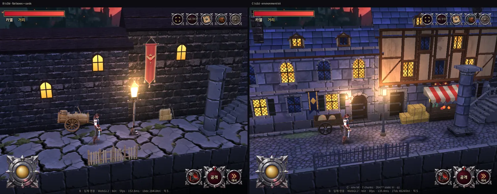

# 환경 키트 — 상자 세계를 "지은 마을"로 (장면 `v2c`)

`index.html?scene=v2c` · 코드 `src/v2/env/` · 보기 도구 `tools/v2/env_view.html` · 검사 `node tools/v2/envkit_check.mjs`
작성 2026-11-17. 소유자 의견("적과 모든 것들을 3D 로, 배경도 좀 더 디테일하게 — 사물이나 벽면 등도")에 대한 **배경 쪽 답**이다.
숫자는 §5. 헤드리스 Chromium 은 소프트웨어 렌더러(SwiftShader)라 **프레임 시간은 실제 기기 값이 아니다** — 삼각형·그리기 호출·메모리만 믿을 수 있다.

## 0. 한눈에

- 시범판 B 는 **납작한 상자에 타일을 바른 벽 + 색칠한 네모 창 + 세워 둔 그림판 소품**이었다. 키트는 같은 자리를 **실제 기하**로 다시 짓는다:
  깊이 있는 창(틀·창턱·살·덧문·불 켜진 유리), 아치 문과 계단, 밑돌·돌림띠·모서리돌·버팀벽, 내민 목조 위층, 돌기와 지붕(처마·용마루·굴뚝·지붕창), 아치 다리, 성문, 난간과 울타리, 연석과 올린 보도, 그리고 저폴리 3D 소품 12종.
- **놀이는 B 와 똑같다.** 충돌 상자는 B 의 `compileStage` 가 그대로 만들고(같은 숫자), 카메라·영웅·적·판정·HUD 는 B 의 장면을 상속해서 쓴다. B 가 입체 영웅(`src/v2/char3d/`)을 그리면 `v2c` 도 그대로 그린다.
- B 의 렌더러(`glr.js`)·셰이더·정점 형식을 **한 줄도 바꾸지 않았다.** 키트는 그 형식의 삼각형을 만들어 내는 순수 함수 모음이라 나중에 B 의 건축기로 그대로 들어갈 수 있다.
- 실행 중 빛 계산 0, 프레임마다 올리는 캔버스 0(추가분). 정적 기하는 "덩어리 × 텍스처"로 묶여 있다.

| 파일 | 내용 |
|---|---|
| `src/v2/env/geo.js` | 기하 쓰기 + 빛 굽기: `Geo`(quad·quad4·tri·poly·box·lathe 회전체·tube 각기둥) · `Frame`(벽면 틀) — 순수 JS, node 에서도 돈다 |
| `src/v2/env/mats.js` | 재질 표(`KMATS`) · 잡동사니 아틀라스 조각(`TRIM`) · 키트 텍스처 목록 |
| `src/v2/env/kit.js` | 건물 조각: `dressWall` `dressRoof` `dressFloor` `pave` `dressBlock` `dressStairs` `dressPillar` `arch` `gate` `railing` `woodFence` `windowAt` `doorAt` `timberFrame` |
| `src/v2/env/props.js` | 3D 소품 `PROPS`(12종) · 벽에 다는 것 `WALLPROPS`(간판·깃발·벽등) |
| `src/v2/env/build.js` | 스테이지 컴파일러 `compileEnv` (충돌은 B, 그림은 키트) · `validateEnv` |
| `src/v2/env/stage_slice0_env.js` | 다시 지은 시범 구간 (저작 데이터) |
| `src/v2/env/index.js` | 장면 `v2c` = B 장면을 상속 + 덩어리 가려 그리기 + 바닥 스티커 |
| `assets/v2/env/*.webp` | 텍스처 6장 (합계 248 KB) · 만드는 법 `tools/v2/envkit_tex.py` |
| `tools/v2/` | `env_view.html`(보기) · `envkit_check.mjs`(검사) · `envkit_shot.mjs` · `envkit_compare.mjs/.py`(B 와 나란히) · `envkit_view_shot.mjs` |

왼쪽 B · 오른쪽 `v2c` (폴드 화면, 같은 자리 · 같은 카메라):




## 1. 키트에 든 것 — 건물 조각

모든 조각은 **벽면 틀**(`Frame`: u = 벽을 따라 오른쪽, y = 위, w = 벽 바깥) 위에서 짓는다. 벽이 길 건너(−z)를 보든 골목 옆(±x)을 보든 같은 코드다.

| 조각 | 무엇이 생기나 | 삼각형 (시범 구간 실측) |
|---|---|---|
| 벽 `dressWall` | 격자로 쪼갠 벽면(창·문 자리는 **실제로 뚫린다**) + 밑돌(plinth) + 돌림띠 + 모서리돌(quoin) + 버팀벽(두 단, 비스듬한 머리) + 처마띠/갓돌/성가퀴 + 낮은 담의 기둥·쇠 난간 | 집 한 채 정면 750–1,360 · 골목 긴 벽 2,200 · 낮은 담 250–550 |
| 창 `windowAt` | 깊이 9 의 구멍(안쪽 문설주·창턱이 어둡다) + 돌/나무 틀 + 내민 창턱 + 십자 살 + 열어젖힌 덧문(띠쇠) + 납선 유리. `lit` 이면 유리가 스스로 빛나고 앞 벽·바닥에 빛을 굽는다. 네모/둥근 아치/뾰족 아치 | 약 40–70 |
| 문 `doorAt` | 깊이 15 의 아치 속 문짝(널 + 띠쇠 3줄 + 고리) + 문설주 + 홍예석·이맛돌 + 문 앞 계단(밟는 상자도 생긴다) | 약 60–90 |
| 목조 `timberFrame` | 기둥(창 양옆에 자동으로 선다) · 가로대 · 가새 · 들보. 위층은 `jetty` 만큼 길 쪽으로 내밀고 장선 끝이 보인다 | 층당 100–250 |
| 지붕 `dressRoof` | 돌기와 경사면 + 처마 널 + 용마루 + 박공 벽·박공널 + 굴뚝(갓돌·연통) + 지붕창(작은 맞배, 불 켜진 창) | 100–280 |
| 바닥 `dressFloor` | 36 단위 격자(빛 웅덩이가 곱게 구워진다) + **띠별 재질**(조약돌 길·판석 띠·이끼·흙) + 벽 밑동 그늘 | 구간 합 5,600 |
| 보도 `pave` | 높이 7 의 판석 보도 + 낱장 연석 + 젖은 도랑. 밟는 상자가 생겨 캐릭터가 실제로 올라선다 | 500 |
| 단상 `dressBlock` | 밑단 + 몸통 + 내민 갓돌 + 판석 윗면 + 뒤쪽 난간동자 | 520 |
| 계단 `dressStairs` | 칸마다 밝은 디딤판·어두운 챌판 + 비스듬히 오르는 옆 벽(갓돌) + 끝 기둥 | 130–390 |
| 기둥 `dressPillar` | 네모 주춧돌 + 10각 배흘림 몸통 + 머릿돌 | 100 |
| 아치 `arch` | 골목을 건너는 아치 다리: 홍예석 띠 + 이맛돌 + 밑면 + 성가퀴 + 받침돌 | 136 |
| 성문 `gate` | 뾰족 아치 속 내림 쇠창살 + 양옆 버팀 기둥 | 벽에 포함 |
| 난간 `railing` · 울타리 `woodFence` | 쇠: 기둥 + 가로대 + 끝이 뾰족한 창살 / 나무: 기둥 + 널 + 기운 말뚝 | 길이 100 당 약 80 |

깊이감을 싸게 내는 장치(전부 구운 값, 실행 비용 0):
- **벽 밑동·바닥 닿는 곳의 그늘**: 벽은 아래 70 단위가 어둡고, 바닥은 벽·단상·기둥에서 46 단위 안쪽이 어둡다.
- **처마·내민 층 밑 그늘**, **창·문 안쪽 어둠**(문설주 0.5–0.6배), 지붕 처마 쪽 어둠.
- **빛 웅덩이**: 가로등·화로·벽등·불 켜진 창이 바닥과 벽에 따뜻한 빛을 굽는다(빛 43개). 가로등·화로 밑에는 바닥 스티커를 한 장 더 깐다.
- **얼룩 잡음**: 꼭짓점 색에 낮은 주파수 잡음(±8–15 %) + 집마다 다른 색조 → 긴 벽이 되풀이되어 보이지 않는다.
- 보이지 않는 면(카메라는 늘 화면 안쪽을 본다: 뒤를 보는 면, 낮은 곳의 밑면)은 아예 만들지 않는다 → 삼각형 약 25 % 절약.
- 소품은 구운 빛을 캐릭터와 같은 식으로 들어 올린다(`Geo.lift`) → 어두운 길에서도 장애물이 읽힌다(B 의 그림판 색조와 같은 생각).

## 2. 3D 소품 (세워 둔 그림판 대신)

`PROPS[이름](G, x, y, z, 옵션)` — 텍스처를 입힌 저폴리 메시. 충돌은 스테이지 줄의 `solid` 값이 맡으므로 B 와 같다.

| 소품 | 삼각형 (보이는 면만 / 전부) | 생김새 |
|---|---|---|
| 술통 `barrel` | 104 / 168 | 배부른 10각 몸통 + 쇠 테 3줄 + 뚜껑 |
| 나무 상자 `crate` | 80 / 84 | 널 + 테두리 널 + 가새 (크기를 주면 B 의 상자 장애물 자리에 그대로) |
| 손수레 `cart` | 262 / 314 | 짐칸 + 살 달린 바퀴 2 + 손잡이 + 받침 다리 + 자루 2 |
| 우물 `well` | 125 / 151 | 돌 테 + 물 + 기둥 + 도르래 줄 + 두레박 + 작은 지붕 |
| 가로등 `lamp` | 129 / 182 | 쇠 받침·기둥·가로대 + **빛나는 등불 상자** + 빛 번짐·바닥 빛 |
| 가판대 `stall` | 284 / 382 | 판매대 + 기둥 4 + 줄무늬 차양(늘어진 술) + 궤짝·채소·병 |
| 화로 `brazier` | 82 / 106 | 세 다리 + 쇠 그릇 + 이글거리는 숯 + 불꽃 |
| 건초 `hay` | 48 | 짚단 3개 + 묶는 끈 |
| 묘비 `tomb` | 38 | 둥근 머리 석판 또는 십자, 조금 기울어 있다 |
| 분수대 `fountain` | 128 / 192 | 팔각 수반 + 물 + 기둥 + 윗 접시 |
| 석상 `statue` | 158 / 215 | 받침대 + 두건 쓴 수호자(칼을 짚고 선 모습)의 회전체 — **시범 구간에서는 쓰지 않음**(아래) |
| 마른 나무 `tree` | 168 / 192 | 휘어 오르는 줄기 + 가지 두 층 + 잔가지 |
| 벽걸이 `sign` `banner` `sconce` | 20–60 | 걸이 간판(골목에서는 카메라를 본다) · 제비꼬리 깃발 · 벽등 |

**그림판으로 남긴 것: 가고일 2개와 천사상 2개.** 날개·얼굴 같은 유기적인 모양은 손으로 짠 저폴리로 만들면 지금 그림보다 못하다. 키트의 3D 석상(`statue`)을 골목에 세워 봤더니 가까이서 "두건 쓴 덩어리"로만 읽혀 B 의 천사상 그림보다 분명히 못했다 → 시범 구간에서는 그림판으로 되돌리고, 3D 석상은 보기 도구의 늘어놓기에만 남겼다(§7·§8: 생성 3D 모델이 필요한 첫 대상).

## 3. 텍스처와 재질

- 새 텍스처 6장을 `assets/v2/env/` 에 두었다: `k_ashlar`(다듬은 돌 쌓기) · `k_plaster`(회벽) · `k_slate`(돌기와, 256²) · `k_cobble`(조약돌) · `k_flag`(판석) · `k_trim`(잡동사니 아틀라스: 참나무 널·불 켜진 납선 유리·어두운 유리·짚·쇠·천·숯·흰색). 모두 512²(기와만 256²), webp 5–66 KB, **합계 248 KB**.
- **코드로 만든 텍스처다**(`python3 tools/v2/envkit_tex.py`, 주기 잡음이라 이음매가 없다, 같은 씨앗이면 늘 같은 결과). Higgsfield 생성은 이번 작업에서 **쓰지 못했다**(생성 요청이 실행 권한 단계에서 거절됨, 0 크레딧) — §7 의 약점 1 과 이어진다.
- B 가 이미 올리는 v1 타일 5장(`flag`·`block`·`brick`·`wood`·`dirt`)도 그대로 쓴다(거친 돌벽·단상·계단·나무·흙·골목의 갈라진 판석).
- 재질 표 `KMATS`: 텍스처 + 타일 크기 + 색. 아틀라스 조각 재질(`timber`·`glass`…)은 반복하지 않고 면 크기에 맞춰 조각 안에 넣는다.
- 픽셀 단위 빛·노멀맵은 **넣지 않았다**(기기가 이미 끊긴다). 품질 단계는 하나만 있다: `?envq=0` 이면 반투명 꾸밈(얼룩·물웅덩이·바닥 빛 웅덩이·빛 번짐 바깥 겹)을 끈다 → 겹쳐 칠하는 양이 준다.

## 4. 스테이지를 쓰는 법 (저작 형식)

**B 의 parts 형식 그대로 + 꾸밈 필드.** 한 줄 = 눈에 보이는 한 덩어리라는 약속은 같다.

1. B 의 part(`floor` `block` `wall` `stairs` `pillar` `roof` `blocker` `prop` `light`)는 숫자를 그대로 쓴다 → 충돌·검증(`validateStage`)이 B 와 같다.
2. 거기에 `kit:{…}`(어떻게 꾸밀지)와 `mesh:'이름'`(그림판 대신 3D 소품)을 덧붙인다.
3. 키트 전용 줄: `pave`(올린 보도) · `arch`(아치 다리) · `fence`(쇠/나무 울타리) · `deco`(충돌 없는 3D 소품).
4. `chunks`(메시를 나누는 덩어리)와 `decals`(바닥 얼룩)는 스테이지 맨 위에.

```js
// 목조 3층 집 한 채 = 벽 한 줄 + 지붕 한 줄  (src/v2/env/stage_slice0_env.js 발췌)
{ t: 'wall', x: 440, z: 260, w: 470, d: 90, h: 350, mat: 'plaster', kit: {
    style: 'timber',            // stone(돌집) · timber(아래 돌 + 위 목조) · plaster · rubble(거친 돌) · low(낮은 담)
    faces: 'F',                 // 꾸밀 면: F 앞(−z) · L(−x) · R(+x)
    base: 7,                    // 벽 앞 땅 높이 (올린 보도 위)
    storey: 150, jetty: 14,     // 150 부터 위층, 길 쪽으로 14 내민다
    windows: [ { u: 250, y: 60, w: 84, h: 64, lit: 0.9, cols: 3, rows: 2 },          // u = 벽 왼끝에서, y = 벽 밑에서
               { u: 395, y: 66, w: 42, h: 62, shutters: true },
               { u: 110, y: 176, w: 42, h: 56, lit: 0.5, frame: 'timber' } ],
    doors:   [ { u: 75, w: 58, h: 104, rise: 7 } ],                                   // rise = 문턱 높이(계단 한 칸 = 7)
    hang:    [ { type: 'sign', u: 250, y: 128, w: 78, h: 20 } ],                      // 간판 · banner · sconce(벽등 + 빛)
} },
{ t: 'roof', x: 440, z: 260, w: 470, d: 90, y: 350, h: 70, kit: { chimneys: [{ u: 390, t: 0.75 }], dormers: [{ u: 150, lit: 0.5 }] } },
{ t: 'prop', mesh: 'barrel', x: 1500, z: 214, h: 78, solid: 24 },                     // 3D 소품 (충돌 반지름 24 — B 와 같은 값)
{ t: 'pave', x: -60, z: 240, w: 2040, d: 20, h: 7, kerb: 'F' },                       // 보도 + 연석 + 도랑
{ t: 'fence', kind: 'iron', x0: 196, z0: 5, x1: 464, z1: 5, h: 44 },
```

- 시범 구간 전체 = part 80줄(B 는 84줄) + 얼룩 28줄. B 의 숫자에 `kit` 을 덧붙이는 데 든 시간은 약 30분(키트를 만든 시간 제외).
- `compileEnv(stage)` → B 의 세계 `W`(상자·빛·구간·적) + `W.env`(메시·덩어리 경계·스티커). node 에서 0.4초.
- 검증: `validateEnv(stage)` = B 의 `validateStage` (시작 위치에서 모든 적·구간·goal 에 닿는가).
- 카메라 규칙은 B 와 같다: 카메라와 놀이 공간 사이에 카메라보다 높은 것을 두지 않는다. 내민 위층·간판·차양은 캐릭터 머리(80)보다 위에만 둔다. 골목 아치는 카메라 길(높이 약 340)보다 높게 잡았다(시작 338 + 낮은 호).

## 5. 숫자 (`node tools/v2/envkit_check.mjs --base 1`, 2026-11-17, 헤드리스 fold_open)

<!-- numbers:begin -->
| | 시범판 B (`v2b`) | 꾸민 배경 (`v2c`) | 목표 |
|---|---|---|---|
| 세계 정적 삼각형 (구간 전체) | 8,526 | **26,477** (거리 덩어리 11,113 · 골목+마당 덩어리 15,364) | — |
| 한 화면 삼각형 — 세계 + 스프라이트 | 약 8,800 | 약 26,700 (거리·골목) · 15,500 (뜰·마당) | ≤ 60,000 |
| 한 화면 삼각형 — 입체 영웅 포함 | 28,400 | **46,300** (거리·골목) · 35,200 (뜰·마당) | ≤ 60,000 |
| 그리기 호출 (영웅 포함, 서 있을 때) | 18–30 | **17–32** (그중 정적 메시 18 / 마당 9) | ≤ 40 |
| 그리기 호출 — 봇이 끝까지 싸우며 가는 동안 최대 (영웅 제외) | — | 33 | ≤ 40 |
| 텍스처 메모리 (GL, 밉맵 포함) | 20.7 MB | **27.7 MB** (키트 텍스처 +7.0 MB) | — |
| 정점 버퍼 | 850 KB | **2,320 KB** | — |
| 텍스처 파일 | (v1 타일 재사용) | 6장 248 KB (가장 큰 것 66 KB) | 장당 ≤ 150 KB |
| 프레임마다 올리는 캔버스 | 캐릭터 아틀라스 1 | 같다 (추가 0) | 추가 0 |
| 들어갈 때 세계 컴파일 | 약 0.1초 | 0.2–0.5초 (빛 43개 × 꼭짓점 8만) | — |
| 봇이 구간을 끝까지 (무적 없음) | 통과 | **통과** — 폴드·휴대폰 모두 40–45초(게임 시간, 세 번 돌림), 최저 체력 91, 쓰러짐 0 | 통과 |
| 페이지 오류 | 0 | 0 (폴드·휴대폰·배포 빌드) | 0 |
| 배포 빌드(`build_web.mjs`) + CSP 에서 열림 | 예 | 예 (키트 텍스처 6장을 실제로 받음) | — |
<!-- numbers:end -->

- 입체 영웅 모델 한 명이 19,638 삼각형·텍스처 21.4 MB 다(`src/v2/char3d/` 값). **지금 화면에서 가장 큰 덩어리는 배경이 아니라 영웅이다.**
- 봇이 달리는 동안 삼각형이 순간 15–16만, 그리기 호출이 39–43 까지 튄다: **대시 잔상이 영웅 모델을 여러 번 통째로 다시 그리기 때문**이다(B·char3d 쪽 코드). 기기에서 끊김의 한 원인일 수 있어 요청서에 적었다.
- 덩어리 가려 그리기: 메시를 **거리 / 골목+마당** 두 덩어리로 나누고 경계 상자가 시야 밖이면 그리지 않는다. 뜰·마당에서는 거리 덩어리(11,113 삼각형·그리기 9)가 빠진다. 거리에서는 먼 성벽이 지붕 너머로 보여 둘 다 그린다. (처음에는 골목과 마당도 나눴는데 늘 같이 보여서 그리기 호출만 5회 늘었다 → 합쳤다.)
- 반투명 꾸밈(매 프레임 동적 묶음에 쓰는 사각형): 얼룩 28 + 빛 웅덩이 11 + 소품 그림자 34 + 빛 번짐 14×2. 가까운 것만 쓴다. 그리기 호출은 B 의 스티커 묶음 1회에 같이 들어간다.

## 6. 검사와 보기

- `node tools/v2/envkit_check.mjs [--devices fold_open,phone2] [--base 1] [--json 파일]`
  ① 데이터 검증 ② 텍스처 파일 크기 ③ 장면이 뜨는가 ④ 구간 7곳의 그리기 호출·삼각형·덩어리 수와 예산 ⑤ **봇이 처음부터 마당까지 걸어 적을 모두 쓰러뜨림**(무적 없음) ⑥ 페이지 오류 0 ⑦ 나가기(자원 정리). `--base 1` 이면 B 를 같은 방법으로 재서 견준다.
  - 봇은 B 검사(`proto_b_check.mjs`)의 봇에 **한 줄을 더한 것**이다: 같은 적에게 세 번 막히면 7초 동안 잊고 길을 따라간다. 까닭: 골목 어귀의 벽 모서리와 나무 상자 사이(x 2020, z 269)에 근접 적이 끼면 영웅과 적이 서로 깊이를 못 맞춰 멈춘다. **B 의 세계에서도 똑같이 생기는 일**이다(같은 상자로 node 에서 `Sim` 만 돌려 재현). 키트 탓이 아니라 스테이지 배치·적 길찾기의 과제라 요청서에 적었다.
  - 숫자를 재려고 구간마다 순간 이동하면 적이 깨어 골목 어귀로 몰려와 위 상황이 잘 생긴다 → 검사는 숫자를 잰 뒤 `sim.reset()` 으로 처음 상태로 돌리고 봇을 돌린다.
- `tools/v2/env_view.html` — 게임 없이 배경만 본다. `?mode=gallery`(키트 조각·소품 늘어놓기, 돌려 보기) / `?mode=slice`(다시 지은 구간, 단추로 거리·모퉁이·골목·마당의 **게임 카메라 틀**). 드래그 = 돌리기, 휠 = 거리, WASD = 옮기기. 개발 서버(`node tools/serve.mjs`)에서 연다.
- 나란히 비교: `node tools/v2/envkit_compare.mjs && python3 tools/v2/envkit_compare.py` → `/tmp/claude-0/v2/envkit/cmp_1_street.png` … `cmp_6_yard.png` (왼쪽 B, 오른쪽 `v2c`, 폴드 화면).

## 7. 아직 약한 곳 (비교 그림을 직접 보고 적음)

1. **텍스처가 손그림보다 밋밋하다.** 새 6장은 코드로 만든 것이라 가까이서 보면 "무늬"로 읽힌다. 특히 조약돌은 칸 나눔이 규칙적이라 모자이크 같다. B 가 쓰는 v1 손그림 타일(갈라진 판석)이 한 장 한 장은 더 보기 좋다 — 그래서 골목 바닥은 v1 타일을 그대로 썼다. 벽·지붕·회벽은 그려진(또는 생성한) 텍스처로 바꾸면 바로 좋아진다(형식은 그대로, 파일만 바꾸면 된다).
2. **소품의 표면이 단순하다.** 실루엣은 3D 로 읽히지만(바퀴 살, 술통 테, 차양, 등불) 나무결·녹·때 같은 겉이 타일 한 장이라, B 의 채색 그림판보다 색이 수수하고 어둡다(나무 상자·술통). 석상·가고일 같은 조각상은 손으로 짠 저폴리로는 안 된다 — 그래서 넷은 아직 그림판이다("모든 것을 3D 로"에서 남은 숙제).
3. **계단 현상**(안티에일리어싱 없음)이 가는 것(쇠 난간, 창살, 목조 뼈대)에서 B 보다 더 눈에 띈다. 기기 여유가 확인되면 MSAA 를 켜야 한다.
4. **모서리가 전부 직각**이다. 돌 모서리의 닳은 면, 기와의 들쭉날쭉한 끝, 휘어진 들보가 없다.
5. 빛이 꼭짓점 단위라 창에서 나오는 빛 모양이 뭉툭하다. 그림자는 여전히 둥근 얼룩이다.
6. 거리에서 구간 전체(덩어리 둘)를 다 그린다(먼 성벽이 지붕 너머로 보인다). 장이 커지면 덩어리를 방 단위로 나누고 먼 것은 단순한 메시로 바꿔야 한다.
7. **성문이 납작하다.** 아치 속을 실제로 뚫지 않고 벽 앞에 어두운 면과 쇠창살을 덧댄 것이라, B 의 성문 그림(돌 아치 + 창살)보다 깊이가 덜하다. 마당 바닥의 판석 길도 흙과 만나는 가장자리가 칼로 자른 듯 곧다(띠 재질의 한계 — 가장자리 얼룩 스티커나 섞임 정점 색이 필요).
8. 가판대 하나가 B 에 없던 충돌(벽 쪽 144×46)을 더했고, 올린 보도(높이 7)와 문 앞 계단(높이 14) 위에 캐릭터가 실제로 올라선다. 봇 길과 검증은 통과하지만 "B 와 한 치도 다르지 않은 바닥"은 아니다.

## 8. 그린(또는 생성한) 3D 모델을 쓰면 무엇이 달라지고 얼마가 드나

| 방법 | 얻는 것 | 비용 |
|---|---|---|
| **지금 방식 + 그린 텍스처** (권장 첫걸음) | 약점 1 이 풀린다. 벽·지붕·바닥·나무 6–8장만 바꾸면 모든 집이 좋아진다 | Higgsfield `gpt_image_2_5` 1장 0.25 크레딧 × 8–12장 = 2–3 크레딧 + 이음매 손질(자동 스크립트) 반나절. 실행 비용 변화 없음 |
| 소품을 **생성 3D 모델**로 (술통·수레·석상·가고일·나무 등 눈에 띄는 것 10–15종) | 약점 2 가 풀린다: 구운 색·닳은 모서리·유기적인 모양(석상·가고일·나무) | 영웅 모델 기준으로 1개에 생성 수 크레딧 + 손질(삼각형 줄이기·크기 맞추기) 30–60분. 소품 하나를 500–1,500 삼각형·256² 텍스처로 줄이면 화면에 20개 = 삼각형 +2만·텍스처 +5 MB. **줄이지 않고 쓰면 영웅처럼 하나에 2만 삼각형·20 MB 라 못 쓴다** |
| 건물 전체를 생성 모델로 | 집마다 다른 개성 | 권하지 않는다: 충돌 상자와 어긋나고, 장마다 새로 만들어야 하고, 창 불빛·빛 굽기를 따로 맞춰야 한다. 키트 조각 + 좋은 텍스처가 60장 이상을 찍어내는 데 맞다 |
| 손으로 모델링(블렌더) | 가장 좋은 품질, 정확한 삼각형 수 | 사람 손이 필요하다 |

### 비교 그림을 보고 내린 판정 (`/tmp/claude-0/v2/envkit/cmp_*.png`)

| 자리 | 더 세밀한가 | 사물이 덩어리로 읽히나 | 싸 보이거나 시끄러운 곳 |
|---|---|---|---|
| 1 거리 | 분명히 그렇다 — 벽 한 장이 집 네 채(돌집·목조·예배당·목조)로 읽힌다 | 수레·건초·가판대·기둥 모두 입체 | 조약돌 무늬가 조금 시끄럽다. 쇠 난간에 계단 현상 |
| 2 건물 정면 가까이 | 가장 큰 차이 — 창 깊이, 덧문, 아치 문, 목조 뼈대, 내민 층 | — | 가까이서는 회벽·돌 텍스처가 밋밋하고 문짝 널이 흐리다 |
| 3 가로등·소품 | 그렇다 | 술통·상자·우물·가로등이 입체. 등불이 실제 상자 | 나무 겉이 B 의 그림보다 단순 |
| 4 골목 | 그렇다 — 간판·깃발·벽등·버팀벽·내민 층이 원근을 따라 늘어선다 | 그렇다 | 왼쪽 벽이 화면 가장자리에서 크게 잘린다(B 와 같은 카메라 문제) |
| 5 계단 | 조금 — 옆 벽·갓돌·끝 기둥이 생겼다 | — | 계단 자체는 B 와 비슷하다 |
| 6 마당 | 그렇다 — 성가퀴·깃발·좁은 창·버팀벽·쇠 난간 | 화로가 입체 | 성문이 그림보다 납작(약점 7), 판석 길 가장자리가 곧다 |

## 9. 다음 단계

1. **폴드에서 `?scene=v2c` 를 직접 본다.** 맨 아래 작은 글자 줄에 fps 가 나온다. B 와 견줘 더 끊기면 `?scene=v2c&envq=0` 으로 반투명 꾸밈을 끄고 다시 본다(삼각형 3배·버퍼 2.8배가 실제로 부담인지 여기서 갈린다).
2. 텍스처 6–8장을 그린 것으로 교체(§8 첫 줄).
3. 키트를 B 의 정식 건축기로 옮긴다: `compileStage` 가 `kit`·`mesh` 를 직접 읽게 하고(지금은 B 를 상속해 바꿔 끼우는 돌아가는 길 — 요청서 참고), 창 불빛·간판·등불을 스테이지 검증에 넣는다.
4. 덩어리를 방 단위로 더 잘게 + 먼 덩어리용 단순 메시, 굽기 때 빛을 가까운 것만 보게 해서 컴파일 0.1초로.
5. 눈에 띄는 소품 10종을 생성 3D 로 시험(삼각형 1,500 이하·256² 로 줄이는 손질 포함) → 석상·가고일부터.
6. 장마다 다른 분위기 묶음(성·묘지·성당): 재질 표와 벽 양식만 더하면 조각은 같이 쓴다.
