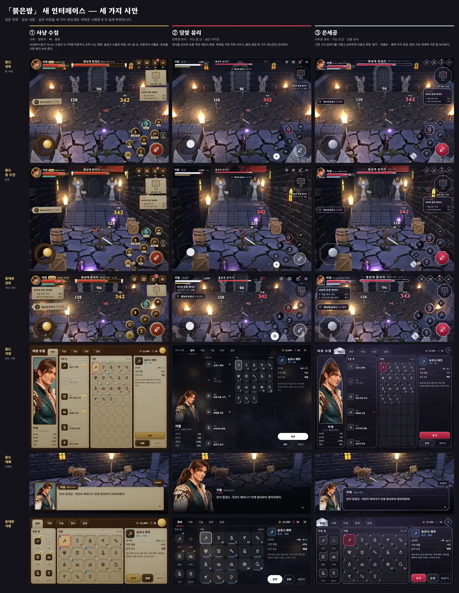
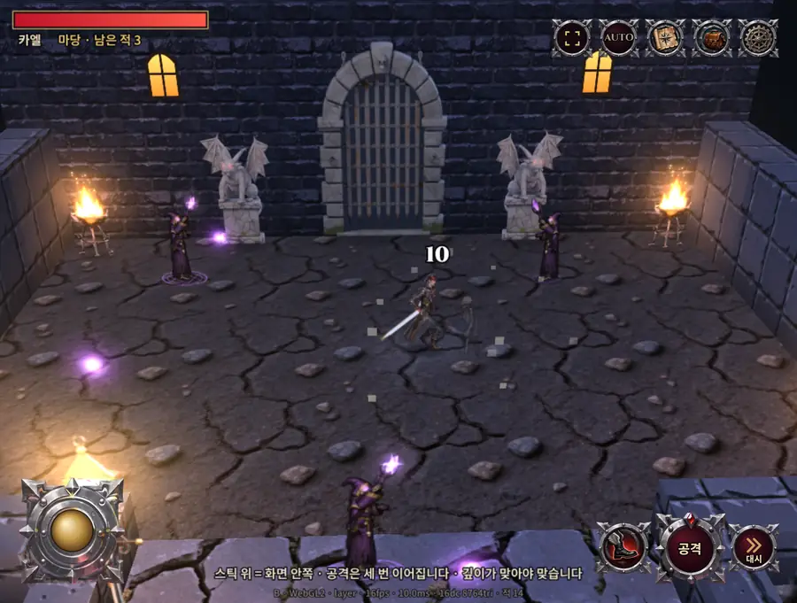
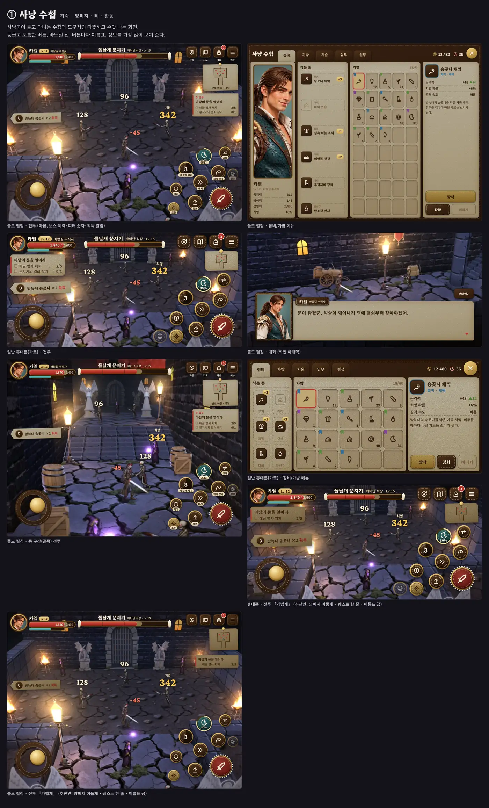
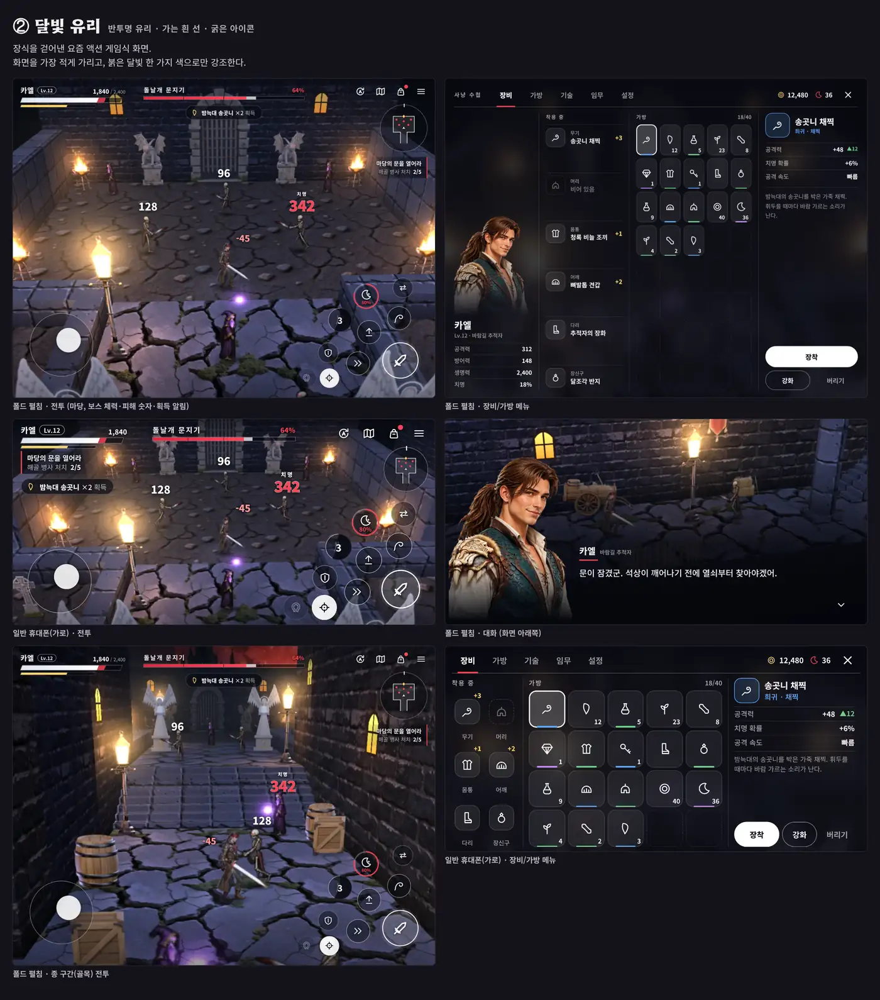
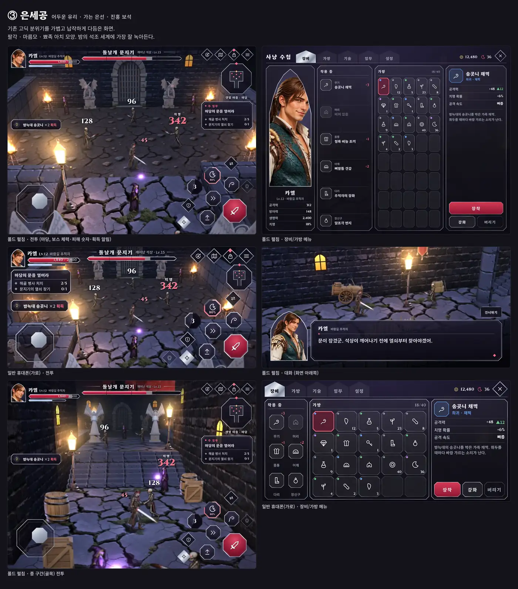
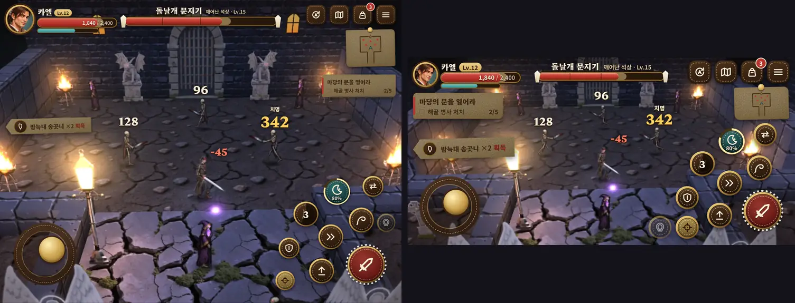

# 「붉은밤」 인터페이스 시안 (UI 파일럿)

2026-11-17 · 소유자 결정 "인터페이스도 지금 배경에 어울리게 다 갈아 엎자"(헌장 §2)에 따른 **세 가지 후보**다.
세 시안 모두 시범판 B 의 실제 화면 위에 같은 내용 · 같은 버튼을 얹은 **눌리는 웹 페이지**로 만들었다(`tools/v2/ui_mock/`).
유료 그림 생성은 쓰지 않았다(0 크레딧) — 질감 · 틀 · 아이콘 모두 코드로 그렸다.

> **소유자 결정 (헌장 §2, 2026-11-17):** 세 시안 가운데 **② 「달빛 유리」(반투명) 방향으로 간다** — 버튼은 배경이 비쳐 보이게, 얇은 테의 반투명 원에 흰 동작 그림, 큰 공격 버튼 둘레에 기술 버튼.
> 이 결정은 시안 작업 도중에 내려졌다. ① · ③은 비교 기록으로 남기고, ②는 결정에 맞춰 한 번 더 다듬었다(§6). 참고 화면의 아이콘 · 배치는 베끼지 않았다.



큰 그림: `/tmp/claude-0/v2/uipilot/owner_ui_compare.png` (세 시안 나란히) · `owner_ui_fieldkit.png` · `owner_ui_glass.png` · `owner_ui_silver.png`

## 1. 지금 인터페이스가 왜 안 맞나



| | v1 인터페이스 | 새 세계(시범판 B) · 새 캐릭터 |
|---|---|---|
| 재질 | 가시 돋친 무거운 고딕 금속 테(`assets/ui/hud/ring_*.webp`), 금테 두른 검은 판 | 단순한 면의 돌 · 나무, 가로등의 따뜻한 빛, 푸른 밤. 캐릭터는 가죽 · 뼈 · 황동의 수렵 장비 |
| 밀도 | 버튼 하나의 장식이 배경 벽 한 칸보다 촘촘하다 → 눈이 세계보다 버튼으로 먼저 간다 | 세계는 큼직한 덩어리와 빛으로 읽힌다 |
| 깊이 | 버튼마다 진한 입체 음영 → 원근이 있는 세계 위에서 "또 하나의 입체물"처럼 떠서 깊이감을 흐린다 | 화면 자체가 입체다. 그 위에 얹는 것은 납작할수록 세계가 산다 |
| 정보 | 체력 막대 한 줄 + 이름. 지도 · 퀘스트는 버튼 뒤에 있다 | 앞뒤로 움직이므로 **방향(미니맵)과 목표(퀘스트 한 줄)**가 늘 보여야 길을 잃지 않는다 |
| 색 | 금 + 검정 + 피빛 | 붉은 달 · 등불의 주황 · 돌의 남보라 |

그대로 지킨 조건 (세 시안 공통, 자동 검사 `tools/v2/ui_mock/render.mjs`):

- 폴드 펼침(1000×756 CSS px, 거의 네모)과 일반 휴대폰(740×360) 둘 다. 눌리는 것은 모두 **44 CSS px 이상**, 서로 겹치지 않음, 화면 밖으로 나가지 않음.
- 엄지: 스틱은 왼쪽 아래, 행동 버튼은 오른쪽 아래 구석에서 손이 닿는 호 안.
- 안전 영역(펀치홀 · 제스처 바)만큼 들여 그린다(`env(safe-area-inset-*)`).
- 한국어. 버튼 묶음은 지금과 같다: 스틱 · 공격 · 점프 · 대시 · 기술 2 · 궁극기 · 교대 · 탑승 · 막기 · 조준, 시스템 줄(자동 · 지도 · 가방 · 메뉴).
- 화면에 넣은 것: 영웅 체력 · 기력 · 이름 · 레벨, 시스템 줄, 미니맵, 퀘스트, 보스 체력, 피해 숫자, 획득 알림, 대화(카엘 ③ 흉상), 장비/가방 메뉴 한 화면.

## 2. 세 시안

### ① 사냥 수첩 — 가죽 · 양피지 · 뼈 · 황동

사냥꾼이 들고 다니는 수첩과 도구처럼 따뜻하고 손맛 나는 화면.
둥글고 도톰한 버튼, 바느질 선, 버튼마다 이름표. 정보를 가장 많이 보여 준다.



- **모양:** 원 · 둥근 모서리. 가죽 원판에 황동 테, 점선 바느질, 공격 버튼만 뼈 징을 두른 붉은 가죽. 미니맵 · 퀘스트 · 획득 알림은 살짝 기울어진 양피지 조각.
- **색:** 가죽 갈색 · 양피지 · 뼈색 · 황동, 체력은 붉은 가죽끈, 기력은 카엘 조끼의 청록.
- **글자:** 제목 · 이름은 명조 계열(Hahmlet), 숫자 · 본문은 고딕(Noto Sans KR). 양피지 위는 **어두운 잉크색 글자**.
- **보여 주는 양:** 가장 많다 — 초상, 직업 이름, 버튼 이름표, 퀘스트 두 줄, 스테이지 이름.
- **좋은 점:** 새 캐릭터의 장비(가죽 · 뼈 · 황동)와 같은 재질이라 캐릭터와 화면이 한 벌로 보인다. 등불의 따뜻한 빛과 잘 맞는다. 밝은 바탕에 어두운 글자라 대화 · 아이템 설명 같은 **긴 한국어 문장이 가장 잘 읽힌다**. v1 과 가장 달라 "새 게임"으로 보인다.
- **약한 점:** 밤 장면에서 양피지가 화면에서 가장 밝은 것이 되어 눈을 끈다(전투 중에는 한 단계 어둡게 무두질한 색으로 낮춰야 한다). 화면을 가장 많이 차지한다. 만들 것이 가장 많다(질감 · 틀 · 아이콘 손맛).

### ② 달빛 유리 — 반투명 유리 · 가는 흰 선 · 흰 동작 그림 (소유자가 고른 방향)

장식을 걷어낸 요즘 액션 게임식 화면.
화면을 가장 적게 가리고, 붉은 달빛 한 가지 색으로만 강조한다.



- **모양:** 원과 알약. 버튼은 **배경이 비쳐 보이는 반투명 원**(가운데만 살짝 어둡게 해 그림이 읽히게 함)에 1–2 px 흰 테, 안에는 흰 채움 그림. 지금 쓰면 좋은 기술은 호박색 고리로 알린다. 체력 막대는 기울인 가는 띠. 시스템 줄은 테 없는 아이콘.
- **색:** 흰색 + 어두운 유리 + 강조색 하나(붉은 달 `#ff4458`: 보스 · 치명타 · 궁극기 · 알림 점). 기력만 호박색.
- **글자:** 고딕 한 가지(Noto Sans KR), 숫자는 폭이 같은 숫자.
- **보여 주는 양:** 가장 적다 — 초상 없음, 버튼 이름표 없음, 퀘스트 한 줄, 보스는 이름 · 퍼센트 · 6 px 막대.
- **좋은 점:** 입체 세계가 주인공이 된다(가리는 넓이가 가장 작다). 어떤 장 · 어떤 색 배경에도 무난하다. 만들기 가장 싸고 가볍다(그림 파일 0, 글꼴도 줄일 수 있다).
- **약한 점:** 개성이 가장 약하다 — 어느 게임에나 있을 화면이다. 가죽 · 뼈의 따뜻한 캐릭터와 온도가 다르다. 가는 흰 선과 글자는 횃불 · 가로등처럼 밝은 곳 위에서 묻힐 수 있다(퀘스트 줄 뒤에 옅은 어둠을 깔아 막았다). 이름표가 없어 처음 하는 사람에게 불친절하다.

### ③ 은세공 — 어두운 유리 · 가는 은선 · 진홍 보석

기존 고딕 분위기를 가볍고 납작하게 다듬은 화면.
팔각 · 마름모 · 뾰족 아치 모양. 밤의 석조 세계에 가장 잘 녹아든다.



- **모양:** 모서리를 딴 판, 팔각 버튼(주 버튼) · 마름모(보조 버튼 · 시스템 줄), 뾰족 아치 초상, 끝이 뾰족한 막대. 입체 음영 없이 가는 은선 두 겹.
- **색:** 남빛 도는 검은 유리 + 은 + 진홍(공격 버튼 · 체력 · 선택).
- **글자:** 제목 · 이름은 Hahmlet, 숫자는 Cinzel(둘 다 지금 게임에 들어 있다), 설명은 고딕.
- **보여 주는 양:** 중간 — 초상 · 직업 이름 · 퀘스트 두 줄은 있고 버튼 이름표는 없다.
- **좋은 점:** 돌 · 철문 · 석상의 세계와 색 · 모양이 가장 가깝다. 뱀파이어 헌터라는 정체성이 남는다. 지금 글꼴과 v1 아이템 그림(고딕 채색)을 그대로 쓸 수 있어 옮겨 오기 쉽다.
- **약한 점:** 소유자가 "갈아엎자"고 한 옛 분위기에 가장 가깝다. 마름모는 누르는 넓이는 같아도 눈에는 작아 보인다. 뾰족한 모양과 차가운 색이 "호감 가는 사냥꾼"보다 날카롭다. 작은 명조 글자는 휴대폰에서 고딕보다 덜 읽힌다.

## 3. 잰 값

헤드리스 Chromium(DPR 2.6 / 3)에서 `render.mjs` 가 잰 값. 기록 `/tmp/claude-0/v2/uipilot/measure.json`. 26 화면(세 시안 × 두 기기 × 전투 · 종 구간 · 대화 · 가방, ①의 「가볍게」 2장) 모두 겹침 0 · 화면 밖 0 · 44 px 미만 0.

| | ① 사냥 수첩 | ② 달빛 유리 | ③ 은세공 |
|---|---|---|---|
| 전투 화면에서 가장 작은 버튼 (폴드 / 휴대폰)⁰ | 46 / 44 px | 46 / 44 px | 50 / 46 px |
| 인터페이스가 차지하는 넓이¹ (폴드 / 휴대폰) | 21 % / 35 % | 15 % / 28 % | 21 % / 35 % |
| 화면 가운데(가로세로 60 %)를 가리는 넓이 (폴드 / 휴대폰) | 2.7 % / 9.0 % | 1.1 % / 4.5 % | 2.6 % / 8.7 % |
| 오른쪽 아래 구석에서 가장 먼 행동 버튼² (폴드 / 휴대폰) | 325 / 260 px | 307 / 246 px | 311 / 260 px |
| 가장 작은 글자 (폴드 / 휴대폰) | 10 / 10 px | 10.5 / 10 px | 10.5 / 10 px |
| 대화 본문 글자 (폴드 / 휴대폰) | 20 / 15 px | 20 / 15 px | 19.5 / 15 px |

⁰ 대화 · 메뉴까지 합친 전체 최소는 세 시안 모두 44 px (건너뛰기 버튼, 휴대폰 메뉴의 탭 · 버튼).
¹ 각 덩어리를 둘러싼 네모의 합이라 실제 그려진 넓이보다 크다(원 · 마름모의 빈 귀퉁이 포함). 시안끼리 비교하는 용도.
² 폴드 화면 가로를 약 155 mm 로 보면 325 px ≈ 50 mm. 실제 기기에서 손으로 확인한 값은 아니다.

눈으로 본 것(캡처 26장 + 모음 4장 전부 확인):

- 정지 화면에서는 세 시안 모두 영웅 · 적 · 피해 숫자를 가리지 않는다. *(검수에서 고쳐 씀: 실제로 돌려 보면 영웅은 한 번도 가려지지 않지만, 적은 표본의 0–6 % 가 획득 알림 · 퀘스트 쪽지 · 교대/궁극기 버튼 아래로 들어간다 — §9)* 폴드는 위쪽이 벽 · 하늘이라 위 가운데의 보스 막대가 전투를 가리지 않는다.
- 휴대폰(높이 360)은 어느 시안이든 오른쪽 1/3 이 버튼으로 찬다. 버튼 수(10개)가 원인이라 생김새로는 못 줄인다 → §7 질문 5.
- 종 구간(골목)에서는 길이 화면 가운데로 뻗어 좌우 가장자리 인터페이스와 겹치지 않는다.
- ①의 양피지(미니맵 · 퀘스트 · 알림)는 밤 화면에서 가장 밝다. ②③은 어두운 판이라 배경에 묻히듯 앉는다.

## 4. 글꼴

지금 들어 있는 것(`assets/fonts`, 첫 화면 예산 500 KB 중 약 483 KB 사용): Noto Sans KR 173 KB · Hahmlet 247 KB · Grenze Gotisch 24 KB · Cinzel 24 KB · Cinzel Decorative 13 KB · BN Num 2 KB (+ 나중에 받는 확장 · 붓글씨 · 낙관).
시안에 쓴 문구 56줄(한글 142자)은 전부 지금 기본 부분집합 안에 있다 — 글꼴 파일은 건드리지 않았다. 문구 목록: `/tmp/claude-0/v2/glyphs_uipilot.txt`.

| 시안 | 지금 글꼴로 되나 | 더 어울리는 무료 글꼴 (추가는 고른 뒤에) |
|---|---|---|
| ① 사냥 수첩 | 된다. Hahmlet 의 도톰한 명조가 양피지 위 제목 · 대화에 잘 맞는다 | **고운바탕(Gowun Batang)** — SIL OFL 1.1. 손글씨 기운이 도는 부드러운 명조라 수첩 · 쪽지 · 대화에 더 어울린다. 대화 · 쪽지에만 쓰고 나중에 받게 하면 첫 화면 예산에 영향 없음 |
| ② 달빛 유리 | 된다. Noto Sans KR 하나로 충분하다. 이 시안은 Hahmlet · Grenze · Cinzel 을 첫 화면에서 뺄 수 있어 **약 300 KB 가 남는다** | **Pretendard** — SIL OFL 1.1. Noto 보다 자간이 단정하고 숫자가 또렷해 작은 글자 · 수치가 많은 화면에 유리. Noto Sans KR 을 대신하므로 용량은 비슷하다. (대안: SUIT — SIL OFL 1.1) |
| ③ 은세공 | **가장 잘 맞는다.** Hahmlet + Cinzel 이 그대로 이 시안의 글꼴이다. 바꿀 것 없음 | 굳이 고르면 **마루 부리(MaruBuri)** — SIL OFL 1.1. 가는 굵기가 있는 명조라 작은 설명문이 Hahmlet(600 이상만 들어 있음)보다 덜 뭉친다 |

피해 숫자는 세 시안 모두 지금의 BN Dmg(Anton)로 바꿔도 된다(시안은 각 스타일 글꼴로 보여 줬다).

## 5. 진짜로 만들 때 드는 것

v1 에서 가져올 수 있는 것부터:

- `src/core/touchpad.js`(2,163줄): 배치 프리셋 · 최소 44 px · 겹침 밀어내기 · 위치 편집기 · 누름 판정은 **그대로 쓴다**. 바꾸는 것은 테 그림 8장(`assets/ui/hud`)과 그리는 함수뿐 → 세 시안 모두 "다시 칠하기".
- `src/render/hud_layout.js`(727줄, 화면비별 자리 · 안전 영역)는 재사용. `src/render/hud.js`(1,048줄, 그리는 코드)는 어느 시안이든 **새로 쓴다**(미니맵 · 퀘스트 줄 · 보스 막대는 v1 에 없던 것).
- 메뉴 `src/scenes/menu/` 16파일 8,267줄은 Canvas 로 직접 그리고, 색 · 글꼴 · 판 · 버튼 · 막대는 `src/core/ui.js` 의 `COLORS` · `FONT` · `panel()` · `button()` · `bar()` 를 거친다. 다만 메뉴 파일 안에서 색을 직접 정한 곳이 99군데 있다.
- 시안의 선 아이콘 30개(SVG 경로)는 Canvas 의 `Path2D` 로 바로 옮길 수 있다. v1 아이템 그림 320장(`assets/icons`, 어두운 고딕 채색)은 따로 판단.
- 시안은 CSS 로 만들었지만 실제 HUD 는 Canvas 다. 점선 바느질 · 원뿔 그라데이션 · 모서리 따기는 **미리 구운 그림(오프스크린 캔버스)**으로 바꿔야 한다(v1 성능 규칙: 매 프레임 그라데이션 금지).

| | ① 사냥 수첩 | ② 달빛 유리 | ③ 은세공 |
|---|---|---|---|
| 질감 · 그림 | 가죽 · 양피지 질감 2종(코드 노이즈를 시작할 때 굽거나, 품질을 올리려면 생성 1–2 크레딧), 양피지 가장자리 틀, 버튼 원판 3종 · 스틱 | **없음** (전부 선과 면) | 없음 (은선 그라데이션만 미리 굽기) |
| 아이콘 | 시안 30개를 쓰되, 잉크 맛을 내려면 붓끝 느낌으로 다시 그리기(약 40개) | 시안 30개 그대로 + 메뉴용 10여 개 | 시안 30개 그대로(끝을 각지게) + 10여 개 |
| v1 아이템 그림 320장 | 어두운 가죽 칸 안에 넣으면 쓸 수 있다. 양피지에 바로 올리면 안 맞는다 | 납작한 칸과 화풍이 가장 안 맞는다 → 칸을 어둡게 하거나 장기적으로 다시 그림 | **그대로 잘 맞는다** |
| 판 · 버튼 모양 | 9칸 늘리기(양피지) + 바느질 점선 | 네모 + 1 px 선 | 모서리 딴 판 · 팔각 · 마름모 경로 함수 3개 |
| 메뉴 코드 | 글자가 "어두운 바탕 위 밝은 글자"에서 **"밝은 바탕 위 어두운 글자"로 뒤집힌다** → `ui.js` 만으로 안 되고 색을 직접 쓴 99곳과 글자 테두리를 손봐야 한다. 대략 **다시 칠하기 60 % · 다시 쓰기 40 %** | 밝은 글자 그대로. `ui.js` 의 색 · 판 · 버튼만 바꾸면 대부분 따라온다. **다시 칠하기 85 %** | 밝은 글자 그대로 + 판 모양 함수 교체. **다시 칠하기 80 %** |
| 글꼴 | 그대로 (선택: 고운바탕 추가) | 그대로 또는 줄이기(−300 KB) | 그대로 |
| 메뉴 배경 | 가죽 표지(불투명) | 멈춘 화면을 한 번 흐리게(전투 중 HUD 에는 흐림을 쓰지 않는다 — Canvas 위에서 매 프레임 흐림은 비싸다) | 어두운 그라데이션 |
| 어림 크기³ | 가장 큼 (②의 약 2배) | 가장 작음 | ②의 약 1.3배 |

³ HUD + 가상 패드 + 대화 + 메뉴 한 벌 기준의 상대 크기. 정확한 일정이 아니라 어림이다.

## 6. 추천과 결정

### 결정 전의 추천 (기록)

시안만 놓고 본 추천은 **① 사냥 수첩을 바탕으로 하고, 전투 화면에서만 ②의 절제를 빌리는 것**이었다.

- 이유: 새 캐릭터의 장비(가죽 · 뼈 · 황동)와 한 벌로 보이고, 이야기 분량이 늘수록 밝은 종이 위 어두운 글자가 읽기에 유리하고, v1 과 가장 달라 보인다.
- ①의 약점(밤 화면에서 양피지가 가장 밝다)을 줄인 모습이 아래다(`?lite=1`: 양피지 어둡게 · 퀘스트 한 줄 · 이름표 끔). 차지하는 넓이는 폴드 21 % → 19 %, 휴대폰 35 % → 34 % 로 조금 줄 뿐이고(②는 15 % / 28 %), 효과는 밝기와 글자 수가 줄어 눈을 덜 끄는 쪽이다.



### 소유자 결정: ② 달빛 유리 (반투명)

결정에 맞춰 ②를 다듬은 것 (위 그림들에 반영됨):

- 버튼 바탕을 더 비치게 했다(가장자리 13 %, 가운데 40 % 어둠). 가운데만 어둡게 둔 까닭은 횃불 · 가로등 같은 밝은 배경 위에서도 흰 그림이 읽히게 하려는 것이다 *(검수: 시안 바탕 6장이 모두 밤 장면이라 밤에서만 확인된 것이다. 밝게 올린 장면에서는 공격 버튼 그림의 대비가 2.6 : 1 로, 흰 섬광 위에서는 버튼 그림 · 글자 대부분이 3 : 1 아래로 떨어진다 — §9)*. 흰 테 바깥에 어두운 실선 1 px.
- 그림을 가는 선에서 **흰 채움 그림**으로(공격 · 궁극기 · 막기 · 탑승), 나머지 선은 굵게.
- 쓸 수 있는 기술을 알리는 호박색 고리(시안에서는 기술 1). 궁극기 충전 · 보스 · 치명타는 붉은 달 색 그대로.
- 스틱도 더 비치게.

②로 갈 때 챙길 것 (이 문서가 찾은 ②의 약점에서):

1. **개성** — 지금 그림은 단순 기호다. 참고 화면처럼 "사냥꾼이 그 동작을 하는 실루엣" 그림을 기술마다 **우리 것으로** 새로 그리면 반투명이어도 우리 게임으로 보인다(행동 10개 + 영웅별 기술). 숫자 · 이름 글꼴과 붉은 달 색도 개성을 맡는다.
2. **처음 하는 사람** — 이름표가 없다. 첫 몇 분(또는 설정)만 버튼 아래에 이름을 띄운다.
3. **밝은 배경** — 흰 선 · 흰 글자는 밝은 곳에서 묻힌다. 글자 뒤 옅은 어둠(퀘스트 줄에 적용)과 그림 그림자를 규칙으로 둔다. 낮 장면 · 눈밭 같은 밝은 장이 생기면 다시 확인한다.
4. **메뉴 · 대화** — 같은 어두운 반투명 판으로 통일(시안 그대로). 메뉴 배경 흐림은 멈춘 화면을 한 번만 흐리게 하고, 전투 중 HUD 에는 흐림을 쓰지 않는다(성능).
5. **비용** — 세 시안 중 가장 작다(§5): 그림 파일 0, 메뉴는 다시 칠하기 약 85 %. 남는 일은 동작 그림 아이콘이다.
6. **휴대폰** — 버튼 10개가 오른쪽 1/3 을 채우는 것은 그대로다(§7 질문 5).

## 7. 소유자께 여쭐 것

1. (방향은 ② 반투명으로 정해짐) 메뉴 · 대화도 전부 반투명으로 통일할까요, 메뉴 · 대화에만 ①의 따뜻한 종이 느낌을 섞을까요?
2. 버튼 이름표(공격 · 점프 같은 글자): 늘 보이게 / 처음 얼마 동안만 / 없이?
3. 미니맵을 늘 띄울까요? (v1 은 지도 버튼만 있었습니다. 앞뒤로 움직이는 v2 에서는 띄우는 쪽을 권합니다.)
4. 전투 중 체력 옆에 얼굴 초상을 둘까요? (①③ 있음, ② 없음)
5. 휴대폰에서 버튼 10개가 화면 오른쪽 1/3 을 채웁니다. 덜 쓰는 버튼(탑승 · 조준 · 교대)을 휴대폰에서만 접어 둘까요?
6. 대화 초상: 액자 안의 작은 그림(①③) / 화면에 크게 서는 흉상(②)?
7. 강조색: 붉은 달(진홍) 하나로 갈까요, 카엘의 청록을 기력 색으로 같이 쓸까요?
8. 폴드에서 세 시안을 직접 눌러 보시겠어요? 원하시면 배포에 시안 페이지를 넣습니다(약 0.75 MB).

## 8. 열어 보기 · 파일

```
node tools/serve.mjs                         # 주소가 나온다 → /tools/v2/ui_mock/ 를 연다 (세 시안 × 전투 · 대화 · 가방 · 실제 화면 위)
node tools/v2/ui_mock/render.mjs             # 26 화면 캡처 + 크기 · 겹침 검사 → /tmp/claude-0/v2/uipilot/
node tools/v2/ui_mock/owner_sheets.mjs       # 소유자용 모음 4장
node tools/v2/ui_mock/live_check.mjs glass   # "실제 화면 위" 방식 검사 (시안의 스틱 · 공격 · 점프 · 대시가 시범판 B 의 영웅을 움직인다)
```

| 경로 | 내용 |
|---|---|
| `tools/v2/ui_mock/shared/mock.js` | 세 시안이 함께 쓰는 뼈대: 내용(영웅 · 버튼 · 퀘스트 · 가방) · 아이콘 30개 · 누름 동작 · 검사용 `window.__ui.measure()` |
| `tools/v2/ui_mock/shared/base.css` | 글꼴 · 자리 잡는 규칙 · 보기 전환 |
| `tools/v2/ui_mock/fieldkit/` · `glass/` · `silver/` | 시안별 `index.html` + `style.css` (생김새 · 배치는 전부 여기) |
| `tools/v2/ui_mock/bg/` | HUD 없이 찍은 시범판 B 화면 6장 (`capture_bg.mjs`) |
| `?view=play\|dialog\|menu` `?bg=yard\|street\|alley` `?shot=1` `?live=1` `?lite=1` | 보기 · 바탕 · 캡처용 · 실제 시범판 위에 얹기 · ①의 전투 중 가볍게 한 모습 |

한계: 헤드리스 Chromium 에서만 확인했다(실제 폴드 · 실제 손가락 아님). 안전 영역은 값만 연결했고 노치 기기에서 보지 않았다. 보스 막대 · 피해 숫자 · 획득 알림은 정지 화면 위에 꾸며 넣은 것이다. 시안은 DOM/CSS 라서 Canvas 로 옮겼을 때의 성능은 재지 않았다. 색각 보정 검사는 하지 않았다.

## 9. 검수 (pilotreview, 2026-11-17 13:48–14:22 UTC)

**판정: 고쳐서 통과 (PASS-WITH-FIXES).** 시안 페이지 셋은 두 화면 크기에서 오류 없이 열리고, 문서의 잰 값은 다시 재도 같다(26 화면, 겹침 0 · 화면 밖 0 · 44 px 미만 0). 코드 결함은 찾지 못했다. 고친 것은 이 문서에서 실제보다 좋게 적힌 두 문장이다(*검수에서 고쳐 씀* / *검수* 표시).

도구: `node tools/v2/pilotreview_ui.mjs` (시안의 `measure()` 와 따로 잰다), 기록 `/tmp/claude-0/v2/pilotreview/uix/ui_review.json` · 같은 폴더의 밤/밝음/섬광 캡처 18장, 소유자용 그림 `/tmp/claude-0/v2/owner_ui.png`.

| 물음 | ① 사냥 수첩 | ② 달빛 유리 | ③ 은세공 |
|---|---|---|---|
| 눌리는 것의 가장 짧은 변 (폴드 / 휴대폰, 포인터 커서가 붙은 모든 것) | 46 / 44 px | 46 / 44 px | 50 / 46 px |
| 잘린 한글 문구 | 없음 | 없음 | 없음 (폴드에서 미니맵 이름표의 상자가 화면 오른쪽 밖으로 조금 나가지만 글자는 안 잘린다) |
| 가장 작은 글자 | 10 px | 10–10.5 px | 10–10.5 px |
| 놀이 중 영웅이 HUD 아래로 들어간 비율 (폴드 / 휴대폰) | 0 / 0 % | 0 / 0 % | 0 / 0 % |
| 놀이 중 적이 HUD 아래로 들어간 비율 (폴드 / 휴대폰) | 5.2 / 6.2 % | 0 / 3.9 % | 4.8 / 6.0 % |
| 버튼 속 그림의 대비, 밤 장면 (가운데값, 폴드) | 11.8 : 1 | 13.5 : 1 | 13.8 : 1 |
| 〃 밝게 올린 장면 | 11.8 : 1 | **5.5 : 1** (공격 버튼 2.6 : 1) | 12.6 : 1 |
| 〃 거의 흰 화면 (섬광) | 11.8 : 1 | **2.5 : 1** (버튼 6개 · HUD 글자 5개가 3 : 1 아래) | 10.8 : 1 |

- 가림 비율은 시범판 B 를 실제로 돌려(거리 · 골목 · 마당 각 600틱, 자동 입력) 영웅 · 깨어난 적의 몸 가운데가 화면 어디에 오는지 뽑아 각 시안의 HUD 상자와 견준 값이다. 적을 가리는 것은 주로 **획득 알림**과 **퀘스트 쪽지**, 가끔 교대 · 궁극기 버튼이다. 사람이 하는 놀이가 아니라 자동 입력이라 어림이다.
- 대비는 캡처에서 버튼 가운데(지름의 60 %)의 밝은 4 % 와 가운데값을 견준 어림이다(WCAG 식). 그래픽 · 큰 글자의 기준은 3 : 1.
- **② 달빛 유리의 약점이 숫자로 확인됐다:** 바탕이 비치는 만큼 밝은 장면에서 버튼 그림과 글자가 흐려진다. 밤 장면에서는 셋 가운데 가장 또렷한 축이지만, 헌장은 v2 를 "지금보다 밝고 깔끔하게"라고 했고 타격 섬광 · 마법 효과도 밝다. → 반투명으로 갈 때는 **버튼 가운데 어둠을 장면 밝기에 따라 올리거나, 그림에 어두운 테(1–2 px)를 두르는 규칙**이 꼭 필요하다. §6 의 "챙길 것 3"을 "나중에 다시 확인"이 아니라 **지금 정할 것**으로 올린다.
- **세 시안은 정말 다른가 → 옷은 다르고 몸은 같다.** 재질 · 모양(원 / 원 / 팔각 · 마름모) · 글꼴 · 색 · 판의 처리는 뚜렷이 다르다. 그러나 자리 배치 · 들어 있는 정보 · 버튼 10개 · **버튼 속 그림 30개는 셋이 똑같다**(`shared/mock.js`). 그래서 소유자가 ②에 대해 한 말("기호가 단순하고 앱 같다")은 세 시안 모두에 해당한다 — 배치 자체를 달리한 안은 없었다.
- 엄지 거리: 가장 먼 행동 버튼은 오른쪽 아래 구석에서 폴드 307–325 px(화면 가로를 155 mm 로 보면 48–50 mm), 휴대폰 246–260 px. 닿는 거리지만 한 손에 폴드를 든 엄지에게는 끝자락이다. 실제 손으로는 아무도 확인하지 않았다.
- 가장 작은 글자 10 px(버튼 이름표 · 재사용 대기 숫자)는 획이 많은 한글에는 작다. 실제 HUD 에서는 11–12 px 를 바닥으로 잡기를 권한다.
- 시안 바탕의 영웅은 예전 납작한 카엘이다(입체 카엘이 들어가기 전에 찍었다). 인터페이스 판단에는 영향이 없다.
- **이 문서 뒤에 바뀐 것:** 헌장 §2 에 따르면 제목은 다시 「블러드 녹턴」(3D 판)이고, 소유자는 이 1차 반투명 시안을 본 뒤 "반투명은 유지하되 더 고급스럽게"로 정했다 — 2차 시안은 `tools/v2/ui_mock2/` 에서 따로 만들고 있다. 이 문서의 ① · ③ 과 잰 값은 그 비교 기준으로 남는다.
- 확인하지 못한 것: 실제 폴드와 손가락, 노치 · 안전 영역, 색각 보정, Canvas 로 옮겼을 때의 성능 (본문 §8 의 한계와 같다).
