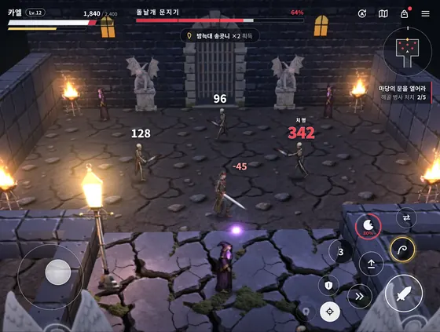
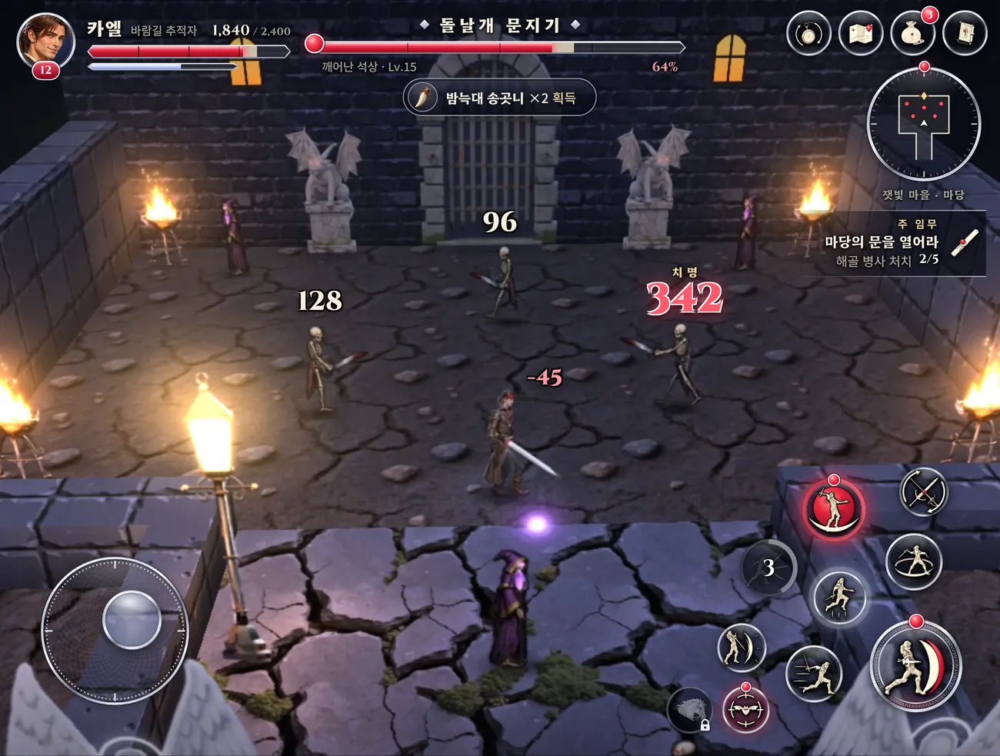
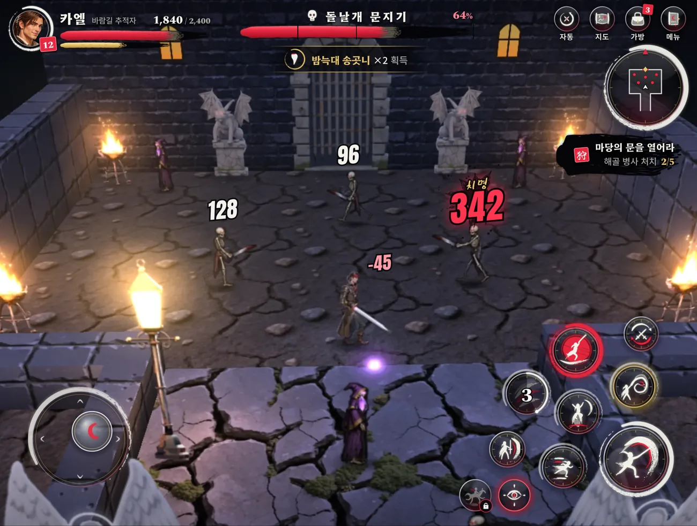
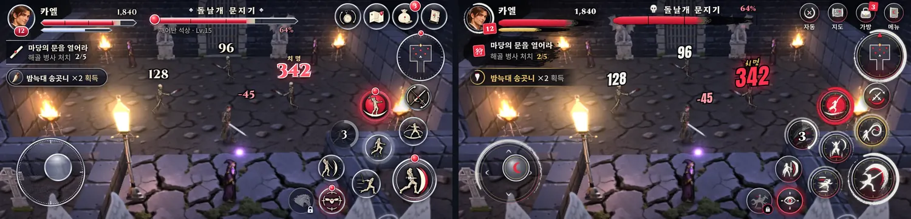
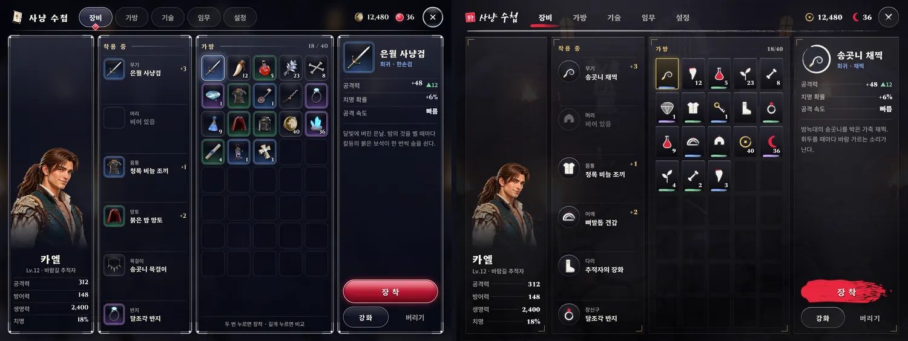
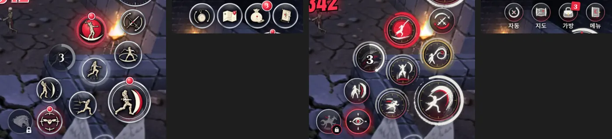
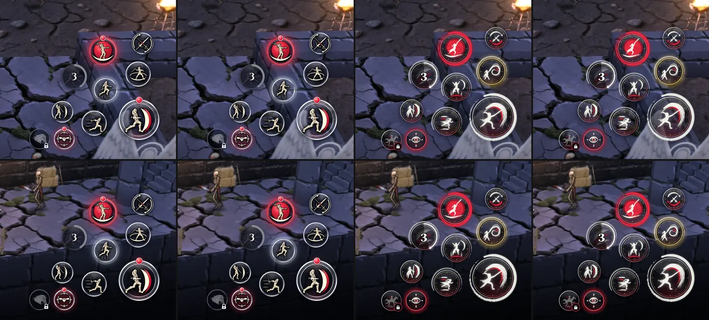
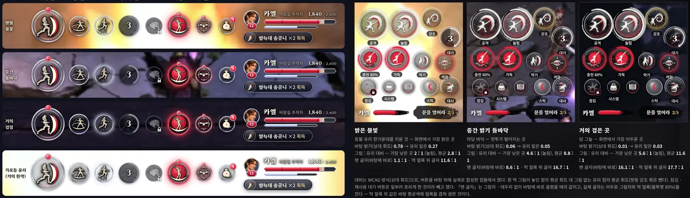

# 인터페이스 2차 시안 — 검토와 추천 (UI_ROUND2)

2026-11-17 · 검토자 ui2review. 시안 두 가지는 `tools/v2/ui_mock2/uigem/`(세공한 유리)와 `tools/v2/ui_mock2/uiink/`(먹과 달빛)의 눌리는 웹 페이지이고, 게임 코드는 아직 아무것도 바뀌지 않았다. 각 시안의 자세한 설명은 그 폴더의 `NOTES.md` 에 있다. 이 문서는 두 시안을 **같은 조건으로 다시 열어 보고 다시 잰** 결과다.

소유자용 비교 한 장: `/tmp/claude-0/v2/owner_ui2.png` (저장소 밖).

## 0. 소유자의 말과 판정 기준

> "인터페이스 버튼은 이렇게 반투명? 배경이 보였으면 좋겠다!"
> "근데 그렇다고 해도 너무 단순한 기호는 아니겠지? 너무 단순해. 그리고 반투명이지만 고급스러웠으면 좋겠어. 지금은 무슨 클로드 같아"

기준 여섯 가지: ① 고급 게임처럼 보이는가(납작한 앱이 아닌가) ② 버튼으로 세계가 정말 비치는가(실시간 흐림 없이) ③ 아이콘이 동작을 그린 세밀한 그림이고, 한 벌로 통일되고, 휴대폰 실제 크기에서 읽히는가 ④ 어수선하거나 싸움을 가리지 않는가 ⑤ 참고 화면을 베끼지 않았는가 ⑥ 게임의 2D 캔버스(WebGL 위)로 그릴 수 있는가.

## 1. 결론

| | Ⓐ 세공한 유리 (uigem) | Ⓑ 먹과 달빛 (uiink) |
|---|---|---|
| 판정 | **PASS-WITH-FIXES** | **PASS-WITH-FIXES** (바탕으로는 추천하지 않음) |
| 한 줄 | 밤색 유리 + 백금 테 + 루비, 카엘 3D 모델의 동작을 상아 조각처럼 새긴 아이콘 | 그을린 유리 + 흰 붓 그림, 막대 · 이름표까지 붓 한 획 |
| 추천 | **이것을 바탕으로** | 붓 숫자 · 굵은 실루엣 · 이름표 · 캔버스 코드를 Ⓐ에 옮겨 쓴다 |

**추천: Ⓐ 세공한 유리를 바탕으로, 유리를 더 맑게 고치고, Ⓑ에서 네 가지를 옮겨 온다**(§7).

두 시안 모두에 해당하는 가장 큰 발견: **유리가 1차 「달빛 유리」보다 두 배쯤 짙다**(§3). "배경이 보였으면 좋겠다"가 첫 요구였으므로 어느 쪽을 고르든 유리를 더 맑게 해야 한다. 두 시안에 `?glass=clear` 판을 넣어 확인했다.

## 2. 미리보기

1차 — 소유자가 "너무 단순하다"고 한 것:

Ⓐ 세공한 유리 (폴드 펼침 · 전투):

Ⓑ 먹과 달빛 (같은 장면 · 같은 크기):

일반 휴대폰(가로) — 왼쪽 Ⓐ, 오른쪽 Ⓑ:

장비 · 가방 — 왼쪽 Ⓐ(물건이 채색 그림), 오른쪽 Ⓑ(물건이 흰 기호):

휴대폰 실제 크기(1배로 줄인 뒤 2배로 본 것) — 왼쪽 Ⓐ 버튼 · 시스템 줄, 오른쪽 Ⓑ:

유리를 더 맑게 한 판 — 왼쪽부터 Ⓐ 지금 · Ⓐ 더 맑게 · Ⓑ 지금 · Ⓑ 더 맑게 (윗줄 마당, 아랫줄 어두운 거리):

아이콘 한 벌: `img/ui2_uigem_icons.webp` · `img/ui2_uiink_icons.webp`, 밝기별 버튼: `img/ui2_uigem_strip.webp` · `img/ui2_uiink_strip.webp`.

## 3. 다시 잰 값

재는 법: 헤드리스 Chromium, 폴드 펼침 1000×756(배율 2.6) · 휴대폰 740×360(배율 3), 전투 화면(마당). 시안이 스스로 잰 값을 쓰지 않았다. 눌림 크기는 화면 요소의 네모에서, 가림과 투명도는 **배경을 흰색 · 검은색으로 바꿔 찍은 두 장의 차이**에서 구했다(픽셀마다 "인터페이스가 장면을 얼마나 가리는가" = 0–100 %). 피해 숫자 · 막대 · 위아래 어두운 그늘까지 모두 포함한 값이다. 도구: `tools/v2/ui_mock2/ui2review/`.

### 눌림 크기 (CSS px, 폴드 / 휴대폰)

| | Ⓐ | Ⓑ |
|---|---|---|
| 공격 | 94 / 74 | 94 / 72 |
| 점프 · 대시 · 기술 2개 | 58 / 48 | 62 / 50 |
| 궁극기 | 64 / 52 | 68 / 52 |
| 막기 · 교대 | 50 / 44 | 54 · 52 / 46 |
| 조준 · 탑승 | 48 / 44 | 48 / 44 |
| 시스템(자동 · 지도 · 가방 · 메뉴) | 46 / 44 | 48 / 44 |
| 스틱 | 150 / 114 | 150 / 112 |
| **가장 작은 것** | **46 / 44** | **48 / 44** |
| 버튼 사이 가장 좁은 틈 | 6 / 3 (시스템 줄) | 3 / 2 (시스템 줄) |
| 오른쪽 아래 구석에서 가장 먼 버튼 | 313 / 249 (탑승) | 321 / 250 (탑승) |

- 두 시안 모두 44 미만 없음, 버튼 가운데를 눌렀을 때 다른 것이 가로채는 곳 없음, 페이지 오류 없음.
- Ⓐ의 점프가 53.9 / 44.6 으로 찍히는 것은 "눌린 모습"(0.93배)으로 보여 주고 있어서다. 평소 크기는 58 / 48.
- 시스템 줄은 두 시안 모두 버튼이 거의 붙어 있다(2–6 px). 싸움 중에 누르는 것이 아니어서 큰 문제는 아니지만 게임에서는 6 px 이상으로 벌리는 것이 좋다.

### 가리는 넓이 (화면 전체 대비 %, 폴드 / 휴대폰)

| | Ⓐ | Ⓑ | 1차 달빛 유리 |
|---|---|---|---|
| 조금이라도 덮는 넓이(가림 8 % 이상) | 35.4 / 47.5 | 38.4 / 50.9 | 35.0 / 43.5 |
| 절반 넘게 가리는 넓이 | 11.3 / 20.2 | 14.3 / 24.6 | 5.0 / 9.1 |
| 거의 안 보이게 가리는 넓이(85 % 이상) | 5.3 / 9.9 | 5.7 / 10.0 | 2.1 / 4.1 |
| 화면 평균 가림 | 15.4 / 23.9 | 18.0 / 27.2 | 12.8 / 17.5 |
| 화면 가운데 60 %(싸움터)를 덮는 넓이 | 3.7 / 10.6 | 5.6 / 13.1 | 2.6 / 6.9 |
| 버튼 + 스틱 네모 합 | 8.8 / 17.1 | 9.5 / 17.6 | — |
| 오른쪽 버튼 무리가 차지하는 네모 | 12.8 / 22.4 | 13.7 / 22.8 | — |

- "조금이라도 덮는 넓이"가 큰 것은 세 시안 모두 화면 위아래에 옅은 어두운 그늘을 깔기 때문이다.
- **Ⓑ가 모든 줄에서 가장 많이 가린다.** 버튼이 조금 더 크고, 버튼 둘레의 그림자 · 빛무리와 붓 고리가 넓다.
- 2차는 둘 다 1차보다 "절반 넘게 가리는 넓이"가 두 배 넘게 늘었다. 그림이 생긴 값이기도 하지만, 절반쯤은 유리가 짙어진 탓이다.

### 유리가 얼마나 비치나 (준비된 보통 버튼, 원판에서 가장 맑은 1/4 지점의 가림)

| | 지금 | `?glass=clear` |
|---|---|---|
| 1차 달빛 유리 | 13–40 % (스타일 값) | — |
| Ⓐ 세공한 유리 | **61 %** | 51 % |
| Ⓑ 먹과 달빛 | **69 %** | 55 % |

- 참고 화면의 버튼은 눈으로 보아 1차와 비슷하게 맑다. 2차 두 시안은 밝은 불빛 위에서 그림을 읽히게 하려고 유리를 짙게 했다.
- Ⓐ는 유리 자체의 값(12–34 %)보다 훨씬 짙게 나온다. 가림의 절반쯤이 유리가 아니라 **아이콘에 구워 넣은 그늘 · 위쪽 반사 · 물결 무늬**에서 온다. 그래서 Ⓐ를 더 맑게 하려면 유리 값만이 아니라 아이콘 그늘을 좁혀 다시 구워야 한다.
- `?glass=clear` 판에서 마당 · 어두운 거리 위의 그림은 두 시안 모두 여전히 읽힌다(§2 그림).
- **밝은 불빛 위에서는 두 시안이 갈린다**(아래 그림 — 두 시안의 밝기 띠 페이지를 더 맑은 유리로 다시 찍은 것).
  - Ⓑ: 그림 대 유리 대비가 평균 4.2 → **2.8 : 1**, 가장 낮은 곳 2.6 → **2.0 : 1** 로 떨어진다(시안의 밝기 띠 페이지가 스스로 다시 센 값). 흰 먹 그림에는 제 그늘이 없어 유리가 맑아지면 밝은 바탕에 묻힌다. 돌바닥 위는 9.8 → 8.8, 어두운 곳은 11.6 그대로.
  - Ⓐ: 아이콘에 짙은 그늘이 구워져 있어 불꽃 · 흰 가로등 유리 위에서도 사람 윤곽이 남는다(눈으로 확인, 숫자로는 재지 않았다). 즉 **유리를 맑게 할 여유는 Ⓐ 쪽이 크다.**

### 시안 작성자가 잰 대비 (검토자는 밝기 띠 그림을 눈으로만 확인)

- Ⓐ: 준비된 버튼 7.3–12.7 : 1, 시스템 4.2–6.9, 글자 5.6–10.6. 가로등 유리(거의 흰색) 위에서도 그림 윤곽이 남는 것을 눈으로 확인했다. 그 위의 작은 회색 글자(직업 이름, 체력 최대값)는 흐리다.
- Ⓑ: 밝은 불빛 위 평균 4.2 : 1, 가장 낮은 것 3.4(시스템), 눌린 순간 2.6. 글자는 먹 얼룩 없이는 밝은 불빛 위에서 읽히지 않는다(1.1 : 1).

### 눌림 검사

- Ⓐ `tap_check.mjs`: 두 기기 × 10가지 모두 통과.
- Ⓑ `tap_check.mjs`: 10가지 가운데 9가지는 늘 통과. "공격 눌림" 한 항목은 두 번 돌려 기기마다 한 번씩 실패했다 — 빠른 탭 직후의 그림을 비교하는 검사의 타이밍 문제로 보이며(눌린 모습 자체는 `?press=attack` 캡처와 밝기 띠에서 확인), 시안의 결함으로 보지 않는다.

## 4. 기준별 판정

| 기준 | Ⓐ 세공한 유리 | Ⓑ 먹과 달빛 |
|---|---|---|
| ① 고급 게임처럼 보이나 | **그렇다.** 테 · 보석 · 유리 반사 · 물결 무늬가 겹쳐 "만든 물건"처럼 보인다. 메뉴는 채색 아이템 그림 + 등급 빛 + 루비 단추로 큰 게임의 가방 화면에 가깝다 | **전투 화면은 그렇다**(개성이 가장 강하다). **메뉴는 아니다** — 가방 물건이 흰 기호(플라스크 · 새싹 · 뼈)라 1차와 같은 "단순함"이 남는다 |
| ② 세계가 비치나 (흐림 없이) | 비치지만 1차의 절반 수준(가림 61 %). 실시간 흐림 없음 확인. 메뉴 배경만 한 번 구운 흐림이고 흐림 없는 판도 고급스럽다 | 가장 덜 비친다(가림 69 %). 실시간 흐림 없음 확인 |
| ③ 아이콘 | **가장 세밀하다.** 카엘이 실제로 베고 뛰고 달리는 자세. 사물 11개는 v1 그림을 같은 상아 톤으로. 휴대폰 실제 크기에서는 사람 자세가 서로 닮아 궤적 · 색으로 구별한다. 교대 아이콘은 선이 가늘어 뭉개졌다(고침) | 굵은 흰 실루엣이라 **작은 크기에서 더 또렷하다.** 다만 머리는 점, 팔다리는 한 획이라 "세밀한 그림"보다는 "잘 그린 기호"에 가깝다. 탑승(말 탄 사냥꾼)은 44 px 에서 덩어리로 보인다. 시스템 · 물건 아이콘은 기호다 |
| ④ 어수선함 · 가림 | 가장 적게 가린다. 휴대폰에서는 오른쪽 1/3 이 버튼 · 미니맵 · 시스템 줄로 찬다(1차와 같은 문제). **붉은 보석이 공격 · 궁극기 · 조준 버튼 위에 얹혀 "새 알림 점"처럼 보일 수 있다** — 가방의 진짜 알림 숫자(붉은 원)와 같은 모양이다 | 가장 많이 가린다. 공격 버튼 · 미니맵의 흰 붓 고리가 화면에서 가장 밝은 선이라 흰 타격 효과와 다툰다. 휴대폰에서는 붓 고리와 빛무리가 서로 닿을 만큼 빽빽하다 |
| ⑤ 참고 화면을 베꼈나 | **아니다.** 자세 · 재질 · 보석 · 테 모두 참고 화면에 없는 것이고, 그림은 이 게임의 카엘 모델에서 나왔다 | **베끼지 않았다.** 다만 "어두운 원 위의 흰 사람 실루엣 + 큰 호"라는 말투는 두 시안 가운데 참고 화면과 더 가깝다(자세 · 붓 결은 다르다) |
| ⑥ 캔버스로 그릴 수 있나 | 전부 그릴 수 있다. 다만 시안은 CSS 로 만든 것이라 **옮긴 적은 없다.** 그림자 · 흑백 처리 · 테 차오름은 미리 굽거나 호로 바꿔야 하고(`NOTES.md` §5 의 계획은 타당하다), 메뉴 배경 흐림은 WebGL 화면을 한 번 읽어 와야 한다(안 되면 어둡게만 — 그 판도 확인함) | **원판 · 아이콘 · 스틱은 이미 Canvas 2D 코드**(`ui.js` · `ink.js`)라 가장 확실하다. 막대의 마른 붓끝(CSS 마스크) · 판의 연기 결(혼합 모드) · 치명 숫자의 빛(CSS 그림자)은 아직 옮기지 않았다. "붓끝을 지우기로 그린다"는 계획은 HUD 캔버스에 바로 하면 밑의 어두운 자리까지 지우므로, 막대를 따로 합성해 두었다가 붙여야 한다 |

배치(큰 공격 버튼을 오른쪽 아래에 두고 기술을 둘레에 두는 것)는 두 시안 모두 1차와 v1 가상 패드의 배치를 이어받은 것이고 이 장르의 표준이다. 참고 화면의 아이콘 · 버튼 위치를 그대로 가져온 것은 없다.

## 5. 강점과 약점

### Ⓐ 세공한 유리

강점
- 소유자의 두 말("단순하지 않게", "고급스럽게")에 가장 곧게 답한다. 사람 그림이 세밀하고, 재질이 겹겹이다.
- 은 · 루비 · 유리 · 종 · 붉은 달 — 이 게임의 고딕 세계와 결이 같다.
- v1 아이템 그림 228장(`assets/icons/`)을 가방에 그대로 쓴다(추가 그림 0).
- 화면을 가장 적게 가린다.
- 아이콘이 게임의 3D 모델에서 나오므로 영웅이 바뀌면 같은 방법으로 다시 뽑을 수 있다.

약점
- 유리가 1차보다 짙다(§3). 아이콘 그늘을 좁혀 다시 구워야 충분히 맑아진다.
- 48 px 이하에서 사람 자세가 서로 닮는다(공격과 막기가 둘 다 "사람 + 초승달 호"). 크기와 붉은 궤적으로 구별된다.
- 붉은 보석이 알림 점처럼 보일 수 있다.
- 아이콘이 카엘 모델 하나에 매여 있다 — 다른 영웅은 모델이 있어야 한다.
- 사물 아이콘은 128 px 그림을 키운 것이라 크게 보면 무르다(버튼 크기에서는 괜찮다).
- 차갑고 격식 있는 보석 느낌이라 가죽 · 뼈의 수렵 장비보다 귀족적이다.
- 캔버스로 옮긴 적이 없다. 유료 생성으로 그린 전용 그림이 아니다.

### Ⓑ 먹과 달빛

강점
- 한눈에 이 게임의 것으로 보이는 개성. 붓 막대, 치명 숫자, 붉은 초승달 스틱 손잡이가 힘이 있다.
- 작은 크기에서 그림이 또렷하다. 시스템 버튼 아래 한글 이름표가 있어 처음 보는 사람도 안다.
- 원판 · 아이콘이 이미 캔버스 코드다. 그림 파일 없이 시작할 때 구울 수 있다(0 KB).
- 색이 세 가지뿐(흰 먹 · 핏빛 · 금)이라 통일감이 높다.

약점
- **먹 · 낙관(狩 한자 도장)은 동양화의 말투**라 교회 종 · 은 · 고딕 석조의 세계와 결이 다르다. 한자 도장은 읽지 못하는 사람이 많고 다른 수렵 게임의 인상을 부를 수 있다.
- 가방 물건 · 시스템 아이콘이 흰 기호다 — 소유자가 싫다고 한 바로 그것이 메뉴에 남는다. v1 채색 그림을 넣으면 붓 그림과 화풍이 부딪친다.
- 유리가 가장 짙고, 화면을 가장 많이 가린다.
- 탑승 · 점프 그림이 한눈에 덜 읽힌다. 사람 그림을 늘리려면 획 정의를 손으로 써야 한다.
- 치명 숫자의 굵은 검은 테는 힘은 있지만 만화 쪽으로 기운다.
- 묶음 그림 두 장이 746 KB 로 무겁다(줄이거나 시작할 때 굽기).

## 6. 검토에서 고친 것

| 어디 | 무엇 |
|---|---|
| `uigem/style.css` | 교대 아이콘(엇갈린 두 검 + 돌림 화살)이 44–50 px 에서 뭉개져 원판을 더 채우게 키웠다(76 % → 92 %) |
| `uigem/style.css` · `uigem/mock.js` | `?glass=clear` — 유리를 더 맑게 한 판(선택 사항, 기본값은 그대로) |
| `uiink/ui.js` | `?glass=clear` — 유리 가운데 48 → 30 %, 가장자리 78 → 66 % (선택 사항, 기본값은 그대로) |
| `tools/v2/ui_mock2/ui2review/` | 검토 도구 6개(새 폴더) |
| `docs/v2/img/ui2_uigem_play.webp` · `ui2_uiink_play.webp` | 같은 장면 · 같은 크기로 다시 찍어 바꿨다 |

고치지 않고 남긴 것(만들기 전에 할 일): Ⓐ 붉은 보석의 알림 점 혼동, Ⓐ 아이콘 그늘 다시 굽기, Ⓑ 탑승 아이콘, Ⓑ 밝기 띠 페이지에서 이름표 하나가 버튼 고리에 가려지는 것(시안 설명 페이지만의 문제), 두 시안의 시스템 줄 틈.

유료 생성: 검토에서도 쓰지 않았다(0 크레딧). 두 시안 작성자 모두 생성 호출이 권한 검사에서 막혔다고 보고했다.

## 7. 추천 — Ⓐ를 바탕으로, Ⓑ에서 옮겨 올 것

1. **Ⓐ 세공한 유리를 바탕으로 한다.**
2. **유리를 더 맑게**: `?glass=clear` 수준(가림 51 %)을 기본으로 하고, 아이콘에 구운 그늘을 조금 좁혀 다시 구워 45 % 안팎까지 간다(지금 61 %, 1차 13–40 %). 그늘을 좁힐 때마다 밝은 불빛 위 대비를 숫자로 다시 잰다 — 그늘이 읽기를 떠받치고 있으므로 한 번에 다 걷어내면 안 된다.
3. **Ⓑ에서 옮겨 올 것**
   - 작은 버튼(교대 · 탑승 · 조준)과 궤적 선은 Ⓑ처럼 **굵은 덩어리**로 — 44 px 에서 또렷하다.
   - **치명 · 피해 숫자의 붓 힘**(타격감). 굵은 검은 테는 줄이고 Ⓐ의 은 · 루비 색으로.
   - 시스템 버튼 아래 **한글 이름표**(자동 · 지도 · 가방 · 메뉴).
   - **캔버스 굽기 코드**(`uiink/ui.js` 의 원판 그리기)를 Ⓐ의 굽는 모듈의 출발점으로.
   - 스틱 손잡이의 **붉은 초승달**.
4. **붉은 보석**은 궁극기가 다 찼을 때 · 조준이 켜졌을 때만 빛나게 하거나, 알림 점과 다른 모양(마름모 · 버튼 아래쪽)으로 바꾼다.
5. 생성 권한이 열리면 공격 · 조준 · 지도부터 전용 그림으로 다시 그릴 수 있다(선택 사항 — 지금 그림으로도 방향은 충분히 보인다).

## 8. 만드는 비용 (1차 「달빛 유리」를 1 로 본 어림)

| | Ⓐ 세공한 유리 | Ⓑ 먹과 달빛 |
|---|---|---|
| 작성자 어림 | 약 1.5배 | 약 1.4배 |
| 검토자 어림 | 약 1.5배 + 영웅마다 기술 아이콘 3–4개(모델이 있으면 개당 10–15분) | 약 1.6–1.8배 — 가방 물건을 기호로 두지 않으려면 붓 그림 60장쯤을 더 그려야 한다 |
| 내려받는 그림 | 아이콘 180–321 KB | 746 KB 또는 0 KB(시작할 때 굽기 — 폴드에서 걸리는 시간은 재지 않음) |
| 가방 아이템 그림 | v1 228장 그대로 | 다시 그리거나 화풍이 섞이는 것을 받아들임 |
| 공통 | `src/core/touchpad.js` 의 배치 · 판정 · 편집기는 그대로, 그리는 함수와 굽는 모듈 교체. `src/render/hud.js` 는 새로 씀. 메뉴 16파일은 색 · 판 · 단추 교체 | 같음 |

검토자 어림은 두 시안의 `NOTES.md` 와 화면을 보고 낸 것이고, 실제로 옮겨 보며 잰 것이 아니다.

## 9. 확인하지 못한 것

- 실제 폴드 · 손가락으로 눌러 보지 않았다(헤드리스 Chromium 만).
- 캔버스로 옮겼을 때의 프레임 시간, 시작할 때 굽는 시간(폰).
- 더 맑은 유리에서 밝은 불빛 위 Ⓐ의 대비(숫자) — 눈으로만 봤다.
- 색각 보정(붉은색 강조가 많다).
- 움직이는 타격 효과와 겹쳤을 때의 모습(정지 화면만 봤다).

## 10. 파일 · 다시 재기

- 시안: `tools/v2/ui_mock2/uigem/index.html` · `tools/v2/ui_mock2/uiink/index.html` (`?view=play|dialog|menu` `?bg=yard|street|alley` `?glass=clear`)
- 검토 도구: `tools/v2/ui_mock2/ui2review/` — `review.mjs`(두 시안 × 두 기기 캡처 + 흰/검은 바탕) → `analyze.py`(크기 · 가림 · 투명도) → `clear.mjs`(더 맑은 판 + 1차) → `cmp.py`(비교 그림) → `strip_clear.mjs`(밝기 띠를 더 맑은 유리로) → `owner_sheet.mjs`(소유자용 한 장)
- 잰 값: `/tmp/claude-0/v2/ui2review/review_measure.json` · `clear_measure.json` (저장소 밖)
