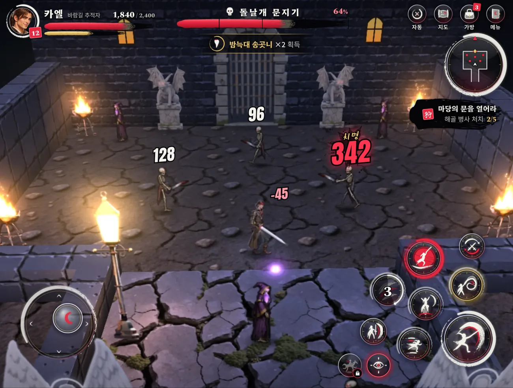
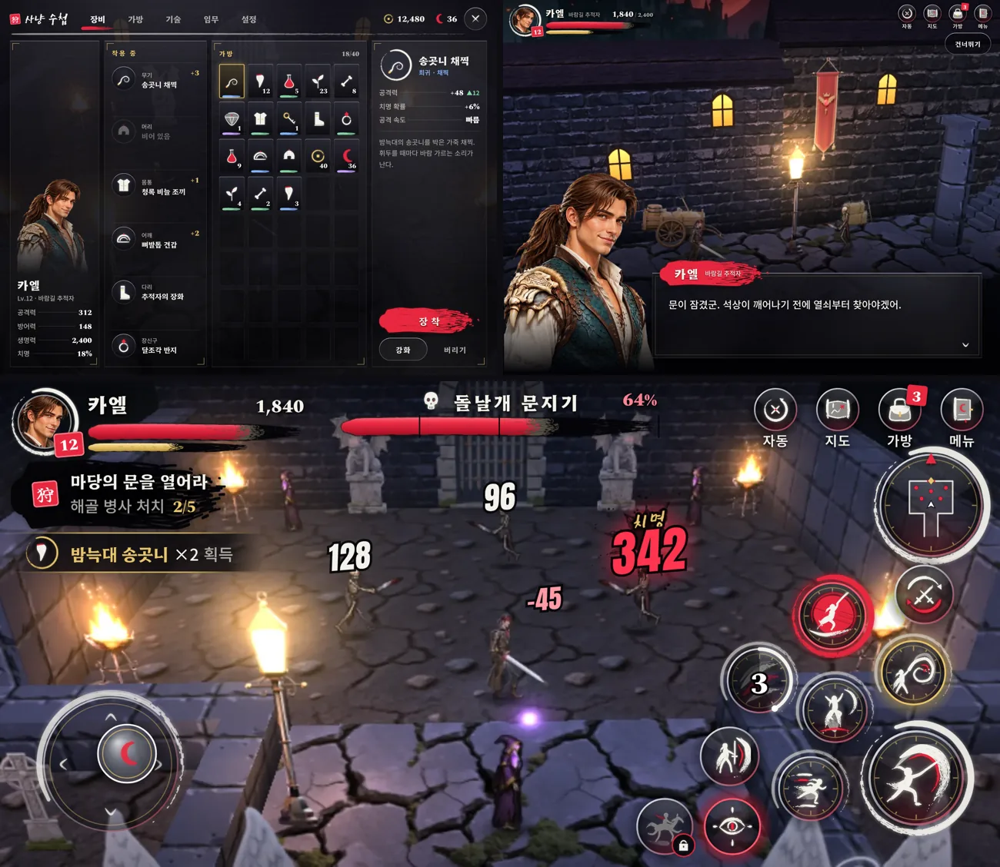
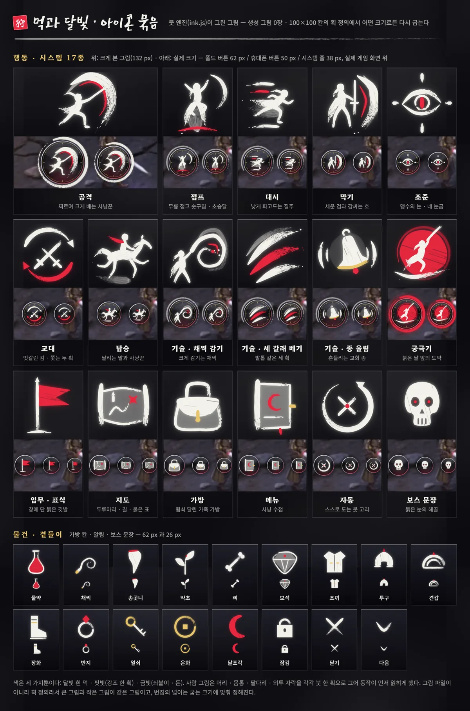
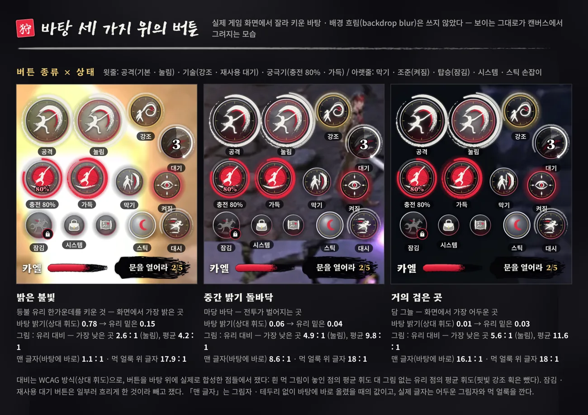

# 「먹과 달빛」 (uiink) — 인터페이스 2차 시안

2026-11-17 · `docs/v2/UI_ROUND2.md` 에 넣을 절. 시안은 `tools/v2/ui_mock2/uiink/`, 캡처는 `/tmp/claude-0/v2/uiink/`, 소유자용 모음은 `/tmp/claude-0/v2/uiink/owner_uiink.png`.

## 생각 (두 줄)

그을린 검은 유리 버튼 너머로 3D 세계가 비치고, 그 위에 **달빛 같은 흰 먹으로 동작을 그은 그림**이 앉는다.
버튼 · 체력 막대 · 이름표 · 「장착」 단추까지 전부 **붓 한 획**이라는 한 가지 말로 묶어, 이 게임만의 얼굴로 삼는다.






(그림 경로는 이 폴더 기준이다. `docs/v2/UI_ROUND2.md` 로 옮길 때는 `img/ui2_uiink_*.webp` 로 바꾼다.)

소유자 말씀("너무 단순한 기호", "반투명이지만 고급스럽게", "무슨 클로드 같아")에 이렇게 답했다:

- 선 기호 → **사냥꾼이 그 동작을 하는 그림**(공격 · 점프 · 대시 · 막기 · 탑승 · 채찍 감기 · 궁극기)과 손맛 있는 사물(종 · 깃발 · 두루마리 · 수첩).
- 납작한 원 → **깊이가 있는 유리**: 가운데는 비치고 가장자리로 갈수록 두꺼워지는 그을림, 위쪽 달빛 반사, 아래쪽 붉은 달 반사, 달빛에서 핏빛으로 넘어가는 가는 테, 안쪽 금빛 실선과 **종탑 시계 눈금**(시간을 넘나드는 이야기), 공격 버튼과 미니맵을 두르는 **붓 고리**.
- 배경 흐림(backdrop blur)은 **한 곳도 쓰지 않았다.** 캡처에 보이는 그대로가 캔버스에서 그려지는 모습이다.

## 재질과 색

| 것 | 내용 |
|---|---|
| 그을린 유리 | 검은 유리. 불투명도 가운데 48 % → 가장자리 78 % (가운데로 배경의 절반쯤이 비친다). 안에 옅은 연기 결 |
| 달빛 테 | 1.25–1.6 px 선. 왼쪽 위 흰 달빛 → 은 → 오른쪽 아래 핏빛. 안쪽에 0.75 px 금선 + 12 눈금 (지름 50 px 이상만) |
| 붓 고리 | 마른 붓으로 한 번 돌린 고리. 공격 · 미니맵 · 초상 = 굵은 흰 먹, 기술 = 가늘고 옅게, 궁극기가 차면 핏빛 |
| 붓 한 획 | 체력(핏빛) · 기력(금빛) · 보스 체력 · 대화 이름표 · 탭 밑줄 · 「장착」 단추 · 임무 줄의 먹 얼룩. 줄어든 끝은 곧게 자르지 않고 마른 붓끝으로 흩는다 |
| 낙관 | 붉은 네모 도장(狩). 레벨 · 임무 · 메뉴 제목 · 알림 수 |

색은 넷뿐이다: 달빛 흰 먹 `#f3f1ea` · 핏빛 `#e8283f`(강조 · 체력 · 궁극기 · 켜짐) · 금빛 `#e8c56c`(쇠붙이 · 수치 · "지금 쓰면 좋음") · 그을음 `#050508`. 희귀도만 옥 · 달파랑 · 보라 붓 자국을 쓴다.

## 글자 — 새 글꼴 없이 지금 들어 있는 것만

| 쓰임 | 글꼴 (`assets/fonts`) | 이유 |
|---|---|---|
| 이름 · 제목 · 탭 · 단추 | Hahmlet 700–800 | 붓 획과 어울리는 도톰한 명조. 14 px 이상에서만 |
| 본문 · 설명 · 작은 이름표 | Noto Sans KR | 10–13 px 한글은 고딕이 읽힌다 |
| 수치 (체력 · 수량 · 대기 초 · 돈) | BN Num (Spectral ExtraBold 숫자, 2 KB) | 굵은 세리프 숫자가 유리 위에서 보석처럼 선다 |
| 피해 숫자 | BN Dmg (Anton, 6 KB) | 지금 게임 그대로. 검은 먹 테두리 4 px + 치명타는 먹 얼룩 |
| 붓글씨 강조 (「치명」 · 메뉴 제목 · 장 제목) | BN Brush (East Sea Dokdo, 144 KB · 나중에 받음) | 이미 들어 있는 붓글씨. 24 px 이상 · 두세 낱말만 |
| 낙관 | BN Seal (Yuji Syuku 한자 17자 — 狩 · 血 · 印 포함, 10 KB) | 이미 들어 있다 |

시안 화면에 나온 한글 문구 43줄은 전부 지금 부분집합 안에서 나왔다(글꼴 파일은 건드리지 않았다). 붓글씨를 더 단정하게 하고 싶다면 **송명(Song Myung, SIL OFL 1.1)** 을 장 제목용 후보로 볼 만하다 — 넣어 보지는 않았다.

## 아이콘 — 붓 엔진

- `ink.js`(28 KB)가 100×100 칸 위의 **획 정의**(스플라인 · 굵기 곡선 · 마름 정도 · 색)를 받아 붓털 수십 가닥으로 긋는다. 끝으로 갈수록 · 가장자리일수록 먹이 끊기는 비백, 몸통 안의 붓결, 튄 먹, 두 겹 번짐(가까운 먹 번짐 + 넓은 달빛 번짐), 옅은 먹 잔상(담묵)이 들어간다.
- 지금 34개: 행동 · 시스템 17(공격 · 점프 · 대시 · 막기 · 조준 · 교대 · 탑승 · 기술 3 · 궁극기 · 지도 · 가방 · 메뉴 · 자동 · 임무/표식 · 보스 문장) + 물건 · 곁들이 17.
- 그림 파일이 아니라 획 정의(벡터)라서 **어떤 크기로든 다시 구울 수 있다** — 132 px 확대용과 26 px 가방 칸용이 같은 그림이다. 버튼에는 256 px 로 구운 것을 줄여 붙였다.
- 유료 생성은 쓰지 않았다(0 크레딧) — 생성 호출이 권한 단계에서 거부되어 제출되지 않았고, 우회하지 않았다. 기록 `tools/higgsfield/manifest_uiink.json`.

## 게임 캔버스에서 어떻게 그리나

HUD 는 WebGL 위의 2D 캔버스다. 매 프레임에는 **그라데이션 · 그림자 · 필터를 쓰지 않고** 붙여넣기(drawImage)와 호(arc)만 쓴다.

| 조각 | 미리 구운 스프라이트 | 매 프레임 그리는 것 |
|---|---|---|
| 행동 버튼 | 원판 = 종류(공격 · 기술 · 보조 · 궁극기) × 상태(기본 · 눌림 · 강조 · 켜짐 · 가득) 11장 + 아이콘 | 원판 1 + 아이콘 1 붙여넣기. 눌림은 스프라이트 바꾸기 + 0.94 배 |
| 재사용 대기 | — | 어두운 부채꼴 1(arc 채우기) + **차오르는 테** 호 1 + 끝점 + 숫자(미리 구운 숫자 그림) |
| 궁극기 충전 | 가득 찼을 때의 붉은 원판 · 붓 고리 | 바깥 핏빛 호 1 |
| 잠김 | 자물쇠 봉인 | 아이콘을 30 % 로 붙이고 봉인 1 |
| 스틱 | 바탕 원판 · 달빛 구슬 | 붙여넣기 2 |
| 체력 · 기력 · 보스 막대 | 붓 한 획(색별) · 어두운 자리 · 마른 붓끝 | 자리 1 + 획을 비율만큼 잘라 1 + 끝에 붓끝 지우기 1 |
| 미니맵 | 유리 원판 + 붓 고리, 방 윤곽은 방에 들어갈 때 한 번 | 붙여넣기 2 + 점 몇 개 |
| 임무 줄 · 알림 · 이름표 | 먹 얼룩 · 핏빛 이름표 획 · 금 붓 고리 | 늘여 붙이기 + 글자(바뀔 때만 다시 굽는 글자 캐시) |
| 피해 숫자 | 숫자 그림(흰 · 핏빛) · 먹 얼룩 · 「치명」 | 붙여넣기 |
| 대화 상자 · 메뉴 판 | 9칸 늘리기용 유리판(위쪽 달빛 선 · 금 모서리) | 열릴 때 한 번 굽고 붙여넣기. 메뉴 바탕은 어두운 덮개(불투명 약 90 %) + 연기 결 — 흐림 없음 |

스프라이트는 두 가지로 넣을 수 있다: ① 묶음 그림 두 장(`assets/v2/ui/uiink/icons_ink.webp` 411 KB · `mat_ink.webp` 334 KB, 좌표는 같은 이름의 json — 품질 92 로 뽑은 것이라 더 줄일 수 있다), ② `ink.js` 를 넣고 시작할 때 굽기(그림 0 KB; 헤드리스 Chromium 에서 아이콘 34개 0.30초 · 전부 57개 0.40초 — 폴드 실기기에서는 재지 않았다).

## 잰 값

헤드리스 Chromium, `render.mjs` · `strip.html` (기록 `/tmp/claude-0/v2/uiink/measure.json` · `contrast.json`). 12 화면 모두 겹침 0 · 화면 밖 0 · 44 px 미만 0.

| | 폴드 펼침 1000×756 | 휴대폰 740×360 |
|---|---|---|
| 공격 / 기술 · 대시 · 점프 / 궁극기 | 94 / 62 / 68 px | 72 / 50 / 52 px |
| 막기 / 교대 / 조준 · 탑승 | 54 / 52 / 48 px | 46 / 46 / 44 px |
| 시스템 줄(눌리는 넓이) / 스틱 | 48×54 / 150 px | 44×47 / 112 px |
| 가장 작은 눌림 (전투 / 대화 / 메뉴) | 48 / 44 / 46 px | 44 / 44 / 44 px |
| 인터페이스가 차지하는 넓이¹ | 18.3 % (원으로 세면 16.2 %) | 32.4 % (28.8 %) |
| 화면 가운데 60 % 를 가리는 넓이 | 1.7 % | 7.1 % |
| 구석에서 가장 먼 행동 버튼 | 321 px (탑승) | 250 px (탑승) |
| 가장 작은 글자 | 10.5 px (시스템 이름표) | 10 px |

¹ 1차 「달빛 유리」는 15 % / 28 %, 가운데 1.1 % / 4.5 % 였다. 그림을 읽히게 하려고 버튼을 키운 값이다(기술 56 → 62, 휴대폰 46 → 50).

대비(WCAG 상대 휘도, 버튼을 실제 화면 조각 위에 합성해 잰 값 — 흰 먹 그림 대 그 밑 유리):

| 바탕 (실제 화면에서 자름) | 바탕 휘도 → 유리 밑 | 그림 : 유리 (평균 / 가장 낮은 것) | 맨 글자 | 먹 얼룩 위 글자 |
|---|---|---|---|---|
| 밝은 불빛 (등불 한가운데) | 0.78 → 0.15 | 4.2 : 1 / 시스템 3.4 : 1 (눌린 순간 2.6 : 1) | 1.1 : 1 | 17.9 : 1 |
| 중간 밝기 돌바닥 | 0.06 → 0.04 | 9.8 : 1 / 4.9 : 1 (눌린 순간) | 8.6 : 1 | 18 : 1 |
| 거의 검은 곳 | 0.01 → 0.03 | 11.6 : 1 / 5.6 : 1 (눌린 순간) | 16.1 : 1 | 18 : 1 |

읽는 법: 버튼 그림은 어느 바탕에서나 선다(가장 밝은 등불 한가운데에서 3.4–6.2 : 1). 글자는 밝은 불빛 위에 **맨몸으로 두면 안 읽힌다(1.1 : 1)** — 그래서 글자는 늘 먹 얼룩이나 어두운 테두리를 깐다.

## 만드는 데 드는 것

- `src/core/touchpad.js`(배치 · 44 px · 겹침 · 편집기 · 누름 판정)는 그대로, 그리는 함수와 테 그림만 바꾼다 — 1차 시안들과 같다.
- 새로 쓰는 것: HUD 그리기(막대 · 미니맵 · 임무 · 보스 · 알림), 스프라이트 굽기 단계(`ink.js` · `ui.js` 의 그리기 함수는 이미 Canvas 2D 코드라 **거의 그대로 옮긴다**), 9칸 유리판, 글자 캐시.
- 아이콘: 34개 완성. 메뉴 · 기술 · 물건까지 하려면 25–40개 더. 사물은 획 3–8줄(개당 10분 안팎), 사람 동작 그림은 8–12줄에 눈으로 다듬는 시간이 든다.
- v1 아이템 그림 320장(어두운 고딕 채색)은 화풍이 다르다. 어두운 유리 칸 안에 넣으면 당장은 쓸 수 있고, 눈에 띄는 60장쯤부터 먹 그림으로 바꾸는 것이 맞다.
- 메뉴 16파일은 밝은 글자 그대로라 `ui.js` 의 색 · 판 · 단추 교체가 대부분(1차 「달빛 유리」와 같은 급), 거기에 붓 자국 스프라이트 붙이는 일이 더해진다.
- 어림: 1차 「달빛 유리」의 약 1.4배(스프라이트 굽기 · 막대 붓끝 · 9칸 판), 「사냥 수첩」보다는 작다. 생성 그림에 기대지 않아 비용은 사람 손 시간뿐이다.

## 약한 점

1. **아이콘은 코드로 그은 그림이다.** 머리는 점, 팔다리는 한 획이라 참고 화면의 아이콘이나 사람이 그린 삽화만큼 세밀하지 않다(갑옷 · 얼굴 · 무기 장식 없음). 탑승(말)과 점프는 한눈에 덜 읽힌다. 유료 생성이나 일러스트레이터로 주요 11개를 다시 그리면 한 단계 오른다 — 이번에는 생성이 막혀 해 보지 못했다.
2. **참고 화면보다 유리가 어둡다**(가운데 48 %). 더 맑게 하면 밝은 불빛 위에서 그림 대비가 3 : 1 아래로 떨어진다. 눌린 순간의 번쩍임은 밝은 불빛 위에서 2.6 : 1 까지 내려간다(0.15초).
3. **휴대폰에서 32 % 를 차지한다** — 1차 「달빛 유리」(28 %)보다 크다. 그림을 살리려면 버튼이 커야 한다. 버튼 10개 문제는 그대로다.
4. 공격 버튼과 미니맵의 **흰 붓 고리가 화면에서 가장 밝은 선**이다. 흰 타격 효과와 겹치면 시끄러울 수 있다(전투 중 옅게 하는 선택지 필요).
5. 궁극기가 찼을 때의 **붉은 원판은 붉은 달 하늘 · 피 효과 위에서 묻힐 수 있다.** 강조(금)와 켜짐 · 가득(핏빛)은 색으로만 갈린다 — 색각 보정 검사는 하지 않았다.
6. 붓글씨(East Sea Dokdo)는 손글씨 느낌이 강해 큰 낱말에만 쓸 수 있고, 낙관의 한자(狩)는 꾸밈일 뿐 뜻이 전달되지는 않는다.
7. 시안은 DOM/CSS + 캔버스다. 막대의 마른 붓끝은 CSS 마스크로 보여 줬고 게임 캔버스로는 아직 옮기지 않았다. 헤드리스 Chromium 에서만 봤다(실제 폴드 · 손가락 · 성능은 재지 않았다). 피해 숫자 · 보스 막대 · 알림은 정지 화면 위에 꾸며 넣은 것이다.

## 열어 보기 · 파일

```
node tools/serve.mjs                               # → /tools/v2/ui_mock2/uiink/ (전투 · 대화 · 가방, 눌린다)  · icons.html · strip.html
node tools/v2/ui_mock2/uiink/render.mjs            # 12 화면 캡처 + 크기 · 겹침 검사 → /tmp/claude-0/v2/uiink/
node tools/v2/ui_mock2/uiink/shot.mjs tools/v2/ui_mock2/uiink/strip.html /tmp/claude-0/v2/uiink/bg_strip.png 1000 700 2   # 바탕 세 가지 + 대비 값
node tools/v2/ui_mock2/uiink/shot.mjs tools/v2/ui_mock2/uiink/icons.html /tmp/claude-0/v2/uiink/icon_set.png 1000 900 2   # 아이콘 묶음
node tools/v2/ui_mock2/uiink/export.mjs && python3 tools/v2/ui_mock2/uiink/pack_atlas.py                                    # 스프라이트 묶음 → assets/v2/ui/uiink/
node tools/v2/ui_mock2/uiink/owner_sheet.mjs       # 소유자용 모음 한 장
```

| 파일 | 내용 |
|---|---|
| `ink.js` | 붓 엔진(획 · 면 · 번짐) + 아이콘 34개의 획 정의 + 붓 자국 스프라이트(가로 획 · 붓 고리 · 먹 얼룩 · 연기 결) |
| `ui.js` | 유리 원판 · 스틱 그리기(Canvas 2D), CSS 에 붓 자국을 넘기는 부분 |
| `mock.js` · `style.css` · `index.html` | 전투 HUD · 대화 · 장비/가방 메뉴. `?view=play\|dialog\|menu` `?bg=yard\|street\|alley` `?shot=1` `?press=attack` `?ult=80` |
| `icons.html` · `strip.html` · `sheet.css` | 아이콘 묶음, 바탕 세 가지 위의 버튼 + 대비 재기 |
| `export.html` · `export.mjs` · `pack_atlas.py` | 게임용 스프라이트 내보내기 |
| `img/` | 1차 시안에서 가져온 실제 화면 6장과 카엘 흉상 · 얼굴 |
